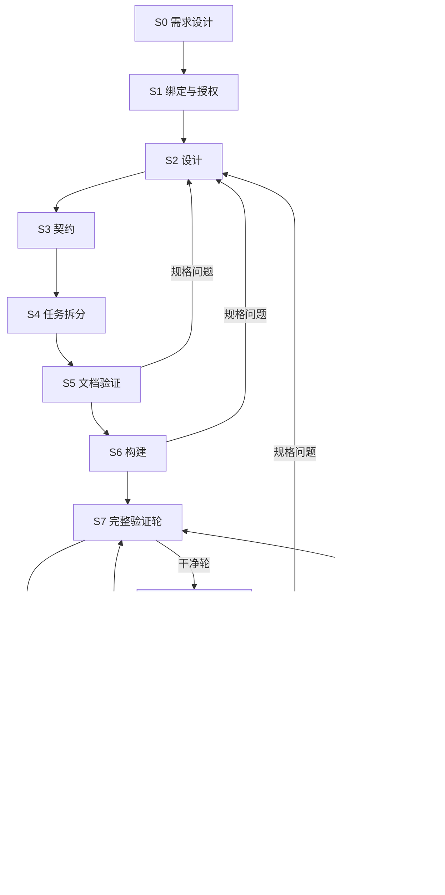

# L2 生命周期规划

本层将 [L1 设计原则](../l1-principles/L1-design-principles.md)转化为需求交付流程。它定义必须完成的工作，不规定具体命令与文件格式。

阶段划分用于安排专业思考、检查与交接，不要求为每阶段复制一套协议或运行状态。跨阶段机制应遵循[工作流边界与收敛设计](../l4-mechanisms/L4-workflow-convergence.md)：明确责任、减少遗漏和无效手续，保留专业判断及质量要求，并约束自动化的总成本。

## 1. 主干与纠错回路

修复之后必须重新完成一轮完整验证。发布授权是生命周期的授权终点，实际发布仍需要相应操作与授权；图中没有自动发布路径。

## 2. 阶段职责

| 阶段 | 要解决的问题 | 入口 | 完成交接 | 失败路由 |
| --- | --- | --- | --- | --- |
| S0 需求设计 | 将真实目标、范围、约束和验收标准说清楚 | 人的需求意图 | 人明确锁定的需求基线 | 未知项继续澄清，不代填价值判断 |
| S1 绑定与授权 | 确立本周期唯一需求及开发、发布目标 | 已锁定需求与真实启动决定 | 唯一活跃绑定，进入设计 | 缺决定继续等待，缺实际目标补齐 |
| S2 设计 | 形成支撑实现的架构、行为和适用场景 | 有效需求绑定 | 可供契约消费的设计与场景依据 | 设计缺口本阶段补齐；需求变化交人 |
| S3 契约 | 使各端按同一模型与协议履职 | 设计产物 | 可追溯到需求的分端契约及共享来源 | 设计缺口回 S2，需求变化交人 |
| S4 任务拆分 | 将条款变成可独立交付的任务 | 契约集 | 任务、完成判据、依赖与整体派发计划 | 契约缺口回 S3 |
| S5 文档验证 | 独立审查规格一致性与执行可行性 | 候选规格链和任务计划 | 两路审查完成，精确批次原子锁定 | 回对应产物层修订，必要时重新审查 |
| S6 构建 | 将批准任务转为集成后的真实实现 | 锁定任务批次 | 所有任务交付、集成和必要检查完成 | 规格问题回规划；真实缺陷交 S8 |
| S7 完整验证轮 | 从符合性、工程质量、真实行为验证产品 | 已集成交付，或修复后新基线 | 干净轮进入 S10；阻断发现进入 S8 | 缺证据补当前责任；基线变化按原流程重开 |
| S8 发现调查 | 将表象转为可证伪的因果解释与修复约束 | 发现及执行现场，或人的实际问题 | 有依据的处置；需要修复时交付经有效批准的修复合同 | 根因不明继续调查；规格或需求问题回相应层 |
| S9 修复 | 修复根因并重建受影响证据 | 已批准修复合同 | 交付、必要集成、影响处置和独立定向重验完成，进入新 S7 | 重验失败回调查；真实阻塞交对应责任人 |
| S10 验收与审计 | 汇总需求兑现情况，判断本次发布风险 | 当前有效干净轮 | 明确验收、审计结论及发布材料 | 缺材料本阶段补齐；缺陷交 S8；需求变化交人 |
| S11 人工发布闸 | 由人决定本次交付的处置 | S10 完成 | 明确批准、搁置、驳回或中止 | 驳回缺陷交 S8，驳回验收或审计交 S10 |

阶段设计分别见 [L3 索引](../l3-stages/L3-README.md)。S0 没有独立运行时阶段；表中的阶段是工作划分，不要求逐项对应存储状态。

## 3. 交付要求

### 方向与授权

需求锁定、启动授权、需求修订、修复合同的必要批准和发布决定按各自职责处理。已经明确的真实人意可以承接，不重复索取相同确认；草稿、沉默和代理建议均不构成批准。

### 连续执行与独立分工

主会话负责分工、依赖与集成，执行平台负责子代理运行。专业任务应提供足够输入、边界和完成条件，执行者可连续开展工作；不另设通用读回、激活或首写批准。实施计划是专业工作记录，真正需要审批的领域决定单独处理。

实现者自测不等于独立验证。S5 的两路审查、S7 的独立验证和 S9 的定向复验保持各自责任。个人交付完成不等于阶段完成，不让已交付执行者等待同事或主会话集成。

### 完整验证

干净轮要求当前轮全部必需项都有通过结论或经专业审查认可的不适用理由，没有未处置的阻断发现和被当前门引用的失效证据。场景用例是行为验证的共同分母，需求、条款、任务和用例保持可追溯关系。

发现记录保留现场，调查可以复用可信复现材料，仅对缺口补查。定向重验只证明修复合同内的断言，不生成干净轮；修复扰动后仍须重新验证全局。

### 输入与交付来源

正式需求、设计、契约、代码和测试按交付要求提交后供下游消费。私人计划、答卷、回执与不入库运行证据使用各自真实来源，不因属于工程交接就一律要求提交；控制状态有独立权威。隔离执行不继承未提交内容，分工前应完成必要输入交接。

共享模型、协议与分端责任各有唯一来源；下游引用和细化，不复制成互相矛盾的定义。任务依赖根据实际输入、写入与资源冲突建立，共同只读材料不自动构成串行依赖。

## 4. 需求授权生命周期

| 动作 | 语义与边界 |
| --- | --- |
| 绑定 | 以真实授权开启唯一活跃需求，明确开发分支与发布目标 |
| 暂停 | 保存当前位置与恢复依据，停止未经决定的推进 |
| 恢复 | 检查当前基线与暂停依据，回到原责任；漂移需按修订处理 |
| 修订 | 人批准周期内换基线，增加代际并处置受影响下游；不伪装成新周期 |
| 解绑 | 撤销当前绑定并留痕归档，不抹除已发生工作 |
| 中止 | 依明确决定关闭本周期，保留终态和现场 |
| 批准与归档 | 批准只记录发布授权；归档是另一个明确动作，不自动发布或重启周期 |
| 重新绑定 | 从合法归档或解绑边界开启新周期，不复用旧责任的完成状态 |

需求文档的草稿、锁定、归档描述文档生命周期；当前阶段和授权以运行时事实为准。具体事务由 [L4 状态机](../l4-mechanisms/L4-state-transition-core.md)与 [L3-S1](../l3-stages/L3-S1-bind.md)定义。

## 5. 收敛与异常

记录真实失败、未知项、风险与阻塞，不把它们改写成通过。环境失败恢复原检查；代码问题交返工；因果判断失败回调查；需求语义变化交人。连续失败和轮次预算用于发现不收敛，超限后按既有流程暂停或升级处理。

证据失效不删除已经发生的历史交付。当前质量结论与历史来源分开读取；旧成功不能充当当前通过，历史文件也不能被删掉以制造干净状态。

已知妥协与兼容成本需要明确影响、责任和退出条件。阶段推进由实际交付及领域条件决定；日常工作反馈提供具体下一步，不靠人工拨动阶段表。

产品交付中的纠错回路与框架自身的整改范围分别管理。修复框架不自动启动全生命周期重构；范围内终点和适用验收成立后结束本轮，无关增强另行排序。环境或证据不足保留待验，不据此继续扩展功能，也不冒充通过。

本层承载 D1 的权威外置、D4 的明确交付、D6 的独立背书和 D7 的收敛回路；具体控制点由 L3、L4 落实。
