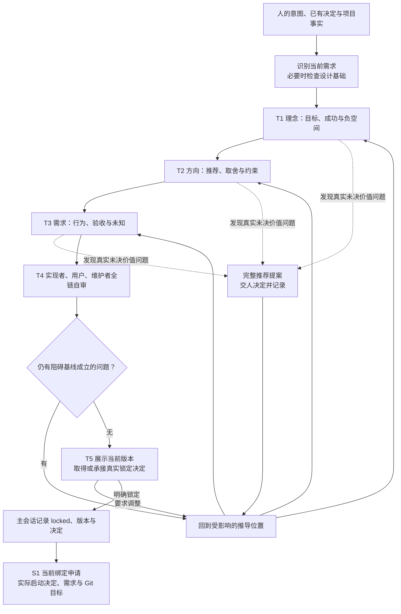

# L3-S0 需求设计

S0 将人的预期效果整理成一份可以共同遵循的需求基线。它是后续设计、契约、任务、实现与验收的语义起点；S1 再把这份基线和实际启动决定登记为本周期的执行依据。

上游原则见 [L1 设计原则](../l1-principles/L1-design-principles.md)，生命周期位置见 [L2 生命周期规划](../l2-lifecycle/L2-lifecycle-plan.md)。本文先说明阶段为何存在、需求怎样推导，再沿工作过程解释模板、技能与系统的承载方式。执行时使用 [REQ 模板](../../docs/requirements/REQ-template.md)和 [requirement-funnel 方法](../../skills/requirement-funnel/SKILL.md)；调查框架行为时再读本文的职责、观测与实现边界。

## 1. 为什么需要需求设计

### 1.1 从一句意图到共同理解

“我要一个导出功能”还不能成为共同基线。这句话可能指运营对账、数据备份、对外报送，也可能暗含“只能看本人组织的数据”“需要可复用的入口”“不能打断现有流程”等前提。若直接开始架构或实现，各个执行者会自行补全这些空白，最终可能都声称完成，却交付了不同的东西。

S0 要消除的是这种分歧的源头：

1. **意图分歧：** 谁遇到了什么问题，为什么值得改变，成功后有什么可感知的差别？
2. **取舍分歧：** 哪条方向值得采用，哪些能力本次不做，哪些约束确实不能打破？
3. **判定分歧：** 哪些行为必须成立，拒绝和失败时应怎样表现，怎样得到一致的验收结论？

因此，需要设计的既有需求内容，也有人与代理形成共识的过程。主会话承担消歧、调查、推导、推荐和自审；人保留真实意图、价值取舍与最终锁定的决定权。文档把这份共识保存下来，使后续执行者能够重读，而不必重新猜测对话。

### 1.2 阶段目标与完成的含义

| 项目 | S0 的定义 |
| --- | --- |
| 输入 | 人的预期效果、已有明确决定、项目事实、适用规则及受影响模块的既有设计依据 |
| 核心工作 | 从理念推导方向，从方向形成需求，审查推理链，处理真实未决问题并取得明确锁定 |
| 正式产物 | `docs/requirements/REQ-{id}.md`，包含现行目标、范围、约束、验收、未知项处置及真实决定记录 |
| 专业完成 | 各层可追溯且没有阻碍基线成立的矛盾；后置未知有明确影响、消费者和阻塞位置；人明确锁定当前版本 |
| 文件完成 | 主会话依据实际决定填写 `locked`、版本和锁定记录；将审阅内容与待交接版本保持一致 |
| 下一责任 | S1 取得或承接实际启动决定，绑定准确需求和 Git 目标，并交给 S2 |

这里有三种不同事实：需求内容已经达成共识、文件已经记录锁定、执行周期已经绑定。主会话有责任保持它们一致。保存成功或文件写着 `locked`，都不能单独证明人已经作过相应决定；完成 S0 也不能宣称 Runtime 已经进入 S2。

### 1.3 S0 与下游如何分工

S0 说明要达成什么、为什么以及什么算达成；下游据此设计怎样实现、怎样协作、怎样验证。

| 内容 | S0 做到什么程度 | 后续消费者 |
| --- | --- | --- |
| 目标、成功状态、负空间 | 形成真实且可解释的共同意图 | 全部下游，尤其是 S2 与 S10 |
| 方向与硬约束 | 裁定需求级取舍，保留理由和假设 | S2 的架构与关键决策 |
| 功能需求、流程、权限、异常 | 说明应承诺的外部行为及边界 | S2 行为设计、S3 契约 |
| 验收与非功能要求 | 给出可判定承诺及来源 | S2 场景、S4 完成条件、S7 验证、S10 验收 |
| 迁移与重构范围 | 说明受影响资产、处理意图和已知依赖 | S2 影响分析、S4 任务拆分 |
| 界面影响与设计基础 | 判定路由，引用适用基础或声明真实缺口 | S2 模块设计与需求推导 |
| 下游设计、契约、任务、测试索引 | 标明职责归属，不提前制造产物 | S2～S7 各自维护 |

S0 可以调查技术事实来判断某项承诺是否可行，也可以做必要的探索，但不能把探索稿当作已经授权的阶段产物。具体架构、数据模型、接口协议、场景全集、任务分派和实现验证仍由相应阶段负责。

## 2. 设计推导：理念 → 方向 → 需求

### 2.1 为什么采用分层漏斗

REQ 的 §A、§B、§C 表达三种不同层次的判断：

- **§A 理念：** 为什么做，服务谁，成功是什么，本次明确不做什么。
- **§B 方向与约束：** 在这些目标下选择哪条路线，承担什么代价，哪些条件不可破坏。
- **§C 具体需求：** 这条路线需要哪些行为与质量承诺，怎样判定它们成立。

三层之间有推导关系。一个需求点应能说明服务于哪个理念；一个硬约束应能说明破坏后为什么无法接受；一条验收标准应能指向真实承诺。否则，填满三张表也可能得到一份没有逻辑联系的需求。

这种关系同时提供返工位置：发现功能多余时先检查它服务的目标；发现验收互相矛盾时回查方向和约束；发现目标理解错误时先改理念，再重新推导受影响内容。不能只在最下层增加例外来遮住上游矛盾。

### 2.2 推理依赖与人的决定

上一层有真实未决选择时，不能把某个未经决定的候选当成事实继续推进。但这不意味着每层都要重新找人确认一次。人已经明确给出的目标、范围和方向，应如实承接；主会话能够依据事实解决的问题，应自己调查并给出结论。

一次必要的上交应包含完整提案：推荐什么、为什么、其他真实选择的代价，以及仍需要人决定的那一项。人应判断业务价值、范围、优先级和风险容忍度，而不是替主会话寻找文件、填模板或完成专业推导。

方法中“比较两三个方向”“集中少量拍板点”的作用，是促使主会话先完成收敛。这些是组织思考的建议，不是机器配额。方向已经明确时不制造陪衬方案；确实存在多个独立价值问题时也不能为了凑数量而隐去问题。应按依赖整理提案，让每次决定能够真正消除不确定性。

### 2.3 文档各部分怎样配合

| 位置 | 保存的判断 | 为什么需要 | 消费方式 |
| --- | --- | --- | --- |
| 顶部元数据 | 需求身份、状态、版本、归属、日期、`UI impact` | 明确当前是哪份需求、哪一版及其路由 | S1 读取绑定元数据，下游按已登记版本引用 |
| §A | 预期效果、背景、成功状态、负空间、角色与术语 | 统一意图，限制自行扩张的解释 | §B/§C 推导，后续判断范围是否漂移 |
| §B | 方向选择、否决理由、硬约束、假设与风险 | 保存选择背后的依据 | S2 细化设计，识别哪些结论可派生、哪些需要重新决定 |
| §C | 需求点、流程、异常、权限、验收、非功能、迁移与界面关系 | 将方向变成可交付、可判定的承诺 | 场景、契约、任务与验收逐层消费 |
| §D | 未知问题、影响、阻塞范围、状态与结论 | 防止未知被遗漏或被当作默认答案 | 当前阶段解决，或由明确的下游责任解决 |
| §E | 实际必要决定、自审结论、最终锁定 | 保存共识形成的依据，支持换手与恢复 | 主会话恢复、需求修订和后续审查 |
| §F | 下游索引骨架及维护位置说明 | 告诉读者去哪里找派生产物 | 活索引由 S3 起的契约索引维护，不回写已锁定 REQ |

模板说明具体字段形状，本文解释这些字段为什么存在以及如何一起发挥作用。不是每个栏目都在 S0 完成：例如 CASE、合同、TASK 和验证证据属于下游责任；当前无适用内容时如实说明范围，不造材料来填空。

### 2.4 每层内部怎样收敛

每层都使用同一个小漏斗，但其内容和剪枝依据不同：

> 展开可能解释或可行路线 → 依据真实意图、上层结论与事实剪枝 → 自审 → 形成完整提案 → 处理必要决定 → 记录结论及其依据。

§A 展开的是对意图的可能理解，§B 展开的是满足目标的不同路线，§C 展开的是为兑现承诺必须覆盖的行为与边界。发散用于发现遗漏，剪枝用于保留与目标有关的内容；二者都不能省略。把第一个想到的功能直接列为需求，会丢掉选择依据；把所有可能功能都留下，又会制造范围蔓延。

这一循环的停止依据是当前层已经足以支持下一层推导。若仍有关键事实未知，继续调查；若缺的是人的价值选择，带完整提案等待决定；若已有足够明确的结论，就记录并推进，不靠增加轮次或确认次数换取形式上的安心。

## 3. 进入 S0：先知道正在设计什么

### 3.1 识别当前需求与已有决定

主会话先阅读用户本次意图和已有明确决定，再确定是否已有对应需求草稿。已有草稿应先阅读并延续，不能因为开启新会话就重新复制模板。存在多个候选时，根据当前任务核实对象；无法判断才向人澄清，不按编号、文件时间或 `locked` 标签猜测。

当前需求已有绑定时，先识别它是该周期内的需求修订，还是另一个尚未启动的想法。新的聊天意图不会自动替换已绑定需求。对于已有明确锁定或启动决定，要确认其适用对象与版本，不能把上一次周期的批准沿用到新责任。

### 3.2 项目事实应支持判断

项目事实入口是目标项目的 `docs/project-map.md`，其形状见 [项目地图模板](../../docs/project-map-template.md)。按本次需求读取现有模块、业务术语、使用者、约束和相关规则；触及已有模块时，读取相应的当前行为或设计依据。

事实、推断和未知应分开。例如“现有命令支持组织过滤”可以由实现和测试核实；“运营只需要月度执行”若没有来源，就不能写成已确认事实。发现材料过期时，先核实与当前需求相关的部分，再决定是否需要更新项目事实。

这种调查用于避免提出违背现状的承诺，并不要求在 S0 扫描整个仓库。只有会改变目标理解、范围、约束或验收判断的资料，才需要在此时展开。

### 3.3 界面相关工作先判断设计投入

形成对预期效果的初步理解后，若可能改变页面、组件、交互、文案、动效或用户可见状态，应在展开需求设计前检查项目级设计基础。目的是防止每个需求重新猜产品表达，也防止一次性局部工作被迫承担整套设计体系。

先按 [设计基础规则](../../docs/rules/design-foundation.md)在项目地图记录投入档位及依据：

| 情况 | S0 的处理 |
| --- | --- |
| 产品没有用户可见界面 | 设计投入可记 `N/A`；不建立界面设计基础 |
| 无本次界面变化 | 判断 `UI impact` 是否可为 `none`；已有设计基础按相关性参考，不启动完整定向 |
| `local`：一次性、单模块单表面、无换手复用或共享语义/组件 | 记录局部设计关系；由后续模块推导说明选择，不发布项目级设计基础 |
| `core` / `extended`，已有发布且覆盖当前表面的基础 | 读取约束卡和相关表面配置，REQ 引用准确版本及继承关系 |
| `core` / `extended`，基础缺失、过期、未覆盖或尚未真实发布 | 进入 [design-foundation 方法](../../skills/design-foundation/SKILL.md)补齐所需基础与真实决定，再继续本次需求漏斗 |

项目级设计基础在需求生命周期之外建立，不新增 S0 子阶段或 Runtime 状态。投入档位与研究路径也不同：已有充分方向事实时可以走薄路径；真实价值方向未定时才展开完整比较。详细步骤由 [L4 项目级设计基础](../l4-mechanisms/L4-project-design-foundation.md)定义。

本次 REQ 不改界面，不代表整个产品的设计投入就是 `N/A`；长期产品已有的基础与投入依据仍然保留。所谓“已发布且覆盖”，还需要真实发布确认、可用约束卡和当前表面的适用关系，不能将待确认、临时或已替代版本视为可继承基线。

S0 记录 `Foundation reference`、`Surface` 和 `Design posture` 的关系：继承、扩展、例外或局部设计。跨需求内核与语法仍住在设计基础中，不复制到 REQ。S2 才将这些依据具体推导为模块设计；S0 不为完成字段提前生成页面或整份推导笔记。

现有规则、技能和模板承担这条专业默认路径，Runtime 尚未对缺失设计基础设置硬门。文档不能把它写成机器已经保证的前置条件，也不能因尚无硬门就省略必要的设计工作。

## 4. 从入口到锁定的工作流

S0 有五项主要工作，§D 的未知项处理贯穿其中。

| 工作 | 要解决的问题 | 主要产出 |
| --- | --- | --- |
| T1 建立理念 | 用户想改变什么，成功和明确不做分别是什么 | 可解释、忠实于真实意图的 §A |
| T2 裁定方向 | 为什么走这条路线，哪些约束真正成立 | 有依据的方向、边界、假设和风险 |
| T3 形成需求 | 要兑现哪些行为和质量承诺，怎样判断 | 可追溯的 §C 与受控未知项 |
| T4 全链自审 | 推理链是否一致、可实现、可判定、可维护 | 修正后的完整提案与自审结论 |
| T5 人锁定并交接 | 当前版本是否成为共同基线，是否已获启动决定 | 已锁定 REQ，准确交给 S1 的责任与决定 |



图中的返回表示回到问题来源，不表示每次都从头重做。已有明确决定可以直接用于对应推导；未决价值问题必须等待决定，但不阻止继续处理与该决定无关的事实调查。最终锁定针对一份明确版本的完整需求。

## 5. 沿推导过程展开专业工作

### 5.1 T1 建立理念：把意图解释清楚

主会话先将口语表述整理成自己能够负责的理解，再展开背景、成功状态和负空间。A1 应表达要改变的处境和价值，不能只是把用户原话粘贴到表格中。必要时可以保留原始材料供追溯，但共同基线使用的是经过消歧的整理稿。

例如，用户提出“运营每个月导出订单对账，现有后台不要动”。它还留下角色权限、数据范围与交付方式等问题。调查后可以形成如下理念提案；其中尚未有来源的判断必须标为候选，不能冒充已经获得批准。

| 理念项 | 示例内容 |
| --- | --- |
| A1 预期效果 | 让各组织的运营使用现有操作入口取得本组织指定月份的订单明细，完成月度对账，减少人工拼接与漏单 |
| A2 背景与痛点 | 当前需要人工整理多个查询结果，难以确认是否完整；具体事实应引用实际工作方式或资料 |
| A3 成功状态 | 有权限的运营能取得范围明确、内容可核对的明细；无权操作不产生数据泄露 |
| A4-1 明确不做 | 不支持跨组织导出，避免突破当前业务与权限边界 |
| A4-2 明确不做 | 本次不新增后台页面，也不提供 PDF 报表；分别保留范围依据 |

随后核实利益相关者和术语。“订单月份”到底按创建、支付还是完成时间计算，会影响后续每一层；“运营”是否包括平台管理员，也不能留给实现者各自猜。可以由既有定义确定的直接引用，确有业务分歧的形成推荐再交人决定。

本步完成时，读者应能说明为什么需要这项需求、面向谁、成功的精神锚点以及范围外事项。已有明确人意足以支持这些结论时，记录其依据继续推进；存在多个不可派生解释时，携候选解释与影响请求决定。

### 5.2 T2 裁定方向：说明选择及其代价

方向是在理念约束下选择一条满足需求的路线。主会话先调查可行选项，再给推荐与否决理由。例如同为“对账”，可能选择受控明细导出，也可能把范围扩成报表中心。两者的使用方式、交付成本与业务承诺不同，应依据 A1～A4 收敛。

若用户已经明确“不改后台、沿用现有操作入口”，且事实调查证明可行，就不需要为了填表再要求人在新页面与旧入口之间选一次。可以写明为什么采用既定方向，以及为什么不扩展成其他产品形态。

§B 应保存三类判断：

1. **方向及否决理由：** 推荐路线服务什么目标，替代路线多付出什么或牺牲什么。真实比较的价值在于保存取舍，而不是凑足候选行数。
2. **硬约束及代价：** 每个“必须”都要能解释打破它的后果。例如组织权限不能放宽，因为这会改变访问边界；某个库或颜色若没有这样的依据，应作为偏好或待验证方案。
3. **假设与风险：** 尚未证实但被设计依赖的判断、它的影响以及验证方式。例如预期数据量需要核实，不能悄悄写成性能承诺的分母。

方向停留在需求级边界。“不得跨组织访问”“沿用现有操作方式”可以进入 §B；具体采用何种服务拆分、索引、状态机和接口由 S2 设计。若已有部署事实限制选择，就引用该事实；不能把未经分析的实现偏好升级为业务硬约束。

当方向确实未决时，上交可以这样表达：“推荐在现有受控操作入口提供月度明细，保持本次只解决对账；报表中心能支持更丰富分析，但会新增界面和持续维护范围。需要决定的是：本次是否承担报表中心的产品范围？”这让人判断真实取舍。若本次范围早已明确，则保留推荐及理由，不再把同一事项列为待决点。

本步产出应让 S2 知道哪些选择已经确定、为什么确定、哪些仍有设计空间，以及哪些假设需要继续验证。

### 5.3 T3 形成具体需求：把方向变成承诺

功能需求（FR）描述需要成立的行为，非功能需求（NFR）描述质量与约束，验收标准（AC）说明怎样判断这些承诺。三者需要可追溯，但不能互相替代。

沿用导出示例，§C 可以逐步形成：

| 对象 | 示例 | 推导关系 |
| --- | --- | --- |
| FR-001 | 有权限的运营可按所选月份导出本组织订单明细 | 服务 A1 的月度对账，遵守 A4-1 的组织边界 |
| FR-002 | 无相应权限或请求超出组织范围时拒绝导出 | 服务 A3 的安全边界，保持 §B 权限约束 |
| NFR-001 | 导出不得改变订单数据与订单业务状态 | 保护既有业务，说明判定方式与实际范围 |
| AC-001 | 给定包含当月与其他月份订单的数据，导出结果仅包含所选月份、当前组织的全部目标订单，约定字段与值可逐项核对 | 指向 FR-001 |
| AC-002 | 给定无权限身份或越组织请求，操作被拒绝，不返回订单明细，不产生可下载数据 | 指向 FR-002 |
| AC-003 | 比较导出前后的订单记录与状态，没有由导出造成的修改 | 指向 NFR-001 |

这些条目只示范推导方式，不能直接作为任何项目的默认业务规则。实际需求仍须定义月份口径、时区、字段、空结果、数据变化和失败后的行为；如果这些内容影响承诺是否成立，就不能靠实现者自行选择。

**流程同时覆盖成功、拒绝与异常。** 对每条主要流程说明输入、输出、业务状态、权限、异常和验收依据。例如没有数据时是合法空结果还是失败，依赖不可用时是否生成部分结果，失败后是否允许安全重试。S0 确定业务承诺，S2 再将其展开为规则、分支、场景和测试预期。

**验收应可复核。** “结果正确”“响应很快”“体验良好”缺少共同判据。性能承诺还需要负载、环境、统计口径和阈值等必要条件；能够在 S0 依据事实确定的写清，仍需调查的记入未知。不能为显得具体而编造数字，也不能在业务已经明确要求速度时默默删掉承诺。

**引用保留真实覆盖责任。** AC 的“指向”使用已声明的 FR、NFR 或具体负空间条目。一个 AC 可以指向多条承诺，不能只覆盖其中一条就认为全部成立；附带 NFR 或负空间引用也不能免除已有 FR 的场景责任。S0 给出引用，CASE、规则分支与测试映射由下游形成。

**优先级表达实际承诺。** `Must / Should / Could / Won't` 应服务于真实范围与价值选择。不能因为某项难实现就自行降低优先级，也不能由优先级推导已承诺需求可以不验证；需要移出本次范围时，应让范围、负空间和验收一起保持一致。实际取舍有分歧才交人裁定。

**迁移范围应足够支撑拆分。** 对迁移、删除、替换和重构，说明相关路径或资产类型、保留或移除意图、已知引用和兼容边界。S4 据此检查依赖、确定任务归属和收尾条件。模板中出现 TASK 列不意味着 S0 必须提前生成任务编号；现阶段未知的分工如实后置，不能虚填。

### 5.4 界面影响是路由事实

`UI impact` 位于 REQ 顶部，合法值为 `none / changed / unknown`。§C 中的同名内容是回显，应与顶部一致。它们共同说明本次需求如何进入后续设计，不能形成两个相互竞争的决定。

| 值 | 含义 | 对下游的影响 |
| --- | --- | --- |
| `none` | 本次不改变适用的用户界面行为或呈现 | 可免除界面产物，但仍需判断服务行为与 FR 对应的场景责任 |
| `changed` | 页面、组件、交互或用户可见状态等发生变化 | S2 消费适用设计基础，形成模块 UI 与行为设计；S3 消费相应设计依据 |
| `unknown` | 当前尚不能确定是否涉及上述变化 | 允许如实锁定、绑定，但 S2 的原推进条件不允许此未知继续进入契约阶段 |

导出示例如果实际沿用命令且不改变后台页面，可以有依据地声明 `none`；它仍然有功能行为，因此 S2 仍需形成适用的服务行为场景。`none` 不等于“没有 CASE”，也不等于其他设计与验证均为不适用。

只有当所有 AC 都由已声明的 NFR 或负空间支持、且没有模块行为真相变化时，才可能合理地不产生模块场景包。S0 记录真实需求与范围，下游据此处理；不能先为了省掉某个产物，再把真实 FR 改写成 NFR。

绑定之后，推进检查读取 Runtime 中已绑定的 `ui_impact`。因此将 `unknown` 澄清为确定值，需要通过批准的需求修订更新基线；仅在 §D 写一条结论或改工作区顶部，不会自动更新已绑定事实。

### 5.5 未知项贯穿推导，不能只留一个问号

§D 是问题账本，不是把所有问题推给人的访谈清单。每项未知应说明问题、影响、阻塞范围及已知结论，并通过解释或引用明确后续由谁、在哪项工作中解决。

| 未知类型 | 处理方式 | 是否允许锁定 |
| --- | --- | --- |
| 可由现有事实、规则或工程调查解决 | 主会话主动调查，记录结论及依据 | 依赖该结论的需求承诺应先明确 |
| 真实意图、价值、范围或优先级未决 | 形成推荐与代价，交人决定 | 若影响基线成立，则暂不锁定 |
| 合理留给下游的设计问题 | 明确消费者与解决时点，不预设候选为事实 | 可以，但不得改变已经承诺的需求语义 |
| 影响后续路由的未知，如界面影响 | 如实登记影响与阻塞位置 | 可按现有契约锁定；到对应推进点必须解决 |

“没有任何未知”不是锁定要求。“不知道究竟为谁做、做什么算成功”则不能作为普通下游未知。判断关键是：剩下的问题会不会改变当前基线的含义，或者使验收没有判据。

例如，选哪种导出实现算法通常属于 S2；是否允许导出跨组织数据属于需求边界。后者未决时不能以“交给架构师决定”来锁定。

### 5.6 T4 全链自审：攻击推理链

每次形成必要提案前做局部自审，锁定前再审整条 A→B→C 链。自审至少采用三种视角，它们提出不同的问题：

| 视角 | 追问 | 应怎样处理发现 |
| --- | --- | --- |
| 实现者 | 哪条承诺含有矛盾、缺少必要前提，或在现有约束下无法兑现？ | 补事实、改推导；需要改变价值承诺时带建议交人决定 |
| 用户 | 哪个术语、范围或结果容易被误解？拒绝与失败是否也有明确预期？ | 消歧、补边界与可复核判据 |
| 维护者 | 负空间与约束是否冲突？迁移是否遗漏消费者？后续需求能否理解本次选择？ | 修正范围与依赖，保存取舍理由和后置责任 |

在导出例子中，若 A4 排除后台变更，而 AC 要求后台出现新的进度面板，就要回到方向或范围修正；若“全部当月订单”与“只取前一千条”并存，就要解释分页、数量边界或重新决定承诺。不能保留两个相互冲突的条件再声称“实现时处理”。

§E 保存一段实际自审结论：审了哪些关系、发现并修了什么、还留下哪些有明确归属的风险。不能只写“检查通过”，也不以勾选清单替代推理。主会话自审承担作者责任，S5 的独立审查仍有独立价值，二者不能互相抵消。

### 5.7 T5 人锁定：让明确版本成为共同基线

主会话向人展示当前完整提案、重要取舍与残余未知，并指出这次锁定针对的需求对象和版本。人明确表示锁定或给出同等清晰的决定后，主会话负责编辑文件：填写顶部 `locked`、版本、相关日期，并在 §E 如实记录操作与实际决定依据。触发监听的是文件落盘，不是特定编辑工具；`cp`、脚本写入与 Write 工具保存具有同等触发效力。

已有明确锁定决定适用于当前完整版本时，不要求人再说一次相同的话。如果主会话后来对目标、范围、优先级或验收作了实质修改，原锁定不能被自动扩展为对新内容的批准。

§A、§B、§C 的决定记录反映实际发生过的必要决定。一次明确决定可以覆盖多个层次；没有发生过的独立确认不虚构日期、拍板人或结论。身份与日期用于记录来源，不是身份证明，也不意味着系统能够认证意图真实。

锁定形成语义基线，S1 的绑定形成执行周期。人可以明确说“这一版锁定，开始执行”，同一决定覆盖两种含义；只说“锁定”时，S1 的启动授权仍未成立。区分职责可以避免越权，同时不增加重复审批。

文件形态沿用原模板，例如锁定后的顶部可为：

```markdown
# 需求：REQ-017

> 名称：组织月度订单导出
> 状态：locked
> Owner：{实际需求负责人}
> PM / Architect：{实际记录者}
> 版本：v1.0.0
> 创建日期：{实际日期}
> UI impact：none
```

§A～§D 保存上述推导结果，§E 的 `locked` 行记录实际操作日期、记录者及用户确认的版本和范围，必要决定表与自审段落记录实际过程。示例展示的是产物形状，不为任何真实项目预先成立锁定或启动决定。

## 6. 交给 S1：共识如何成为执行依据

### 6.1 交接内容

S0 的主要交付仍是一份已锁定的 REQ，不另增 S0 答卷、JSON 包、PASS 证据或确认字段。S1 需要准确知道选中哪份需求、谁作出了实际启动决定，以及选定的开发分支与发布目标。

阶段提示必须保持同一职责边界。虽然 S0 和 S1 在 Runtime 中都属于 `inactive`，S0 的当前动作、完成条件和阅读顺序只应指向需求共识、未决专业问题与真实锁定。尚未锁定时，不将 TR-001、四项绑定回答或进入 S2 写成 S0 的完成前提，也不要求主会话先寻找尚未准备的绑定文件、内部编号、来源摘要或解析规则。初始入口、`next` 与 Hook 恢复提示都遵循这一点；人的启动授权可在同一决定中给出，但不成为完成需求设计必须追加的一项批准。

正常路径是：需求锁定完成后，系统给出当前 `requirement-binding.md` 的准确路径；主会话填写原四个问题并正常保存；接收器调用原绑定事务，登记基线并准备 S2。详细绑定设计见 [L3-S1](L3-S1-bind.md)。

| S1 需要的事实 | S0 交接时怎样处理 |
| --- | --- |
| 选中的需求 | 使用实际 REQ 路径，确保是本次共识对象 |
| 实际启动决定 | 已明确则承接并记录；仅锁定时授权回答留空，等待真实决定 |
| 开发分支 | 使用实际选择的 Git 引用；不知道时说明缺项，不从 HEAD 猜业务选择 |
| 发布目标 | 使用明确目标；它是周期目标记录，不是实际发布授权 |

`req bind` 保留兼容与恢复用途，不作为正常交接必须再手动执行的步骤。作者不填写哈希、Runtime revision 或机器回执，也不另向人索取工具执行许可来证明启动决定。

### 6.2 审阅内容、工作区与已提交对象

S1 绑定所选开发分支中的已提交需求对象。主会话应确保提交的内容就是本次人锁定的版本，不能只看工作区文件存在，或把尚未提交的修正当作已经绑定的事实。

这要求正常的 Git 工作与准确交接。Hook 不替主会话提交、创建分支、推送或发布。机器能够记录绑定时所读对象及其指纹，但不能理解它是否就是人最后审阅的语义版本。

若绑定已经记录、S2 材料准备随后失败，应区分两个结果：保留已成立的绑定，处理准备失败；不能重新索取启动批准、另建一份 S0 完成证明或反复绑定。后续恢复依据原事务与实际反馈进行。

## 7. 锁定后的发现、修正与需求变化

锁定的作用是让后续人员可以依赖相同含义，不是禁止人继续改进需求。目标、范围、优先级与验收发生变化时，必须先取得针对该变化的真实决定，再留下可追溯的新依据。普通聊天建议、作者自审意见或一次文件保存，都不能悄悄改变已锁定承诺。

### 7.1 已锁定但尚未绑定

尚未建立需求绑定时，没有该需求的 Runtime 基线代际可供暂停和修订。若发现已锁定内容需要纠正，主会话先解释纠正内容与影响，取得或承接实际批准，更新版本及决定记录，再将准确版本交给 S1。

不能因为没有机械门就擅自修改语义，也不能虚构一次不存在的已绑定周期来执行暂停。纯记录错误与实质需求变化应说明清楚；以“格式修复”为名改变范围仍然是需求变化。

### 7.2 已经绑定

已绑定后，按[批准的需求修订入口](../../loop-harness.md#approved-requirement-amendment)处理：保留或建立原暂停检查点，只修改人批准的内容，保持同一 REQ ID，将版本提高到高于已绑定版本，提交到绑定开发分支，再由原 `req amend` 接收器更新代际及下游失效事实。

基线代际、修订和证据失效的共用含义见 [L4 修订语义](../l4-mechanisms/L4-revision-usage.md)与 [L4 状态迁移核心](../l4-mechanisms/L4-state-transition-core.md)。S0 在这里负责解释需求发生了什么变化及实际决定，不重新定义这些事务。

新旧版本可以使用同一需求路径，历史依靠 Git 对象和 Runtime 登记保留。不能通过直接改旧哈希掩盖变化，也不要求作者猜建 `gN` 目录、组装证据元数据或手动调用底层迁移。原接收器交回当前 S2 材料后，按新基线重新处理受影响设计，不恢复旧周期的完成结论。

若下游只是需要解释现有承诺而没有改变含义，应补充相应设计依据；若解释会改变允许行为、验收范围或优先级，就必须作为需求修订处理。这个区分由专业分析说明，不能单靠版本号或文件差异大小决定。

## 8. 角色、机制与职责覆盖

### 8.1 谁作判断，谁保存事实

| 职能 | 负责者与承载 | 实际消费者 | 保证范围 |
| --- | --- | --- | --- |
| 提出真实目标和必要价值选择 | 人的明确表达与决定 | 主会话的理念和方向推导 | 人决定业务价值，代理不代批 |
| 调查、设计、推荐、自审 | 主会话，使用需求漏斗方法 | 人及全部下游专业执行者 | 对内容与推理负责，不能以模板齐全代替质量 |
| 保存共同语义 | REQ §A～§E | S1、设计者、审查者、验收者 | 持久化已明确内容，支持换手与恢复 |
| 提出必要思考问题 | REQ 模板与 requirement-funnel | 当前作者 | 模板承载产物形状，技能承载推导过程 |
| 引用项目设计基础 | 主会话检查，REQ 记录关系 | S2 需求推导与模块设计 | 复用跨需求约束；当前没有 Runtime 完整性硬门 |
| 入口发现与责任提示 | Hook 入口接收和投影 | 主会话 | 给准确路径和具体缺项，不认证需求语义或人意 |
| 建立执行基线与交接 | S1 原接收器、事务和 Runtime Writer | 全部下游 | 登记对象、版本、指纹、目标与实际决定记录 |
| 独立检查规格链 | S5 专业审查 | 后续执行与问题处置 | 检查一致性与可行性，不替人重新定义需求 |
| 维护派生产物与覆盖关系 | S2～S7 相应责任及 S3 契约索引 | 实现、验证和验收 | 维护当前关系，不回填已锁定 REQ 的活矩阵 |

S0 的默认专业责任在主会话，不要求为了完成需求设计建立子代理分派生命周期。是否需要额外调查应取决于真实问题；存在辅助调查也不转移主会话的整合责任或人的锁定权。S5 等阶段的独立角色不能提前替代 S0 的意图共识。

### 8.2 各项工作由什么承载

| 工作 | 方法与产物承载 | 判断责任 | 系统何时接力 |
| --- | --- | --- | --- |
| T1 理念 | requirement-funnel 的消歧与提案方法，REQ §A 和必要决定记录 | 主会话形成理解，人裁定真实意图分歧 | 入口定位实际 REQ，不逐字段认证理解 |
| T2 方向 | 漏斗的发散、剪枝和约束检验，REQ §B | 主会话调查并推荐，人裁定不可派生取舍 | 无单独的方向审批事务；决定留在原记录 |
| T3 需求 | REQ §C/§D，适用项目规则及设计基础引用 | 主会话对完整性、追溯与判据负责；真实业务选择交人 | S1 读取锁定元数据与 UI 路由，S2 接续专业展开 |
| T4 自审 | 三视角审查过程，REQ §E 的实际结论 | 主会话对发现、修正与残余风险负责 | 不以 Hook 成功或字段齐全自动认证自审 |
| T5 锁定与交接 | 人的明确决定，REQ 顶部与 §E，当前 S1 原四问题 | 人锁定，主会话如实落盘并交接 | 锁定保存准备申请；申请保存接原 TR-001 与 Runtime Writer |

这样分配后，模板不重复讲整套方法，技能不另建产物和状态，Hook 不代做专业判断，Runtime 不充当人的意图认证器。下游重复读取同一基线是各自履责的需要，重新发明一份不同的需求真值则会破坏共识。

### 8.3 关键选择及其理由

| 设计选择 | 解决什么问题 | 需要防止的偏移 |
| --- | --- | --- |
| 理念→方向→需求的推导 | 让功能、边界与验收有共同来源 | 将其变成三个无条件审批动作 |
| 完整提案与少量真实决定 | 节约人的注意力，同时保留价值决定权 | 先连续访谈，或代理为了自主而替人决定 |
| 三视角自审和独立后审 | 分别发现作者推理问题与跨产物问题 | 用勾选、自报通过或后审代替当前思考 |
| 显式未知及其阻塞范围 | 诚实保留不确定性并交给正确消费者 | 猜答案、无限后置，或要求所有设计细节在 S0 解决 |
| 按投入档位使用设计基础 | 同时支持局部交付和长期一致性 | 有 UI 就强建全套基础，或长期产品每次重新猜风格 |
| 语义锁定与执行绑定分责 | 保持意图、授权和机器对象一致 | 重复问相同批准，或由锁定推断启动与发布 |
| 原产物正常保存接原事务 | 让交接贴近自然工作路径 | 新增 S0 收卷、手抄元数据或重复执行命令 |
| 活覆盖关系在下游索引维护 | 保持锁定语义稳定，避免多个可变矩阵 | 每完成一阶段就回写 REQ，破坏基线与指纹 |

## 9. Hook 衔接、观测与恢复

### 9.1 观测进入正常工作路径

S0 在工程生命周期中对应 `inactive`，没有独立 Runtime phase。安装或恢复场景可能已经存在未绑定的 Runtime；“没有 S0 阶段状态”不等于“磁盘上绝无 Runtime 文件”。需求文档状态也不是责任进度状态，不能从 `draft/locked` 推导执行责任已经完成。

入口机制应帮助主会话找到实际产物和当前问题，避免要求作者额外汇报一套进度。当前衔接如下：

| 时点 | 读取与动作 | 对作者可见的结果 | 不代表什么 |
| --- | --- | --- | --- |
| 初始 `SessionStart`，处于 inactive 且无现成需求 | 从原模板准备需求草稿，填草稿状态与未知界面影响；不覆盖已有文件 | 实际草稿路径、模板路径和专业工作提示 | 没有预填答案、锁定或启动决定 |
| 已有草稿 | 读取候选的路径和文档元数据 | 指向现稿；多候选时提示核实当前责任 | 不证明系统理解了本次业务意图 |
| 普通 `PreToolUse` / `Stop` | 读取现有入口材料及缺项 | 原稿或当前申请路径，具体待处理项或准备缺口 | 不反复准备，不锁定或绑定，不阻断普通工具 |
| 保存实际需求且声明 `locked`，仍处于 inactive | 在保存路径被识别后准备既有 S1 申请 | 当前绑定申请的准确路径与原问题 | 没有 S0 PASS，也没有自动启动批准 |
| 保存当前 S1 申请 | 原问题未填齐则反馈缺项；填齐后调用原绑定事务 | 真实绑定结果及 S2 责任，或具体失败 | 字段非空不能证明人真实批准或需求设计正确 |
| 恢复或返回 inactive | 重读现行需求、当前申请与已有决定 | 继续当前真实责任 | 旧申请或旧人意不会自动授权新周期 |

保存接收需要 Hook 能从实际工具输入或结果定位到保存路径。编辑器、脚本或 MCP 应按当前接线提供实际位置；不能把任意 shell 修改都描述为已保证会被发现。保存后没有收到应有交接时，应检查当前路径、事件与原接收反馈，不能直接手改 Runtime 来补进度。

### 9.2 哪些记录有助于定位问题

S0 的专业进度来自文档与真实决定，而非填写行数。恢复时应能回答：当前需求是哪份、推导进行到哪里、哪些结论有依据、还有什么阻碍锁定、下一项责任是谁。这些信息分别保存在 REQ、项目事实和必要的决定记录中。

机制观测应围绕实际交接事件：入口给出了哪个路径，是否保留现稿，保存事件识别到哪个文件，反馈哪些未答问题，绑定原事务是否成立，以及后续准备是否成功。可以结合真实 Hook 输入输出、需求 Git 对象及 S1 的 Runtime/事务记录定位问题。

这些是已有材料的观察位置，不新增由作者填写的埋点字段、通用事件账本或 S0 进度证明。当前系统没有自动维护“已批准层数”“需求质量分数”或 S0 收敛轮次预算。若提案反复往返，应比较未决价值问题是否减少、矛盾是否得到解决，再调整调查或上交方式，不能用编辑次数证明进展。

### 9.3 常见异常怎样继续

| 情况 | 处理与恢复位置 |
| --- | --- |
| 模板或入口材料缺失 | 明确缺失路径，修复安装或责任准备问题；普通 Pre/Stop 不负责重建草稿 |
| 多份草稿或锁定需求并存 | 主会话依据用户任务确认当前对象；不能把自动候选提示当作选择决定 |
| 意图经过整理仍有多种关键解释 | 展示候选解释、推荐及对范围的影响，请人裁定；不将其中一种当作事实继续依赖它 |
| 关键价值取舍缺少判断依据 | 保留完整提案和待决点，等待真实决定；可继续不依赖该选择的调查，不虚构“默认批准” |
| 只有锁定，没有启动决定 | 保留锁定事实，S1 授权回答留空；请求真实启动决定 |
| 已有明确锁定并启动 | 直接承接适用决定，按准确申请完成交接，不重复索取批准 |
| 自审发现 A/B/C 冲突 | 回到最早产生矛盾的位置，修正受影响推导；涉及已锁定语义时取得真实修订决定 |
| 后置未知开始阻碍推进 | 由指定消费者解决；影响已绑定需求事实时走原批准修订 |
| 保存 locked 后没有 S1 交接 | 核对是否 inactive、是否保存了实际需求路径及成功事件、是否有准备错误；不要另外制造 S0 回执 |
| 旧绑定申请再次保存，或已结束周期回到 inactive | 使用系统给出的当前申请路径；旧决定不授权新责任，不在旧申请里反复改写来推进 |
| S1 拒绝需求对象或 Git 目标 | 按实际缺项处理提交、目标或需求修订；不让人手抄指纹，不把旧提交误称为当前共识 |
| 绑定已记录但 S2 准备失败 | 保留原绑定，处理准确准备错误与原恢复路径，不重复启动同一周期 |
| 会话丢失上下文 | 重读当前 REQ、项目事实和决定记录；未记录的推测不能在恢复时自动升级为批准 |

## 10. 当前实现对应与保证边界

| 设计环节 | 当前落点 | 已有能力与边界 |
| --- | --- | --- |
| 漏斗推导与决定复用 | [requirement-funnel](../../skills/requirement-funnel/SKILL.md)、[S0 使用指引](../../docs/control/agent-protocol.md#s0) | 引导提案、自审与真实决定记录；不是自动语义判定器 |
| 需求作者源 | [REQ 模板](../../docs/requirements/REQ-template.md) | 给出结构、追溯关系与下游分工；有字段不代表已经完成相应工作 |
| 入口与锁定出口 | [entry_questionnaire.go](../../internal/cli/entry_questionnaire.go) | SessionStart 准备、普通事件只读、锁定保存交 S1；不产生 S0 接收证据 |
| 保存接收接线 | [questionnaire_observer.go](../../internal/cli/questionnaire_observer.go) | 接入原保存接收器；识别范围依赖真实事件与路径 |
| 候选发现 | [req_discovery.go](../../internal/cli/req_discovery.go)与入口选择逻辑 | 按文件元数据发现对象；入口优先展示 locked 候选，不能自行理解当前任务，也不能把候选集合等同于已选需求 |
| 原绑定事务 | [run.go](../../internal/cli/run.go)、[迁移引擎](../../internal/transition/engine.go) | 使用选定开发分支的已提交对象并登记原始内容指纹；不认证人名，不完整证明 §E 决定或需求语义 |
| 界面影响检查 | [迁移引擎](../../internal/transition/engine.go)、[推进条件](../../internal/transition/guards.go) | 接受三值；检查已声明的 §C 回显一致性；阻止已绑定 unknown 继续推进。未填模板占位不是语义完整证明 |
| 绑定后修订 | [lifecycle_commands.go](../../internal/cli/lifecycle_commands.go)、原修订事务 | 校验同一需求及递增版本，更新基线和失效事实；作者不自建代际协议 |
| 项目设计基础 | [设计基础规则](../../docs/rules/design-foundation.md)、[design-foundation](../../skills/design-foundation/SKILL.md) | 专业路径与辅助检查已提供；缺失基础未成为 Runtime 硬门，检查也不判断设计价值 |

当前入口会优先提示锁定候选，不能自动识别其是否属于这次用户任务；其入口扫描也不能等同于需求列表中的完整归档资格分类。主会话必须结合实际任务核实对象。这个实现边界需要如实保留，不能在文档里宣称“系统已经选好当前需求”。

锁定后的变更依靠真实决定、变更纪律、Git 与已登记基线检查处理。Hook 提示不等于文件写保护；本阶段不承诺机器会在工具调用前阻止所有改写，也不恢复额外的工具权限或身份认证流程。

相关现有测试包括 [入口与绑定测试](../../internal/cli/entry_questionnaire_e2e_test.go)、[绑定对象测试](../../internal/cli/req_bind_ux_test.go)、[UI 解析测试](../../internal/transition/engine_test.go)、[未知值推进测试](../../internal/transition/guard_test.go)及[修订边界测试](../../internal/cli/lifecycle_review_test.go)。它们适合验证草稿不代批、普通事件不重建、原保存交接、对象来源、UI 三值和修订约束，不能证明代理的专业推理质量。

真实 Claude Code 验证还应区分预制需求流转与从真实意图开始的设计过程。[全阶段模拟夹具](../../tests/fixtures/native-stage-simulation/README.md)使用预制专业材料和模拟决定，只能支持其实际测试的机制范围。真实 S0 的质量还要观察：是否忠实理解目标、是否减少真实未知、是否形成有依据的取舍、不同执行者是否能据同一基线得到一致理解。

## 11. L1 原则在本阶段怎样成立

| 原则 | S0 的实际设计落点 |
| --- | --- |
| D1 权威外置 | 需求、取舍、未知及决定写入可重读材料；绑定后的对象与指纹由 S1 登记，避免依赖会话记忆 |
| D2 观测进入正常工作路径 | 设计写入原 REQ，锁定出口交当前绑定申请，正常保存接原事务；不另造 S0 汇报协议 |
| D3 反馈指向下一步 | 明确哪个矛盾、哪项决定或哪份材料缺失；阶段未就绪时继续补工作，不以工具封锁代替指导 |
| D4 产物引导思考 | 负空间、硬约束代价、拒绝路径、AC 来源和未知影响要求作者说明判断依据 |
| D5 先引导再约束 | 方法与模板先支撑推理，机器检查可判定事实；不增加语义鉴真或人的身份资格门 |
| D6 完成需要独立背书 | 主会话自审、人锁定、机器登记、S5 独立审查承担不同责任，各自保留判断范围 |
| D7 纠错必须可收敛 | 矛盾回来源层，未知有消费者，必要决定带完整推荐；不以反复询问或持续填表冒充进展 |

这些安排对应真实产品发现与工程交接：人决定价值，主会话承担专业设计，系统保存可公证事实。每项字段和机制都有实际消费者；额外工作是否值得，由它能消除什么具体分歧和风险判断，而不是由形式复杂度判断。

## 12. 出口审查与阅读安排

### 12.1 一份可交接基线应该成立什么

锁定前需要整体判断以下关系，而不是逐项勾选后自动通过：

| 审查对象 | 成立条件 |
| --- | --- |
| 意图与范围 | 预期效果忠实于真实人意，成功状态与负空间清楚，关键术语一致 |
| 推导与取舍 | 方向受理念约束，需求可追溯，硬约束有依据；没有用下游补丁掩盖上游矛盾 |
| 行为与验收 | 主要行为、拒绝、权限及失败有明确承诺，AC/NFR 具备适当判据，迁移边界足以交给下游 |
| 未知与风险 | 没有阻碍基线成立的未决项；允许后置的未知有影响、消费者及阻塞位置 |
| 设计基础与路由 | UI 三值有依据且回显一致，适用设计基础或局部关系真实，未把字段存在写成已完成后续设计 |
| 决定与记录 | 最终有针对当前版本的真实锁定，必要决定和自审如实记录，无虚构批准 |
| 交接对象 | 人审阅的内容、实际锁定文件及准备交给 S1 的版本一致；当前申请准确，启动授权有则承接、无则等待 |

专业审查由主会话和真实人的判断完成；S1 的机器校验只承担其中可公证的部分。通过绑定不等于这些语义关系已经被机器证明。

### 12.2 按工作需要展开阅读

| 时机或角色 | 优先阅读 | 何时再展开 |
| --- | --- | --- |
| 首次理解 S0 | 本文 §1～§4、REQ 结构、需求漏斗方法 | 进入具体工作时展开 §5 |
| 判断理念与方向 | 已有用户决定、项目事实、REQ §A/§B | 涉及具体模块时读取相关事实与当前行为 |
| 界面相关需求 | 设计基础规则、适用约束卡及表面关系 | 缺失或未覆盖时进入设计基础方法，不把全套背景设为常规必读 |
| 形成需求与自审 | REQ §C～§E、本文 §5 | 按实际问题读取非功能、迁移、场景等规则 |
| 人作决定 | 当前完整提案、推荐理由、真实分歧、最终锁定版本 | 无需承担模板填写、指纹计算或系统元数据工作 |
| 交给 S1 | 当前绑定申请、实际决定与 Git 目标、本文 §6 | 有准备或事务错误时读对应恢复入口 |
| 框架维护与审查 | 本文 §7～§12、相关实现和限定测试 | 追踪问题时展开 L4 与真实事件记录 |

渐进阅读用于减少无关资料的负担，不删去解释阶段设计所需的信息。本文应始终让人和代理能够理解这条完整关系：真实意图如何经过有依据的推导与决定，成为一份可稳定引用、可继续设计、可最终验收的共同基线。
