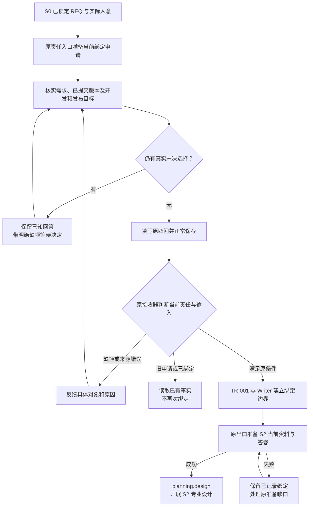
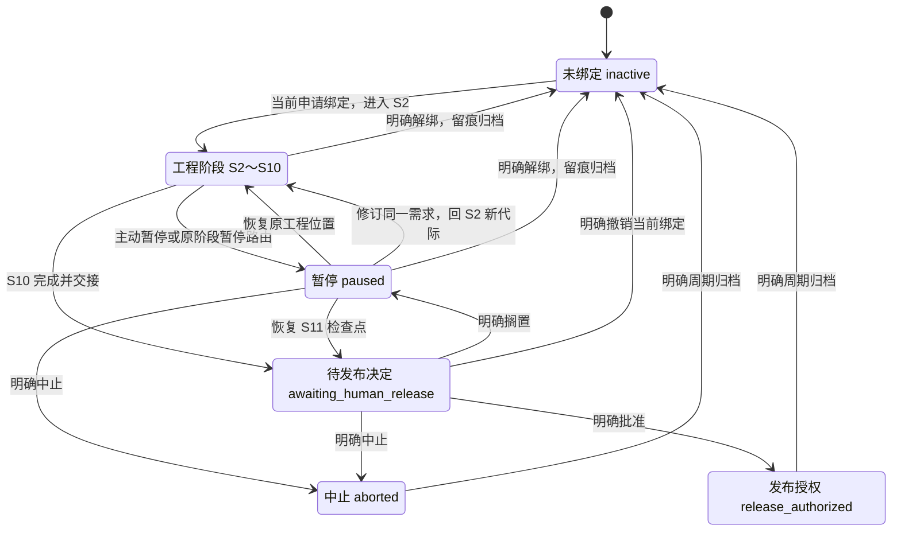

# L3-S1 绑定与授权

S1 将一份人已锁定的需求、实际启动决定和明确的 Git 目标，建立为本周期唯一的工程执行依据。它衔接 [S0 需求设计](L3-S0-requirement-design.md)与 S2 设计，也说明这份授权在后续阶段如何暂停、恢复、修订、撤销和收尾。

本阶段遵循 [L1 设计原则](../l1-principles/L1-design-principles.md)与 [L2 需求授权生命周期](../l2-lifecycle/L2-lifecycle-plan.md)。正文先解释一次正常绑定为何成立、如何完成，再展开后续控制动作。实际操作入口见 [S1 使用指引](../../docs/control/agent-protocol.md#s1)；事务、修订与工作区的共用机制分别引用 L4。

## 1. 为什么锁定之后还需要绑定

### 1.1 共识需要一个准确的执行对象

S0 解决“这是不是我们共同认可的需求”。但项目里可以同时存在多份草稿和已锁定需求，同一路径的内容也可能继续变化。只知道某份文档写着 `locked`，还不能确定当前周期处理谁、以哪个版本为准、在哪里集成，以及是否真的获得了开始工作的决定。

S1 需要把五件事放在一起：

1. **对象：** 本周期究竟处理哪份 REQ，需求 ID 与路径是什么。
2. **版本：** 作为依据的是哪个已提交版本及其实际内容，后续如何识别漂移。
3. **启动：** 人是否明确允许以这份基线启动本周期，实际决定归属于谁。
4. **目标：** 开发成果集成到哪条分支，最终发布目标是什么。
5. **继续位置：** 后续执行者应从哪处权威记录获知当前阶段、责任和基线。

绑定把这些信息作为一笔工程事实建立起来，使后续工作能够共同引用。它既防止多个需求混用状态，也防止代理把“看到一份文件”误解为“可以开始一切下游工作”。

### 1.2 一次绑定承担什么，不承担什么

| 判断 | 所属责任 | S1 如何承接 |
| --- | --- | --- |
| 目标、范围和验收是否忠实于人意 | S0 的需求设计与人的锁定 | 读取已锁定基线，不重新开展需求发现 |
| 是否启动本周期 | 人的真实决定 | 承接适用决定并记录，没有决定则等待 |
| 选中的版本与 Git 目标是否准确 | 主会话确认对象，系统校验来源 | 使用选定开发分支的已提交对象，登记实际目标与内容指纹 |
| 当前是否允许建立唯一绑定 | 原接收器、迁移引擎与 Runtime Writer | 核对当前未绑定状态，提交一致的基线和授权事实 |
| 架构、契约、任务与实现怎样展开 | S2 及后续阶段 | 绑定完成后给出 S2 当前责任 |
| 是否允许正式发布 | S11 的真实发布决定及相应外部操作 | 发布目标只是坐标，不授予发布权限 |

S1 不驻留在一个独立 Runtime phase 中。未绑定时为 `inactive`；原绑定事务 TR-001 完成后直接进入 `planning.design`，即 S2。观察者不需要等到一个名为“S1”的存储状态，也不应手动补一次阶段迁移。

### 1.3 阶段目标与完成定义

| 项目 | 定义 |
| --- | --- |
| 输入 | 真实锁定的 REQ、适用启动决定、实际开发分支与发布目标、可用控制根及其未绑定 Runtime |
| 核心工作 | 定位当前申请 → 核实需求、来源和目标 → 如实填写原四问 → 正常保存 → 原事务绑定并交接 S2 |
| 正式结果 | `bound_req`、需求代际、工作区目标、授权记录及绑定边界回执；它们属于同一绑定事实 |
| 事务完成 | 原 Writer 已建立唯一绑定，并可从原记录读回；不能只凭保存动作或命令退出码判断 |
| 交接结果 | S2 当前资料与答卷路径已给出才算交接完成；准备失败时明确保留已成立绑定及尚未完成的责任 |
| 责任归属 | 主会话整合真实输入，人决定启动，系统公证可判定事实并维护持久记录 |

正常路径应直接完成绑定和 S2 交接。两者之间若发生准备失败，需要保留已经成立的事务，继续处理准确缺口；不能把后半段失败解释为前半段从未发生。

## 2. 先说清绑定的对象与坐标

### 2.1 四种信息不能互相代替

| 信息 | 回答什么 | 不能从中推出什么 |
| --- | --- | --- |
| REQ 的 `locked` 状态与 §E | 当前需求版本是否被人明确锁定 | 不能单独推出已获启动授权或已经绑定 |
| 已提交需求对象与 SHA-256 | 本次使用的具体内容是什么 | 不能证明语义合理或人真实批准 |
| 实际启动决定及归属记录 | 谁允许以这个对象开始本周期 | 不授权未来的需求变化、撤销或发布 |
| 当前 Runtime 与绑定回执 | 机器是否已经登记，当前应继续什么责任 | 不能证明专业设计质量或替代实际产品验证 |

同一真实决定可以同时表达锁定和启动。例如“REQ-017 这一版锁定，开始执行，开发走 develop，发布目标为 origin/main”。主会话直接承接已经明确的部分；若只说“锁定”，仍需等待启动决定。不会因为职责分成 S0、S1，就要求人重复批准同一事项。

### 2.2 开发分支、发布目标与控制根

开发分支确定正式输入的读取来源和后续集成目标；发布目标记录最终交付希望到达的位置。二者可以不同，不能由当前检出分支、远端默认分支或 tracking 设置自动补成业务选择。

| 坐标 | 作用 | 填写与使用规则 |
| --- | --- | --- |
| `project_root` | 本需求的权威控制根 | 由实际绑定根生成；保存 Runtime 与接收事实 |
| `dev_branch` | 开发输入与成果集成目标 | 原四问记录实际选择的本地开发分支；系统按该引用解析提交 |
| `release_upstream` | 最终发布目的地 | 原四问明确填写；远端目标包含远端名称，例如 `origin/main` |
| `bound_commit` | 绑定当时实际解析到的开发提交 | 系统生成，不让作者手抄 |

控制根可以本身就是一个 Git linked worktree，但不能因后续子代理换了工作目录，就把它改锚到另一个 checkout。执行者的临时工作树和权威控制根承担不同职责，不能复制 Runtime 来形成第二写者。详细规则见 [L4 工作区与集成](../l4-mechanisms/L4-worktree-governance.md)。

唯一活跃绑定是当前权威控制根内的不变量。它不意味着框架在所有克隆、所有机器上建立了一个全局需求锁；项目协作仍须明确使用哪个控制根。

### 2.3 读取的是所选提交，不是眼前文件

绑定读取所选开发分支的已提交 Git 树。工作区中已有 `locked` 文件、文件已经暂存、另一条分支上有正确版本，都不能代替该提交中的实际对象。

沿用 S0 的订单导出需求，若人在工作区审阅了 `REQ-017 v1.1.0`，而 `develop` 仍只有 `v1.0.0`，绑定器能够读取并登记旧提交，却不能理解用户想要的是新版本。因此主会话必须使人审阅的内容、实际锁定版本与准备交给绑定器的提交一致。

缺分支或缺已提交文件时，处理的是正常 Git 工作与输入交接；Hook 不替作者提交、切分支、推送或发布。主会话按项目既有授权和约定完成必要操作，有真实选择缺失时再澄清，不把例行环境配置变成新的业务审批。

文件视图固定到一次解析的提交，并在事务内检查声明的引用是否移动。分支在检查到提交之间变化时，应重新核实来源再继续；不能悄悄改用工作区文件或另一个分支来绕过错误。共用来源语义见 [L4 输入来源](../l4-mechanisms/L4-state-transition-core.md#input-contract)。

## 3. 正常绑定的工作流

S1 的日常入口是一份当前绑定申请。四个问题承载真实选择，接收器调用原事务，作者不额外组装机器证明。

| 工作 | 需要搞清楚什么 | 产出 |
| --- | --- | --- |
| T1 定位当前责任 | 目前是否未绑定，系统给的是哪份当前申请 | 准确申请路径及实际候选 |
| T2 核实并记录输入 | 哪份需求、哪次启动决定、哪些 Git 目标 | 原四问的真实回答，或明确未决项 |
| T3 保存并建立绑定 | 实际对象和当前状态是否允许原事务成立 | 唯一绑定事实及原边界回执 |
| T4 接续 S2 | 绑定是否已成立，当前设计责任是否已准备好 | S2 当前路径，或准确的准备失败与恢复责任 |



图中的循环是修正实际缺项或恢复原出口，不是反复要求人给出批准。已经明确的选择继续有效；来源或当前责任发生实质变化时才重新判断它是否仍适用。

## 4. 沿正常路径展开各项工作

### 4.1 T1 定位当前申请：先确认这次责任

S0 的锁定出口、初始 `SessionStart`，以及原解绑或周期归档出口，可以准备当前绑定申请并返回准确路径。普通 `PreToolUse` 与 `Stop` 只读已有内容和具体缺项，不反复准备申请，也不自行启动绑定。

项目安装与初始化提供原未绑定状态。兼容绑定入口在 Runtime 缺失时也支持原自动初始化，但不能覆盖已经存在的状态或日志；已有记录异常时应识别其实际问题，而不是反复执行初始化。

初次申请通常位于 `.claude/submissions/requirement-binding.md`。有既有归档边界后，系统使用新的内部路径定位当前责任，文件名仍为 `requirement-binding.md`。作者始终使用系统给出的准确路径，不猜归档目录，不在文件中新增 attempt 或确认标志。

当前投影也必须与这份责任一致：已有锁定候选时，`next`、`status` 与 Hook 描述 S1 的真实选择、原申请和保存交接，不把合法的 inactive 误报成“恢复 Runtime 游标”，也不要求作者读取内部状态文件补齐绑定信息。阶段投影只解释现有责任，不增加独立的 S1 存储状态或预检手续。

准备动作保留已有申请，不覆盖作者已经写下的回答。唯一锁定候选可以预填路径；多候选则展示实际对象，由主会话依据用户明确任务确定选择。用户已经指定对象时直接承接，只有对象本身仍不明确时才请人决定。

候选展示与正式绑定的读取来源不同：入口根据工作区元数据列出需求，正式绑定消费所选开发提交。入口扫描也不等同于完整的归档资格分类。因此“系统显示了这个候选”仅帮助定位，不能证明它是当前用户目标、尚未关闭或已经满足正式来源要求。

### 4.2 T2 原四问：把业务输入与机器事实分开

申请保留既有四个问题，实际示意如下。示例中的决定和分支仅用于说明形状，不为真实项目提供默认授权。

```markdown
## Questions

- Which requirement is selected? docs/requirements/REQ-017.md
- Who actually authorized this binding? {实际启动决定的归属记录}
- Which development branch was selected? develop
- What is the explicit release destination? origin/main
```

| 问题 | 主会话填写什么 | 缺失时怎样处理 |
| --- | --- | --- |
| 选中哪个需求 | 本次明确选择的实际 REQ 路径 | 核实任务与候选，不用“唯一文件”替代真实对象判断 |
| 谁实际授权启动 | 针对该需求的真实启动决定归属 | 未获启动决定则留空；不使用 Git 身份补造批准 |
| 选择哪条开发分支 | 实际选定的 Git 引用 | 从明确项目事实承接；仍未决定则说明缺项 |
| 发布目的地是什么 | 明确的本地或远端目标 | 记录真实目标，不猜默认远端或主分支 |

每个回答写在原问题后同一行。分支引用逐字填写，例如 `develop`、`main`、`origin/main`，解释放在单独段落；不要把“main（发布分支）”这样的说明混入引用字符串。

系统能够派生的路径、提交、指纹、Runtime 身份和序号由系统生成。四问不要求作者复制 Runtime 中的 SHA、填写时间或回执，也不要求先运行哈希命令或写脚本补齐它们；原接收器读取实际来源并生成。姓名记录真实决定的归属，接收时间由系统记录，二者都不构成身份认证凭据；不要求人提供身份材料、输入完整命令或再次通过工具权限确认来证明启动意图。

四题尚未答齐时可以保存，系统应反馈具体未答问题并维持未绑定。表格被保存不等于授权成立；四题非空也只能说明作者填了答案，不能证明人真实作过决定。专业责任仍由主会话承担。

### 4.3 T3 正常保存：由原接收器提交

主会话保存当前申请后，成功的 `PostToolUse` 事件将可识别的实际文件路径交给入口接收器。接收器读取原四问，调用与兼容命令共用的原 `bindRequirement` 事务，不另起一个问卷授权或状态机。

原路径依次处理：

1. 核对当前是否处于可绑定的未绑定状态，以及实际申请是否属于当前责任。
2. 解析显式开发分支与发布目标，建立固定提交的文件视图。
3. 读取所选 REQ，检查锁定、版本、命名和界面影响等原元数据，计算实际内容指纹。
4. 由迁移引擎执行 TR-001 的原条件与动作，由 Writer 在锁内复核当前状态并发布绑定边界。
5. 原出口准备 S2，返回当前责任或准确错误。

这里的界面影响仍按 S0 的三值语义处理：`none / changed / unknown` 都是合法绑定值。`unknown` 如实登记后，由 S2 的原推进条件要求解决；S1 不为了通过而猜成 `none`。顶部路由值与 §C 已明确填写的回显不一致时，原解析器反馈冲突。锁定元数据可读不等于系统已经审查了需求正文或核实了全部决定记录。

这些步骤是实现内部的分工，不转写成作者每次必须手动执行的预检清单。正常保存之后不再要求 `req bind`、手工发行/消费答卷、登记 S0 PASS 或补填机器元数据。

保存路径必须能够由当前 Hook 输入或工具结果实际定位。编辑、脚本和 MCP 使用同一原接收路径，但不能据此宣称任意 shell 修改都一定会被发现。事件未触发时检查实际接线与反馈，不手改 Runtime 来模拟接收。

### 4.4 T4 接续 S2：读结果，不重新申请

绑定完成应给出选中需求、实际目标、当前游标和 S2 的准确资料及答卷路径。主会话核对它们是否符合本次任务，然后开展 S2；不等待下一次普通工具事件再推动，也不要求人再次授权同一绑定。

若反馈明确“绑定已记录，但 S2 准备失败”，说明事务与准备已经处于不同结果。主会话保留绑定，处理原准备错误并继续原恢复路径，不把旧申请另存一份重绑。相同原则适用于响应丢失：先从原绑定回执与当前责任确认已经发生了什么，再处理未完成部分。

绑定后仍可以读取原申请作为历史输入，但再次保存不会变更已绑定对象。当前周期需要改需求时走修订，需要撤销时走解绑；不能通过改写旧申请替换已有授权。

## 5. TR-001 为什么能成为权威起点

### 5.1 一组需要共同成立的事实

绑定的价值在于以下事实属于同一次提交，而不是分别由作者在几个地方补写：

| 事实 | 典型内容 | 后续用途 |
| --- | --- | --- |
| `bound_req` | ID、路径、版本、内容 SHA-256、锁定状态、实际批准归属与时间、`metadata.ui_impact` | 所有下游识别需求基线 |
| `bound_req.workspace` | 控制根、开发分支、发布目标、绑定提交 | 输入读取、原生任务准备及 Main 集成 |
| `authorization` | 原绑定动作、调用角色和发生时间 | 解释本周期为何开始 |
| `baseline.generation` | 首次绑定建立第 1 代 | 将设计、证据与后续修订分开 |
| `documents[]` 中的 REQ | 本代需求对象及其指纹 | 下游引用、漂移检查、暂停与恢复 |
| `binding_receipt` | `req_bound`、来源与目标边界、原关联及内部恢复信息 | 证明绑定边界已发布，支持恢复 |
| 生命周期游标 | `planning.design` | 指向 S2 当前工作 |

调用角色与真人归属是不同事实。当前绑定回执中的角色性记录不能替代 `bound_req.approved_by` 所保存的实际决定归属，更不能作为身份认证。

### 5.2 可绑定的 inactive，不等于所有数字都为零

初始化、解绑或周期归档会提供新的 inactive Runtime。它必须没有已绑定需求、已建立基线或遗留业务责任，并有合法、成对的状态与事件记录。

在用户锁定和启动之前，控制器可能已经保存恢复检查点，导致未绑定 Runtime 的内部序号前进。只要它没有业务进展且满足原可绑定条件，就不应让用户清空日志或把序号改回零才能开始。缺少应有 journal、带着旧业务绑定或状态配对错误，则需要准确恢复，不能包装成“只是初始化”。

系统区分“新建的空 inactive 形状”与“仍可绑定、但已有控制观察记录的 inactive”。两者的内部校验不同，作者不需要手工拼装其中任何一种。

### 5.3 绑定是一次边界重置

TR-001 使用原 Writer 的边界发布能力。它先验证并归档未绑定时期的完整 Runtime/journal 配对，再安装需求周期的目标状态，保留 `binding_receipt`。这样既能给新需求清楚的执行起点，也不会抹掉绑定前已经发生的控制记录。

在绑定边界刚成立时，新 Runtime 的内部 `revision` 为 0、活动 journal 为空、`last_transition` 为空。随后准备 S2 可能立即产生新的记录并推进序号，因此主会话拿到结果时不必仍是 0。

```text
未绑定时期的状态与事件
    → 原 Writer 校验、封存来源配对
    → 发布需求绑定和 binding_receipt
    → 新需求 Runtime：第 1 代，planning.design
    → 原出口准备 S2，并产生属于新周期的后续记录
```

因此，不能要求“当前日志首条必须是 TR-001”“last_transition 必须永远显示 req_bound”或“绑定成功后 revision 必须等于某个固定值”。绑定完成依据是原绑定事实及其回执，当前 journal 则继续记录后续真实动作。

### 5.4 原子性、并发与恢复分别解决什么

Writer 加锁并读取当前状态，避免多个并发保存各自建立一个活跃绑定。事务检查当前游标与原领域条件，防止旧对象继续写入；文件视图检查声明引用是否移动，防止检查时与提交时换了来源。

原边界操作保存归档和持久化待完成标记，用于中断后的校验与接续。普通领域提交也使用原 pending/state/journal 协议，具体顺序见 [L4 状态迁移核心](../l4-mechanisms/L4-state-transition-core.md)。不能把跨文件过程描述成任意时刻都不会观察到待恢复状态；应保证其结果可以被原恢复流程识别和完成。

`revision` 是 Writer 内部提交协调量，内容 SHA 是内容标识，`generation` 是需求代际，三者不能互换。普通作者不读取 X 再手算 X+1；需要显式快照断言的高级恢复工具沿原能力使用，详见 [L4 revision 与命令协调](../l4-mechanisms/L4-revision-usage.md)。

原 `runtime_id` 由需求 ID 派生，同一需求解绑后重新绑定可能再次出现相同字符串。它不能单独当作跨周期全局唯一凭据；当前申请、归档边界、绑定回执和实际领域上下文共同确定正在处理的责任。

### 5.5 已接收申请为什么不会授权下一周期

第一次绑定消费当前申请后，活跃 Runtime 不再接收它为新绑定。随后即使解绑或归档回到 inactive，也不能靠旧申请中仍有四个回答就自动启动。

当前实现使用已有归档目录名的时间边界定位新的申请路径；它不为正常填写重新验证整份历史状态与哈希，也不增加让作者维护的尝试编号。新申请不继承上次的批准回答，旧申请可读但不是当前接收位置。

这使“重复保存同一责任”和“开始新的周期”具有不同含义。仍可能出现真实并发、准备失败或归档缺失等问题，它们按原边界反馈处理，不能用一个通用“重试成功”掩盖。

## 6. 授权建立后怎样控制生命周期

### 6.1 为什么在 S1 统一解释

绑定为后续阶段建立共同授权根，因此需要统一解释这份授权怎样暂存、恢复、更换基线或结束。否则，各阶段容易把“暂时等人”“改需求”“换对象”“放弃周期”都表达成同一个模糊的停止动作。

这些动作会发生在 S2～S11，不是正常绑定之后要顺次执行的手续。本节解释业务语义和阶段影响；具体事务机制归 L4，S11 的发布决定内容归 [L3-S11](L3-S11-release-gate.md)。



图中只展示授权控制主线，S11 的缺陷、验收和审计驳回仍回相应阶段；不在这里复制它的全部工作流。

### 6.2 暂停：保存继续工作的依据

主动暂停用于人在工程阶段决定暂时停住，例如等待外部资源或准备变更需求。原 `runtime pause` 记录实际决定并捕获当前状态、相位、需求代际、验证轮次及已登记文档指纹，之后进入 `paused`。

暂停也可以由原阶段路由触发，例如需要人的需求决定或修复预算耗尽。此时系统记录实际原因和检查点，等待所需决定，而不是假装人已经批准下一步。不是每次进入 paused 都需要事先另向人索取“允许暂停”的重复决定。

S11 的“搁置”由其自身处置走 TR-026，保存 S11 检查点。不能把主动暂停的 GTR-001 说成对所有状态都通用；其实际源状态与 S11 处置各有边界。

暂停保存的是工程控制依据，不是操作系统进程快照。它不会自动取消原生子代理、撤回已运行命令或删除工作区。主会话要根据实际在飞工作安排停止、交接与保留现场，不能用一个 paused 标记推导所有资源已经静止。

### 6.3 恢复：继续原基线与原责任

恢复用于“仍按暂停前的需求和基线继续”。原 `runtime resume` 根据检查点确定返回位置，复核已记录基线，并在成功后清除该暂停检查点。它不选择新需求、不提高需求代际，也不批准任何新的范围。

若基线漂移，应先判断变化是什么：意外改动需按实际恢复处理；经过批准的需求变化走修订，不能重新盖指纹后把它称为“没变”。恢复拒绝只说明继续原责任的前提不成立，不能直接证明某项业务修改已经获批。

当前恢复动作复核控制根磁盘上的已记录文档内容，不能描述成它已全面改为读取固定 Git 树，也不能声称它证明了所有输入与环境完全等价。有关恢复保证范围应以记录中实际覆盖的对象为准。

### 6.4 修订：同一需求进入新代际

需求目标、范围、优先级或验收确实需要改变时，复用针对该纠正的实际批准，按[批准的需求修订入口](../../loop-harness.md#approved-requirement-amendment)处理。原流程保留或建立暂停检查点，修改同一 REQ ID 的批准内容、提高版本、提交到绑定开发分支，再交原 `req amend` 接收器。

TR-020 增加需求代际，更新绑定需求，处置旧代证据并回到 `planning.design`。旧设计、交付和验证记录作为历史保留，不能因为修订幅度小就把旧 PASS 当成当前代际的完成。已有 workspace 目标继续保留；修订 REQ 不会自行改开发或发布目标。

修订完成已经离开 paused，不再恢复旧检查点。原出口给出新 S2 路径后，从新基线开展设计。新旧需求版本可以使用同一路径，历史由 Git 对象与 Runtime 登记保存，作者不自建代际目录或改旧哈希。

界面影响由 `unknown` 变为确定值也应更新已绑定基线。只修改 §D 的解释，不能改变 Runtime 原已登记的路由事实。

### 6.5 解绑：撤销当前执行授权

解绑用于“撤销这次绑定，让需求返回可重新选择的范围”，例如选错对象，或明确决定先做另一项需求。原 `req unbind` 可以从非终态撤销，包括 paused；它归档当时状态与事件，记录 `unbound` 处置、理由和实际批准归属，再建立未绑定 Runtime。

解绑不抹除已发生工作，也不把需求认定为完成。原 REQ 通常仍保持锁定，可在新的真实启动决定下重新绑定。它与“本周期已经终结”的 abort 不同。

存在已登记在飞任务或团队时，原入口要求先处理，或在真实决定覆盖遗留责任的情况下显式记录强制撤销。`--force` 用于留下可见的放弃事实，不能作为日常绕过缺项的习惯。

当前在飞检查主要依据任务活动和团队记录，不是 Claude Code 所有原生 actor 的完整进程清单。强制解绑不会自动结束它们或清理 Git 工作树；主会话仍需处理真实执行资源、未接收成果和可能返回的旧交付。

### 6.6 中止与发布批准：保留不同终态

中止表示人决定本周期不再继续。paused 可通过原 TR-021 中止，S11 可通过自己的 `abort` 处置走 TR-030；它们保留各自实际决定与来源，进入 `aborted`。当前没有一个覆盖所有状态的统一“随时 abort”高级动作，不能仅凭目录或工具退出实现终结。

S11 明确批准则进入 `release_authorized`，只记录发布授权。它不执行推送、合并、部署或实际发布，也不自动归档和开启下一周期。`awaiting_human_release` 仍是待决定位置，既不是发布授权，也不是可归档终态。

是否批准、搁置、驳回或中止，由 S11 负责完整呈现。S1 在此只保持授权语义一致，不提前代作决定。

### 6.7 周期归档：关闭旧实例，再准备新责任

原 `runtime rollover` 只允许从 `release_authorized` 或 `aborted` 归档。它需要针对归档动作的真实决定及原要求的决定证据，不能把之前的发布批准或解绑记录当作任何新动作的通行凭证。

原 Store 封存 Runtime 与完整 journal（包括轮转段），核对原来源和归档清单，再建立新的 inactive。原 pending 负责新状态替换与已归档旧段清理之间的中断恢复；未知分段或字节变化保留给明确恢复，不要求作者手抄日志清单或删除文件。随后 CLI 尝试给原 REQ 标记 `archived`，另存状态变化前后的指纹回执。后者是后续动作，失败时可能只给出告警；因此 Runtime 周期归档与 REQ 文件标签变化不能宣称在同一个原子事务中完成。

归档并不删除旧周期资料，不自动提交需求标签变化，也不自动启动下一个周期。新责任仍使用当前申请和新的实际选择。不要因归档后序号重新开始，就复用旧申请或旧完成记录。

### 6.8 三种容易混淆的“重新绑定”

| 场景 | 正确理解 | 不能混用 |
| --- | --- | --- |
| 同一活跃需求改内容 | amendment：同一 REQ 的新代际 | 不用解绑重绑来隐藏旧证据失效 |
| 已解绑或合法结束后重新启动 | 新一次 binding：重新确认本周期对象和启动决定 | 不沿用旧申请中的批准作为新授权 |
| 项目或工作区物理迁移 | 原工作区迁移入口处理坐标与历史引用 | `workspace rebind` 不是换需求或重新批准业务范围 |

更换业务目标、开发/发布坐标和物理路径也不是同一件事。需要改变已登记目标时，应使用已有明确入口及其审计边界；缺少相应受支持入口时报告能力缺口，不能静默修改 Runtime 字段。

例如，`req workspace` 支持显式补全或变更绑定的开发/发布坐标，记录原 `REQ-WORKSPACE-BIND` 事件，并核对新开发分支中仍包含已绑定 REQ 的准确内容；若需求内容也变了，必须回到 amendment。这个入口不替代首次四问绑定，不为新原生子代理增加一次工作区绑定手续，也不应被描述成所有已派发工作都能自动适配新的集成目标。

## 7. 职责分布与机制取舍

### 7.1 机制各自承载什么

| 职能 | 承载 | 主要消费者与保证范围 |
| --- | --- | --- |
| 明确启动及必要业务选择 | 人的真实决定，主会话整合记录 | 给本次绑定提供意图依据；不由机器补造 |
| 展示原问题及准确位置 | 入口准备、原四问申请 | 主会话直接填写，不承担机器元数据劳动 |
| 核对任务对象与已审阅版本 | 主会话，读取实际 REQ 和项目事实 | 防止候选、工作区与提交版本错配 |
| 固定实际来源 | Git 文件视图及原元数据检查 | 原绑定事务；不判断需求质量 |
| 唯一性与持久发布 | 迁移引擎、原 Writer、归档与 pending | 后续全部阶段；作者不复制控制状态 |
| 当前责任与缺项反馈 | Hook 和原出口投影 | 主会话；反馈不是第二权威来源 |
| 后续操作编排 | [loop-orchestration](../../skills/loop-orchestration/SKILL.md)及具名领域入口 | 按当前真实意图使用，不把兼容命令叠成正常手续 |
| 暂停、修订、撤销与终结 | 原领域动作与对应事务 | 保留来源、作用域和历史；不接管平台进程生命周期 |
| 独立质量判断与发布处置 | S5/S7/S10/S11 等原责任 | 绑定只给基线，不替代后续专业背书 |

S1 默认由主会话履职，不派发 builder，也不建立子代理启动或激活协议。Claude Code 原生执行能力在需要专业分工的阶段使用；S1 维护的是它们共同依赖的工程授权依据。

### 7.2 为什么采用这些安排

| 设计选择 | 理由 | 必须防止的偏移 |
| --- | --- | --- |
| 锁定与启动分责，真实决定可合并承接 | 同时避免未获授权执行与重复审批 | 将文件保存、沉默或工具权限当作业务批准 |
| 原四问正常保存调用原事务 | 降低记命令、抄元数据和重复交卷的成本 | 在原绑定前后再建一套问卷授权生命周期 |
| 显式 Git 目标与固定提交 | 后续输入、隔离执行和集成使用同一依据 | 默认为 HEAD、另一条主分支或工作区最新版 |
| 一个控制根和原 Writer | 并行工作仍共享同一工程事实 | 每个工作树持有可独立推进的 Runtime 副本 |
| 保留绑定边界与来源归档 | 新周期有清楚起点，旧观察记录不丢失 | 清零旧历史或硬要求绑定前从未发生过控制写入 |
| 原决定具有具体作用域 | 启动、修订、撤销、发布和归档分别负责 | 用一次批准替代之后所有必要决定 |
| 回执与投影直接指向下一责任 | 状态外置后能自然恢复与继续 | 将每次正常操作变成全历史重新证明 |
| 异常按真实结果恢复 | 保留已成立事务，减少重复副作用 | 退出码非零就假设什么都没发生 |

## 8. 观测、重复操作与异常恢复

### 8.1 在哪里观察发生了什么

| 时点 | 有用的观察 | 应得出的结论 |
| --- | --- | --- |
| 进入 S1 | 当前 Runtime 是否未绑定、实际申请路径、需求候选 | 当前正在处理哪次责任，尚缺什么 |
| 申请保存 | 实际事件与保存路径、原问题是否有答案、接收反馈 | 是否识别到当前输入，而不是只看文件修改时间 |
| 原绑定提交 | 固定需求对象、实际 Git 目标、`bound_req` 与绑定回执 | 哪次绑定已经成立 |
| 来源封存与新状态发布 | 原归档配对、内部 pending 与回执 | 中断发生在哪个边界，哪些事实必须保留 |
| S2 准备 | 返回的当前资料与答卷路径，准确准备错误 | 是正常交接还是已绑定后的准备缺口 |
| 暂停和修订 | 原检查点、实际决定、代际变化及证据失效记录 | 继续原基线还是开始新代际 |
| 解绑与归档 | 实际处置、归档位置、遗留责任、REQ 标签回执或告警 | 授权是否撤销、周期是否关闭，资源和文件后续动作是否仍待处理 |

这些观察沿已有事实发生，不给正常作者新增日志字段、哈希复核表或身份凭据。需要调查时读取原 Hook 输入输出、回执、Runtime/journal 与实际 Git 对象；日常使用只需理解当前结果及下一责任。

### 8.2 失败路由

| 情况 | 正确处理 |
| --- | --- |
| 没有对应锁定需求 | 回 S0 完成真实需求设计与锁定；不创建一份空需求来满足入口 |
| 有多个候选但任务对象不明 | 展示候选与当前理解，请求必要对象选择；已有明确指定则直接使用 |
| 只有锁定，没有启动决定 | 保留已知事实，授权回答留空，等待真实启动决定 |
| 分支引用缺失、夹带括注或提交中缺 REQ | 指出准确目标/路径，处理实际 Git 工作；不从其他来源偷偷补文件 |
| 工作区与已提交版本不一致 | 核实实际审阅版本和授权范围，使正式来源准确；不让人手抄 SHA |
| 当前已经绑定或处于 paused | 继续原责任，或按真实意图走恢复、修订、解绑；不再用 TR-001 覆盖 |
| 已处于发布授权或中止终态 | 仅在明确决定后走原周期归档；不能直接开启下一需求 |
| 保存的是旧申请 | 使用原反馈给出的当前路径，旧批准不授权新责任 |
| 同时保存发生竞争或来源分支移动 | 读取原结果与当前责任，再判断原动作是否仍适用；不手填下一 revision |
| 绑定已成立，S2 准备或响应失败 | 保留绑定，处理原出口或读取原回执；不再次绑定 |
| pending、journal 缺失或状态配对异常 | 按实际错误使用原恢复入口，不人工对齐日志尾或重建假历史 |
| 暂停后基线变化 | 调查真实改动；批准的需求变化走 amendment，不直接刷新需求指纹 |
| 解绑后仍有原生执行者或未接收成果 | 主会话按平台与原交付事实处理，不能把撤销标记当成自动清理 |
| Runtime 已归档而 REQ 标签更新告警 | 分别保留成功归档和后续缺口，不再次归档旧周期来掩盖告警 |

`doctor`、`validate --all`、`ready` 和原恢复入口服务不同问题，不组成每次绑定前固定执行的仪式。结构或控制定义问题按对应诊断处理，阶段缺项读取当前责任，pending 或历史配对问题走原恢复；任何诊断命令都不能替人批准变化。

## 9. 当前落地位置、差距与验证边界

### 9.1 实现对应

| 设计环节 | 当前落点 | 范围 |
| --- | --- | --- |
| 原四问、路径与保存接收 | [entry_questionnaire.go](../../internal/cli/entry_questionnaire.go) | 原申请、普通事件只读、真实保存接原绑定；不认证人意 |
| 候选发现与归档分类 | [req_discovery.go](../../internal/cli/req_discovery.go) | 工作区入口提示、候选列表、已提交候选各有用途，不能混为相同资格判断 |
| 原绑定、S2 准备及周期归档入口 | [run.go](../../internal/cli/run.go) | 调用原 TR-001、交接 S2、rollover 及 REQ 后续归档标记 |
| Git 目标与来源 | [binding.go](../../internal/workspace/binding.go)、[文件视图](../../internal/fileview/view.go) | 显式目标、固定提交与引用移动检查；发布目标的格式检查不证明远端存在或可发布 |
| 状态、边界回执与恢复 | [Store](../../internal/runtime/store.go)、[解绑与归档](../../internal/runtime/unbind.go) | 原 Writer、合法 inactive、绑定重置和来源封存 |
| 暂停、恢复、修订与解绑 | [lifecycle_commands.go](../../internal/cli/lifecycle_commands.go) | 原决定记录、检查点、领域事务和准确出口 |
| 事务规则与决定作用域 | [迁移引擎](../../internal/transition/engine.go)、[生命周期定义](../../docs/control/loop-definition.json) | 当前状态、原条件、代际和决定消费；不以 actor 认证人 |
| 物理工作区迁移 | [workspace_rebind.go](../../internal/cli/workspace_rebind.go) | 受支持的坐标迁移与历史关联；不替换需求目标 |
| 显式需求 Git 坐标维护 | [worktree.go](../../internal/cli/worktree.go)中的原 `req workspace` | 复核相同需求字节并登记坐标变化；不自动使既有执行与集成记录全部重绑 |

### 9.2 设计要求与当前保证仍有距离的地方

**控制定义与维护元数据。** 当前定义与策略需要可读，并满足原迁移和候选状态校验；其版本及指纹维护由既有控制面维护入口承担。正常绑定不增加“全部控制文件必须与先前登记字节完全相同”的来源资格，也不能从绑定通过推导定义变更已经获得认可。绑定的结构/语义校验、需求内容指纹及控制版本维护各有用途，不能把其中一项当作另外两项的证明。维护元数据尚未更新时，应在对应维护和诊断责任中呈现，不转移成正常作者的全源证明义务。

**决定归属与真实性边界。** 正常四问及兼容绑定入口均要求真实启动决定的归属，不从 Git identity 推断批准。接收器保存作者如实承接的决定，系统记录发生时间；它不提供身份认证，也不会自动核实完整 §E 内容是否足以支持业务决定。

**可选修复策略。** 显式兼容绑定入口支持登记已经获批的修复策略，供后续原消费者使用；当前普通四问没有策略选项，接收时也不自动加载。不能宣称每次正常绑定都会授予这类权限，或为了补齐它擅自增加第五问。确有这类需求时，应按已有明确入口和其适用范围处理，相关授权仍须真实成立。

**退出与资源。** 当前暂停、解绑和归档是工程记录操作，未完整接管原生 actor 终止和资源回收；已有在飞检测也不覆盖所有平台活动。文件归档标签是 Runtime 归档后的后续动作。文档需要保留这些实际边界，不能从状态转换推出平台工作和物理清理均已结束。

**兼容入口与候选资格。** `req bind` 仍为兼容和恢复提供显式入口；自动候选的归档过滤不能等同于所有显式路径都绝对禁止重开同一 REQ。重新使用仍须新的真实决定、准确基线与当前责任，不能复用旧批准来绕过正常周期边界。

### 9.3 如何验证这些设计

机制验证应覆盖：未授权保存不绑定、已有明确决定不重复索取、原保存完成交接、来源使用所选提交、旧申请不重放、控制检查点不妨碍合法绑定、来源归档不丢失、并发只形成一个合法结果，以及中断后继续原事务。

后续控制动作还应验证：恢复回到原责任且拒绝漂移；修订同一需求进入新代际并给出新 S2；解绑记录遗留责任；决定作用域不能串用；发布授权和待决定位置不能混为终态；归档失败及 REQ 标签后续失败分别呈现。

相关测试见 [入口与保存](../../internal/cli/entry_questionnaire_e2e_test.go)、[绑定来源](../../internal/cli/req_bind_ux_test.go)、[绑定与周期归档](../../internal/cli/bind_rollover_test.go)、[生命周期链](../../internal/cli/lifecycle_e2e_test.go)、[生命周期边界](../../internal/cli/lifecycle_review_test.go)、[决定作用域](../../internal/transition/human_decision_scope_test.go)及 [Store 一致性](../../internal/runtime/store_test.go)。

测试应对应现行契约，并按实际停点说明验证范围。例如，归档动作若先被授权作用域拒绝，就尚未验证到后面的文件标签与换行处理；结构校验通过也不能证明控制指纹完全一致。具体运行结果与未对齐断言属于维护证据，按仓库约定归档，不在正文积累回归流水账。

[真实平台模拟夹具](../../tests/fixtures/native-stage-simulation/README.md)提供的是预制需求与模拟决定的流转检查。它不能证明用户真实授权、需求语义充分或实际发布成功；真实业务场景还需验证主会话能否正确承接已知决定、识别真正缺项并将准确版本交给 S2。

## 10. 原则落点、出口与阅读安排

### 10.1 L1 原则怎样进入 S1

| 原则 | 实际结构 |
| --- | --- |
| D1 权威外置 | REQ 对象、目标、授权、代际与绑定回执持久化，后续从原事实继续 |
| D2 观测进入正常工作路径 | 当前申请正常保存接原事务，原出口直接给出下一责任 |
| D3 反馈指向下一步 | 缺决定、缺对象、来源变化和准备失败各给准确原因，不泛化为工具禁止 |
| D4 产物引导思考 | 原四问只承载真实选择，结果投影显示已经发生什么及尚缺什么 |
| D5 先引导再约束 | 专业选择先说清，机器公证对象、事务与作用域；不再添身份、全源证明或手填序号 |
| D6 完成需要独立背书 | 人决定启动，主会话保证准确交接，机器登记事实；质量与发布各有后续责任 |
| D7 纠错必须可收敛 | 重复保存读原结果，准备失败继续原出口，业务变化走具名动作，避免反复重绑 |

每个机制都应有实际消费者和可说明的收益。四问减少作者的无效劳动，固定提交减少来源分歧，原事务保证一致性，归档与恢复保存已经发生的工作；它们共同承担绑定，不形成多套相互竞争的授权事实。

### 10.2 出口审查

| 对象 | 应成立的关系 |
| --- | --- |
| 实际意图 | 当前需求及启动决定真实明确，已知决定被正确承接 |
| 基线来源 | 绑定对象与人锁定的版本一致，已提交来源、元数据及 UI 路由准确 |
| Git 目标 | 开发分支与发布目的地是实际选择，控制根明确 |
| 持久事实 | 原 Writer 已建立绑定，需求为第 1 代，绑定回执可读且历史来源保留 |
| 当前责任 | 正常结果指向 S2；若准备失败，已成立绑定与未完成准备分别呈现 |
| 授权边界 | 没有把启动推导成修订、发布或归档批准，没有复用旧申请启动新责任 |

这些关系由专业判断和机器校验共同保证。仅有四个非空回答、某个固定 revision、文件存在或退出码为零，都不足以独立替代整个出口判断。

### 10.3 按角色和问题展开阅读

| 时机或角色 | 优先阅读 | 触发后再展开 |
| --- | --- | --- |
| 人决定启动 | 当前需求、真实缺项、开发与发布目标、绑定含义 | 只有实际未决选择才需要继续决定 |
| 主会话正常履职 | 当前申请、S0 锁定依据、本文 §1～§4 | 来源和事务异常时读 §5、§8 |
| 周期内需要暂停或改需求 | 当前事实与本文 §6 对应动作 | 原领域入口、批准修订手册及相关阶段职责 |
| 处理归档或新周期 | 原终态或解绑处置、当前申请路径 | 原归档清单、REQ 标签回执与实际准备缺口 |
| 框架维护者 | §5～§9 的事实结构、职责、差距与验证 | 原 Store、迁移引擎、来源视图及限定测试 |

正常执行不要求作者背诵所有控制动作或重算系统记录。详细设计保留这些推导与边界，使人和代理在需要时能够解释：本周期为什么有权开始，究竟以什么为准，以及发生变化后应怎样继续。
