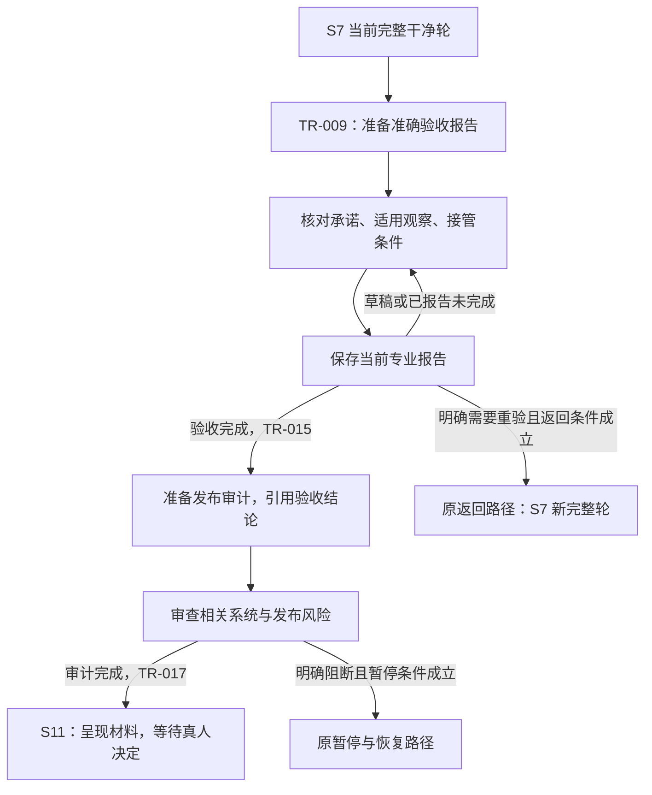

# L3-S10 验收与发布审计

## 1. 干净轮之后，为什么还需要验收和审计

S7 的干净轮回答：当前验证计划的必要断言已经完成，本轮没有留下使该轮不能通过的发现或无效结果。它使交付具有可引用的验证基础，却不能独自回答“人的需求是否被完整兑现”和“这次交付能否被安全接管”。测试通过、需求验收、工程审计和人类发布授权，是四种不同责任。

例如，一个订单接口通过了当前接口测试，但需求还承诺老客户端在兼容窗口内继续使用；新字段可能要求先迁移数据再部署服务，回滚也可能只能回滚代码、不能恢复已经改写的数据。接口测试仍有价值，验收则要把兼容承诺与实际行为对应起来，审计还要判断发布顺序和数据恢复安排是否成立。把这些判断留给“测试全绿”会漏掉真实交付条件；无差别重跑全部验证又不能自动消除这些问题。

因此，S10 安排两个依次完成的专业步骤：

| 步骤 | 核心问题 | 判断对象 |
| --- | --- | --- |
| 需求验收 `acceptance` | 这次交付兑现了什么承诺，还有什么未兑现？ | 锁定 REQ、适用契约、TASK 完成约定与实际交付 |
| 发布审计 `release_audit` | 已验收的交付是否保全相关系统不变量，风险能否被明确接管？ | 本次相关的状态、事务、并发、数据、运行、运维与发布安排 |

两个步骤共同把工程事实翻译成人能作决定的材料。它们不代替 [S11 发布门禁](L3-S11-release-gate.md)的真人裁决，也不在审查时修改产品、锁定需求或规格。设计依据来自 [L1 设计原则](../l1-principles/L1-design-principles.md)中的统一事实、独立审查、可解释交接和人类边界；阶段关系见 [L2 生命周期](../l2-lifecycle/L2-lifecycle-plan.md)。

## 2. 输入和责任：先弄清审什么，再选择怎样审

### 2.1 验收基础必须是本次交付

S10 继承当前完整、有效的 [S7 验证轮](L3-S7-verification-round.md)。[S9](L3-S9-repair.md)的一次定向复验只能说明相应修复断言；修复后准备好的新轮种子也只是下一轮工作起点。两者都不能替代完成的干净轮。

Main 需要结合以下材料理解当前责任：

| 材料 | 使用目的 |
| --- | --- |
| 锁定 REQ 与成功标准 | 回到人的目标、范围、业务规则、非功能约束与实际承诺，避免只验收容易演示的部分 |
| 适用设计、契约和 TASK 完成约定 | 解释模块协作、共享模型、兼容责任、拒绝分支及完成条件如何落实 |
| 当前 S7 计划、已接收结果与干净轮事实 | 复用已经完成的必要验证，判断观察是否真正适用于本次验收对象 |
| 真实集成结果、变化范围与交付材料 | 识别配置、依赖、数据、调用方和运维方面的实际影响 |
| S8、S9 的相关调查、修复及影响结论 | 理解修复了什么、原先为什么漏检、哪些旧观察仍可使用 |
| 已知风险、技术债与操作安排 | 明确剩余影响、处理责任、部署与恢复条件，避免工程通过后无人接管 |

系统提供已知关联、材料路径和已有承诺原文，不替作者推导新的验收标准。若 REQ 本身含糊，应指出缺失并交给有权决定的人，不能在报告里悄悄补写承诺，再宣称产品已经符合它。

### 2.2 Main 汇入真实专业工作

| 参与者 | 本人责任 |
| --- | --- |
| Main／验收负责人 | 理解需求与当前交付，安排实际审查，汇入结果与作者归属，处理矛盾，形成准确验收结论 |
| 发布审计负责人及必要专业审查者 | 按真实风险检查相关系统与操作条件，报告观察、未完成工作及风险判断 |
| 实现者、原验证者和操作负责人 | 提供本人已有结果、说明适用边界，回答具体问题，接管实际剩余工作 |
| Claude Code | 为 Main 必要的专业委托提供原生子代理上下文、执行、返回与沟通 |
| Hook、原消费者与 Runtime Writer | 给出准确报告位置，接收当前答案，维护登记、幂等与阶段事实，反馈本步出口和下一责任 |
| 人类 | 决定需求变化、不可逆操作、风险接受和最终发布选择 |

独立性取决于实际参与情况。让实现者换一个 owner 名字并不能形成独立审查；Main 必须真实安排、通知并获得必要的独立意见，保留报告来源。也不要求每条验收项都新派一个子代理：已有独立验证确实适用时，直接复用其观察；只有具体缺口、矛盾、本步特有风险或必要独立判断才增加工作。

S10 不创建框架 Team、启动许可或另一套派发器。Main 通过 Claude Code 原生机制进行必要委托，向执行者说明实际问题、材料和输出要求；阶段报告仍由 Main 汇入当前责任。平台子代理返回一段“通过”不能直接完成 S10，更不能替真人批准发布。

## 3. 两个步骤怎样形成闭环



这条链路有三个不同的完成点：专业工作完成、专业报告被接收、阶段事务成功。写了 `pass` 不证明第一点；Runtime 记录了报告不证明第三点。正常完成保存负责尝试本步原出口，并反馈实际到达的位置，不让作者另填登记证书或等待下一次普通工具事件补业务。

## 4. 需求验收：将承诺、观察和结论连起来

### 4.1 从承诺出发，解释对应关系

Main 先读 REQ 的目标与成功标准，再结合适用契约和 TASK 完成约定，确认实际交付是否包含所有必要责任。模块、接口、CASE 或测试名只是帮助定位的材料，验收最终仍要回答人的承诺。

每项判断应能解释：承诺来自哪里，预期行为是什么，现有哪次观察直接支持它，观察覆盖什么角色、数据和环境条件，尚未检查什么。如果同一结果支持多个相关承诺，可以共同引用；不能把“某个测试执行过”直接替换成“需求已经兑现”。

例如，需求承诺“重复请求不能产生重复扣款”。已有 S7 集成结果真实验证了相同幂等键的重复提交，可以直接支持相应判断；如果它只覆盖串行重复，而实现引入了并发创建路径，就需要检查并发条件下是否仍满足承诺。补查由这个明确缺口引出，不由 evidence 数组是否为空引出。

系统当前按材料文件交付题干，并不自动把一份 REQ 分解为每条验收标准。Main 必须阅读整份原文，保留必要的逐项解释；不能只为整个文件写一句“已看，pass”就把文件中的不同承诺全部视为完成。发现不同子项结论不一致时，应在现有报告中说清各项结果，整体不能盖过尚未完成的部分。

### 4.2 复用验证，同时检验结论能否成立

已有 S7 观察可直接使用，但需要判断其对象、版本、运行条件和断言是否适用。相关反例用于追问“什么事实会推翻这个结论”，例如拒绝访问、异常数据、边界、重试、恢复或兼容场景；不是每条报告都必须另造一份反证表、测试任务和日志。

一次实际观察可以同时支持正常行为及相关反例判断。若需要单独表达反证问题，使用现有 `counterevidence` 字段，保留实际问题和结果；没有额外内容时数组可以为空。缺少检查必须保留 `unknown` 和原因，不能把未知改成“不适用”，也不能以非阻断风险的名义把一个尚未判断的必要承诺视作通过。

不适用判断同样需要专业理由，例如本次根本没有数据迁移对象；没有对象时不新建一行来填 `not_applicable`。对已有确实不适用的责任说明一次原因即可，不为理由制造证据或引用。

### 4.3 验收包含可接管性

可交付不只是用户路径可演示。与本次变化相关时，需要把实现结果翻译为后续操作者能够使用的安排：

| 方面 | 需要解释的实际问题 |
| --- | --- |
| 交付范围 | 哪些模块、接口、配置、依赖和数据被改变，哪些明确不在本次范围 |
| 部署顺序 | 服务、客户端、配置、开关和依赖是否有先后关系，兼容窗口怎样维持 |
| 数据处理 | 迁移前提、历史数据、校验、重复执行和不可逆步骤如何处理 |
| 运行验证 | 发布后看哪些实际用户路径、健康状态、指标和日志，异常由谁判断 |
| 恢复安排 | 代码回滚能恢复什么，数据还需怎样补救，何时需要人工介入 |
| 运维接管 | 操作说明、告警、人工控制入口和实际责任人是否可用 |
| 剩余债务 | 当前选择留下什么影响，谁后续处理，在哪里继续跟踪 |

这些是判断视角，不是必须为所有项目生成七份产物。已有可用说明直接引用；确有风险和债务才记录。专业验收不能授权执行生产迁移、不可逆操作或正式发布。

## 5. 发布审计：从已验收交付检查相关系统风险

验收完成后，审计引用已接收的验收结论和相关观察，不复制整张 REQ／Contract／Claim 表重新答一遍。它把注意力移到跨模块、跨状态和跨运行边界的风险：局部行为看起来正确时，系统整体是否仍能一致运行、失败恢复和被操作者理解。

八类主题帮助审计者发现遗漏，但由实际变化决定相关性与检查深度：

| 主题 | 为什么要问 | 有意义的检查方向 |
| --- | --- | --- |
| 状态转换 | 局部成功可能掩盖无出口的状态或无法恢复的责任 | 进入与退出条件、失败和取消、重试后的去向、依赖是否会永久等待 |
| 事务与会话 | 多步骤写入可能只完成一部分，错误记录也可能沿用已失效事务 | 原子边界、回滚、错误保存、跨会话写入、长 I/O 与事务持有范围 |
| 并发与幂等 | 串行测试通过不能证明重复事件与多个执行者安全 | 唯一性、竞争、重启、重复提交与失败后重试的实际行为 |
| 数据、身份与迁移 | 新字段和约束可能与历史数据、默认值或实际身份语义冲突 | 正式迁移入口、历史冲突、枚举一致性、执行后校验与数据补救 |
| 调用点与运行拓扑 | 一个入口更新不代表后台任务、管理入口和其他消费者同步更新 | 真实调用链、依赖注入、共享与隔离状态、运行配置及调用方兼容 |
| 可观测性与错误 | 能失败但无法定位和接管，仍然不是可管理的交付 | 错误上下文、稳定诊断信息、指标和日志、控制面状态与操作说明 |
| 验证证据 | 只测替身或单实例，可能没有观察本次真正改变的运行条件 | 适用 S7 结果、真实数据／迁移／并发路径、环境限制和未执行项 |
| 文档与发布范围 | 代码正确也可能因交付范围不清或操作顺序错误而失效 | 文档与实际一致性、范围外变更、依赖顺序、回滚与风险接管 |

例如，唯一键变更却没有检查历史冲突、关键数据库行为只测了替身、回滚说明没有覆盖真实数据后果，都是需要认真判断的具体问题。审计者应按实际影响明确阻断或可接管风险，不能用测试数量抵消它们，也不能把所有问题机械归类为同一种严重度。

主题已有结构化落点 `audit_areas[]`：`id` 对应主题，`conclusion` 为 `pass`／`not_applicable`／`unknown`／`fail`，有实际归属和输出时保留 `owner`／`evidence_refs`。主题与现有 ID 的对应为：状态转换 `state_machine`；事务与会话 `transaction_uow`；并发与幂等 `concurrency_idempotency`；数据、身份与迁移 `data_migration`；调用点与运行拓扑 `call_sites_topology`；可观测性与错误 `observability_errors`；验证证据 `verification_evidence`；文档与发布范围 `docs_release_scope`。实际风险／债务／阻断分别保留在 `risks`／`technical_debt`／`blocking_findings`，必要观察和 N/A 解释可复用关联库存行的 `oracle`／`na_reason`；不增加主题报告或必填八行。

八类主题不是八个必做任务，不要求每类都有独立 Agent、证据、N/A 行或新产物。若使用 `audit_areas` 报告实际主题结论，保留这些专业答案；该字段不是系统自动生成的资格证书。已填写主题中的未知或失败同样需要处理，不能因为主题列表是可选的就忽略已经报告的问题。

## 6. 风险、未知和阻断怎样影响决定

未知表示尚不足以判断，失败表示已有观察不符合预期，阻断表示当前问题使本步不能按正向完成。它们应分别说明实际含义，而不是都改成一个总体“有风险可发布”。

非阻断风险可以在工程结论成立后交给 S11。报告应让人明白影响、实际处理责任和可落实的后续安排；已有本地工作记录可以承担跟踪，不强制另开固定拼写的票据。`tracking_ref` 或 `recovery_point` 没有真实内容时可以留空，不伪造恢复点。

风险严重度是一项专业描述，不能单独代替阻断判断：有 P1 标签不自动被机器拒收，低严重度也不自动允许忽略必要的未完成工作。风险和技术债的 owner 是否缺失会影响进度显示，但显示数值并不能证明风险已被实际接管。Main 仍须完成必要沟通，使 S11 看到真实剩余问题。

对于需求定义、架构边界或项目基础的争议，报告具体影响并交回有权处理的路径。S10 不通过修改锁定材料消除失败，也不把风险接受当作 REQ、Kernel 或发布操作的授权。

## 7. 产物：一份专业报告，同源生成可读结果

### 7.1 Manifest 的职责

S10 的 Manifest 是现有机器可读专业报告，不是子代理分派清单。验收和发布审计各有一份当前报告，由系统在本步入口准备，并提供准确绝对路径。作者保存这份报告，系统登记并生成可读投影，不要求另写 Markdown、证据封套、来源证书或重复汇总。

| 字段 | 表达什么 | 谁负责 |
| --- | --- | --- |
| `schema_version`、`manifest_type`、`runtime_id`、`baseline_generation`、`review_round` | 报告属于哪个当前责任与轮次 | 系统根据准确路径和当前 Runtime 带入 |
| `coverage_inventory` | 已知材料及其专业判断 | 系统带出行标识、来源、承诺原文和已知 owner；Main 填真实结论与必要解释 |
| `counterevidence` | 确有单独表达价值的反例问题和观察 | 专业作者；可复用已有观察，无额外内容时留空 |
| `audit_areas` | 已实际表达的相关审计主题结论 | 专业作者；不是必须填满的八项清单 |
| `risks`、`technical_debt` | 真实剩余影响、处理责任和后续位置 | 专业作者及实际接管者 |
| `blocking_findings` | 已报告的业务阻断及对应去向 | 专业作者；总体正结论不能抵消它 |
| `metrics` | 从已报告数据派生的进度显示 | 系统计算，不由作者维护 |
| `outcome` | 当前验收或审计的明确专业结论 | Main 汇入实际工作后填写，草稿留空 |

`coverage_inventory` 行的 `expected` 是系统预填的原始承诺基线（所提供 REQ／CONTRACTS／BE／TASK 材料正文），不是让 Main 另写“应该怎样”；保留系统提供的实际承诺，`source_refs` 指向材料；`disposition` 是作者的判断。`oracle` 可写实际观察、判断依据和未完成原因，不是另一个必须满足格式的证明。`evidence_refs` 有真实可用输出时引用，也允许为空，不能为了非空而创造日志。

正常保存从当前准确路径绑定顶层机器字段并重算指标；作者不必补回省略的机器段，也不靠手填旧 Runtime／轮次改变本次责任。系统已有的行标识和来源关联保持原投影；可选风险或反证对象不要求作者编内部编号、抄父行编号或另注册其实际文件来源。专业内容仍须说明具体问题与实际影响，省略机器编号不能省略判断。

### 7.2 用现有字段表达未完成和完成

以下仅展示同一系统行中的专业字段片段，不是可提交的新报告，也不提供应复制的 ID、路径或机器关联：

```json
{
  "oracle": "已有串行重复提交观察符合预期；并发创建条件尚未观察，暂不能判断整项承诺。",
  "evidence_refs": [],
  "disposition": "unknown"
}
```

补齐实际检查后，在当前行继续填写实际事实，而不是另交一份“证明已完成”的登记单：

```json
{
  "oracle": "已复核现有集成输出中的串行重复与两个并发请求，均只形成一次扣款；适用条件与本次交付一致。",
  "evidence_refs": [],
  "disposition": "pass"
}
```

示例不证明任何真实项目通过。实际输出已有可用位置时应填写，行结论的真实性仍由真实审查工作承担。必要内容可以在同一已有观察中表达，不因引用为空而凭空新增工作。

行级 `disposition`、反证 `outcome` 和主题 `conclusion` 使用 `pass`、`not_applicable`、`unknown`、`fail`；整份报告的 `outcome` 使用下一节的阶段结论，两者不能混用。反证问题得到回答后也不用另造 `refuted` 等本报告不采用的同义状态。字段形态见[现有示例](../../docs/examples/s10/README.md)，数组项使用已有对象结构，不能把风险或反证对象写成字符串。

### 7.3 投影和指标的含义

[验收模板](../../docs/reports/acceptance/ACC-template.md)与[审计模板](../../docs/reports/release-audits/TEMPLATE.md)说明人类可读投影的内容。正常正向出口成功后，系统从同一 Manifest 生成可读文件；作者不再手填模板。若出口已提交而投影写入失败，工程事实仍然已提交，应报告具体输出缺口并修复，不能称整次事务已经回滚。

指标只描述报告中的数据。没有某类对象时，覆盖值可以为零；没有逐行引用时，不生成缺引用资格门；反过来，显示满覆盖也不能证明承诺被穷尽、独立性成立或风险已经接管。已经写入的未知、失败和阻断必须保留在实际判断中，手填零指标或总体正结论不能抹去它们。

## 8. 报告接收与本步完成是两道不同判断

### 8.1 先允许真实报告进入

普通保存先读取当前准确路径，解码现有字段类型并关联本步责任。空 `outcome` 表示草稿：报告原地保留，不登记最终结果、不推断通过，也不自动选负向路由。作者可继续实际工作和正常使用工具。

明确填写本步允许的最终结论后，原消费者通过 Runtime Writer 登记事实。报告中包含未知、失败或阻断，并不是拒绝记录真实情况的理由；登记也不授予完成。JSON 不可读、字段类型错误或路径不属于当前责任时，应反馈具体路径、问题和修正位置，不让作者猜另一份问卷。

责任进度仍沿用 `pending`、`active`、`blocked`、`done`、`cancelled` 五种状态；验收／审计是阶段位置，`pass` 等是专业结论，草稿是尚未明确结论的报告。它们不合并成另一套状态，也不由一个单词互相推断。

### 8.2 再判断正向完成

| 本步 | 最终 `outcome` | 该结论的含义与出口 |
| --- | --- | --- |
| 验收 | `pass` | 声明验收完成；当前报告无已报告未完成／阻断，且当前干净轮条件成立时，经 TR-015 进入发布审计 |
| 验收 | `review_required` | 明确要求返回验证；使用原返回路由及其必要影响材料，不走发布审计正向出口 |
| 发布审计 | `approved` | 相关工程审计完成；条件成立时经 TR-017 交 S11 |
| 发布审计 | `approved_with_risk` | 工程结论完成并如实保留非阻断风险；同样交 S11，由人决定是否接受 |
| 发布审计 | `blocked` | 明确报告阻断，尝试原暂停路径；不交 S11 作为已通过审计 |

两类正向出口都读取已报告的覆盖行、反证问题、审计主题和阻断项。存在非 `pass`／`not_applicable` 的已报告行，或存在 `blocking_findings`，就不能按正向完成。没有被作者报告的遗漏不会因这项检查而自动被机器发现；专业工作仍须覆盖实际责任。

当前报告的查找依据是本责任、本代际和本轮次的最新有效记录，不是账本中任意一条旧 PASS。审计出口还需要当前验收通过事实。单独改总体结论、删除未完成文字或借用旧轮报告，不能替代真正补齐工作。

### 8.3 当前干净轮条件实际保证什么

TR-015、TR-017 仍通过 `EvaluateCleanRound` 读取当前 Runtime 的验证事实，包括本轮计划、必要断言处置、发现、证据失效与阻断情况。只有一次 targeted pass、刚创建新轮或一个手写 clean-round 汇总，都不足以满足该条件。

这里没有在每次保存或普通 Hook 里重新扫描、认证全部上游来源。TR-009 进入验收时具有产品基线复核；TR-015／TR-017 的本阶段完成读取当前已登记轮次与专业报告，不再重复同一套完整产品基线证明。不能由此推导“这些出口已经证明当前所有文件与原验证对象完全相同”。

若期间发生真实产品、配置、迁移或权威材料变化，Main 必须判断原观察是否仍适用；使验证基础失效的变化应走原影响处置和 S7 完整重验路径。维持准确登记和如实报告变化，才使状态条件与真实交付一致；文档不能把未实现的全盘漂移识别写成现有保证。

## 9. Hook 怎样衔接，怎样避免重新形成控制抽象

### 9.1 入口准备属于原阶段交接

S7 经 TR-009 进入验收时，原入口准备验收报告。验收经 TR-015 完成时，原入口准备发布审计报告。TR-017 完成后准备 S11 既有人类材料与决定入口。每次交接只准备下一准确责任，不在一次保存中跑完多个专业步骤。

当前验收草稿以已绑定 REQ、当前代际登记的 contract／task 文件为材料行，提供整份原文及来源。发布审计草稿主要引用已验收结果，不自动复制完整验收表，也不默认填入八类审计任务。文件级材料交付不等于机器已经完成逐承诺分析。

普通 `PreToolUse`、`Stop` 只读当前责任和材料位置，不创建草稿、重做审查或推进业务。若缺少应由入口准备的报告，应明确给出准确预期路径及接线问题；不靠下一次普通事件偷偷补建。

缺稿反馈还必须交付可执行的原准备恢复入口：Main 解决具名原因后调用原准备器，系统从当前 S10 责任恢复缺失材料，保留已有报告，不重跑 TR-009、重接 Reviewer Result 或要求作者重建机器来源。阶段已经转换而材料未准备好，应明确报告这两个事实。入口与失败编排见 [S7→S10 指引编排](../l4-mechanisms/L4-agent-guidance.md#s7s10-的分层与事件编排)。

### 9.2 保存只完成当前一步

Main 正常保存准确报告，`PostToolUse` 识别当前保存事实；编辑器、脚本或 MCP 都可以承载，不要求某一种命令文字或额外提交指令。正常接收链路依次完成：

1. 读取实际保存内容，处理草稿或明确结论，带入当前机器关联并派生指标。
2. 对本次内容生成登记标识及机器封套，通过原 `RecordEvidence` 和原子 Writer 记录。
3. 对正向且无已报告未完成／阻断的答案，或作者明确选择的负向结论，尝试当前 Controller 原出口。
4. 返回实际登记结果、未完成项、事务是否提交和下一准确位置；正向出口成功后生成可读投影。

这些环节没有新增子代理启动前提。Main 不调用 AgentBegin、不手工生成证据封套、不手工 `runtime evidence add`，也不为阶段推进调用第二套登记流程。显式 validate、render 和原命令可用于具体故障诊断与维护，不是正常专业作者的必经步骤。

### 9.3 并发和重复由原事实维护

同份内容已经接收且仍停在本步时，重复保存不重复登记，但可以继续尝试尚未完成的原出口。否则，一次出口失败就会被“幂等：已处理”永久吞掉。出口已完成、游标已经改变时，旧卷回放不能再次完成本步或创建新责任。

真实补充产生新内容，沿原登记记录其事实，并由当前责任的最新匹配记录表达更新。并发与修订冲突由原 Writer／CAS 处理，不让作者再填一份来源一致性问卷。返回原责任时保留可用观察、清除旧最终结论，让作者据实际退回原因重新判断；不能把历史 PASS 自动视为新的答案。

## 10. 未完成、发现问题和返回路径

### 10.1 先区分材料缺口和验证失效

没有找到某次输出、一个解释尚不清楚、某个相关风险尚未判断时，可以在当前报告继续工作。保持 `unknown`、说明实际缺口和责任，不必为了保存草稿先选返工，也不让普通工具使用被未知项锁住。

如果已有观察相互矛盾、产品行为不符合承诺，或真实变化使原验证基础失效，就不能只润色报告直到总体通过。应留下真实问题与影响，按原返回、调查或人类决定路径处理。

| 情况 | 处置原则与边界 |
| --- | --- |
| 本步尚缺解释或适用观察，未确定需要产品／完整验证变化 | 在当前原报告补充，保留未完成状态，不伪造引用 |
| 验收明确要求重验 | `review_required` 进入原 TR-016 返回流程；需要真实影响材料，成功后回 S7 新完整轮 |
| 产品、架构或数据缺陷 | 保留观察并交回原发现／调查路径；S8 确认原因，S9 获批修复，再回 S7，S10 不直接修产品 |
| 审计明确阻断 | `blocked` 尝试 TR-018，记录审计并捕获原暂停检查点，等待处理与恢复 |
| 锁定需求、规格或项目基础需要有权修改 | 报告实际影响并交原人类／所有者决定路径，专业报告本身不授予修改权 |
| 不可逆生产操作或发布授权问题 | 交给人类，不借审计通过执行操作 |
| 工程结论完成且只有可接管非阻断风险 | 如实保留风险后交 S11，不替人接受风险 |

“产品问题交 S8”表达专业分流方向，不代表 S10 保存发现文字就能无条件直接切到 S8。必须使用实际存在的返回／发现入口及其必要材料；不能为了满足路由伪造 Finding、影响记录或暂停证据。

### 10.2 负向报告接收，不等于负向事务已提交

`review_required` 是 Main 明确要求回到 S7 开展完整重验的专业决定。它不等于已经修改了产品，也不自动确认原因或授予修复权。保存时先接收原验收报告，再从原决定和当前 ReviewPlan 的冻结范围派生原 `change_impact_record`，交给 TR-016；系统不从自然语言猜测文件路径，不为返回而制造 Changeset、Case、Final Result 或产品修改记录。

原影响信封绑定已接收报告与原计划的准确来源摘要，作用范围保存在既有 `scope_refs`。TR-016 的失效动作读取该原范围；保存报告或后续恢复工具的文件路径不能替代产品影响。事务仍检查原完整轮预算，清除本轮干净标记并开启新轮；成功后直接交付新轮 S7 Main 的准确计划工序。原轮次观察保留为历史，新轮需要重新登记实际专业计划和独立验证，不能继承旧 PASS 作为新完成。

来源计划缺失、字节变化、代际或轮次不符、冻结范围为空时，报告可以已接收而返回未完成。反馈必须同时说明这两个事实，并指向 Main 应恢复的原计划或指针；作者不重填验收，也不补来源证明。恢复原材料后，Main 的正常完成事件沿已接收且内容未变的报告继续原消费者，不能顺手接收修改过但未提交的新专业内容。普通 Pre 和 Stop 不负责补造返回材料。预算不足则沿原人类预算决定处理，不能降低预算门或隐藏未完成返回。

新轮的产品基线检查将原 Runtime 已登记的 S10 信封及其准确 Manifest、同源可读投影视为控制历史；它们需要与登记来源匹配。不会放行整个 `s10` 目录，同目录的未知文件仍属于需要说明的变更。这一边界避免“已经接收验收，却在重验登记时把验收自己的报告当作产品修改”。

发布审计 `blocked` 的原 TR-018 则以动作生成暂停检查点，正常路径可进入 `paused`；作者无需先手填 `pause_record`。实际是否成功仍以事务反馈和当前游标为准。后续沿原检查点恢复，不能把“已暂停”当成审计通过或发布许可。

### 10.3 人类退回 S10

S11 可以退回验收或发布审计。应携带人的真实理由与准确材料位置，保留已有观察，清除被退回步骤的旧最终结论，再针对实际问题补工作。不能用旧 `pass` 自动再次完成，也不能无差别清空全部有效结果迫使重复审查。退回后的重新完成仍沿本步原出口返回 S11，由人对当前材料重新作决定。

## 11. 交给 S11 的材料应该让人看懂什么

TR-017 表示工程审计完成并进入 `awaiting_human_release`。Main 应能向人解释：本次需求与实际交付是什么，验收结论如何得出，哪些系统与操作风险已检查，哪些风险仍然存在，谁接管，发布和恢复需要哪些真实条件。

系统复用已接收 S10 报告和准确路径提供人类材料，不要求另填一张机器元数据表，也不复制全部过程证据。可读报告用于理解结论，原始观察用于必要追溯，两者都不能替人作决定。

S11 原决定应用只由 Main 忠实填写真人选择的 `disposition` 和可选 `reason`。`decision`／`decision_id`／`approved_by`／`runtime_id`／`scope`／`target_cursor` 都是系统元数据，保留系统提供的值或空白；空元数据不表示真人漏答，适用值由原 Writer 在接收时提供。

S11 未收到真实选择时保持等待。S10 的 `approved` 是工程审计结论；它既不代表人的批准，也不执行 merge、publish、deploy 或正式 release。若真人随后拒绝缺陷、验收或审计，按相应原路处理，而不是把曾经到达 S11 当作永久通过。

## 12. 观测与恢复：用事实定位卡在哪里

S10 的观测应该帮助区分入口接线、专业未完成、登记失败和出口失败，而不是再搭一个审查控制面。

| 观察位置 | 应显示的事实 | 能解决的问题 |
| --- | --- | --- |
| 当前 Hook 上下文 | 本步种类、准确绝对路径、已有材料与允许结论 | 作者是否在正确责任、是否拿到真实题干 |
| 草稿保存反馈 | `outcome` 未答、具体未完成材料与原因、原路径 | 是否还在工作，而非误判为拒收或自动返工 |
| 正式接收反馈 | 本次登记标识、明确结论、已报告未完成与阻断 | 报告是否进入原账本，哪些真实问题仍存在 |
| 出口反馈 | 实际 TR、当前游标、缺失项、冲突和具体错误 | 已接收但未推进，还是阶段已完成 |
| 原 Runtime 账本与事件 | 当前责任／轮次、有效登记、事务修订与转换 | 重复提交是否写入、实际完成的是哪一步 |
| 下一步准备与投影反馈 | 下一准确报告／人类入口、可读输出位置或写入错误 | 业务事实已提交但后续材料是否缺失 |
| 只读 `s10 status` | 当前已登记报告、结论、已报告进度和下一动作 | 恢复时定位原责任，不重做全套来源证明 |

恢复时先读当前游标，再读当前报告及实际错误。可读文件写入失败、草稿准备失败、Runtime 并发冲突和业务材料不足，需要不同修复；不能统一表现为“再点一次通过”。普通重复保存应保持幂等，并只接续尚未完成的本步出口。已经跨阶段的旧保存不应带来新的业务作用。

维护者可针对具体缺口使用既有诊断命令，但正常作者只在准确报告里继续实际专业工作。所有观测都应保留“已报告”这一含义，不能将汇总数字描述为系统已经独立证明真实性、穷尽覆盖或实际独立性。

## 13. 实现对应与适用边界

### 13.1 从使用入口追到原事务

| 设计责任 | 当前落点 |
| --- | --- |
| Main 的 S10 操作契约和专业方法 | [主会话阶段指引](../../docs/control/agent-protocol.md#s10)、[验收与交接技能](../../skills/acceptance-and-handoff/SKILL.md) |
| 当前报告字段、接收、进度派生与完成读取 | [acceptance/manifest.go](../../internal/acceptance/manifest.go) |
| 准备准确报告、草稿处理、正常保存、幂等和出口反馈 | [audit_questionnaire.go](../../internal/cli/audit_questionnaire.go) |
| 原阶段交接后的下一报告与人类入口准备 | [CLI 控制循环接线](../../internal/cli/run.go) |
| 当前专业报告与干净轮的出口求值 | [质量门求值](../../internal/qualitygate/evaluator.go)、[门定义](../../internal/qualitygate/registry.go) |
| 原 TR-015～TR-018、当前完成守卫与原子转换 | [生命周期定义](../../docs/control/loop-definition.json)、[转换守卫](../../internal/transition/guards.go)、[转换引擎](../../internal/transition/engine.go) |
| 同源可读投影和只读诊断 | [Markdown 生成](../../internal/acceptance/markdown.go)、[S10 命令](../../internal/cli/s10_command.go) |
| 跨阶段答卷、事实与 Hook 分工 | [阶段答卷机制](../l4-mechanisms/L4-stage-form.md)、[状态转换核心](../l4-mechanisms/L4-state-transition-core.md)、[Hook 平台接线](../l4-mechanisms/L4-hook-platform-wiring.md) |

### 13.2 机械接收不替代专业真实性

当前接收读取已有 Go 字段类型和本步报告，不把固定类别数、库存精确集、八类审计齐全、引用注册资格、角色名字或逐行证据非空作为验收资格。正常保存负责当前机器关联；报告中的自然语言含义仍须由专业工作保证。

现有部分辅助接口仍能重建上游材料与变化范围，但其存在不意味着正常接收和每个出口都调用它们。当前 S10 完成读取已登记报告及其指向的当前 Manifest，并不全面复核来源哈希，也不认证所有引用指向的观察。本轮状态条件有效，也不等于磁盘、HEAD 或材料内容永不漂移。Main 需要如实处理真实变化和重新判断适用性。

当前草稿按文件提供原文，没有逐条抽取并认证全部自然语言承诺；当前完成检查能够阻止已报告未知、失败和阻断被总体正结论覆盖，但不能发现作者没有报告的每项遗漏。专业独立性、N/A 理由和风险接管同样没有被字符串检查证明。

这些边界不能用恢复一套启动／证据资格抽象来掩盖，也不能解释为无需真实审查。S10 的可信度来自明确承诺、适用观察、实际独立意见、诚实的未完成项和原事务交接共同成立。自动化链路验证、真实 Claude Code 执行与产品验收分别提供证据，任何一类都不独自替代另外两类。
