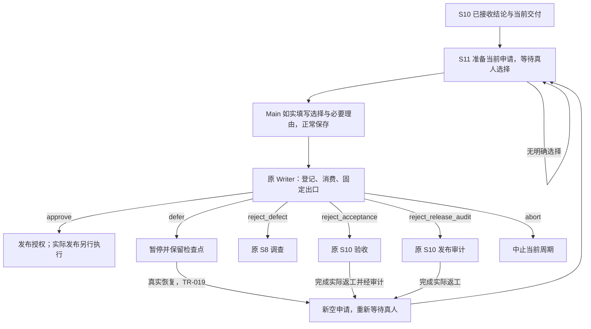

# L3-S11 人工发布门禁

## 1. 工程条件成立之后，为什么还要等人决定

S10 已经完成需求验收与相关发布审计，说明当前工程工作可以形成可解释的交付结论。它仍不能替项目负责人决定是否在此刻接受剩余风险：业务价值、运营窗口、用户影响、资源安排和组织责任，并不由一组绿色测试或一个审计结论自动决定。

S11 将这项决定留给人。它把当前候选交付、已接收结论和真实剩余风险交给人，要求明确选择，并将选择转成可追溯、可恢复的固定去向。没有选择就继续等待；沉默、超时、Agent 建议和材料齐全，都不能代替批准。

需要分清三个事实：

| 事实 | 回答的问题 | 谁负责 |
| --- | --- | --- |
| 达到工程交接条件 | 承诺是否兑现，相关工程风险是否已审查？ | S7～S10 的实际专业工作 |
| 获得发布授权 | 是否接受当前风险与时机，允许本次交付进入发布安排？ | 人类在 S11 明确决定 |
| 实际执行发布 | 是否已合并、推送、发布制品、部署，以及运行结果如何？ | 另行授权的实际操作与外部发布流程 |

S11 的批准只记录第二项，不执行第三项。`release_authorized` 是发布授权状态，不是“已经上线”。这一分离落实 [L1 设计原则](../l1-principles/L1-design-principles.md)中人握出口、职责分工和统一事实的要求；生命周期关系见 [L2](../l2-lifecycle/L2-lifecycle-plan.md)。

## 2. 从 S1 的目标与授权回到当前交付

[S1 需求绑定](L3-S1-bind.md)明确执行哪个需求、开发目标与发布目标；它让后续工作有执行范围，不提前批准最终发布。S11 需要让人看懂本次实际交付与这个范围的关系，避免把“已经允许开发”理解成“任何后来产物都可自动发布”。

候选交付由当前 REQ、代际、验证轮与已接收 S10 结论定位，并结合实际集成结果、目标和交付材料解释。Main 应说明它实现了什么、会影响谁、发布和恢复需要哪些实际条件。发现范围外变化、候选改变或观察不再适用时，应明确处理，不能把旧批准移用给新的交付。

当前系统主要依据原 Runtime、当前验收／审计记录和阶段入口来关联决定，没有在 S11 重新证明全部 Git HEAD、文件、运行环境和生产制品。Main 对真实候选的解释及变化判断仍是必要责任；不能把已有机器关联描述成“任意发布对象的来源已经全部认证”。

## 3. 给人的材料应当怎样组织

### 3.1 让人作决定，而不是再做一遍工程审计

S11 复用 [S10](L3-S10-acceptance-audit.md)已接收的验收与审计报告、相关观察和真实风险。人可以沿报告追溯细节，但正常交接应先让人理解：

- 本次需求、实际交付范围、目标及主要变化是什么。
- 验收与工程审计给出了什么结论，关键依据和适用限制是什么。
- 还有什么真实风险、未决问题或操作前提，影响及处理责任是什么。
- 对当前交付建议怎样处置，各选择会回到哪里。
- 已接收报告、原专业报告与必要操作材料的准确位置。

这是一种理解顺序，不是要求再造一份固定字段齐全的决策包。没有风险时不编造风险；没有某种恢复任务时不硬填任务；没有“唯一未决事实”也不制造一个问题来满足格式。人不需要抄写哈希、轮次、证据标识和修订算术。

当前上下文从本轮已登记的验收／审计记录给出原专业报告和可读投影路径，并展示已报告风险的影响、owner 与后续位置。它并不自动完整理解自然语言报告，也不能凭路径存在证明材料充分。Main 需要将真实内容解释清楚，保留专业作者归属，不把机器汇总当成替人判断。

### 3.2 材料不足时怎样继续

准确材料缺失、无法读取或本次候选不清楚时，指出具体文件和原责任，先补齐实际交接。已有工程结论需要返工时，使用相应返回选择；普通疑问可以阅读和解释，不必每次都退回一个阶段。

S11 不重开一轮隐含的工程审查。人的问题如果揭示缺陷，应进入调查；如果质疑验收或审计，应回对应专业步骤。不能在 S11 一边修改产品或锁定依据，一边继续使用原已通过材料批准。

## 4. 参与者与等待边界

| 参与者 | 本人责任 |
| --- | --- |
| 人类 | 阅读足以理解候选和风险的材料，明确选择处置，并在实际需要时说明理由 |
| Main | 如实呈现交付与风险，解释选项，将人的明确原意填写到当前申请，反馈真实去向并交接后续责任 |
| S10 专业负责人 | 提供已接收结论和已有材料，接收验收或审计返工，不用旧结论自动跳过新问题 |
| 原消费者与 Runtime Writer | 维护当前申请关联、固定路由、并发校验、决定登记与一次消费事实 |
| Claude Code 与 Hook | 承载 Main 的读取、沟通和正常保存；显示准确材料及等待原因，不代替人选择 |
| 外部发布或周期管理执行者 | 在各自真实授权下执行发布、归档或开启新周期，不由 S11 自动代行 |

S11 不创建子代理派发器，也不需要“发布批准 Agent”。必要的专业问题可由 Main 沿原机制委托，但审查者的建议不构成人类决定。`actor`、`approved_by` 和调用者标识是记录，不是外部身份认证；Main 如实承接人意是履职要求，不能由换一个名字满足。

等待停止的是未经决定的阶段推进。Main 仍可读取、解释材料和正常使用工具，不因尚未批准就禁止所有工作。Controller 对 `awaiting_human_release` 不产生自动发布决定；即使已有证据齐备，也没有默认 `approve`。系统没有以等待超时自动批准或自动中止的语义。

## 5. 六种选择为什么有不同去向

六种处置把人的意思与下一项真实责任对应起来。理由补充细节，不能用自由文字指定任意目标状态。

| `disposition` | 人的意思 | 原固定出口 | 后续责任 |
| --- | --- | --- | --- |
| `approve` | 接受当前交付与风险，记录发布授权 | TR-025 → `release_authorized` | 按另行授权执行实际发布；本阶段不执行发布操作 |
| `defer` | 现在暂不作最终发布安排，保留以后继续的依据 | TR-026 → `paused` | 保存原暂停检查点；真实决定恢复后回门禁重新选择 |
| `reject_defect` | 发现产品、架构或数据方面的问题，需要调查 | TR-027 → `bug_resolution.investigation` | S8 接收人的真实问题或已有发现，确认原因与后续路线 |
| `reject_acceptance` | 对需求兑现或验收判断不满意，需要补验收 | TR-028 → `acceptance` | S10 处理真实理由，重新形成验收及下游审计结论 |
| `reject_release_audit` | 对系统、运维或发布风险判断不满意 | TR-029 → `release_audit` | 保留有效验收，返工相关发布审计 |
| `abort` | 中止当前工程周期 | TR-030 → `aborted` | 保留中止事实和历史；后续周期管理另行决定 |

`defer` 不是一种隐含批准，也不同于终止；`reject_acceptance` 与 `reject_release_audit` 有不同失效范围；`reject_defect` 是调查入口，不是直接授权 Builder 修复。固定六种选择使状态恢复不依赖对任意人类文字的猜测，同时让必要理由保留真实问题。



## 6. 正常交互：一次真实选择，保存原申请

### 6.1 原入口准备，普通事件展示

TR-017 完成进入 S11 时，原交接入口准备当前申请，给出准确绝对路径。申请保留既有格式，其中机器元数据由系统带入，`disposition` 初始为空。Main 不另建表格、登记凭据或命令草稿让人重复批准。

普通 `PreToolUse`、`Stop` 只读已有材料和当前申请位置，不创建申请、不补业务、不消费决定。若应存在的申请缺失，要给出准确预期路径与准备故障，由原入口／系统恢复；不能通过反复普通工具事件掩盖缺失。

### 6.2 只有真实选择才填写

人明确选择后，Main 只将实际意思填入原 `disposition` 和可选 `reason`。以下是现有专业字段片段，表示尚无选择的草稿，不是要另建的申请：

```json
{
  "disposition": "",
  "reason": ""
}
```

例如，人明确表示“验收对兼容承诺的解释不足，请补验收”，可在当前原申请写：

```json
{
  "disposition": "reject_acceptance",
  "reason": "请补充说明兼容窗口内老客户端的承诺如何得到验证，再重新提交验收结论。"
}
```

示例只是解释字段，不构成本项目的真实决定。Main 不能因为认为下一步合理而替人选；也不要求人使用某一句逐字命令、补 `human_confirmed` 字段或复制身份／哈希来证明意图。若人的意思含糊到无法确定去向，先澄清实际决定，保持当前选择为空。

### 6.3 保存由原入口接收

Main 正常保存准确申请，编辑、脚本或 MCP 均可承载。`PostToolUse` 识别当前申请的真实保存，读取原两个字段，沿原 Writer 记录并消费决定，执行固定出口。作者不另运行 `runtime human-decision`、不手工登记证据，也不等待下一次 Pre 补推进。

空选择只保留草稿，不写成 Runtime 决定；未知选择或字段类型错误给出当前路径和准确修正反馈，不默认为批准。保存成功只说明文件保存，业务结果仍看原 Writer 的实际反馈。

## 7. 决定怎样与当前责任关联并只消费一次

### 7.1 系统关联，作者不做修订算术

当前申请的位置由 Runtime、代际、轮次、已登记发布审计身份和既有阶段入口修订共同定位。阶段入口修订 `lifecycle.phase_revision` 用于区分重新进入门禁的责任，不是人需要填写的字段，也不是另加一套尝试状态。

正常接收使用当前快照的 Runtime 身份与修订提交原 Writer，在锁内再核对当前发布审计身份。这样处理真实并发，防止在同一次写入中把选择交给已经变化的工程责任。作者不需要复制这些坐标、自己生成决定标识或另交来源证明。内部快照冲突交由 Main 核对原决定回执和当前申请后恢复原转换；它可能来自无关提交，不能因此归因作者数字错误、要求重新选择或自动重试。保留这项 CAS 是为了保护保存读取到转换接收之间的原申请范围，不能直接改成当前值写入后默认人类已同意另一份发布。

这种关联仍有边界：它读取当前已登记审计身份，不重新审计其全部来源，不独立认证人看到的 Git HEAD 或实际制品。真实候选变化应先由 Main 如实处理，不可把本地 CAS 解释为已经证明所有外部对象不变。

### 7.2 原 Writer 内的逻辑提交

原 `HumanReleaseTransitionID` 将六种选择映射到 TR-025～TR-030。正常申请路径校验调用者非空、选择与固定出口一致、当前申请标识及路径可用，再进入原 Writer。

同一业务提交在原事实中完成：记录人类决定、登记 `human_decision`、标记被哪个固定 TR 消费、执行该 TR 的原动作和状态变化。`consumed_by`、`consumed_at` 保留一次消费的结果，不允许同一授权继续批准另一责任。原状态与事件写入、并发冲突和中断恢复沿用 Runtime 机制。

“一次逻辑提交”不是一次文件写入。决定文件、状态／事件持久化和后续材料准备有各自 I/O 边界；不能承诺后续文件输出失败会回滚已经提交的决定，也不能仅凭申请文件存在断言消费成功。实际结果必须以原账本和事务反馈为准。

### 7.3 重放与新决定分开

原 Apply 可以识别相同决定标识、路径、答案和已完成固定出口，返回已有事实而不重复业务。正常保存跨阶段旧申请时，也不能重新执行决定或清空返工者的新工作。已消费申请属于历史记录，不通过改其内容来表达新的选择。

重新进入 S11 时，必须有当前入口的新申请，即使 REQ、轮次甚至审计记录未改变。新的阶段进入与新的明确选择承担这一次责任；原决定不会因内容仍看起来适用就变成可反复使用的授权。

现有 `runtime human-decision` 和显式 evidence 参数保留为兼容／恢复入口，沿各自实际校验处理原记录。它们不是正常作者的第二次提交，也不能用旧命令要求恢复额外人工登记职责。维护时应先确定原决定是否已经接收，避免将恢复当作重复批准。

## 8. 暂缓之后怎样恢复

人选择 `defer` 后，TR-026 捕获原 S11 暂停检查点并进入 `paused`，保留回到哪项责任的依据。它不会等待某个时长后自动批准，也不自动中止。

恢复本身需要真实的人类决定，沿原暂停／恢复入口执行。TR-019 核对检查点与必要基线，恢复原责任；如果暂停期间依据漂移，应处理实际变化和原修订路径，而不是强行恢复旧结论。恢复决定和发布决定是不同用途，不能把已经消费的 defer 当成 resume 或 approve。

回到 `awaiting_human_release` 时，由原恢复入口准备新的空申请。即使发布审计没有产生新记录，也应根据这次真实阶段入口定位新责任；不能复用已消费的旧申请。普通 Pre／Stop 继续只展示，不承担准备或自动补选。

Main 应向人说明现在仍待决定什么、已有材料是否继续适用和准确新申请在哪里。若恢复已成功但新申请准备失败，应如实报告当前已恢复状态与准备缺口，不能把它描述成仍未恢复，也不能用旧决定继续向批准推进。

## 9. 三种退回怎样交到原专业责任

### 9.1 缺陷退回：真实问题先进入调查

`reject_defect` 将人的真实问题或已有发现交给 [S8](L3-S8-finding-investigation.md)，不要求先注册一个占位 Finding 才允许接收人的决定。没有 S7 发现批次时，可以用本次已消费决定作为真实来源，建立调查 Case，并围绕实际问题提出假设和调查任务。

原 TR-027 清除当前批次／调查入口指针以建立这次入口，保留历史文件和已记录观察。人的描述是调查依据，不自动等于已确认根因、正式 BUG 或获批修复合同；不能在 S11 直接派 Builder 修改产品。

原 S8 消费者识别经 TR-027 消费的人类决定，把其准确标识、路径和已固定摘要交给调查题目；没有 Finding 时，相关数组保持为空。Case 的原修订历史保留最初来源，Investigator 返回沿原来源边界校验，合同批准继续核对该来源和冻结产品基线。Main 无须把人的问题另登记成 Finding，也不抄写来源摘要或批准元数据。实际调查结论、合同范围与真实批准仍分别由原责任形成，进入 S8 本身不代表已经完成修复；具体机制与边界见 S8。

### 9.2 验收退回：保留观察，重新判断承诺

`reject_acceptance` 使验收与下游发布审计类有效记录失效，回到 S10 验收。失效表达需要新结论，不意味着所有已有观察都错误，也不清空全部工程事实。

原交接将本次决定路径与真实理由交给原报告，保留专业观察，清除验收及下游审计的旧最终 `outcome`。有现成行时追加真实来源引用；没有行时才以实际理由形成待处理内容，不造模板任务。该准备对同一决定只做一次，旧申请回放不能清掉返工者后来补写的答案。

验收负责人应围绕人的真实问题完成补审。旧行的 `pass` 可以作为原观察保留，却不是对新问题的自动回答；新最终结论必须由实际返工得出。验收完成仍经 TR-015，审计在当前验收依据上再作结论，然后经 TR-017 回 S11 新申请。

### 9.3 审计退回：保留验收，补相关发布判断

`reject_release_audit` 只使发布审计类有效记录失效，保留原验收事实，回 S10 发布审计。原报告接收人的理由与准确决定路径，保留观察并清除被退回审计的最终结论。

两种 S10 退回当前按证据种类失效，不逐条解析人类理由后计算精确验收项或主题影响集，也不自动开启新 S7 轮。Main 需要判断具体问题是否只是审查不足，还是已经涉及真实产品、需求或验证基础变化；后一种情况应继续原返工／完整验证路径，不能只重填批准。

决定提交与后续返工材料准备是不同边界。出现“决定已记录，但 S10 准备失败”时，保持已提交去向，修复明确报告路径与材料，不能声称未消费，也不能靠普通事件再选一次处置。

## 10. 批准、中止、实际发布与下一周期

### 10.1 授权不执行外部动作

`approve` 经 TR-025 记录当前发布授权；`abort` 经 TR-030 记录当前周期中止。两者都不在转换动作中合并分支、推送、发布制品或部署，也不在 Runtime 中自动确认生产运行成功。

实际发布由对应执行者依据真实目标与授权安排，遵守实际操作责任并留下真实运行结果。发布失败、制品变化、窗口变化或需要新的不可逆操作时，应处理实际问题，不能借一条旧授权无限扩展动作范围。

门禁等待和授权记录不是完整命令拦截器。不能因为没有自动候选，就宣称任意 shell、MCP 或外部系统的发布动作均被 Hook 阻止；同样，工具能够执行也不构成人类授权。S11 的职责是准确维护决定与去向。

### 10.2 终态与独立周期管理

`awaiting_human_release` 是等待位置，`paused` 是可恢复位置；它们不是可直接归档的新周期终态。当前 Runtime 的终态包括 `release_authorized`、`aborted`。

需要开始下一周期时，使用原独立 rollover 流程。它检查当前终态、合法的新 inactive Runtime、归档对象和针对周期切换的真实授权，并保存原状态／事件的可追溯归档。发布批准不代替这项授权，中止也不自动创建下一需求。具体绑定与周期边界见 S1，状态和恢复规则见 [L4 状态转换核心](../l4-mechanisms/L4-state-transition-core.md)。

归档表示周期事实被保存与切换，不表示产品已经发布。授权、实际操作、周期管理应分别留下真实结果，不能由一个终态名称推断另外两件事已经完成。

## 11. 观测、错误和恢复如何帮助人继续

S11 的观测应让 Main 回答：现在在等谁、正在决定哪个交付、申请是否被接收、实际到了哪里、后续哪项工作仍未准备好。

| 观察点 | 应展示的事实 | 用来区分的问题 |
| --- | --- | --- |
| 当前上下文 | 本轮已登记验收／审计、可读与原报告位置、实际风险、当前申请路径和六个去向 | 是否拿到正确责任与足够交接材料 |
| 草稿反馈 | 选择未答，不登记决定；继续等待真实人意 | 尚无决定，不是默认拒绝或批准 |
| 字段与路径反馈 | 具体读取／解码问题、准确当前路径和允许选项 | 是准备缺口、类型错误还是错用旧申请 |
| 原 Writer 结果 | 本次决定标识、实际处置、固定 TR、当前游标 | 文件保存是否已经转成决定事实 |
| 消费记录 | `consumed_by`、`consumed_at` 和原事件 | 哪个操作已经使用该决定，是否只是重放 |
| 退回与恢复材料 | 真实理由、新责任位置、观察保留情况、新申请是否为空 | 是否正确交接，旧结论有没有跳过返工 |
| 后续准备错误 | 已提交的去向、具体未生成文件或失败原因 | 事务已完成而输出缺失，还是事务未提交 |

恢复先看实际当前游标与消费记录，再处理文件；不要仅凭一句成功文字或一份申请推断状态。真实并发冲突应读取当前责任，不能盲目按旧快照覆盖。输入错误和空选择不应产生批准，已消费旧申请也不应重新推进。

身份与意图不由这些本地记录认证。系统可以记录 Main 提交了什么，并维护其工程消费事实，但不能从字符串和本地文件证明人实际说过什么。Main 需要如实承接人的原意，不能用流程自动化掩盖缺少真实决定。

## 12. 实现对应与当前边界

| 设计责任 | 当前落点 |
| --- | --- |
| 主会话的人类交接职责与正常保存方法 | [S11 操作指引](../../docs/control/agent-protocol.md#s11)、[验收与交接技能](../../skills/acceptance-and-handoff/SKILL.md) |
| 读取 S10 材料、定位／准备申请、草稿与保存反馈 | [human_release_questionnaire.go](../../internal/cli/human_release_questionnaire.go) |
| 原阶段入口与恢复入口的准备 | [CLI 控制接线](../../internal/cli/run.go)、[生命周期命令](../../internal/cli/lifecycle_commands.go) |
| 六选择固定映射与终态定义 | [s11_migration.go](../../internal/runtime/s11_migration.go)、[生命周期定义](../../docs/control/loop-definition.json) |
| 正常决定的关联、登记与重放 | [human_release.go](../../internal/transition/human_release.go)、[转换引擎](../../internal/transition/engine.go) |
| 一次消费与定向退回 | [authorization.go](../../internal/runtime/authorization.go)、[原转换动作](../../internal/transition/actions.go) |
| S10 观察保留与最终结论重开 | [audit_questionnaire.go](../../internal/cli/audit_questionnaire.go) |
| 人类问题进入原调查 | [S8 intake](../../internal/investigation/intake.go)、[原假设工作流](../../internal/investigation/case_workflow.go) |
| 自动候选停止与独立归档 | [Controller](../../internal/controller/cycle.go)、[Runtime Store](../../internal/runtime/store.go) |
| 跨阶段责任、答卷与 Hook 分工 | [阶段答卷](../l4-mechanisms/L4-stage-form.md)、[修订机制](../l4-mechanisms/L4-revision-usage.md)、[Hook 接线](../l4-mechanisms/L4-hook-platform-wiring.md) |

现有机制维护当前已登记责任、固定路由、原子状态／事件写入和正常幂等，不提供外部身份认证、全产品来源重证明或真实发布执行。部分兼容接口保留各自历史参数与证据要求，不能将这些维护入口复制为正常作者的额外义务。

责任进度仍沿用 `pending`、`active`、`blocked`、`done`、`cancelled`；生命周期位置、六种选择、一次消费和实际发布结果表达不同事实，不另造一套执行状态机。跨阶段返回应遵守目标阶段真实机制；尤其，人类缺陷入口可用不等于后续调查／合同链全部成立。

验证需要区分本地自动化夹具、真实 Claude Code 的保存与交接、实际人类选择及外部发布。模拟决定可以验证固定去向与幂等，不能证明已经取得本项目真实发布授权；一份设计文档或批准记录也不能证明产品已经上线。
