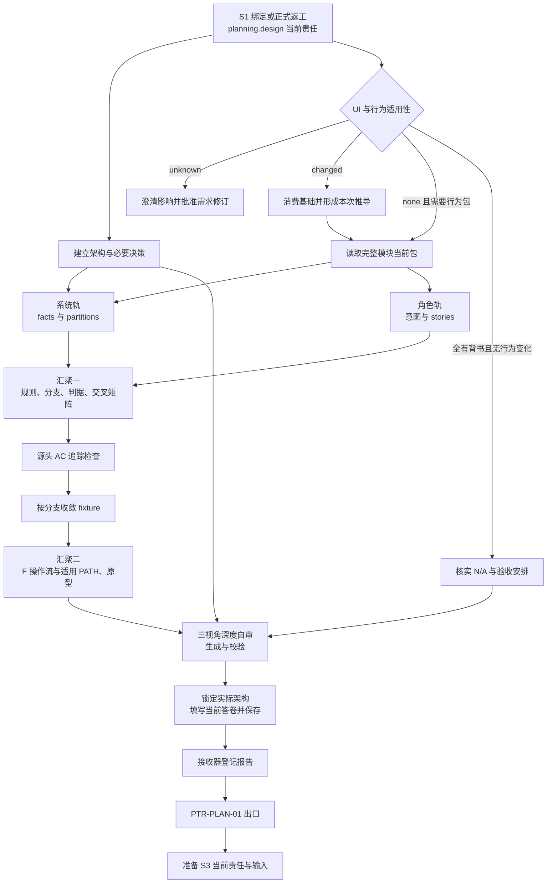

# L3-S2 设计

S2 将已经绑定的需求，推导为各执行者共同遵循的系统设计与行为判据。它要让架构、业务规则、角色目标、数据、状态、操作路径和验证预期形成一个可以解释、可以检查、可以继续翻译的整体，再交给 S3 编写契约。

本阶段承接 [S0 的需求共识](L3-S0-requirement-design.md)和 [S1 的执行绑定](L3-S1-bind.md)，遵循 [L1 设计原则](../l1-principles/L1-design-principles.md)与 [L2 生命周期](../l2-lifecycle/L2-lifecycle-plan.md)。实际操作入口见 [S2 使用指引](../../docs/control/agent-protocol.md#s2)。本文先解释设计如何形成，再说明答卷、Hook、Runtime 和下游交接怎样承载它。

## 1. 为什么需求之后还需要系统设计

### 1.1 从共同目标走到共同解释

REQ 已经说明为什么做、面向谁、做什么、明确不做什么，以及怎样判定成功。但同一份需求仍可能被实现者解释成多套系统。例如“运营导出本组织当月订单”，可以被理解为同步下载、后台任务、预生成文件，也可能涉及时间口径、权限检查时机、数据一致性和失败重试等不同安排。

如果这些问题留到各端分别实现，前端可能等待一个下载地址，后端却只返回任务编号；测试可能只检查文件存在，忽略跨组织泄露；重试可能重复生成数据，或者取到与最初查询不同的订单。每个人都能给出局部合理的实现，组合之后却无法满足同一目标。

S2 要消除的是这种共同解释的缺口。设计必须回答五组问题：

1. **系统怎样分工：** 哪些模块承担什么责任，哪些外部系统参与，数据与控制怎样跨越边界。
2. **行为怎样成立：** 什么事实、权限与状态允许一个动作，什么情形应拒绝，结果和恢复分别是什么。
3. **选择为什么成立：** 采用了什么方案，排除了什么备选，代价、风险与后果由谁承担。
4. **角色怎样完成目标：** 人、API 调用方或后台工作者从什么入口出发，经过什么操作，到达什么可识别的终点。
5. **后续凭什么判断正确：** 验收如何到达规则、分支和稳定 CASE，判据是否足以区分正确实现与错误实现。

因此，S2 同时建立**系统事实**与**验证分母**。前者让契约和实现者能够组合工作，后者让验证者知道必须验证什么，避免每个阶段重新选择对自己有利的一组用例。

### 1.2 本阶段的责任边界

| 问题 | 主要归属 | S2 的处理方式 |
| --- | --- | --- |
| 价值、范围、业务承诺和验收语义 | S0 及人的需求决定 | 以绑定 REQ 为依据；发现缺口提出修订，不悄悄扩大或降低承诺 |
| 模块边界、状态、规则、数据含义与技术取舍 | S2 | 形成共同设计，记录理由及真实后果 |
| 界面与服务的完整目标行为 | S2 | 形成模块当前场景、故事、操作流和适用原型 |
| 各端接口、共享数据约束及协作时序 | S3 | 从 S2 翻译并细化，不能改写上游含义 |
| 可执行任务、依赖和并行安排 | S4 | 消费设计与契约，拆出有明确完成条件的工作 |
| 设计是否忠实、完整并足以执行 | 作者在 S2 自审，S5 独立审查 | 自审负责收敛；独立背书保留为不同责任 |
| 生产实现及其实际运行结果 | S6、S7 及后续阶段 | S2 提供目标与判据，不能以设计生成结果冒充执行通过 |

共享模型和协作协议可以按受影响的业务切片共同收敛。S2 要解释领域含义、状态和约束，但不要求在任何契约工作开始前完成整个项目的全部数据模型。详细边界见 [L4 共享模型与契约治理](../l4-mechanisms/L4-shared-model-contract-governance.md)。

### 1.3 阶段完成需要三种不同事实

| 事实 | 含义 | 依据 |
| --- | --- | --- |
| 专业工作完成 | 设计已回答当前需求需要的问题，适用场景完整，必要决定已解决 | 实际材料、自审和真实方向决定 |
| 设计报告已接收 | 接收器已登记当前责任的专业结论 | 当前答卷与接收回执 |
| 阶段交接已完成 | 规划出口成功，S3 可以取得它的当前责任与准确输入 | PTR-PLAN-01 结果及 S3 准备结果 |

三者需要衔接，但不能相互冒充。保存一个 `pass` 不会证明设计质量；报告已接收也可能仍被出口条件挡在 S2；S2 已完成但 S3 准备失败时，应保留前面的事实，处理后面的准确缺口。

## 2. 输入、参与者与产物的具体形态

### 2.1 从当前责任进入

正常入口是 `planning.design`。它可以来自 S1 首次绑定，也可以来自需求修订或正式规格返工。系统在真实责任入口准备当前资料视图与答卷，给出准确路径、绑定需求、模板和适用材料入口。主会话从这些当前事实继续，不从上一轮聊天或自行猜出的代际目录开始。

| 输入 | 要读出什么 | 使用边界 |
| --- | --- | --- |
| 当前绑定 REQ | §A 的意图，§B 的方向，§C 的功能要求 FR、非功能要求 NFR、验收标准 AC，§D/§E 的收敛与锁定；顶部 UI impact | 需求是语义基线，不能在设计材料里私自改写 |
| 当前架构、代码及集成事实 | 现存模块、状态、数据、调用链、技术约束、已经存在的失败方式 | 现状用于调查和迁移设计；生产实现不能反向决定正确判据 |
| 受影响模块的完整当前包 | 既有规则、故事、CASE、操作流和适用原型 | 先理解全集，再合并本次变化；保留仍成立的行为 |
| 项目规则与基础 | 安全、接口、状态机、可访问性及适用设计基础 | 按风险与真实引用展开，不能把所有背景一次塞入任务 |
| 当前责任与工作区坐标 | 当前阶段、需求代际、责任入口、权威根与开发分支 | 定位真实工作，不要求作者维护内部提交序号或重建发行历史 |

若 REQ 的意图、约束和验收互相冲突，先指出冲突和影响，再走需求修订。不能把“设计阶段会解决”当作继续猜测业务承诺的理由。UI impact 的未决也不能由设计者默认成 `none`。

### 2.2 谁负责什么

| 参与者 | 责任 |
| --- | --- |
| 主会话 Main | 调查、组织设计、协调两条设计轨、整合产物、自审、处理真实决定并完成当前答卷 |
| 人类负责人 | 决定不可从既有依据推导的产品方向、风险接受、需求变化和必要例外 |
| 专业协助者 | 围绕具体问题提供调查、反例或专业意见；由 Main 整合回同一设计 |
| 场景工具与结构检查器 | 校验引用、结构、生成物及可判定覆盖义务，反馈具体源文件和缺项 |
| Hook 与接收服务 | 在正常保存处定位当前答卷、接收专业报告、继续阶段出口，提供准确反馈 |
| Runtime Writer 与迁移引擎 | 保存接收和状态事实，维护事务、幂等及恢复一致性 |
| S3、S4、S5 及后续执行者 | 分别翻译契约、拆任务、独立审查和验证实际实现 |

双轨是设计思考的组织方式，不是两个默认并行的子代理任务。系统词汇和角色目标会互相挑战，Main 必须掌握两边上下文。确有独立调查价值时，使用 Claude Code 原生子代理并给出具体问题；不增加团队激活、启动证明或另一个执行调度层，见 [L4 子代理工程衔接](../l4-mechanisms/L4-agent-dispatch-governance.md)。

### 2.3 产物之间怎样关联

| 产物 | 位置或形态 | 表达什么 | 主要消费者 |
| --- | --- | --- | --- |
| 架构 | `docs/architecture/ARCHITECTURE-*.md` | 系统全景、边界、数据与状态、技术约束和恢复安排 | S3、S5、实现与维护者 |
| 必要决策记录 ADR | `docs/design/decisions/ADR-*.md` | 背景、选择、备选、风险、后果及后续动作 | 契约作者、审查者、维护者 |
| 模块场景源 | `scenario-model.json`、`cross-matrix.json`、`fixture-contract.json` | 事实、规则、行为分支、预期结果及可复现前置 | 生成器、契约作者、验证者 |
| 故事与操作流 | 模块 `stories.md`、`flows.md` | 角色为什么行动，以及从入口到终点怎样操作 | 体验设计、契约、实现及验证 |
| 生成结果 | 模块 `cases.json`、`scenario-coverage.json` | 当前稳定 CASE 集与设计覆盖统计 | S3～S7，作者只改源再生成 |
| 界面资产 | 模块 `index.html`、适用页面及辅助资产 | 目标交互、可见状态和可走查页面 | 前端契约、实现和浏览器验证 |
| 本次设计推导 | `docs/design/derivation/REQ-{id}.md`，仅适用 UI 工作 | 本次如何消费项目基础，采用什么构图、约束和例外 | 原型作者、实现者、审查者 |
| 设计答卷与接收事实 | 系统给出的当前路径及接收回执 | 专业完成声明与阶段出口进展 | 接收器、Main、恢复流程 |

模块场景包的固定容器是 `docs/design/prototypes/<module>/`，即使它只包含服务行为，也不另建一份服务目录。模块名采用稳定的小写连字符名称。模块包表达当前完整目标，跨 REQ 演进；REQ 只作为 `source_refs` 和追踪依据，不拥有一份私有 CASE、故事或动线副本。

```text
docs/architecture/ARCHITECTURE-017.md
docs/design/
├── decisions/ADR-017.md                 # 有真实取舍时记录
├── derivation/REQ-017.md                # UI 工作适用时消费基础
└── prototypes/order-export/
    ├── scenario-model.json             # 手写：事实、规则、分支和判据
    ├── cross-matrix.json               # 手写：交叉检查与理由
    ├── fixture-contract.json           # 手写：合成前置与清理
    ├── stories.md                      # 手写：角色和目标
    ├── flows.md                        # 手写：操作及适用 PATH
    ├── cases.json                      # 生成：当前 CASE 集
    ├── scenario-coverage.json          # 生成：设计覆盖统计
    ├── index.html                      # 有 UI 时的模块入口
    └── export.html                     # 有 UI 时的适用页面，可多页
```

这是产物位置示意；是否存在独立 ADR、Derivation 和页面由实际设计决定，不能为凑齐这棵目录树虚构工作。

Git 保存目标的历史，轮次报告保存一次执行的观察与证据。不能把 `v1/v2`、REQ 或 round 拼进模块包、永久测试定义的路径来保存平行真相。具体结构由[模块场景规则](../../docs/rules/scenario-model.md)定义。

## 3. 先建立足以约束协作的架构与决策

### 3.1 架构恒做，内容由问题驱动

UI impact 为 `none`，仍需要架构。很小的服务变化可以有较小的架构增量，但必须解释它进入既有系统后怎样成立。架构描述预期系统和技术取舍，并明确与现状的差异，不能只复述脚手架有哪些目录。

[架构模板](../../docs/architecture/ARCHITECTURE-template.md)的十二节用于逐层逼问设计，不是十二个标题的填写比赛：

| 设计部分 | 必须弄清的问题 |
| --- | --- |
| 目标与系统上下文 | 哪些需求约束驱动设计；参与者和外部系统有哪些；信任边界在哪里 |
| 容器与模块职责 | 进程或部署单元如何组合；模块输入、输出、职责和排除范围是什么 |
| 数据流 | 数据从何而来、经过哪些加工、存在哪里、怎样保护和清理 |
| 状态机 | 合法状态、触发条件、拒绝转换、并发及恢复怎样成立 |
| 数据模型 | 核心对象和字段的业务含义、标识、约束及权威来源是什么 |
| 接口边界 | 哪些操作需要契约，谁提供、谁消费、哪些协作问题交 S3 细化 |
| 安全 | 认证、授权、组织隔离、敏感数据和审计怎样约束行为 |
| 性能 | 需求指标如何落实到容量、时延、资源限制及验证方式 |
| 部署和回滚 | 怎样上线、迁移、观察与恢复；数据兼容和不可逆动作怎样处理 |
| 锁定记录 | 当前设计何时形成可交接基线，相关决定和仍须落实的动作是什么 |

独立状态机或数据模型文档只在确有表达和消费需要时创建。采用时使用真实文件链接，不适用时说明理由；不因为模板出现过 `model.md` 就制造一个空文件。S3 尚未编写的契约可以作为计划边界说明，不能伪装成已经存在的依赖。

订单导出的架构推导，至少要把正式调用入口、身份与组织来源、授权边界、订单选择、输出及清理串起来。查询过程中订单可能变化时，“指定月份的全部目标订单”按什么一致性口径成立，也要解释。采用同步方案就说明资源上限与失败结果；采用异步方案就说明任务状态、文件访问和失效。设计依据决定是否需要队列或存储组件，不能先把组件画进图，再倒推业务必须使用它们。

### 3.2 取舍需要留下可解释的因果链

ADR 是架构决策记录。值得记录的决定应有真实备选和长期后果，例如同步与异步、事务边界、数据迁移、权限检查位置或外部依赖失败策略。局部命名和可逆实现细节通常不需要各写一份 ADR。

一个有效 ADR 应把“约束或风险 → 候选方案 → 选择依据 → 影响与后续动作”连起来。例如订单导出若考虑异步生成，需要解释它解决的容量问题，也要说明任务权限、文件有效期、失败清理与重试成本。若绑定需求尚未给出足以支持这项选择的交付时限或数据规模，先调查；涉及产品承诺的缺项交人决定，不能用技术偏好代替依据。

[ADR 模板](../../docs/design/decisions/ADR-template.md)使用 `proposed / accepted / rejected / deprecated`。`accepted` 表达当前确实采用的方向；`proposed` 表达尚未解决的取舍。状态和“决策人”字段不能自行证明人已同意。

### 3.3 人在什么地方参与

普通可推导的技术细节由 Main 连续处理。遇到价值冲突、不可逆风险、超出已授权范围的方案或无法由已有依据决定的方向时，主会话给出推荐、备选、后果和需要人决定的问题。架构方向与角色目标冲突时，应在同一决策包中解决，不能让一边无声压倒另一边。

方法中的 ADR 方向签核，把必要方向决定、深度自审及验收 N/A 清单组织为一处可审阅材料；不是每份 ADR、每页原型各开一次审批。既有真实决定可以直接承接，不重复索取确认。REQ 语义发生变化时，走[需求修订](L3-S1-bind.md)，而非仅把 ADR 改为 `accepted`。

当前 PTR-PLAN-01 不是 ADR 真人签核的专门边界，系统不自动证明上述讨论发生过。专业作者和 S5 审查必须核实其实际依据，不能从 Runtime 已前进倒推真实决定已经成立。

### 3.4 数据模型与契约如何接续

S2 先解释“对象意味着什么、规则约束什么、状态何时改变”；S3 再把这些事实与共享数据定义、操作时序、错误语义和各端职责收敛为可执行契约。同一数据定义应有一个原生权威来源，领域、传输和存储投影是不同责任，不要求各建一个文件，更不应为每个 REQ 复制一套模型。

已经在 S2 形成且实际引用的模型，应明确其消费者和当前状态。尚需在 S3 按业务切片细化的部分，应说明边界与未决点；不能一边宣称设计已解决，一边让契约作者猜业务含义。支持格式和校验能力以[共享模型规则](../../docs/rules/shared-model-contracts.md)为准，不能将现有本地 JSON Schema 能力描述成任意 OpenAPI 或 Proto 都已自动验证。

## 4. 按真实影响选择设计路径

### 4.1 UI 适用性与行为适用性分开判断

| 当前情况 | 需要完成的设计 | 可以省略什么 |
| --- | --- | --- |
| `UI impact=unknown` | 调查影响，形成推荐，按批准的需求修订解决已绑定字段 | 不能猜测出口条件；可继续与该未知无关的调查 |
| `changed` | 架构、适用 ADR、设计基础推导、模块行为包、故事/操作流及真实 UI 资产 | 不相关的模块和不适用的背景资料 |
| `none`，但 AC 指向 FR 或服务行为发生变化 | 架构、适用 ADR、七文件服务行为包 | 页面 HTML、`index.html`、浏览器 PATH 与浏览器 spec |
| `none`，全部 AC 有真实 NFR/§A4 背书，且模块行为无变化 | 架构、必要决策、验收追踪与适用性核实 | 模块场景包的生产工作；仍需检查 AC 追踪 |

七文件服务包由五份手写源 `scenario-model.json`、`fixture-contract.json`、`cross-matrix.json`、`stories.md`、`flows.md`，以及两份生成物 `cases.json`、`scenario-coverage.json` 组成。故事中的角色可以是 API 调用方或工作者；操作流使用 F-NNN，服务分支设为 `browser_required:false`。

只要 AC 指向 FR，非浏览器执行也必须保留 CASE。`none`、`browser_required:false` 和“后台功能”都不是 N/A。若现有服务行为确实要变化，却找不到本次需求中的 FR 来源，应先解决需求缺口；不能借 NFR 或技术整理的名义绕过业务承诺。

UI 包在七文件行为核心上增加模块入口及适用页面、状态和辅助资产，文件数由真实界面决定。不能用“交齐九个文件”替代完整设计。混合模块逐分支判断浏览器适用性，无 UI 的新改动也不能成为删除模块既有 UI 目标和回归义务的理由。

### 4.2 UI 工作怎样承接项目设计基础

S0 已判断设计投入，并记录适用基础的引用。S2 消费这些决定，将其推导为本次界面的具体组织；不会重新从组件库默认色或上一页的局部样式发明产品语言。

| 基础情况 | S2 的处理 |
| --- | --- |
| `local`，仍符合单次、单模块、无共享与换手的适用条件 | 使用 `Foundation: local` 的本次推导；局部结果保持模块内，不发布全局 DESIGN |
| `core / extended`，已有覆盖本产品面的真实已发布基础 | 核实版本和确认，读取换手材料，再写本次推导 |
| 缺失、未发布、确认未完成、已失效或不覆盖新产品面 | 停止批量铺页面，回到基础机制解决方向或覆盖范围 |
| 实际无 UI 工作 | 不启动基础建设或本次 UI 推导；已有基础只按真实背景需要读取 |

基础的 `published` 必须有真实确认，不能把 `PENDING` 当锁定。相关机制见 [L4 项目级设计基础](../l4-mechanisms/L4-project-design-foundation.md)，具体规则见[设计基础规则](../../docs/rules/design-foundation.md)。

后续 UI 需求优先读取一个有边界的换手包：`DESIGN.md` §0 的下一代理说明卡、当前 `SUR-*` 产品面差异和本次 Derivation，总预算为 120 行、12 KB。只有这些材料不能回答实际约束时，才展开所需设计语言条款。预算用于迫使交接清晰，不授权丢掉必要约束或在信息不足时继续猜。

### 4.3 将基础变成本次可执行推导

[Derivation 模板](../../docs/design/derivation/DERIVATION-template.md)承载一份按引用组织的消费清单，而非复制基础全文：

- 当前采用哪个基础、产品面和姿态，哪些 `LAW / ANTI / INV` 实际生效，必要时打开哪些 `GR-*` 规则。
- 哪些行为或表现不能发生，以来源 ID 说明依据。
- 信息角色、模式和组件绑定到哪些实际路径，支撑它们的 `PROOF-*` 是否能定位。
- 本次采用什么宏观构图，以及高密度、拒绝、空态或长内容等压力状态怎样成立。
- 采用继承、扩展还是例外；扩展说明提升候选，例外关联有范围和期限的 `EX-*`。

先做一份宏观构图与一个压力态，确认基础真的能支撑该需求，再扩展剩余页面。已发布基础要求语义 token 时，界面消费对应 token，不把局部 hex 或库的 Primary 提升成品牌。局部组件需要全局化时进入真实复用评估，不能顺手成为项目规则。

引用 ID、版本、Proof 路径或价值方向无法解释时，修复的是语义与依据。Foundation 不替代架构轨，也不是当前 PTR-PLAN-01 已接入的美学门；不能以门没挡住为由跳过这项设计责任。

## 5. 用双轨、两次汇聚组织专业工作

### 5.1 五项工作和依赖关系

| 工作 | 要解决的问题 | 形成的结果 |
| --- | --- | --- |
| T1 架构与决策 | 系统怎样实现需求，哪些风险需要取舍 | 架构草案、必要 ADR、系统词汇和边界 |
| T2 适用性与基础 | 哪些模块、行为和界面要变，受哪些基础约束 | 真实工作范围、继承或例外、本次推导 |
| T3 两条设计轨 | 系统能描述什么，角色为什么行动 | facts/partitions 与初始 stories |
| T4 两次汇聚 | 事实与目标怎样成为可验证行为，再成为可操作路径 | 规则、分支、判据、交叉矩阵、fixture、操作流和适用原型 |
| T5 自审与交接 | 设计是否可实现、可判定、可维护，怎样交给契约阶段 | 校验结果、锁定架构、当前答卷及阶段出口结果 |



图展示主要依赖，实际设计可以交错和回看。需求语义问题返回修订；规则和角色目标冲突返回架构或决定；判据无法取证返回行为设计。不能把这些回路压成“写完一个文件就永不再看”的流水线。

### 5.2 系统轨：从架构落到可枚举事实

系统轨将架构词汇转为影响行为的事实及分区。订单导出可以涉及调用角色、所属组织、目标订单月份、导出权限和文件状态。每个事实必须有稳定 ID；分区表达能引起不同判断的类别，使用可复现的合成值。

事实分区不是把生产数据库搬进 JSON，也不是穷举每个具体订单。应从规则需要区分的状态反推最小可解释划分，例如“有权限 / 无权限”“本组织 / 他组织”“目标月份 / 其他月份”。边界需要具体日期和时区时，在架构与数据准备中明确，不使用运行当日的随机时间作为隐含条件。

### 5.3 角色轨：先写目标，再找行为

故事从 REQ §A 的理念和真实角色出发，回答谁在什么情境下，希望得到什么结果，以及失败和恢复意味着什么。它不只是把现有 API 名称换成一句“作为用户，我要调用接口”。

同一个订单导出故事，可以是运营在月结时取得可逐项对账的订单明细；服务包则可以将运营使用的正式命令或受权调用方作为行动入口，不需要虚构页面。授权失败故事也应表达安全结果及可行恢复，而不是只有“返回 403”。

先在 `stories.md` 建立真实 S-NNN，再让分支引用。初始故事可以先写目标和背景，汇聚后补齐分支、CASE、操作流映射，避免要求故事与分支彼此先存在的循环。当前识别要求 `S-001`、`F-001` 这样的三位数字 ID；保持语义稳定，不用新需求重新编号既有故事。

两条轨道可以由同一会话自由交错，但故事不能被架构方便性裁掉，架构约束也不能被故事无记录地绕过。真正冲突进入 ADR；触及需求承诺则交人修订。

## 6. 汇聚一：把目标和事实变成行为与判据

### 6.1 先说明整条追踪链

沿用 S0 的 `REQ-017` 订单导出示例：FR-001 允许有权运营导出本组织指定月份的订单；FR-002 拒绝无权限或越组织请求；AC-001、AC-002 分别验收它们；NFR-001 和 AC-003 约束订单记录不被导出修改。

```text
REQ §A 意图 ───────────────→ S-NNN 故事
REQ §C AC → FR → Rule → required branch / CASE
                       ↑          ↓
架构 → facts / partitions → witness + oracle
                                  ↓
                       F-NNN 操作流
                         ├─ 服务正式入口 → 后续服务 CASE 执行
                         └─ 浏览器适用 → PATH → 原型 → 后续 spec / 执行
```

这不是要求把同一段需求抄进多份文件。不同产物分别解释意图、规则、预期结果和操作过程，引用将它们连接。只有给每个节点一个实际消费者，这条链才有价值。

| 示例分支 | 来源与事实 | 需要判定的结果 | 后续消费 |
| --- | --- | --- | --- |
| 本组织当月导出成功 | FR-001；有权、本组织；数据含目标月与非目标月订单 | 内容完整且只含指定范围；字段和值可核对；订单不变 | CASE-EXPORT-ALLOW、S-001、F-001 |
| 无导出权限 | FR-002；无权身份 | 拒绝；不泄露明细、不生成可下载数据；说明安全恢复 | CASE-EXPORT-DENY、相应故事及操作流 |
| 请求越组织范围 | FR-002；请求含其他组织 | 拒绝且无文件或副作用；不能以过滤后成功掩盖需求规定的拒绝 | 独立 CASE，避免与不同拒绝语义合并 |

示例中的稳定标识说明关联方式，不预先替项目决定同步或异步方案。真实设计必须给出实际状态、接口边界和可观察结果。

### 6.2 规则、分支、见证与结果判据各管什么

`scenario-model.json` 的顶层为 `module`、`coverage_profile`、`facts`、`rules`。规则包含 `id`、`source_refs`、`risk`、`branches`；风险属于规则，不能随意放到分支或添加未定义字段。

| 对象 | 表达的含义 |
| --- | --- |
| Rule | 基于真实来源，哪些条件决定允许、拒绝或其他业务结果 |
| branch | 一个必须区分的行为结果，带稳定分支 ID、CASE ID、极性及 required 义务 |
| witness | 令该分支成立的事实分区组合；键引用 fact，值引用该 fact 的 partition |
| oracle | 独立于实现的预期结果判据，说明怎样识别正确和错误 |
| fixture | 让 witness 能被实际构造的合成前置事实契约 |
| story_refs / flow_refs | 该结果服务什么目标，以及怎样操作到达它 |
| browser_required | 是否需要浏览器 PATH 与后续浏览器 spec，不能改变 CASE 是否需要验证 |

分支与 oracle 同时写。若作者还不能说明预期终态、持久化和禁止副作用，分支就尚未设计完整；不能等测试者看到实现后再补一个“当前输出就是预期”。

下面是服务包内一个拒绝分支的结构示意，所属规则引用 `REQ-017/FR-002`，相关 fact、fixture、故事和操作流须在同一模块中真实存在：

```json
{
  "id": "BR-EXPORT-DENY",
  "case_id": "CASE-EXPORT-DENY",
  "title": "无权限调用被拒绝且不生成导出数据",
  "polarity": "negative",
  "required": true,
  "witness": {"FACT-EXPORT-PERMISSION": "NO-PERMISSION"},
  "oracle": {
    "visible": ["正式调用入口返回明确的权限拒绝，不含订单明细"],
    "terminal_state": "export-not-created",
    "persisted_effects": [],
    "forbidden_side_effects": ["创建可下载文件", "修改订单记录"],
    "rejection": "export-permission-required",
    "expected_state": "export-not-created",
    "recovery": "由有权身份重新发起，原拒绝不产生隐式重试"
  },
  "fixture_id": "FIX-EXPORT-NO-PERMISSION",
  "story_refs": ["S-002"],
  "flow_refs": ["F-002"],
  "browser_required": false
}
```

这一片段不是完整场景文件。严格结构、字段、规范化和引用以[场景模型模板](../../docs/design/prototypes/scenario-model-template.json)及场景规则为准。

### 6.3 判据必须能识别错误实现

所有 oracle 都有四个公共维度；负向分支再补三个维度：

| 维度 | 作者需要回答 |
| --- | --- |
| `visible` | 调用方或用户实际看到什么；服务响应、命令输出也可以是可见结果 |
| `terminal_state` | 业务最后处于什么状态，如何辨认 |
| `persisted_effects` | 哪些事实被持久保存；真实没有时保留字段并写 `[]` |
| `forbidden_side_effects` | 哪些事情绝不能发生，例如泄露、重复创建、错误状态变化 |
| `rejection` | 负向动作为什么被拒绝，拒绝是否符合真实业务规则 |
| `expected_state` | 拒绝后应保持或进入什么状态 |
| `recovery` | 怎样安全恢复，是否允许改正、重试或转交 |

HTTP 200、出现 toast、URL 变化或“没有异常”都不足以证明订单导出正确。需要核对实际内容、组织和月份边界、订单不变及拒绝副作用。哪些证据可取、怎样避免测试修改被测事实，也应在本阶段想清楚。

负向行为确实没有恢复路径时，可写 `recovery: "N/A"`，同时给出 `recovery_reason` 与 `recovery_source_refs`；来源必须属于该规则的 `source_refs`。这只解释恢复维度，不免除拒绝分支或 CASE。

### 6.4 交叉矩阵用来找沉默的设计区域

`cross-matrix.json` 承载 facts × FR × stories 的交叉检查。每个有意义的格指出覆盖它的 branch，或解释为什么不形成分支。目标是发现“这个事实会影响那个目标，但设计里没有人回答”的空白，不要求穷举所有笛卡尔积。

例如同一个权限事实、FR-002 与 S-002，可以分别由“无权限拒绝”和“越组织拒绝”覆盖。相同 fact、req_ref、story 可以关联多个真实 branch；不能为满足唯一键而篡改故事或业务事实。每格使用 `branch` 或 `no_branch_reason` 之一，未使用的字段省略，不填 `null`。

机器可以检查事实、故事和分支确实存在，规则确实引用该格的需求来源，以及每个 fact、每个故事和每个 required branch 至少被检查一次。机器不能证明作者选的组合足够深入。无分支理由要说明因果；当前检查要求至少八个字符且含字母类别字符，中文文字可满足，单写“不需要”不是理由。

模块跨需求演进时保留真实来源和完整模块目标；当前 REQ 的格连接当前 FR 表，历史格保持自己的来源，本次 AC 桥单独检查当前义务，详见 §12.2。不能将旧规则伪造为本 REQ 新增，或把 required 设成 false 隐藏义务。

### 6.5 AC 到 CASE 的桥与三类 N/A

汇聚一之后尽早运行 `scenario bridge`。源头检查不依赖生成物，可以先找出当前 REQ 的 AC 是否指向有效 FR，以及模块规则是否实际引用 `REQ-<id>/FR-<id>`。最终还要通过完整分支及生成物检查，不能把早期源头可达当作 CASE 已经完整。

一个 AC 可以指向多个 FR；每一个都要可达。并列出现 NFR 或 §A4 不会免除其中 FR 的行为义务。以当前 §C 的有效表格为准，代码围栏里的示例和历史片段不能混入验收分母。

| N/A 所在位置 | 它解释什么 | 不能替代什么 |
| --- | --- | --- |
| AC 的指向 | 该验收通过已声明 NFR 或 §A4 的明确负空间处理，不进入功能 CASE 桥 | 不能由自由文本、UI none 或无浏览器替代；NFR 仍要有实际验证方式 |
| 交叉矩阵的 `no_branch_reason` | 某个事实×需求×故事格为什么不产生独立分支 | 不能覆盖已经声明的 required branch，也不免除 AC |
| 负向 oracle 的 recovery N/A | 某个拒绝结果为什么不存在恢复路径 | 不取消该负向 CASE，也不免除其余结果维度 |

例如 AC-003 指向 NFR-001，表示桥的 N/A 有具体来源，并非“不用验证订单是否改变”。它可以通过实际 CASE 的禁止副作用断言和适用验证任务落实。若 §A4 明确排除跨组织导出，也不等于越组织请求可以不验证；FR-002 要求拒绝，就仍有功能分支。

N/A 清单放入同一方向审阅包，说明真实依据。桥能检查部分结构和声明引用，不能自动判断 NFR 分配合理，也不能证明 §A4 指针对应的实际负空间足以背书。

## 7. 汇聚二：从行为走到可复现操作和可见目标

### 7.1 Fixture 在分支明确之后收敛

过早从一批顺手的数据出发，容易让数据决定能设计哪些测试。先明确分支与 witness，再写 fixture，才知道哪些权限、组织、月份、状态和外部响应必须被构造。

[Fixture 模板](../../docs/design/prototypes/fixture-contract-template.json)只声明合成前置事实：稳定 ID、persona、`synthetic:true`、setup 和 cleanup。可以准备身份权限、草稿、参考数据、固定时钟、受控依赖响应及隔离命名空间；setup 和 cleanup 应可重复执行并清理，不依赖生产快照、个人数据或共享可变账号。

Fixture 必须停在被测动作开始之前。不能替浏览器点击、填写、保存、提交、审批、取消或重试，也不能预先写出“已经导出成功”的结果。UI CASE 应从真实用户入口操作；服务 CASE 可以从声明的正式服务或命令入口调用，但不能手改持久化结果来跳过规则执行。

### 7.2 故事、操作流和路径不是三份重复叙事

故事说明目标和理由，F-NNN 操作流说明完成目标的动作顺序，浏览器 PATH 进一步给出可独立复跑的用户路径。它们共同引用同一规则和 CASE，分别解决不同问题。

| 路径类型 | `flows.md` 应写出什么 | 后续如何执行 |
| --- | --- | --- |
| 服务行为 | 调用者、正式入口、前置、请求、校验、响应、持久化与恢复顺序；F-NNN 及 CASE 引用 | 按契约和 TASK 指定的非浏览器入口取证 |
| 浏览器行为 | F-NNN 下的独立 PATH、用户目标、入口、前置、操作步骤、可见结果和终点 | 从声明入口走查，再在实现后通过对应浏览器 spec 执行 |

每条 PATH 都能独立复跑。成功、权限拒绝、校验失败、取消、重试或恢复，如果需要不同操作或终点，就给出各自完整路径；不能藏在成功路径末尾的一句“异常类似”。共享前置可以引用，真正的登录和导航职责不能被数据准备偷偷跳过。

每个步骤有稳定步骤 ID、一个清楚的用户动作、目标控件或标签、输入和立即可见结果。订单导出的浏览器变体，应说明从哪里进入、怎样选月份、触发后看见什么、怎样确认实际结果；只有业务入口本来就是深链时才允许声明直跳 URL。

模块交互覆盖表将原型中每个实际可操作控件映射到 PATH 步骤或有依据的 N/A。纯展示元素不必制造点击任务。故事和动线的完整表达分别参考[故事模板](../../docs/design/prototypes/USER-STORY-template.md)与[动线模板](../../docs/design/prototypes/USER-FLOW-template.md)；服务路径采用其中适用的角色、目标、前置与结果，不虚构 UI 小节来凑齐模板。

### 7.3 原型描述即将实现的目标

HTML 原型让用户、契约作者和实现者能够共同检查目标形态。已有运行代码用于理解基线，不额外要求捕获一份 UI-BASELINE；原型表达本次设计后的当前目标，不能退化为现有页面截图或组件目录。

界面包提供模块 `index.html` 和适用页面、对话框、向导或组件状态。每页解释目标、设计推导、关键决定、布局组织、FR 覆盖、接口用途、边缘状态和未决问题；真实界面状态包括加载、空、错误、权限、长内容、破坏性动作及恢复。具体结构见 [UI 原型规则](../../docs/rules/ui-prototype.md)与 [UI 原型方法](../../skills/ui-prototyping/SKILL.md)。

HTML 的当前信息头使用设计代数、更新日期、适用路由和模块入口链接，不能混入 Runtime 需求代际、round、lock 或 owner。页面设计代数是目标展示信息，不是 Writer revision。REQ 追踪进入场景、故事和操作流的来源映射，契约内容保留在契约自身。

故事结果必须能在适用原型中检查，PATH 的控件和状态必须真在页面出现。页面上的关键 API 或操作名称为 S3 提供边界，但此时不假定完整契约已经写好。影响权限、字段含义、用户理解和恢复的未决问题必须先解决，不能贴一个 OPEN 后交给 Builder 猜。

### 7.4 为后续实现和验证留下准确入口

浏览器永久定义位于 `web/e2e/<module>/**/*.spec.ts`，服务测试使用项目实际入口。S2 需要设计 CASE、路径和预期验证方式，实际测试实现属于后续适用 TASK；不能要求尚未进入实现阶段就交出完整生产测试代码。

模块变化后的验证计划覆盖该模块完整当前操作流和 required CASE；浏览器适用者还覆盖 required PATH。不能只执行本 REQ 新增路径而忽略既有行为。S2 规划这项回归义务，S4 将其变成可执行工作，S6 实现必要测试，S7 保存真正的轮次执行证据。

## 8. 收口前怎样判断设计已足够深入

### 8.1 用三个视角攻击自己的设计

| 视角 | 要找的缺口 | 应怎样收敛 |
| --- | --- | --- |
| 实现者 | 哪个 oracle 无法实现，或正确与错误实现会得到同样判定 | 补清结果、状态、数据和边界；需要真实取舍时回到 ADR |
| 验证者 | 哪个负向 CASE 无法在七个结果维度上取证，fixture 是否真的能复现 | 补可观察点、入口、数据隔离和恢复，不改期望迎合当前实现 |
| 维护者 | 哪条规则会与模块既有语义、稳定 ID 或后续演进冲突 | 合并完整当前目标，解释变化和兼容影响 |

结论写在 ADR 包的 `Depth Self-Review` 一处，讲清实际攻击、发现和处理；无须写成三份报告。`Endorsed N/A` 保留实际验收适用性。相关方向确实未决时继续设计或等待必要决定，不填写 `pass`。

自审应反问：另一个只读当前材料的实现者，会不会仍然猜“组织从哪来”“重试能不能重复”“拒绝后是否保留文件”；另一个验证者能否构造一个足以识别越权或漏单的反例。只写“已检查，无问题”不能替代这些推导。

### 8.2 机械校验承担明确、有限的工作

有行为包时，S2 的校验顺序是早期源头桥、分支与路径收敛、生成、校验；模块完成后再确认当前 REQ 的追踪结果。目标项目使用系统安装的 harness：

```bash
.claude/bin/loop-harness scenario bridge --root .
.claude/bin/loop-harness scenario generate --module <module> --root .
.claude/bin/loop-harness scenario validate --module <module> --root .
```

对每个适用模块执行生成与校验。没有行为包但 AC 都有受控 N/A 时，省略包命令，仍核实源头桥。普通 S2 校验不附加要求完整浏览器 spec 的选项，以免将实现阶段的义务提前变成额外材料门。

| 工具结果 | 可以证明什么 | 不能证明什么 |
| --- | --- | --- |
| 源头 bridge | 当前 AC 声明和 FR 规则来源的可达性，以及部分 N/A 引用有效性 | 不证明分支结果忠实、实际执行通过或 N/A 的业务合理性 |
| generate | 源包可解析、引用及必要结构满足，确定性地产出 CASE 和覆盖结果 | 不运行生产动作，也不从生产服务计算期望 |
| validate | 当前源、引用及生成物保持一致，满足实际 required 覆盖结构 | 不自动证明组合枚举完整或用户体验合理 |
| S3 接收与 PTR-PLAN-02 的完整桥要求 | 当前答卷路径在 S3 接收时检查 AC→FR→分支及模块源包，PTR 消费已接收事实；未启用答卷的兼容路径在 guard 中检查 | 不能代替 S2 专业设计，也不能将已暴露的 S2 缺口改称 S3 作者失职 |

`cases.json` 和 `scenario-coverage.json` 不手改。输入变化后重新生成；不能修改计数、删除失败 CASE 或用当前生产输出来刷新 oracle。

### 8.3 覆盖统计与正反比怎样使用

每个 required allow/reject 分支都必须有相应正向或负向 CASE，设计覆盖义务均为 100%。不同角色、拒绝原因、终态、权限结果或恢复语义不能合并成一个含糊 CASE。若某规则确无拒绝语义，应有可追溯说明，不能靠遗漏表达 N/A。

`coverage_profile` 的 `ordinary / rule-dense / critical` 分别以正反比 1:1、1:2、1:3 作为风险审视参考。它们提醒作者检查拒绝与边界，不是生成、校验或接收配额。不能为数量制造无意义分支，也不能因比例参考而删掉真实行为；生成输出中的兼容字段名称不改变这项语义。

生成覆盖的 100% 表示设计已经构造相应 CASE。它没有执行这些 CASE，因此不能写成测试通过率，更不能据此授权实现或发布。执行覆盖由 S7 以稳定 CASE ID 和实际轮次证据承担。

## 9. 当前答卷、正常保存与规划出口

### 9.1 两个字段是设计交接声明

系统在当前责任入口给出准确资料视图和答卷，不要求作者手动 issue。Main 完成专业工作后，填写当前答卷既有 `answer` 对象中的两个字段：

```json
{
  "answer": {
    "architecture_path": "docs/architecture/ARCHITECTURE-017.md",
    "conclusion": "pass"
  }
}
```

示例只展示专业部分，实际应编辑系统给出的当前文件，不自行创建同形文件替代当前责任。其余设计材料通过真实设计关系引用，不能因答卷只有两个字段就认为场景、ADR、数据或原型均可省略。

`conclusion` 为空或 `null` 表示未完成草稿。当前非空选项只有 `pass`，表达作者对实际工作完成的自审结论；不存在供作者自造的 `blocked`、`fail` 阶段枚举。未决问题继续在实际材料和反馈中处理，不能用 `pass` 表达“先登记一下”。

### 9.2 保存之后发生什么

| 环节 | 系统动作 | 作者应理解的边界 |
| --- | --- | --- |
| 定位当前答卷 | 按已登记路径定位责任，解析专业字段，核对当前阶段与责任入口 | 当前责任仍需真实存在；不会因为随便放一个 JSON 就被接收 |
| 检查草稿缺项 | 判断结论、架构路径和实际文件可读性，反馈具体缺项 | 缺项不登记通过报告，继续补实际材料和当前答卷 |
| 接收报告 | Runtime Writer 保存本次专业结论及系统生成的对应证据 | 作者不手填 evidence ID、subject hash 或信封 |
| 阶段出口求值 | Controller 继续 PTR-PLAN-01，检查设计门和 UI impact 已解决等条件 | 接收、迁移和独立质量判断各自有边界 |
| 登记与交接 | 迁移动作登记相关锁定架构，进入 `planning.contracts` 并准备 S3 | 不手拨 cursor；准确呈现 S2 完成与 S3 准备是否成功 |

当前 S2 专业接收读取权威根磁盘中的实际架构。文件可读的检查和后续门的 `locked` 判断属于不同环节；报告可能已经记录，但架构未锁定或 UI unknown 仍使出口停留。相关架构的正式状态应按模板完成为 `locked`，不能把接收成功当作自动锁定。

`architecture_path` 指向本次专业报告的实际架构，不代表登记批次只有这一份。系统沿 PTR-PLAN-01 的同一文件选择规则，在当前责任指引中列出实际架构批次及未锁定项，包括兼容规则纳入的无明确需求归属文档。选择规则、缺项反馈和登记动作不得各自维护一套成员定义；作者不手工复制这份批次。已废弃方案按真实文档归属与生命周期处理，不能为了通过出口把未采用方案伪标为 locked。

正常接收不以作者标签 Main/Architect、整份资料或草稿逐字相等、开发来源哈希、完整发行历史重证作为额外资格。机器仍维护当前责任关联、输入结构、事务和重复接收的一致性；移除重复证明没有移除真实工作或状态约束。

### 9.3 重复保存和恢复保持同一个事实

同一专业内容已经接收但阶段出口尚未完成时，正常保存接续已登记的待续动作（follow-up），不重复登记报告或另造一个证据编号。当前出口已完成的旧卷重放只读已有结果，不再次推进下一阶段。

已接收后修改专业结论或架构路径，会与原接收内容冲突；它不是新一次设计。真实规格返工应由正式返工路径重新建立当前责任。不能通过改 packet、重写哈希或增加 attempt 来绕过既有事实。

设计答卷的共用规则见 [L4 阶段答卷](../l4-mechanisms/L4-stage-form.md)，事务和来源语义见 [L4 状态机与迁移事务](../l4-mechanisms/L4-state-transition-core.md)。普通工具前事件与主会话 Stop 读取当前事实，不能在每次读取时重建一轮问卷或重新认证历史。

## 10. S3 如何消费设计，以及变化怎样返回

### 10.1 交出可使用的真实来源

进入契约阶段需要可确定的正式设计输入。S3 准备从所选开发分支的已提交 Git 视图读取，并核对权威 checkout 中对应材料。S2 的磁盘接收不会替作者提交、切分支或推送；专业材料须在交给该来源消费者前按项目约定进入正确开发分支。

| S3 输入类别 | 当前来源规则 |
| --- | --- |
| REQ | 当前绑定的已锁定基线，内容须与绑定来源一致 |
| 已登记设计 | 当前 REQ、当前代际的真实架构，取 S3 准备时实际已提交且与磁盘一致的内容 |
| 模块包 | 与原桥一致，枚举 `docs/design/prototypes/` 下全部非模板模块目录及其文件集合，不只看本次受影响模块；这是正式来源范围，不扩大本次专业改动范围 |
| ADR | 与当前 REQ 关联且已 accepted 的实际决策；proposed 表示方向未决，阻止其被当成定案输入 |
| 条件依赖 | 上游真实本地 Markdown 链接及受支持结构化引用指向的设计、模型、状态等，继续解析必要依赖 |

目录成员变化也是来源变化，不能在发行之后增加或删除模块来悄然改分母。被否决或废弃的 ADR 不作为普通采用方向自动加入；真实显式引用仍要解释它的语境。

安装协议、技能与答卷须完整表达此范围，具体责任提供实际架构与模块路径入口；不能把全项目模块消费描述成仅跟随当前需求的显式引用。全局消费不意味着重新设计全部模块，也不授权修改或删除无关历史材料来缩小输入。

来源完整性由真实成员、路径约束、引用可达性、Git/磁盘一致性及冻结事实保证，不由 128 个文件、32 个目录或每目录 256 个成员等任意计数上限定义。合法来源集合增长应由系统完整处理，不能要求作者拆需求、删模块或缩小引用来绕过全局扫描。必要的格式、路径和读取安全校验仍保留；真实技术故障说明具体来源和原恢复入口，不制造新的专业完成门。

真实链接声明依赖；裸路径、行内代码和围栏中的模板示例不凭空增加文件义务。未采用独立模型时，不会因为模板提到 `model.md` 就要求创建；已经使用真实链接却找不到文件时，则应修复材料或错误声明，不能把它一律解释为系统准备故障。

### 10.2 区分历史登记与当前冻结

S2 的历史登记保留当时设计事实，不把 S3 发行前每一处解释性字节永久冻结。S3 准备使用当前已提交且一致的设计构建实际来源闭包；内容的真实语义仍须符合已成立决定，不能借此任意改需求或架构方向。

一旦 S3 当前责任已发行，其 REQ、设计和条件来源成为明确冻结输入。之后修改它们，应走真实返工或需求修订；不能刷新 SHA 来伪造“仍是同一份已审材料”。S3 自己要新建的 CONTRACTS、模型和示例属于输出，不应倒置为尚未开始 S3 的输入前提。

已接受的来源闭包继续由 S3、S4 交给 S5 审查，并用于后续适用保护。不能从“S2 初始只登记架构”推出“其他模块材料后续完全不受基线约束”，也不能把所有可编辑原型自动等同于当前已锁定资产。具体保护取决于真实已接受闭包和冻结集合。

### 10.3 发现问题时回到正确责任

| 发现或失败 | 回到哪里 | 如何继续 |
| --- | --- | --- |
| 需求目标、范围、UI impact 或验收语义需要改变 | 人的需求修订 | 明确推荐、影响和决定，再由现有机制建立新基线及 S2 责任 |
| 规则漏项、oracle 含糊、故事与架构冲突 | S2 专业设计 | 修实际设计与追踪关系，重做受影响自审和生成 |
| 仅契约条款、协作时序或结构不完整 | S3，必要时反馈 S2 | 不擅自修改已冻结上游来让契约通过 |
| S3 完整桥暴露 FR 无分支或 CASE 的缺口 | S2 设计责任 | 补设计分母，不用自由文本 N/A 隐藏问题 |
| S5 独立审查发现设计不可执行或违背需求 | 规格返工路径 | 根据发现修复 S2/S3/S4，重新执行受影响独立审查 |
| 实现或验证阶段出现规格歧义 | 正式规格纠正，必要时需求修订 | 保留发现和影响，不能由执行者局部改判据 |
| S2 已完成但 S3 路径准备或系统衔接失败 | Main 与系统维护，先区分真实材料缺口 | 保留接收和迁移事实，继续既有准备出口，不让作者补造资格证明 |

同一材料读失败时，要先说明读的是磁盘、已提交 Git 树还是已冻结来源，以及缺失的准确路径。不同来源问题不能统一用“重填答卷”处理。

## 11. 机制怎样支撑工作，以及怎样观察收敛

### 11.1 机制用在真实责任点

| 责任点 | 使用的机制 | 作用 |
| --- | --- | --- |
| 首次进入、需求修订或正式返工 | 当前责任准备、阶段答卷 | 一次给出专业职责、准确材料入口和可编辑答卷 |
| 组织专业设计 | 模板、按需技能、模块当前目标 | 用具体问题引导深度，统一来源和消费者 |
| 行为收敛 | bridge、generate、validate | 找断链和结构缺口，派生稳定 CASE，不替代业务判断 |
| 正常答卷保存 | 工具后写入观察与提交服务 | 识别当前答卷，接收专业内容并继续阶段出口 |
| 阶段出口与下一责任 | Controller、迁移引擎、Writer 和 S3 来源解析 | 保持持久事实一致，登记、迁移、交接并区分失败位置 |
| 普通工具前与主会话 Stop | 当前阶段只读投影 | 提示当前责任、准确缺项和待续动作，不反复发行或推进 |
| 确有专业子代理协作 | Claude Code 原生派发及 SubagentStart/SubagentStop | 承接具体调查输入与返回；不改变 Main 的设计整合责任 |

Hook 不推导业务规则、不批准架构方向、不替作者决定业务判据，也不在普通工具事件里维护子代理激活状态。事件选点见 [L4 Hook 事件目录](../l4-mechanisms/L4-hook-anchor-catalog.md)，接线边界见 [L4 Hook 接线](../l4-mechanisms/L4-hook-platform-wiring.md)。

### 11.2 埋点应能回答实际问题

| 需要观察的问题 | 应关联的事实 | 能支持什么判断 |
| --- | --- | --- |
| 现在究竟在设计哪一份需求 | 当前 runtime、generation、阶段和责任入口，实际资料/答卷路径 | 避免旧责任或其他需求材料混入 |
| 设计还缺哪些可判定项 | bridge 的不可达 AC/FR、schema/ref 错误、required branch、实际未决点 | 知道下一步应修哪条设计，而非只看到 not_ready |
| 本次保存是否已登记 | 答卷接收状态、专业内容关联、对应证据、待续动作 | 区分草稿、已接收、出口待续和已完成 |
| 为什么没有进入 S3 | 设计门缺项、UI guard、迁移结果和下一责任准备结果 | 定位是设计未完成、状态条件还是衔接失败 |
| 当前冻结的来源是什么 | S3 实际文件引用、来源指纹和目录成员 | 解释漂移和返工范围，不让作者维护另一份哈希清单 |
| 设计是否在收敛 | 未决取舍、不可达 AC、含糊 oracle、重复失败及返工范围的变化 | 判断是在消除问题，还是重复填写和重试 |

这些事实应从已有记录与工具结果读取，结合已有材料解释，不另加一份手写统计报告。报告已接收时不重复登记；有具体失败才诊断具体环节，不能把检查和恢复命令串成每次保存的仪式。

当前阶段、接收、迁移和来源关联可以从 Runtime、回执与工具输出读回；业务未决点和 oracle 的含糊之处仍来自专业材料及审查。不能把表中的观察目标写成系统已经自动量化全部设计质量。

## 12. 实现边界、退出判据与阅读入口

### 12.1 设计要求与当前机械保证分开

| 事项 | 当前可依赖的能力 | 仍需专业判断或后续背书 |
| --- | --- | --- |
| 专业答卷 | 定位当前责任、识别草稿、读取实际架构、专业接收、幂等和出口恢复 | `pass` 是否忠实于实际设计工作 |
| S2 设计门 | 当前设计证据、locked REQ/架构及 UI impact 已解决等推进条件 | 不直接执行完整场景、UI、Foundation 和 ADR 语义审查 |
| 架构登记 | PTR-PLAN-01 登记当前需求对应的锁定架构 | 可能涉及同需求多份架构，不能只凭答卷一个路径推断全部登记必然成功 |
| 场景引擎 | 支持服务七文件包、严格引用、必要分支覆盖、生成一致性和风险比例参考 | 业务组合完整性、结果判据忠实性、fixture 可取证性 |
| AC 桥 | 解析当前有效表，逐项检查 FR 及声明 NFR 等引用 | §A4 指针实质依据、N/A 合理性和 NFR 实际验证不能靠桥自动背书 |
| 下游来源 | S3 冻结实际上游及条件闭包，继续交下游审查 | 文件指纹一致不证明设计语义正确，也不代替独立审查 |

完整设计要求先于两字段接收门存在。不能用门的检查范围定义专业工作的上限；也不能把尚未接线的检查描述成每次保存已经自动完成。

### 12.2 模块完整性、需求作用域与指引边界

**跨需求模块来源。** 模块包保存跨 REQ 的完整当前行为，交叉矩阵保留每格的真实 `req_ref`。所有当前事实、故事和必需分支仍在同一集合中接受覆盖检查；分支格必须指向实际分支，且该分支所属规则真实引用同一需求来源。迭代中的新目标加入原模块，保留仍然有效的旧行为与 CASE 身份，不为绑定新的需求重写历史来源、复制模块或降低 `required` 义务。

本次需求追踪与完整回归集合承担不同责任。矩阵中属于当前 REQ 的引用与其真实 FR 表连接；其他 REQ 的来源保持原身份，不拿当前表判断历史 FR 是否存在。纯历史模块无需为了当前仅有非功能要求的需求补造 FR。当前 AC 桥则只使用准确的本次 `REQ/FR` 来源寻找规则与 CASE；其他 REQ 的同号 FR 不代替本次义务。模块集合可以完整，本次需求仍可能没有闭合，两者必须分别判断。

`REQ-<id>/FR-<id>` 保留精确追踪；REQ 级矩阵格也可连接规则中该 REQ 的 FR 级来源，不能匹配名字相近的其他需求。当前格所用规则引用的本次 FR 仍须在本次表中声明，不能用 REQ 级写法藏起虚构 FR。对历史需求的语义、无分支理由的合理性和业务组合完整性，仍需专业阅读与独立审查；矩阵结构通过不为其自动背书。S3 的本批契约覆盖应进一步按本次义务收口，不能用其他需求的契约代替本批交付。

**适用资产与后续测试实现。** 故事、动线模板提供 UI 和服务路径的表达，场景方法明确五份手写源与两份生成输出。服务分支保留 CASE、故事和操作流；HTML 与 PATH 只用于实际浏览器行为，正反数量比只作风险参考。S2 阅读既有适用 spec 并设计后续验证义务，新测试代码由后续 TASK 实现；不能把 `--require-specs` 变成普通 S2 收口前置。场景生成器维护 CASE、覆盖计数及摘要，作者不另交指纹清单；当前 Main 答卷保存不会自动运行完整生成和校验。

这些边界决定文档和实现各自能保证什么，不改变设计目标。不能把局部测试通过写成全机制已一致，也不能将夹具或旧测试的假设直接提升为新的业务规则。

### 12.3 什么时候可以交给 S3

退出前，主会话应能对以下问题给出实际依据：

1. 需求意图与设计是否一致，UI impact 是否明确，必要的人类方向判断是否真实完成。
2. 架构是否足以让 S3 不再猜模块、数据含义、状态、权限、失败恢复和集成边界；当前实际架构是否锁定。
3. 适用模块是否形成完整当前包，既有行为是否保留，服务/UI 路径和基础推导是否按真实情况处理。
4. 每个 FR-targeted AC 是否到达真实规则、分支与稳定 CASE，其余 AC 是否有具体 NFR/§A4 背书及实际验证安排。
5. oracle、fixture、故事、操作流和适用原型是否相互一致，required allow/reject 义务是否完整，生成物是否由源正确派生。
6. 深度自审是否消除了可识别缺口，未决问题是否走了正确路由，而不是藏在 OPEN 或一个过早的 `pass` 中。
7. 当前答卷是否由接收器登记，PTR-PLAN-01 是否真正完成，S3 是否拿到准确责任和可消费的正式来源。

上述分别覆盖专业完成、机器登记和阶段交接。当前机械条件不足以独立证明全部专业要求；后续 S5 仍必须审查，S7 仍必须实际执行验证。

### 12.4 实现与使用入口

S2 的入口、专业方法、具体答卷、Hook 交付与恢复反馈按 [Agent 指引的分层与交付](../l4-mechanisms/L4-agent-guidance.md) 分工。变更 S2 交接时，先更新所属权威，再同步技能、模板和运行时投影；接收、PTR-PLAN-01 与 S3 准备分别反馈，不能以一条“已完成”覆盖其中的缺口。

| 想进一步理解什么 | 阅读入口 |
| --- | --- |
| 全阶段专业操作与双轨方法 | [S2 协议](../../docs/control/agent-protocol.md#s2)、[规格规划方法](../../skills/specification-planning/SKILL.md) |
| 场景和模块包的权威形态 | [场景规则](../../docs/rules/scenario-model.md)、[模块包说明](../../docs/design/prototypes/README.md)、[场景设计方法](../../skills/scenario-model-design/SKILL.md) |
| 设计职责、资料和两个专业字段 | [S2 答卷模板](../../internal/schema/assets/stage-form-s2-template.json)、[设计资料构建](../../internal/workpacket/planning.go) |
| 当前责任、正常接收与旧卷重放 | [阶段答卷入口](../../internal/cli/stage_answer.go)、[设计接收服务](../../internal/submission/design.go)、[设计责任校验](../../internal/runtime/planning_authority.go) |
| 规划门与登记动作 | [质量门求值](../../internal/qualitygate/evaluator.go)、[迁移动作](../../internal/transition/actions.go)、[可执行生命周期](../../docs/control/loop-definition.json) |
| 下游如何选真实来源并冻结 | [S3 来源闭包](../../internal/runtime/contract_sources.go)、[S3 输入责任](../../internal/runtime/contract_authority.go) |
| 场景结构与验收追踪实际检查 | [场景引擎](../../internal/scenario)、[AC 桥](../../internal/scenario/bridge.go)、[交叉矩阵检查](../../internal/scenario/cross_matrix.go) |

阅读按当前问题逐层展开：先需求和架构，再完整受影响模块，然后相关决策和规则。契约作者沿引用消费，独立审查者向上核对需求依据，验证者从 CASE 与正式操作入口取得执行分母。无需让每个执行者每次递归读完整仓库，也不能以节约上下文为由只交一份无法解释设计的字段摘要。

本阶段把 L1 的权威外置落实为真实设计和接收事实，把产物引导思考落实为双轨、判据与交叉检查，把自然路径观测落实为正常保存与阶段出口，把独立背书落实为保留 S5、S7 责任。其完成标准是下一位执行者能够理解并继续这份设计，而非标题齐全或答卷显示已接收。
