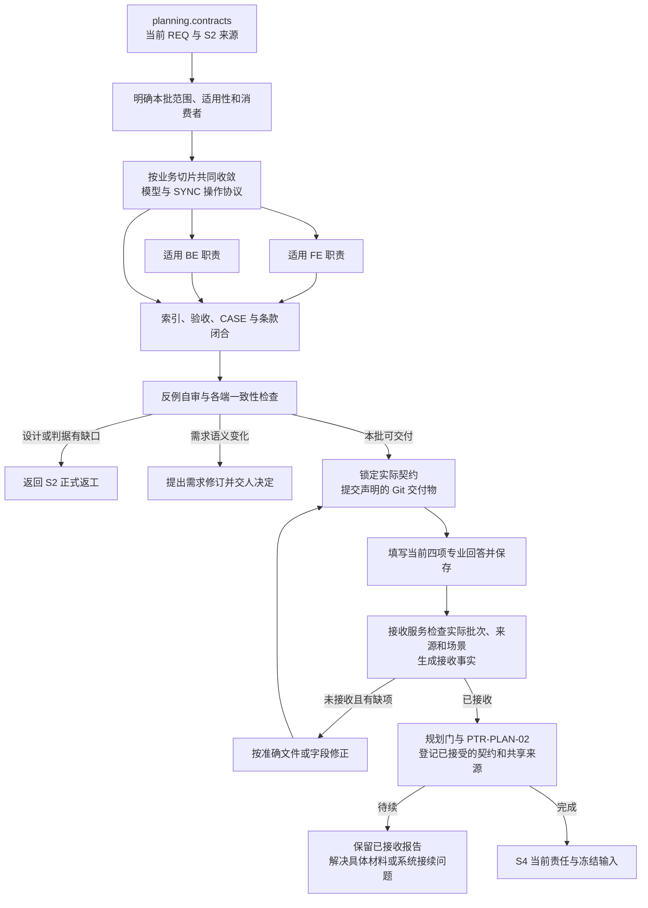

# L3-S3 契约

S3 将需求与系统设计转为执行者共同遵守的承诺：共同数据来自哪里，一个操作允许怎样发生，各端承担什么责任，失败后怎样恢复，以及这些承诺如何兑现验收。它使后续任务能够分开执行，又能组合为同一个系统。

本阶段承接 [S2 设计](L3-S2-design.md)，向 S4 交付契约和条款依据，向 S5 交付可独立审查的完整规格链。整体原则与阶段分工见 [L1](../l1-principles/L1-design-principles.md)、[L2](../l2-lifecycle/L2-lifecycle-plan.md)；实际操作入口见 [S3 使用指引](../../docs/control/agent-protocol.md#s3)。

## 1. 为什么系统设计还需要契约

### 1.1 设计共识需要成为可分别履行的承诺

S2 说明系统边界、业务规则、状态和正确结果，但多个执行者仍不能分别从整套设计里推导各自的接口。前端可能把空值理解为“尚未加载”，后端却用它表达“没有权限”；调用方可能认为重试安全，提供方却每次创建一条新记录；测试可能只检查响应结构，遗漏拒绝后的持久化副作用。

这些分歧往往不会在单端自测中暴露。各端都能根据自己的解释完成工作，却在集成时无法组合。S3 要在分工之前，把容易被各自解释的地方变成共同承诺，避免将规格发现推迟到实现和联调。

本阶段需要回答五组问题：

1. **共同对象是什么：** 字段含义、类型、必填与可空、单位、枚举和约束是否来自同一来源。
2. **共同操作是什么：** 谁在什么前提下发起，提供方何时完成，状态、副作用和可观察结果是什么。
3. **各端分别承诺什么：** 消费方怎样构造输入和处理结果，提供方怎样校验与执行，哪些事情明确不负责。
4. **异常怎样协同处理：** 权限、并发、超时、重试、取消、限流与兼容变化是否有一致解释。
5. **承诺怎样被兑现和验证：** 哪条需求、哪个 CASE 由哪个契约条款承担，后续任务和验证从哪里进入。

契约因此既是分工边界，也是集成依据。它应提供足以执行和判定的承诺，而不是把架构说明换一个标题，或仅列出若干接口路径。

### 1.2 各类事实由谁拥有

| 事实 | 权威归属 | 下游可以做什么 |
| --- | --- | --- |
| 价值、范围、业务承诺和验收 | 已绑定 REQ | 引用并细化；改变语义须走需求修订 |
| 领域含义、业务规则、状态和结果判据 | S2 设计与模块当前包 | 翻译成共同操作和分端职责；发现缺口回设计层 |
| 共同数据定义 | 项目现有原生模型或 Schema | 引用、生成或校验；不在各端另抄一份结构 |
| 操作、时序、错误与恢复 | SYNC 联调契约 | 各端据此履行协作责任 |
| 前端与后端各自承诺 | FE、BE 分端契约 | 细化为本端实现与验证工作 |
| 本次执行目标、路径和完成条件 | S4 的 TASK | 在契约边界内安排工作，不反向改写规格 |
| 实际通过与缺陷 | 实现、自测、独立验证及相应证据 | 如实报告观察，不用运行现状重写判据 |

这里的 SYNC 指跨端共同操作协议，并不要求系统采用同步调用。异步事件、后台任务或其他边界是否适用，应由实际设计确定。FE、BE 是现有契约类型的前端、后端职责分类，不代表本阶段已经创建了同名子代理。

### 1.3 采用的推导方式

按受影响的业务切片，共同收敛数据模型与 SYNC 协议，再从这份共同基线派生各端职责。字段与操作会互相约束：例如取消操作需要区分“已取消”和“不可取消”，模型就要表达相应结果；模型中的状态集合又约束协议能够承诺什么。

这两项工作可以来回推敲，不要求先完成整个项目所有模型。共同基线足够明确后，FE 与 BE 的专业内容可以分别展开；发现无法对齐的地方，回共同事实处理。不能先让各端独立发明对象和错误模型，最后再靠对账拼接。

## 2. 从当前责任取得输入与组织产物

### 2.1 当前入口与输入

正常入口是 `planning.contracts`。系统在成功的阶段交接或正式返工入口准备本次资料视图和答卷，提供准确路径、冻结输入、可确定的产物路径或候选、对应模板及下一动作。

| 输入 | 需要理解什么 | 使用边界 |
| --- | --- | --- |
| 已绑定 REQ | 功能要求 FR、非功能要求 NFR、验收标准 AC，以及范围和负空间 | 不从其他 REQ 借一个相同 FR 编号替代当前语义 |
| S2 架构与必要 ADR | 模块职责、领域含义、状态、数据、安全、性能和已成立取舍 | 决策缺失回设计层，不能在契约中悄悄改方向 |
| 模块场景包 | 规则、CASE、判据、故事、操作流、fixture 及适用原型 | 延续完整验证分母，不另建契约私有用例集合 |
| 既有边界与消费者 | 当前接口、模型、调用方、生成器、错误约定和兼容承诺 | 调查真实消费者，不能只根据字段名称判断兼容性 |
| 项目规则 | 命名、API、安全、错误、状态机和共享模型规则 | 按实际风险展开，不要求每次通读全部规则 |
| 当前来源与工作区 | 权威根、绑定开发分支、已发行输入及当前答卷 | 区分冻结上游、可编辑交付物和磁盘运行记录 |

当前发行的来源闭包由系统解析并记录。作者理解其中与本次操作有关的内容，不复制哈希、Runtime 身份或内部 revision。缺准确路径或入口准备失败时，应呈现系统交接问题，不能要求作者猜目录、制作信封或手动发行。

### 2.2 参与者与责任

| 参与者 | 本阶段责任 |
| --- | --- |
| 主会话 Main | 明确适用性和本批范围，设计共同协议与各端承诺，维护追溯，完成专业自审与答卷 |
| 人类负责人 | 决定真实需求变化，以及超出既有授权的价值、风险和方向取舍 |
| 专业协助者 | 调查具体消费者、兼容风险或提出反例，由 Main 整合回同一规格 |
| 契约与模型检查器 | 核对结构、引用、样例、批次集合及实际来源，反馈准确缺项 |
| Hook、接收服务与 Runtime Writer | 在正常保存处接收当前报告，生成机器关联，维护事务与阶段接续 |
| S4、S5、S6、S7 | 分别拆任务、独立审查、实现共同承诺、验证实际结果 |

S3 是 Main 的专业规划责任，不需要先创建 Assignment 或一个 Contract Planner 子代理。确有独立调查价值时，可使用 Claude Code 原生子代理交付具体问题，不能为契约编写恢复读回、批准、激活的通用执行层。相关分工见 [L4 子代理工程衔接](../l4-mechanisms/L4-agent-dispatch-governance.md)。

### 2.3 正式交付长什么样

```text
docs/dev/contracts/
├── CONTRACTS-017.md                  # 当前 REQ 的总览和条款入口
├── BE-017.md                         # 适用的后端责任
├── SYNC-017.md                       # 适用的共同操作协议
└── FE-017.md                         # 仅在前端交付适用时存在

docs/architecture/data-model/
├── order-export.request.schema.json  # 复用或本次形成的权威定义
├── order-export.request.valid.json   # 合法结构样例
└── order-export.request.invalid.json # 可选结构负例
```

这是位置示意，不要求项目照此新建模型目录或交齐三类契约。已有原生定义应继续作为权威来源；辅助模型入口、额外状态文档和样例数量均由真实设计决定。

| 产物 | 表达什么 | 主要消费者 |
| --- | --- | --- |
| CONTRACTS 索引 | 本批契约、联调点、适用设计输入、需求覆盖和条款宇宙 | Main、S4、S5 及集成者 |
| FE 契约 | 用户可见行为、输入依赖、本端状态和错误恢复承诺 | 前端实现、测试及独立审查 |
| BE 契约 | 校验、权限、状态转换、持久化和禁止副作用 | 后端实现、测试及独立审查 |
| SYNC 契约 | 操作、共同数据引用、时序、错误、幂等和恢复对照 | 消费方、提供方、Mock 与集成验证 |
| 共同模型与样例 | 唯一结构定义及可执行的结构约束实例 | 生成器、边界验证器、各端与检查器 |
| 当前答卷 | 本批专业结论、实际路径和适用性判断 | 接收服务与规划出口 |
| 接收与来源记录 | 系统已接收什么，以及登记和交接进展 | 后续阶段与失败恢复 |

专业内容保存在实际文档，接收记录由系统生成。不能以答卷 `pass` 替代文档，也不要求作者另写一份机器证据报告。

## 3. 先界定本批契约与适用性

### 3.1 一份答卷对应一个当前需求批次

本次答卷对应当前绑定 REQ 的一个 CONTRACTS 索引及其完整适用契约集。项目可以保留其他需求的索引和契约，但它们不因此成为本答卷的交付物，也不能作为省略本批承诺的理由。

契约 ID 在目录中明确且不冲突。文件、索引和答卷应指向同一实际集合，不能在索引中承诺一个 BE，却在答卷中列另一份同名意义的文档。每份实际交付声明状态和版本；状态由草稿、审阅中收敛到 `locked`，具体登记依据由 Runtime 维护。状态与专业版本表达承诺成熟度和兼容性选择，继续由作者维护；登记时间、摘要及内部关联由原消费者生成，不另填锁定日期或机器版本。

这与模块场景包的归属不同：模块包跨 REQ 维护完整当前目标；CONTRACTS 索引组织当前 REQ 的协作承诺；共同模型仍是项目共享来源。不能因为契约批次按需求组织，就再复制一套按需求命名的数据模型。

引用可读性与本批履职也须分开。当前契约可以引用模块中仍然有效的历史 CASE 或已有合同条款，但其他需求的合同正文不能替本批补齐反向覆盖。原接收器直接把已核对的索引与契约路径交给同一检查器；不再把目录里所有合同混成一批。当前规则按准确 REQ 来源确定本次 CASE 义务，模块本身仍保留完整集合。

未限定的 `FR-001` 指本批需求的条目；显式 `REQ-002/FR-001` 指另一个明确来源，不能只因其他需求也出现同号 FR 就判为存在。当前需求使用原绑定文件路径，历史需求按实际来源身份读取；同名前缀不是身份，来源缺失或有多个同身份文件时应报告 Main 处理，不能让作者制造别名或副本。FR 表读取沿用场景机制对当前有效章节与围栏示例的区分；这些结构检查仍不替代对条目含义与映射正确性的审查。

### 3.2 FE、BE、SYNC 分别判断

| 分类 | 判断依据 | 不适用时怎样表达 |
| --- | --- | --- |
| FE | 是否存在本次需要交付或改变的前端行为责任 | 明确无本次前端交付，不能由 UI none 推导其他类型也不适用 |
| BE | 是否存在服务、业务处理、状态或持久化等提供方责任 | 给出当前范围中的真实依据 |
| SYNC | 是否需要明确调用方与提供方共同遵守的操作边界 | 说明没有独立协作协议变化；不能仅因没有网页而省略 |

例如订单导出沿用既有命令入口且无界面变化：如果 S2 已确定它通过服务 API 完成，就仍需描述共同请求、拒绝与结果，SYNC 可以适用；如果只是同一局部实现内部的处理，则未必需要独立 SYNC。适用性来自设计中的实际边界，不能由机器根据一个风险标签替作者决定。

当前答卷对每类使用 `required` 或 `not_applicable`，并附具体理由。`required` 对应真实完整交付，不能拿一个空模板占位；`not_applicable` 不要求创建文件或编造锁定状态、版本。三家都不适用却没有实际契约时，当前接收形态不支持空交付，见 §13.3；不能为流转虚构 BE。

### 3.3 索引组织边界，正文承担语义

[总览模板](../../docs/dev/contracts/CONTRACTS-template.md)组织以下关系：

| 索引部分 | 用途 |
| --- | --- |
| 合同清单 | 实际分端契约的 ID、职责、状态、版本及关联联调点 |
| 联调点矩阵 | 哪个共同协议连接哪些真实消费方和提供方 |
| UI 设计包输入 | 同时承载适用服务行为包，说明模块、契约影响及验证入口 |
| 需求覆盖矩阵 | 把需求、CASE 与各端条款连接，形成 S4 使用的条款宇宙 |
| Shared model baseline | 声明共同数据策略、操作/数据位置、权威来源、消费者与样例 |
| 变更记录 | 解释实际规格变化及影响，不维护第二份 Runtime 指纹账本 |

当前库存解析读取“合同清单”的实际表头、分隔行和连续数据行，表结束后停止。后续适用性表不能被误当成更多契约；类型列的展示文字也不构成一套新增枚举门。已声明不适用的展示行不会要求虚构实际文件，但正文引用仍应清楚，避免读者把展示误解为已交付承诺。

索引与正文各有职责。索引不复制每个字段和错误的详细定义，正文也不另造一份互不一致的契约库存。

## 4. 按共同基线组织工作过程

| 工作 | 要解决的问题 | 阶段结果 |
| --- | --- | --- |
| 确定边界和条款框架 | 当前需求涉及哪些操作、端和真实消费者 | 适用契约集、来源关系和初步稳定条款 |
| 收敛模型与 SYNC | 同一个操作的数据、状态、失败和恢复怎样共同成立 | 共同定义与协议，必要取舍有依据 |
| 派生各端责任 | 每一端需要做什么才能履行共同承诺 | 适用 FE、BE 的可执行条款 |
| 闭合验收与条款 | 需求和场景有没有在翻译中丢失 | 当前覆盖矩阵、CASE 消费关系及明确 N/A |
| 自审和交接 | 整批是否一致、可执行，来源能否被下游消费 | 锁定交付、当前答卷、接收与 S4 交接结果 |



图中的顺序表达依赖，不要求所有文件一次写定。发现不同端不能共同满足某条设计时，回到共同基线调查；不是在 FE 中先作一个假设，再让 BE 被动接受。按切片推进也不允许遗漏全批最终收口。

## 5. 共同模型：让各端使用同一个对象

### 5.1 一份定义承担数据约束

共同模型需要说清字段的业务含义、标识、单位、时间口径、必填与可空、枚举、默认值和边界。S2 拥有这些对象的领域含义，S3 将适用部分落实为可被共同引用的结构约束，不能在模型里改变已成立的业务承诺。

复用项目已有原生来源。领域对象、传输对象、存储和展示投影是不同责任，只有存在真实转换时才记录映射，不强制制造三份 Schema。同名不同义的字段也不能仅为减少文件数强行合并。

FE、BE、SYNC 和 Mock 引用同一权威定义。契约可以解释本端如何使用它，但不复制一套字段表成为第二来源。实际消费者使用生成器还是运行时校验器，应在项目适用实现和任务中落实；一个 Markdown 链接不能证明代码已经消费共同定义。

### 5.2 当前模型策略的可执行形态

现有自动适配器由[共享模型规则](../../docs/rules/shared-model-contracts.md)定义。索引声明 `Shared model policy: json-schema-v1`，在二级标题 `Shared model baseline` 下使用固定六列：

| 字段 | 作者应表达什么 |
| --- | --- |
| `Operation` | 具体操作名称，与真实协议中的操作对应 |
| `Slot` | 该操作的数据位置，例如 request 或 response-200 |
| `Schema` | 一处权威定义的相对 Markdown 链接，可带实际 JSON Pointer 或原生锚点 |
| `Consumers` | 消费该定义的实际 FE/BE/SYNC 文件链接 |
| `Valid example` | 一个应当通过该定义校验的合法 JSON 实例文件 |
| `Structural negative` | 可选的应被结构拒绝的实例文件；不提供时为 N/A |

从 `docs/dev/contracts/` 中引用来源的形态可以是：

```markdown
## Shared model baseline

| Operation | Slot | Schema | Consumers | Valid example | Structural negative |
| --- | --- | --- | --- | --- | --- |
| exportMonthlyOrders | request | [请求定义](../../architecture/data-model/order-export.request.schema.json) | [后端](BE-017.md) [协议](SYNC-017.md) | [合法请求](../../architecture/data-model/order-export.request.valid.json) | [结构负例](../../architecture/data-model/order-export.request.invalid.json) |
```

每个列出的消费者在自己的二级标题 `Shared model inputs` 下引用同一 Schema 及相同片段。路径相对于当前 Markdown 文件解析，不能把仓库根相对字符串当成从该文件可解析的链接。辅助入口用于导航，不需要为了模板占位额外创建 MODEL 文档。

同一需求范围内，一个 Operation/Slot 只有一个权威来源。重复引用同一来源可以成立，两个不同文件不能同时宣称拥有同一位置。Schema 资源标识也应与真实来源一致；数据实例中普通的 `$id` 字段不是另一份 Schema 的证据。

### 5.3 结构负例与业务负例必须分清

假定 S2 已确定订单导出操作接收月份，且实际 Schema 将 `month` 约束为月份字符串。合法实例可以是：

```json
{"month": "2026-09"}
```

结构负例可以是：

```json
{"month": 17}
```

二者都是合法 JSON；后者因类型不符合定义而失败。损坏 JSON 的语法错误不能充当结构负例。

无权限身份发送第一份请求，结构仍然合法，却应被业务授权拒绝。越组织、非法业务状态和并发冲突也可能使用合法结构数据。这类反例进入 S2 CASE 与 SYNC 契约测试断言，不能塞进 Structural negative 后期待 Schema 识别调用者权限。

正样例必须实际通过校验，提供的结构负例必须实际不通过。样例本身不获得“代表所有正确业务输入”的地位，也不能反向成为 Schema 权威。

### 5.4 真实依赖、递归与不适用

检查器加载实际本地引用及编译器使用的传递依赖，包含样例文件；原生 Schema 递归是合法结构，不应被当成 TASK 依赖环。外部资源应事先固定在本地，阶段检查不会联网下载来补齐未知定义。

当前能力是本地 JSON Schema 校验，不能描述成任意 OpenAPI 或 Proto 都已被验证。采用其他原生协议时，保持其真实权威，明确适配和独立审查边界；不能为绕开未支持能力谎报 `none`。

确实没有共同数据定义时，使用 `Shared model policy: none` 和具体 `Shared model reason`，去掉不适用的占位行。旧索引没有策略时，诊断可以给出兼容警告，但这不代表新 S3 已满足明确适用性要求。

## 6. SYNC：把共同操作和失败恢复讲清楚

### 6.1 协议承诺超出数据结构

Schema 能约束结构，不能单独说明一个操作在什么时候合法、何时完成、谁可以观察结果，以及失败后哪些事情不能发生。SYNC 的作用是把这些跨端承诺放在共同位置，消除双方各自补全时序和结果的空间。

[SYNC 模板](../../docs/dev/contracts/SYNC-contract-template.md)需要围绕实际操作回答：

| 对齐内容 | 需要明确的问题 |
| --- | --- |
| 操作与入口 | 方法/路径、事件或其他正式入口是什么，调用者和提供者分别是谁 |
| 数据引用 | 请求、响应和错误使用哪些权威定义，原始交互与样例如何对应 |
| 前置和权限 | 身份、组织、资源、状态如何校验；谁拥有最终授权判断 |
| 完成与状态 | 受理、处理中、完成、拒绝怎样区分；承诺在哪个时点成立 |
| 副作用 | 写入什么、保留什么、禁止发生什么，失败时是否需要补偿 |
| 幂等和并发 | 重复提交、重复事件、超时重试及竞争状态怎样处理 |
| 错误和恢复 | 结构错误、权限拒绝、业务冲突与依赖故障如何区分；消费者怎样继续 |
| 运行约束 | 分页、排序、限流、容量、时限与资源失效怎样约束双方 |
| 验证断言 | 哪个 CT 检查哪条协议承诺，哪些实际场景和副作用必须被验证 |

不是每个操作都需要新增幂等键、队列或补偿机制，但每个实际风险都要有明确解释。不能用一张泛化“错误时重试”表掩盖重复执行或不可逆动作。

### 6.2 用同一行对照双方行为

沿用订单导出示例，假定具体操作形态已由 S2 确定，SYNC 应能在同一处对照以下承诺：

| 当前设计事实 | 共同约定 | 消费方责任 | 提供方责任 |
| --- | --- | --- | --- |
| 仅导出有权访问的组织和月份 | 参数含义、授权上下文、时间口径一致 | 使用正式入口和合法输入，不自行扩大组织范围 | 独立校验权限与范围，不信任消费方已经过滤 |
| 无权限或越组织请求拒绝 | 明确错误类别、可观察结果和恢复方式 | 呈现或传播真实拒绝，不将拒绝转为成功空结果 | 不返回明细，不生成可下载数据，保持禁止副作用 |
| 操作不得修改订单 | 结果与订单状态保护保持一致 | 不用本地状态伪造订单变化 | 查询、生成和失败恢复均不得越过设计边界 |
| 失败后重新发起 | 根据实际方案说明是否可重试及重复结果语义 | 只在约定条件下重试，保留必要关联 | 兑现幂等或明确重复执行结果，不留下隐式部分成功 |

模板中的前端/后端列用于表达这类对照。无前端交付时仍可存在消费方与提供方的协议，不需要为表格虚构 FE 契约。实际状态码、业务码、文件或任务结果必须按已成立的设计写清，不能用这个示意表代替完整协议。

### 6.3 契约测试说明怎样辨别协议偏差

CT 是契约测试断言，例如检查共同输入结构、拒绝分类、状态变化、重复请求和禁止副作用。它连接已有 CASE 与协议条款，不能成为一套更小、更容易通过的验收分母。

只校验响应 JSON 合法，不足以证明授权、时序和持久化正确。一个结构正确的错误响应，可能已经错误生成了文件；同样，一个正确的成功响应也可能漏掉部分订单。SYNC 必须保留这些业务判据到后续验证的关系。

S3 声明可执行的验证要求，测试实现和真实运行在后续适用 TASK 与验证责任中完成。不能在 S3 填一个未来 CT 的 PASS，或用 Mock 的结构通过冒充实际联调已经通过。

## 7. 从共同基线派生各端责任

### 7.1 FE 承诺用户实际能理解和操作的行为

适用 FE 契约将故事、操作流、PATH 和结果判据落实到前端责任：哪些页面或组件改变，使用哪些输入，怎样表示加载、空、拒绝和完成，何时允许重试或继续，以及如何保持可访问性和真实状态。

[FE 模板](../../docs/dev/contracts/FE-contract-template.md)的范围与排除、输入依赖、需求条款映射、设计包映射、场景验证、技术约束和联调点，需要共同解释一个可执行交付。共同字段仍从模型引用；不能在组件方便的情况下自行改变空值、金额、时间或错误含义。

例如导出被拒绝时，前端若实际适用，应说明反馈、已有输入保留、可执行恢复以及不展示下载成功的约束。S2 尚未决定的用户行为或权限解释不能由 FE 自行发明，必须回设计层收敛。

### 7.2 BE 承诺数据、状态与副作用

适用 BE 契约把规则和判据落实到提供方：输入结构与业务校验、身份和资源授权、状态转换、持久化、并发、失败恢复及禁止副作用。数据约束从共同来源读取；状态转换引用实际权威状态设计，不抄成另一张会漂移的表。

[BE 模板](../../docs/dev/contracts/BE-contract-template.md)区分输出协议、需求映射、模块行为反推、技术约束和数据/持久化映射。存在传输到存储的真实转换时，要说明转换及验证责任；不能仅因模板有数据模型章节就复制共同字段。

服务路径即使没有网页，也要将 FR 和 CASE 映射到 BE 条款，说明正式服务入口及可取证断言。`browser_required:false` 只免除浏览器资产，不免除授权、终态、持久化和恢复的验证。

### 7.3 可以分别展开，不等于可以各自改基线

共同模型与协议已经足够明确后，FE、BE 可以分别细化各自责任；共同只读输入不自动造成串行任务依赖。实际实现是否需要一个共同库或生成产物，由 S4 分析真实依赖。

不同端提出的新信息仍需回共同协议判断。不能把提供方未承诺的行为写成消费方默认，也不能以“前端会校验”为由省略后端授权。Main 负责把差异收敛到同一基线，而不是在三个文件里各留一个解释。

## 8. 让验收、CASE、条款和任务接成同一条链

### 8.1 条款是可以交付和判断的语义单位

稳定条款使用 `BE-017 §1`、`SYNC-017 §2` 等标识。它们表达一个有明确边界的承诺，不等于 Markdown 的第几个标题。编号应在索引和正文保持一致；不能只在别处偶然出现一个 §1，就认为某个实际承诺已经定义。

一个条款可以支撑多个 CASE，一个 CASE 也可以需要多个端共同履行。条款应足以让任务和验证定位责任：过大时无法独立判断完成，过碎时只剩字段清单，看不见完整行为。粒度由协作和验证需要决定，不由段落数决定。

### 8.2 索引保留唯一条款宇宙

CONTRACTS 的需求覆盖矩阵是本批条款集合的统一入口。下面示意 S2 订单导出分支如何继续进入契约；具体编号必须与实际正文一致：

| 需求依据 | 场景与判据 | BE 条款承诺 | SYNC 条款承诺 |
| --- | --- | --- | --- |
| REQ-017/FR-001、AC-001 | CASE-EXPORT-ALLOW；指定组织与月份的完整结果 | BE-017 §1：选择范围、结果内容及边界 | SYNC-017 §1：输入、结果与完成语义 |
| REQ-017/FR-002、AC-002 | CASE-EXPORT-DENY 及实际越组织拒绝 CASE | BE-017 §2：授权拒绝和禁止副作用 | SYNC-017 §2：错误分类、消费方反馈与恢复 |
| REQ-017/NFR-001、AC-003 | 导出前后订单状态不变 | BE-017 §3：持久化保护 | 适用操作的禁止副作用与验证关系 |

在正式索引中，每个条款引用使用一个准确 `{契约ID} §{n}` 记号；并列多个承诺时逐条列出。各端正文使用模板已有的“本合同条款”列声明相同编号，并在该行及其所指正文解释实际承诺。例如 BE-017 的这一列可以写 `§1` 或 `BE-017 §1`；SYNC 表中的“前端合同”“后端合同”列是对其他责任的引用，不能充当 SYNC 自身的声明。正文旁注和代码示例也不提供条款身份。

声明表使用带表头和分隔行的普通 Markdown 管道表格；同一正文可以有多张映射表，列顺序可以调整，无需再维护一份条款登记。机器仅核对目标正文这一列中的准确编号，不把 `§10` 当成 `§1`。条款内容、粒度、业务充分性以及映射是否忠实，仍由作者和 S5 判断。S4 聚合 TASK 的交付条款来对账，不在 REQ、单端契约和任务索引里各维护一套不同宇宙。

### 8.3 双向追踪防止翻译中缩小范围

```text
AC → FR → Rule / required CASE → 契约条款 → TASK 完成条件 → 实际验证证据
          ↑                            ↓
     S2 业务判据              FE / BE / SYNC 的共同承诺
```

从验收向下看，应能找到兑现它的实际承诺；从条款和 CASE 向上看，应能解释来源和用户价值。每个功能 CASE 都要有契约消费者，不能只引用成功路径；多个 FR 的验收也不能因并列 NFR 而漏掉其中一个功能要求。

NFR 和 §A4 的受控 N/A 只处理对应适用性，不让实际功能 CASE 消失。服务 CASE 继续使用故事与 F-NNN 操作流，浏览器适用者再连接 PATH 和 spec。S3 不重新定义分支与 oracle，也不为本 REQ 复制一套场景。

当前引用检查按本批及准确 REQ 来源发现部分断链，见 §13.3。它核对声明和引用的结构关系；专业作者与 S5 仍须核对本批矩阵的实际语义，不能让结构绿色替代完整承诺。

### 8.4 不回填尚不存在的任务与结果

S3 交出条款供 S4 消费，不猜未来 TASK 编号、派发人员或执行 PASS。各契约的消费出口链接任务索引，TASK 声明实际交付条款，后续报告再回链契约。

这种单向声明保留了查询消费者的能力，也避免为了记录一个新任务而重写已锁定契约。契约中的任务导航不是第二个任务覆盖登记表，未来的运行结果也不能写入当前规格冒充已发生事实。

## 9. 专业自审与自动检查怎样配合

### 9.1 自审首先攻击共同解释

| 自审视角 | 要找的缺口 |
| --- | --- |
| 消费方 | 仅凭当前条款能否构造正确请求，区分完成、拒绝和可重试失败 |
| 提供方 | 权限、状态、数据与副作用能否共同满足，是否存在无法兑现的承诺 |
| 集成与测试 | 两端同一字段、错误和时序是否同义，能否构造区分错误实现的反例 |
| 维护与演进 | 已有消费者会怎样处理新增字段、枚举、默认值和失败行为，升级顺序是否明确 |

对照真实 CASE 的结果判据检查契约，而不是只检查表格是否填满。一个拒绝路径如果没有说明错误后的状态和副作用，就仍不完整；一个样例如果只有成功响应，也不能证明异常协议成立。

S3 自审保证作者尽力产出正确规格，S5 在独立责任下再次检查整条链；二者不能合并为一次自签通过。必要人类决定保留，但普通可推导细节由 Main 连续处理。

### 9.2 当前自动检查分工

| 检查 | 检查的实际对象 | 不替代的判断 |
| --- | --- | --- |
| 当前批次解析 | 答卷、索引、实际文件集合、状态、版本和适用性一致 | 是否正确划定产品范围 |
| 共同模型检查 | 策略、来源、消费者引用、样例及实际加载依赖 | 字段是否忠实于需求、代码是否真正消费 |
| 契约引用检查 | CASE、故事、操作流、FR、条款号等引用及反向关系 | 同一行双方语义等价、条款粒度与业务充分性 |
| 完整场景桥 | 当前 AC/FR 到模块规则和分支的关系及实际模块源包 | 判据合理性与真实执行成功 |
| 来源核对 | 已声明 Git 输入、实际权威 checkout、冻结上游和交付字节 | 内容相同是否代表设计正确 |
| 阶段门与登记 | 已接收的当前责任、有效证据及必要推进条件 | 独立审查与产品质量结论 |

正常保存已经进入这些检查，作者不用再逐条手工重算 token、指纹或运行相同检查来申请接收。`contracts check` 和 `scenario bridge` 保留为具体报错的诊断入口，不作为一次正常提交之外的手续。

### 9.3 自动化结果的证据边界

通过结构与引用检查，不代表数据模型的业务含义正确，也不代表消费方和提供方实际遵守它。生成器、边界验证器、Mock 和生产路径的真实同源消费需要实现；授权、时序、持久化和恢复需要实际集成验证。

S3 不填写未来 lint、build、契约测试或浏览器验证已经通过。它说明需要什么检查和断言，后续责任产生真实证据。已有共同模型示范可以证明适配器及合成消费者如何工作，不能据此宣称目标产品已经验证。

## 10. 当前四项专业回答与正常接收

### 10.1 回答形态

当前问卷使用 `conclusion`、`index_path`、`contract_paths`、`applicability` 四项专业回答。以下仅展示其 `answer` 部分，假设本次确有 BE 与 SYNC 交付、没有 FE 交付：

```json
{
  "answer": {
    "conclusion": "pass",
    "index_path": "docs/dev/contracts/CONTRACTS-017.md",
    "contract_paths": [
      "docs/dev/contracts/BE-017.md",
      "docs/dev/contracts/SYNC-017.md"
    ],
    "applicability": {
      "FE": {
        "disposition": "not_applicable",
        "rationale": "沿用既有操作入口，本次没有前端交付。"
      },
      "BE": {
        "disposition": "required",
        "rationale": "服务负责导出范围、授权与订单状态保护。"
      },
      "SYNC": {
        "disposition": "required",
        "rationale": "既有调用方与服务需要共同遵守请求、结果和拒绝协议。"
      }
    }
  }
}
```

实际编辑系统给出的当前文件，不创建同形 JSON 替代它。`contract_paths` 不包含索引、不重复路径，也不列未交付的展示项。每个适用性值必须是含 `disposition` 与 `rationale` 的对象，不是字符串或另造 `verdict`。

工具访问路径可为绝对路径；答卷的 `index_path` 与 `contract_paths` 填以项目根为基准的仓库相对路径，例如 `docs/dev/contracts/BE-017.md`，不填 `/项目根/docs/...`。当前指引须同时说明两种用途，并展示作者已填写的安全草稿路径；未完成自审或适用性判断不应让实际路径退回默认候选。展示草稿不授予接收资格，完整四项回答仍由原接收器校验。

`pass` 表达本批实际工作已完成并通过自审。空结论是尚未完成的回答，当前 S3 接收器会报告不完整而不接收；它与 S2 的草稿反馈宽松程度不同。没有供作者自造的 blocked/fail 枚举。未决专业问题和必要决定应先解决，不用一个过早的 pass 占位。

当前 S3 还校验题干、读取清单和机器字段保持发行时内容，见 §13.2。作者只编辑 answer 即可，不手工复制或修补这些机器字段。

### 10.2 先交付正确来源，再保存答卷

声明为 `git_tree` 的契约、模型和样例由绑定开发分支的已提交视图读取，系统同时核对权威工作区中的实际文件。Hook 应给出分支及产物路径。只改工作区、只暂存或提交到另一分支，都不能代替该正式来源。

本阶段尚未接收的交付物可以继续修改。出现“checkout 与 source view 不一致”时，要核实具体文件和分支，保留必要专业修复，提交预期版本后保存同一路径。它不意味着本次契约已经冻结，也不要求回滚修复来迎合旧提交。

答卷和 Runtime 使用各自声明的磁盘路径；共享模型与样例是正式设计输入，不能改标成可变运行证据来绕过 Git 来源要求。详细来源语义见 [L4 状态机与输入契约](../l4-mechanisms/L4-state-transition-core.md#input-contract)。

### 10.3 保存、接收、推进是不同环节

| 环节 | 系统承担的工作 | 作者应理解的结果 |
| --- | --- | --- |
| 定位与解析 | 找到当前已发行责任，验证四项回答和实际适用性形状 | 任意路径的同形文件不是当前答卷 |
| 解析交付 | 读取实际完整批次，核对索引、锁定、版本、冻结输入和来源 | 不完整或来源不符时仍未接收，修具体材料 |
| 专业检查与接收 | 运行现有契约和场景检查，收集模型依赖，生成机器证据并由 Writer 记录 | 当前专业报告已接收，作者不制作第二份信封 |
| 规划出口 | 门从接收事实取得本批依据，PTR-PLAN-02 登记并推进 | 接收成立不等于迁移一定完成 |
| 下一责任准备 | 为 S4 解析本批契约、条款和来源闭包，给出准确路径 | S3 完成与 S4 准备失败分别报告 |

接收器在实际 Writer 事务中保留当前责任关联、专业检查回调和文件视图校验。机器关联与证据从本次实际内容生成，状态和事件通过现有事务记录；作者不维护 subject_refs、哈希、接收编号或 CAS 序号。

`work_complete` 等兼容字段表达的是相应接收责任，不能单独当成 S4 已进入、独立审查通过或产品完成的证据。应结合当前阶段、待续项和实际下一责任路径判断。

### 10.4 重放与未完成出口

同一已接收专业内容重放，复用已有接收事实；不会再创建一份判断或把后来阶段重新推进。报告已接收但出口未完成时，保留待续动作，处理具体材料或系统问题后使用反馈给出的原 `runtime stage-answer recover` 入口接续，无须重填或重存专业判断。普通读取和任意材料保存不构成新的报告提交或自动恢复承诺。

未接收时可以修文件和回答后保存当前路径；已接收后改变结论、路径集或适用性，则不是重试同一报告，应走正式返工或适用修订。不能覆盖旧记录或刷新哈希，把新判断伪装成原判断。

普通公开 PreToolUse 与主会话 Stop 只读当前责任和缺项，不反复发行问卷、重跑完整来源或消费待续动作。正常作者工作不需要手动 issue/consume/recover；已接收出口待续时按反馈执行 recover，阶段已迁移但责任准备失败或已发行文件丢失时按反馈执行 issue。共用机制见 [L4 阶段答卷](../l4-mechanisms/L4-stage-form.md)。

### 10.5 规划内的专业返工

S3/S4 发现冻结 S2 设计需要实质修正时，Main 通过 `runtime stage-answer rework --target design --reason <具体专业原因>` 返回 design；发现已接收契约需要实质修正、而 REQ/S2 含义不变时，使用同一入口的 `--target contracts` 返回 contracts 的新入口。请求给出目标与具体原因，不要求作者复制 packet、指纹或构造接收证据。该入口经 Loop Definition 的显式迁移及原 Writer 处理阶段代际、旧责任资格和影响失效，保留原回答与接收历史；不能直接修改 lifecycle 或复用 S5 审查 revise。

返工不改变锁定 REQ，不代替需求修订，也不代表新专业内容已经通过。未接收且未触及冻结输入的普通 S3 输出修正仍在原入口完成；技术中断沿 issue/recover 继续。只有明确专业返工请求才开启新入口，普通 Pre/Stop 和任意材料变化不自动回退。新的阶段责任须在返工结果中交付，准备失败则给准确恢复动作。具体分层与验收见 [S3→S4 边界复审](../l4-mechanisms/L4-agent-guidance.md#s3-s4-boundary-review)。

## 11. 冻结与交接：让下游拿到同一份规格

### 11.1 分清进入时输入与本阶段输出

| 材料 | 什么时候形成边界 | S3 能否直接修改 |
| --- | --- | --- |
| 当前绑定 REQ | 需求绑定及批准修订 | 不能，语义变化交人修订 |
| S2 设计和条件来源 | S3 当前责任发行时 | 已冻结部分不能在 S3 悄悄改写 |
| S3 新建契约、模型、样例及依赖 | 专业编写后，由接收器读取并记录本次交付 | 接收前可在本阶段连续修改；接收后按正式变更处理 |
| S3 的接收和历史证据 | Writer 接收时 | 不覆盖原事实或手工重封 |
| S4 使用的契约与来源 | 从已接受 S3 交付构建下一责任 | 不从新 Glob 结果猜一份替代集 |

S3 开始时不能要求尚未写出的 CONTRACTS 或本次模型成为发行前提。保存时，共享模型检查器从本批声明和实际编译加载中取得模型、样例与传递依赖，将新增输出关联到已有证据结构。

如果某模型本来已是冻结的 S2 输入，就仍须匹配上游。新建文件若放入已冻结模块目录并改变其成员，也会改变上游来源集合。不能仅凭“这是 S3 输出”就豁免实际冻结边界。

### 11.2 S2 历史记录与 S3 当前输入

S2 登记保留当时的设计身份和历史事实。S3 尚未发行时，系统承接其 ID、路径和版本，读取当前已提交且与工作区一致的设计内容；不能要求作者为了历史 SHA 回滚已经成立的解释修正。

S3 发行以后，当前冻结来源成为本责任的明确输入。之后发现其内容要变，应回正式规划返工；改变业务承诺则走需求修订。不得删除发行或重新算一个哈希来绕过漂移，也不能把合法输入变化的需求推给一个无权改上游的 Builder。

### 11.3 登记与 S4 的接续

PTR-PLAN-02 登记本次已接收的索引及适用契约，不把其他 REQ 的文件重新拉入本批。共同模型、样例和实际加载的本地依赖沿用现有 design documents 登记，不另建模型注册中心。

S4 从已登记契约和已接受 S3 的来源记录构建条款宇宙与输入，继续携带模块包和共享来源。TR-002 处理 S4 任务交付时保留已接受的 S3 契约集合，不能重扫目录扩批。S5 再独立审查完整规格链和来源，锁定准确执行批次。

契约状态 `locked` 是共同承诺及登记事实，不代表普通工具立即物理不可写。Hook 不按阶段替作者批准写入；后续消费者、冻结来源和集成检查判断变更是否仍符合基线。写工具成功不等于规格已经合法改变。

### 11.4 下游怎样实际使用共同来源

| 阶段或角色 | 正确消费方式 |
| --- | --- |
| S4 任务规划 | 从条款宇宙拆工作，安排真实实现依赖和验证责任 |
| S5 独立审查 | 向上核对 REQ/S2，检查模型与协议是否忠实、各端是否可执行，覆盖是否完整 |
| S6 各端与测试实现 | 用项目实际生成器或边界验证器消费权威定义，并兑现自身条款 |
| 集成 | 验证跨端输入、时序、状态、持久化和恢复，而非只比较类型文件 |
| S7 独立验证 | 用当前 CASE 和正式入口产生真实证据，浏览器适用者继续走 PATH |
| S10 验收 | 沿验收—条款—任务—证据回查兑现情况，不以结构绿色替代产品结论 |

TASK 从目标、范围和完成条件进入，再按本端条款→SYNC 操作→共享定义→必要场景逐步展开；必读、条件和背景有明确目的。导航回链与递归模型不自动成为任务依赖环，真实前置条件由 TASK DAG 表达。

只有下游确实依赖一个共享实现产物时，才需要先实现并集成该产物。若各端从共同 Schema 独立生成到不同目录，可以并行；共同只读来源不要求先创建一个没有实际交付的基础 TASK。详细机制见 [L4 共享模型与契约治理](../l4-mechanisms/L4-shared-model-contract-governance.md)。

## 12. 变化、失败与返工怎样收敛

### 12.1 先确定变化属于哪一层

| 发现 | 正确去向 | 处理方式 |
| --- | --- | --- |
| 共同模型、协议或分端文字未对齐，但设计含义明确 | S3 | 修共同基线与受影响契约，补追溯并重做本批自审 |
| 规则、状态、oracle、故事或实际操作在 S2 中缺失 | S2 正式返工 | 先补设计依据，再翻译契约，不由本端自行发明 |
| 需求目标、范围、验收或硬约束要改变 | 人的需求修订 | 说明推荐、影响和必要决定，由现有机制建立新基线 |
| 交付文件与声明 Git 来源不同 | 当前 S3 交付 | 核对文件和分支，提交真实专业修复后保存同一路径 |
| 模型、样例、引用或 CASE 检查失败 | 对应权威源或 S2 | 按具体对象修复，不删除分母、复制定义或手改生成结果 |
| 已接收但门或下一责任准备失败 | Main 与系统接续 | 保留专业接收，区分真实材料缺项与系统衔接缺口 |
| S5 发现本批规格问题 | 正式规划返工 | 修受影响层并重做受影响独立审查，不重用旧 PASS |
| 实现或验证阶段发现规格歧义 | 对应规格纠正路径 | 处置下游影响，不在实现中偷偷扩展已锁定承诺 |

### 12.2 兼容性按真实消费者判断

新增可选字段不天然兼容：拒绝未知属性的消费者可能立即失败。增加枚举值、改变空值、默认值、排序、错误分类或重试时机，也可能在结构仍合法时破坏调用者。应调查真实生成器、验证器、消费者和部署顺序，再分类兼容或破坏性变化。

记录变化的理由、影响范围、模型和条款、迁移或升级顺序、测试及回滚安排。必要架构取舍进入 ADR；触及人持有的需求和风险决定时交人裁定。当前普通契约细化由 Main 在既有授权和变更流程内处理，不将每个字段调整变成重复批准。

已接收或上游冻结基线的实质变化通过[现有变更控制](../../docs/rules/change-control.md)进入规划、影响处置与重新审查。当前 S3 未接收的输出可连续修正和自审；文档 `locked` 只是作者就绪声明，不单独成立系统接收，也不提前触发返工手续。不能私改已接受接口后只更新样例或指纹，也不能以旧消费者暂时未报错证明兼容承诺成立。

### 12.3 恢复应保留历史和专业修复

恢复先读当前责任、接收回执、实际来源和待续项。未接收的当前修复继续保留；已接收内容作为历史事实保存；新责任使用新的实际交付。不能删除旧失败或改写历史证据以制造一致。

缺材料时说明准确文件、读取来源和修复动作；未接收与已接收分别提示。系统准备失败不能统一变成“请作者再填一次”或“再写一份信封”。同类缺项反复出现时，应调查入口、来源或提示是否失配，而非无限重试相同报告。

## 13. 机制、观测、实现边界与退出判据

### 13.1 机制用在具体责任点

指引按入口、阶段合同、专业方法、具体责任、事件交付、结果恢复六层编排，准确载体、首次交付和恢复时点见 [S3→S4 指引编排](../l4-mechanisms/L4-agent-guidance.md#s3-s4-guidance)。阶段完成规则由本合同及原 Gate 定义；其他层只能投影，不能重复发明步骤。正常 Hook 必须给实际输出/模板/绑定分支及下一步，不能要求作者依赖未安装的 blueprint 或查框架源码补齐信息。

| 责任点 | 使用的机制 | 解决的问题 |
| --- | --- | --- |
| 真实进入或正式返工 | 当前阶段资料和答卷准备 | 给准确输入、路径与专业职责，不让作者猜入口 |
| 共同事实形成 | 模板、共享来源、按需专业方法 | 让模型、协议和分端承诺一起收敛 |
| 正常保存 | 工具后写入观察与契约接收服务 | 检查实际交付、登记专业判断，不另造证据手续 |
| 持久接收 | Writer、专业检查回调及来源校验 | 当前责任与记录一致，重复提交和失败可恢复 |
| 阶段出口 | 质量门、PTR-PLAN-02、登记动作 | 消费已接受事实，登记契约和共享来源并交 S4 |
| 普通 Pre/Stop | 当前事实只读投影 | 给当前责任、缺项与待续动作，不反复准备或认证 |
| 确有独立协助 | Claude Code 原生派发及开始/结束衔接 | 获得具体专业调查，不创建 S3 专用执行抽象 |

应观察的是有用途的关联：当前 REQ、代际和责任入口解决“这是谁的工作”；准确路径和字段错误解决“下一步改哪里”；CASE、条款和模型问题解决“还断在哪条边”；接收、待续动作、迁移和 S4 准备结果解决“为何没有进入下一阶段”。

这些机器事实从现有 Runtime、回执和检查输出读回。语义未决、兼容风险和双方解释差异来自专业材料和审查，不宣称系统已自动量化全部契约质量。不要为观察而要求作者维护另一份计数、指纹或重试报告。

### 13.2 当前已经实现的保证

| 事项 | 当前实际行为 | 不能从中推出什么 |
| --- | --- | --- |
| 问卷 | 明确四项专业回答；仍校验题干和机器部分与发行内容一致 | 不能照搬 S2 已放宽题干比较的行为，也不需作者复制元数据 |
| 本批集合 | 校验一个当前 REQ 索引、适用契约、锁定/版本和集合一致；引用检查直接使用原交付集，允许其他 REQ 批次共存 | 不证明引用的业务映射正确，也不要求把历史 CASE 改写为本次来源 |
| 模型适配 | 本地 JSON Schema、真实消费者引用、样例和实际依赖；新批次必须明确策略 | 不证明业务正确、任意协议受支持或实际代码同源 |
| 专业接收 | 核对当前责任、实际材料和来源，执行现有契约与完整场景检查，生成接收证据 | 自审通过不是独立认证，接收也不是阶段完成 |
| 指引交付 | S2 出口、S3 首次/恢复及 S4 出口交付准确产物、模板和绑定来源；待续保留原接收与具体原因，给原恢复命令 | 不要求作者扫描全部来源、抄写身份或反复保存已接收答卷，也不限制正常工具使用 |
| 草稿与字段 | 可识别的作者路径独立于 pass/适用性完成度展示；工具绝对路径与答卷相对值分开，具体字段原因可恢复 | 路径展示不授予接收资格，不代作者填写结论 |
| 规划返工 | Main 显式 rework 经 PTR-PLAN-03～06 开启新的 design/contracts 入口，保留旧接收历史并使受影响责任失效；contracts 目标仍验证冻结 S2，design 目标仍验证原 REQ | 不自动回退、不修改需求授权，不以新入口漂白上游漂移；迁移成功不等于新材料已完成 |
| 门前读取 | 从已接受事实投影本批，不重新解析完整交付与发行来源 | 不能将只读回执描述成重新审查全部当前磁盘 |
| PTR-PLAN-02 | typed 路径的契约/桥 guard 消费已接收事实；登记前核对完整已接收来源，共享检查器识别的成员与原 subjects 对齐后整批登记 | 不能用接续时的新字节替换已接收模型，也不能要求作者重复手工运行或重签旧证据 |
| 后续交接 | S4 使用已接受契约与来源闭包，S5 独立审查执行批次 | 来源一致不证明语义正确，工具可写不授予基线变更 |

### 13.3 校验作用域与尚未收敛的边界

**本批交付与引用作用域。** 原 S3 保存直接使用已验证的实际交付清单，反向 CASE 覆盖只从本批正文取得；本次义务从模型规则的准确 REQ 来源读取。完整模块仍提供前向引用的存在性来源，其他 REQ 的正文不计为本批履职。模型缺失或没有可判断的规则来源时不能退化为更小分母。FR 按本批或显式限定的需求来源核对，缺失、冲突与歧义均明确报告。

原诊断入口在有绑定时选择同一当前需求，并复用原索引归属及成员解析；正常接收不依赖再扫描目录推导第二份清单。声明需求的 Markdown 装饰与不同索引文件名不能让共享模型检查漏掉同一来源。无活动需求的全项目作者诊断保留其合并范围，并明确它不能证明任意单一批次完成。正常阶段仍依原来源、集合与 Writer 事务判定，不能以诊断绿色替代。

这些读取分别落在[本批引用检查](../../internal/semantic/contracts.go)、[来源与作用域适配](../../internal/semantic/contract_scope.go)、[原批次解析](../../internal/runtime/contract_batch.go)和[共享模型归属](../../internal/sharedmodel/check.go)。索引没有声明实际成员时，应说明无法确定原批次，不能把目录中的其他文件猜成本批交付。历史文件可带描述性名称，但身份矛盾或存在多个同身份来源时也不能选第一个来通过。

**条款结构检查的范围。** 当前条款引用只认目标正文普通 Markdown 表格的“本合同条款”列，排除代码围栏示例，读取裸 `§n` 或以目标契约 ID 限定的编号。目标没有可识别声明时，原接收器保留当前责任，指出合同、条款和原列；Main 修正原材料后继续原接收，不新建证明文件。诊断和正式接收共用同一检查器，后者仍从声明的正式视图读取。

这是有限的编号结构检查，不解释任意 Markdown 扩展或自然语言。其他列、正文提及或另一个合同的同号条款不能补声明；声明存在也不能证明承诺有效、没有孤儿条款、所有 CASE 映射充分或产品已经兑现。专业语义与独立审查的责任继续保留。

**模块当前集合与本次义务。** 场景校验保留跨需求模块的完整当前集合和原来源；只将本次 REQ 的矩阵格与本次 FR 表连接，AC 桥按准确的 `REQ/FR` 来源检查本次验收义务。其他需求的旧 CASE 和必需分支仍参与模块完整性检查，无需改写为本次来源。契约检查再按本次规则来源确定反向义务；两种检查分工成立不等于业务组合已被穷尽。

**入口与原生职责。** S3 Main 使用当前资料与专业答卷，不进行 Assignment 读回、批准或激活；已有冻结执行的恢复单独沿其原契约。身份、fingerprint 和接收关联由系统维护，不要求作者抄写。普通公开 Pre/Stop 只读；直接调用核心 Controller 的测试能力不能证明公开读取 Hook 会发行或推进。

**空契约集。** 当前问卷至少需要一份实际 FE/BE/SYNC 契约，不支持三家均不适用的空集合。真实需求若没有这些协作承诺，应明确阶段适配缺口，不能伪造一个 BE 文件满足形状。

**交付集合与资源边界。** 本批契约和实际模型依赖需要来源一致，当前 REQ 的未声明契约不能漏交；目录中无关笔记、编辑器文件或任意子目录不属于本批。S4 应沿用这一对象边界，不能用整个目录成员比较替代本批来源检查。合法完整契约集不应受任意文件数量限制而被迫拆需求，既有答卷大小预算仍适用。题干保持与当前已发行材料一致是回答格式合同，不要求作者抄写机器字段或重建问卷。

### 13.4 什么时候可以交给 S4

主会话应能以实际材料回答：

1. 本批适用性和范围是否有真实依据，需求与设计是否仍是同一语义基线。
2. 共同对象是否只有一个权威定义，操作、错误、状态、副作用和恢复是否双方同义。
3. 各端是否可以仅凭契约履职，而不用猜字段、权限、时序或兼容性。
4. 当前验收、CASE 和条款是否真实闭合，N/A 是否有依据，服务路径是否保留验证义务。
5. 索引与实际交付是否完整一致且 locked，正式来源是否已提交并能被接收器读取。
6. 自审是否消除了具体反例和未决问题，必要方向决定是否真实成立。
7. 当前报告是否已接收，PTR-PLAN-02 是否完成，S4 是否取得准确责任、条款宇宙和来源。

专业完成、持久接收、阶段推进和下一责任准备分别成立。S5 的独立审查、S6 的实际消费与 S7 的执行证据仍有各自职责，不能由本阶段绿色替代。

### 13.5 实现与分层阅读入口

| 要理解什么 | 入口 |
| --- | --- |
| 专业方法与操作要求 | [S3 协议](../../docs/control/agent-protocol.md#s3)、[规格规划方法](../../skills/specification-planning/SKILL.md)、[API 契约方法](../../skills/api-contracts/SKILL.md) |
| 实际产物与共同来源 | [契约目录](../../docs/dev/contracts/README.md)、[共享模型规则](../../docs/rules/shared-model-contracts.md)、[模型合成示范](../../docs/examples/shared-model/README.md) |
| 当前四项问题与解析 | [S3 答卷模板](../../internal/schema/assets/stage-form-s3-template.json)、[契约资料与回答](../../internal/workpacket/contracts.go) |
| 发行输入与来源冻结 | [来源闭包](../../internal/runtime/contract_sources.go)、[契约输入责任](../../internal/runtime/contract_authority.go) |
| 实际完整交付和接收 | [批次读取](../../internal/runtime/contract_batch.go)、[接收服务](../../internal/submission/contracts.go)、[Writer 接收约束](../../internal/runtime/contract_submission.go) |
| 模型与引用检查 | [共享模型实现](../../internal/sharedmodel)、[契约引用检查](../../internal/semantic/contracts.go) |
| 门前事实与正式登记 | [已接收事实投影](../../internal/qualitygate/contract_packet_subjects.go)、[迁移 guards](../../internal/transition/guards.go)、[登记动作](../../internal/transition/actions.go) |
| 下一阶段怎样消费 | [S4 来源与条款解析](../../internal/runtime/task_planning_artifacts.go)、[TASK 模板](../../docs/dev/tasks/TASK-template.md) |
| 公开指引与接续验证 | [当前责任投影](../../internal/cli/stage_answer.go)、[S3/S4 交付回归](../../internal/cli/s3_guidance_delivery_test.go)、[显式恢复](../../internal/submission/receipt.go) |

作者从当前索引、操作和共同模型进入，再展开相关设计；独立审查者向上核对需求和判据；Builder 从 TASK 指定的本端切片进入。完整来源记录保障可追溯，日常阅读按真实职责展开，不要求每个人递归背诵全部规格。

S3 通过共同来源落实权威外置，通过协议与条款引导思考，通过正常保存接收减少手续，通过 S5 和实际集成保留独立背书。完成标准是不同执行者能够基于同一承诺分别工作并组合验证，而非拥有几份格式正确的契约文件。
