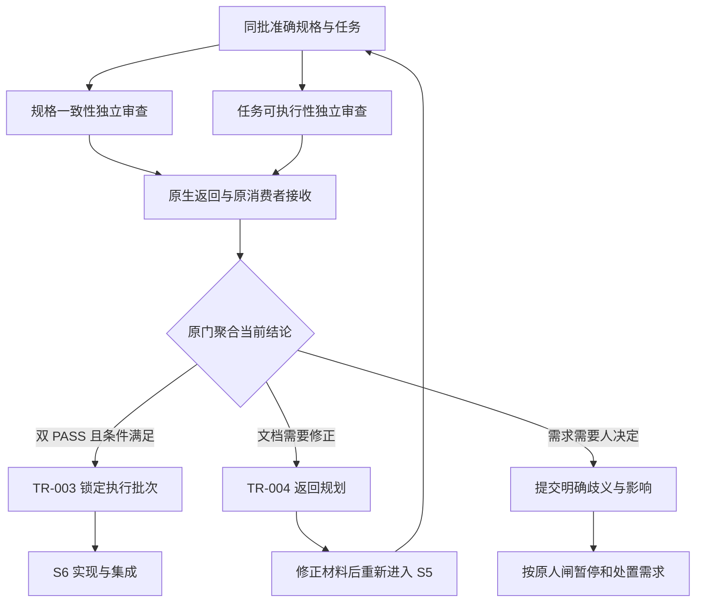

# L3-S5 文档验证

S5 在实现开始前，对 S2～S4 形成的规格链进行独立审查。它分别判断“这些材料是否表达同一套正确承诺”和“执行者能否按任务实际交付”，将发现返回有权修正它的责任，并在两项判断都成立后建立准确的执行基线。

本阶段承接 [S4 任务与整体派发计划](L3-S4-task-split.md)，通过后交给 [S6 构建](L3-S6-build.md)。其依据是 [L1](../l1-principles/L1-design-principles.md)的权威外置、引导思考和独立背书，以及 [L2](../l2-lifecycle/L2-lifecycle-plan.md)对规划、实现、验证和人类决定的分工。

## 1. 为什么需要一次独立的规格审查

### 1.1 作者自审与结构正确还不够

S2 形成系统设计与行为依据，S3 形成共同模型、协议和分端承诺，S4 将承诺变成具体任务。它们大多出自连续的规划过程，容易共享同一组未经说明的前提：作者知道入口在哪里，就误以为任务已经写清；作者认为拒绝行为显然，就漏掉实际错误协议；作者为了便于安排，把可并行的工作串成一条链。

结构检查可以发现缺字段、覆盖遗漏、失效引用和依赖环，却不能判断文字之间是否真的一致、必要接线是否有人承担、收尾判据是否能被证伪。若这些问题到实现或集成才暴露，多位执行者已经各自解释了规格，返工会同时扰动代码和设计。

S5 将这类不确定性留在仍可低成本修订的阶段。它不重新编写一套规格，而是让两个独立责任从不同方向检查同一批材料，再把结论与准确来源一起交给下游。

### 1.2 两个问题必须分别回答

| 问题 | 责任 | 典型缺陷 |
| --- | --- | --- |
| 规格链是否一致 | `DV-SPEC-CONSISTENCY`，规格一致性审查 | REQ 要求越权拒绝，SYNC 与 BE 的错误语义不同，TASK 却只写成功路径 |
| 当前任务是否可执行 | `DV-TASK-EXECUTABILITY`，任务可执行性审查 | 条款一致，但无人注册真实入口，必需文件不在 Scope，自检依赖未来他人报告 |

一致的规格可能无法照单执行，可执行的任务也可能准确实现错误承诺。两项判断不能互相替代，也不能让一个“总体看起来不错”的结论覆盖它们。

两路都阅读完整批次，允许阅读重叠，但各自保留问题意识、专业结论和私人答案。发现彼此影响的缺陷时，Main 按原材料及责任处理，不能要求另一位配合改成相同结论。

### 1.3 审查完成与进入构建分别成立

| 事实 | 成立条件 | 后续责任 |
| --- | --- | --- |
| 一位审查者交付完成 | 本人完成指定审查，专业答案被原消费者接收 | 可以结束本人责任；Main 处理同事、系统接续或发现 |
| 两项结论具备 | 当前两责任各有有效结论及准确对象 | 原门判断通过、文档返工或需求人闸 |
| S5 通过 | 当前两路独立 PASS、来源及原阶段条件有效，TR-003 提交 | 准确任务与计划进入 S6 执行批次 |
| 实现完成 | S6 的真实实现、自检、接收和集成成立 | 后续独立验证判断产品质量 |

`fix_required` 与 `req_change_required` 都可以是完整、有效的审查交付。发现问题不等于审查者没干完；接收一份 PASS 也不等于整个 S5 已通过。

## 2. 审查对象、参与者与交付形态

### 2.1 从当前 S4 交付进入

正常运行位置为 `document_verification`。S4 的实际任务与计划已经接收并登记，等待独立审查；它们尚未因此成为实现通过证明。

| 材料 | 要回答的问题 | 读取要求 |
| --- | --- | --- |
| 当前锁定 REQ | 价值、范围、验收、非功能和负空间是什么 | 读取本周期授权的准确版本 |
| 架构、规则及适用决定 | 系统职责、状态、不变量和取舍怎样支撑需求 | 与当前来源及 accepted 决定对齐 |
| 当前模块行为包 | 哪些角色、操作、分支、输入和判据必须成立 | 消费从上游接受记录承接的准确来源 |
| CONTRACTS、FE/BE/SYNC | 承诺如何分端，接口、失败与恢复是否统一 | 读取实际适用契约及条款宇宙 |
| 共享模型及样例 | 各端是否引用同一结构，业务含义是否合适 | 包括实际传递定义，不另抄字段表 |
| 当前整批 TASK | 目标、读序、条款、改动和本人完成如何闭合 | 包括取消对覆盖和依赖的影响 |
| REQ 整体派发计划 | 成员、并行、真实前置与资源顺序是否合理 | 与 TASK 同批审查，不当作附属看板 |
| 冻结任务分析 | 已有结构结果、上下文、行为及惯例建议是什么 | 保留原分析字节、来源和解析版本 |

不是所有材料都逐份登记为 Runtime 文档。当前正式对象由已登记材料与经原已接受 S4 交付证明的输入、输出闭包合并形成，继承 S3/S2 的实际来源。缺少 `documents[]` 条目，不等于场景包可以被任意 live 文件替换。

### 2.2 模块行为仍是共同分母

只要验收指向功能要求或本次改变服务行为，两路审查都需要查看相应模块的行为依据。无界面变化不免除七文件服务包：五个手写源 `scenario-model.json`、`fixture-contract.json`、`cross-matrix.json`、`stories.md`、`flows.md`，以及生成的 `cases.json`、`scenario-coverage.json`。

服务 CASE 的 `browser_required:false` 只免除浏览器材料，不减少功能、分支、fixture 或判据。需要界面的 CASE 还要检查 PATH、原型和后续真实交互验证安排。不能为了审查容易通过而创建每 REQ、每轮的场景副本，或将既有模块回归范围缩成当前修改的几个 CASE。

### 2.3 责任由谁承担

| 参与者 | 责任 |
| --- | --- |
| Main | 确认本批材料就绪，登记两项专业分工，派入两个独立原生上下文，处理发现、修订和阶段接续 |
| 规格一致性审查者 | 沿需求、设计、场景、契约和 TASK 双向核对承诺，记录真实矛盾与缺项 |
| 任务可执行性审查者 | 代入 Builder 检查范围、上下文、依赖、自检、收尾和整体编排，判断适用风险专项 |
| 原生平台 | 创建、执行、传递消息、恢复和结束子代理 |
| Hook、领域消费者与 Writer | 关联准确责任和实际答案，校验并保存来源、证据、回执及原接续 |
| 阶段门与事务 | 聚合当前结论，执行锁定、返工或人类决定边界 |
| 人类负责人 | 决定真实需求澄清、变更，以及既有授权不能派生的取舍 |

审查者只读产品规格，写自己的专业答案，不在审查中顺手修复被审文档或实现代码。Main 也不能代填另一责任的结论。普通审查无需人逐项批准，真正的需求变化或显式审批按原责任处理。

## 3. 先建立独立分工，再交给原生平台

### 3.1 工程责任与平台身份分开

S5 的两种独立维度、整批覆盖和默认专业方法已经由设计确定，不需要 Main 再翻译成一份内部登记协议。原 S5 入口在 `.claude/workgroups/<REQ>/review-e<entry>/manifest.json` 准备这两份 `document-verifier` 分工，绑定当前代际和阶段入口，使用不同工程 owner，声明 `independence` 分离关系，并沿原登记和发行器取得原问卷。Main 直接获得准确 view／answer，开展真正的原生派发；没有必要的额外选择时不增加一次保存或确认手续。

这一步只建立工程责任与输入关联，不生成审查 PASS。Main 仍应安排实际独立上下文，在原生任务中说明本项目的风险重点，保持既定两维与整批覆盖。自动登记后原 manifest 已成为冻结来源，不能再将“编辑分工清单并保存”作为普通调整办法。原审查答案修订只替换同一冻结责任下的专业判断，S6 canonical Assignment 修订也不适用于此处。若正式材料和基线确需改变，应处理真实专业发现，沿原 TR-004 返回规划并重新进入 S5，而不是临时增加清单修订或自动重签。完整原 manifest 作为领域登记 DTO 留在原位置，兼容旧显式入口；不能因为内部 DTO 要求 SHA，就重新要求 Main 填写系统事实。具体使用见 [分工方法](../../skills/team-planning/SKILL.md)。

清单中的 `agent_id` 是工程 owner 名称，不要求等于 Claude Code 返回的平台 agent_id。保留的 `platform_team_id` 也只是现有登记结构中的逻辑分组字段，不要求创建一个真实平台 Team 来取得它。

登记让系统知道谁承担哪项工程责任，不代表平台已经启动成功。Main 仍须把各自准确的问卷引用交给两个独立原生上下文，不能用两个 owner 名称在同一个实际审查上下文中双签。

### 3.2 两项分工都覆盖整批材料

| 项目 | 规格一致性责任 | 任务可执行性责任 |
| --- | --- | --- |
| 主要问题 | 整条规格链是否忠实、一致、完整 | 任务与整体计划是否可实际交付 |
| 默认专业方法 | `document-verification`、`specification-planning`、`api-contracts` | `document-verification`、`specification-planning`、`testing-strategy` |
| 审查范围 | 本批完整规格链及适用来源 | 本批全部 TASK、计划及所需上游 |
| 产品改动 | 无 | 无 |
| 本人输出 | 当前私人答卷 | 另一份当前私人答卷 |

原登记仍使用一个真实 TASK 关联点，由系统读取 S4 整体计划的首个任务及其准确实体和路径；Main 不需要解析文件名到内部 ID 的规则。这个关联点不缩小审查范围，两位都审完整批次。系统同时提供 Runtime／REQ／generation、已登记文档原版本和 SHA、内部编号、默认技能、输出路径、分离关系、派生计数；校验结果和时间来自真实校验。Main 承担原整批范围内的实际风险重点、独立安排和适用专项，不抄 Runtime、不运行摘要脚本，也不猜 `review_round`。

准备只在原 S5 入口或其具名恢复边界发生，普通读取和 Stop 仅展示当前事实。准备重放保留原 manifest 和已填答案，复用已登记责任；来源缺项或漂移准确指出恢复对象，不从当前字节刷新已接受摘要。默认工程 owner 不能证明真实独立，平台创建和两位本人专业审查仍须实际发生。 原登记沿既有 team 记录固定清单摘要，覆盖登记成功而首张问卷尚未发行的中断间隙；发行与消费均核对同一原字节。清单误改由 Main 恢复原字节，不刷新摘要；缺少原字节就明确保留来源恢复缺口。旧记录没有登记摘要时保留原已发行问卷的摘要边界，不用今天的文件伪造历史。

### 3.3 独立性的实际含义

机器可检查规定责任是否分别存在、分离约束是否有效、当前接收 owner 和 producer 是否不同。它不能仅凭两个字符串证明真实作者未参与自审，更不能证明两个上下文没有共享同一种认识偏差。

Main 应安排不同独立上下文，审查者发现自己实际参与了本范围的作者工作，应报告独立性冲突并交 Main 重新安排。不能通过换一个工程名称继续签字。读取同一事实是必要的，复制另一位的判断或让作者指导其给出 PASS 则破坏独立背书。

尚未形成专业结论的返回可以结束当前平台回合，将准确原引用、阻塞事实和未完成工作交 Main；它不产生 PASS、审查接收或阶段完成。原接收者给出真实字段或来源诊断，由 Main 决定恢复原责任还是重新安排独立执行，不要求审查者为了通过 Stop 校验补选一个不真实的结论，也不新增退出审批表。

## 4. 固定准确输入，交付当前问卷

### 4.1 冻结的是审查对象

每份问卷关联 Runtime、需求代际、S5 入口、责任、工程 owner、原分工及本次 attempt，引用准确材料路径、版本和内容摘要。系统提供这些机器关联；审查者的任务是读懂并判断这些材料，不是手抄一份指纹清单。

“冻结”表示本次结论只能背书这组准确输入，不表示每个输入都复制到一个新目录。新原生只读责任可以读取 Main 提供的实际资料，私人答卷也可以位于 Main 下不同的准确路径；已经登记的独立执行则继续使用其原冻结来源。两种布局不能互相猜测替换。

系统给出完整 view/answer 位置后，Main 原样带入相应原生 Agent 任务。相同角色、返回顺序、一个未关联的文件名或当前看起来像 PASS 的文件，都不能决定责任归属。

当前原生 packet 的阅读清单在 `draft.read`，答案位置为 `answer_path`；`task_analysis` 是带 `path` 的分析引用，先打开该路径，再消费其中的 `structural_check`、`task_contexts` 等内容。旧独立 ExecutionView 在 `packet` 中包装该对象，另给 `frozen_input_root` 和 `authoring_path`；按其原执行根和来源读取。不存在的顶层 `read` 或内嵌分析不能因旧文案曾引用过就视作合法历史合同，旧包装也不能混入新问卷的通用指引。

适用专业方法也属于这次交付：原清单登记的技能应以准确的已安装路径出现在责任 view，说明其用途，不能只保留在内部 `skill_refs`。角色预加载恒常核心，额外专项按本责任和真实材料触发。完整编排遵循 [Agent 指引分层](../l4-mechanisms/L4-agent-guidance.md#s5-s6-guidance)，Main 不需要手工补齐系统已知的技能清单。

### 4.2 先确认材料可读，再开始专业判断

审查者先读 view，确认本责任、实际资料、答案位置与适用要求，再读取指定版本。路径与来源缺失、内容漂移、原分析丢失，应按具体缺项报告 Main/system；不能从 live Glob 换一份同名材料后继续签原版本。

当前输入闭包不代表已经机械证明所有业务材料都充分。比如上游遗漏一个必须的服务 CASE，完整读取已提供文件仍可能缺少需求判据。来源是否准确与规格是否完整是两项检查，后者正是专业审查的职责。

因此“缺层、冲突、范围过大”不能单独作为停止审查的条件。材料准确可读且足以定位规格问题时，形成 findings，并按问题所在层选择 `fix_required` 或 `req_change_required`；只有准确来源不可得、失去独立性等确实无法形成判断的情形，才保留未形成的结论并交 Main 恢复。未接收时，Main 的原返回上下文必须得到具体字段/来源原因，或其准确只读诊断入口；只给“未接收”不能指导续跑与恢复的选择。

### 4.3 分析资料减少重复劳动

`task_analysis` 提供原结构检查、任务读集、粒度建议，以及实际存在的行为和惯例投影。两路读取同一准确基础，任务可执行性审查重点使用它，避免再次手算覆盖和 DAG。

读集字节不是 token、困难程度或拆分阈值；目录未展开、锚点未解析、条件未知都需要具体判断。CASE 样例仅限 TASK 清单明确引用且源包有效的条目，不代表已执行产品验证。惯例默认及例外须有原规范来源，候选或冲突内容不能冒充已决定规则；没有惯例索引不自动构成缺陷。

新问卷的分析应按原字节和解析版本消费。只有明确的旧资料缺少摘要且原冻结输入可用时，才按原指引作兼容补充。诊断命令可以用于调查具体问题，不是每位审查者必须重跑全部 S4 检查的第二道流程。

## 5. 规格一致性：把同一承诺追到最后一公里

### 5.1 双向阅读，避免只确认文件存在

先从 TASK 向上读主契约、共同模型或协议、REQ 和设计，检查本地工作是否有完整依据；再从关键验收向下追到任务和收尾判据，检查有没有无人兑现的承诺。

```text
AC / NFR
  → 架构、规则与业务状态
  → CASE 的输入、分支和判据
  → 契约条款、操作和失败语义
  → TASK 交付条款与实际改动
  → 本人完成判据及后续独立验证
```

这不是要求所有关系都重复抄成一张新表。审查者要能够指明实际路径、条款、CASE 和可观察结果。引用存在而语义接不上，仍应作为发现。

### 5.2 三类恒常深查

| 角度 | 审查动作 | 需要防止的误判 |
| --- | --- | --- |
| 验收到完成条件 | 抽取关键 AC，逐跳走到契约、TASK 和收尾判据，点明最后一公里 | AC 已有 CASE 就误以为必有实现与验证责任 |
| 非功能与负空间 | 逐项找架构、契约或任务落点，核对阈值、边界及验证安排 | NFR 仍在 REQ 表里，却没有任何实际兑现路径 |
| 负向、权限与错误 | 对账规则拒绝分支、CASE、SYNC/本端错误以及真实调用结果 | 三个文档都写“拒绝”，但状态、错误码或副作用彼此矛盾 |

还应检查同一模型、字段、状态、操作和恢复语义是否同源。Schema 正样例通过，只证明结构合法，不证明其字段含义正确；业务拒绝输入也可能完全符合 Schema，不能拿结构负例代替权限或状态拒绝。

### 5.3 延续订单导出示例

沿 S4 示例，若 REQ 与 CASE 要求越权请求被拒绝、订单保持不变，BE 条款承担授权和订单保护，SYNC 承担拒绝协议，则需要核对：

1. CASE 是否有真实的越权输入、预期拒绝及状态判据。
2. BE 与 SYNC 是否约定同一拒绝语义，是否遗漏部分成功或错误映射。
3. TASK-017-01 是否承担服务行为及本人自检，02 是否承担正式入口接线，03 的回归是否验证副作用。
4. 命令端 04 是否正确处理该结果，而不是把拒绝当成功下载。

若 SYNC 明确说不需要鉴权，不能因为四张 TASK 的字段齐全而 PASS；若规格一致但缺入口文件，则还需由任务可执行性视角确认交付缺口。两路允许发现同一因果链，不由 Main 为消除重复而压掉真实问题。

## 6. 任务可执行性：代入真实执行者

### 6.1 五问检查每张任务

| 问题 | 怎样审 | 机器帮助及其限度 |
| --- | --- | --- |
| 单一交付 | 是否有一个可解释的结果，多个步骤是否共同维护它 | 不能从句子短、文件少推断职责单一 |
| 上下文与耦合 | 必要读集是否有限充分，未知条件是否解决，写域是否真实 | 字节和共享读写分析提供调查方向，不自动决定拆分 |
| 依赖语义 | 实际产物是否先于消费者，是否漏边、假边或循环等待 | 无环只能证明结构，不能证明每条边必要 |
| 自包含交接 | 入口、路径、条款、改动和本人输出是否明确 | 不让 Builder 重做规划，也不要求预先写完实现方案 |
| 可测性前向 | 每个完成条件能否在实际范围、环境和后续验证中得到依据 | `assert` 文本存在不表示命令可执行或判据充分 |

特别检查调用者、入口注册、服务/事务、持久化及结果回传是否分别有 owner；同一原子变化不能被人为拆到互相等待的任务。Scope 必须容纳本人实现、测试、必要接线和实际证据，未来独立 QA/E2E 不能被冒充为 Builder 输出。

### 6.2 整体编排必须审查

<a id="dispatch-review"></a>

批次节奏是五问之外的整体视角，也是当前整体计划的必审内容，不能因为早期称为“附加半问”而省略。

规格一致性责任检查 REQ、契约、任务及计划成员闭合；任务可执行性责任检查同波是否真能并行、是否漏真实前置或资源、公共改动是否有 owner、串行理由是否成立，以及前置集成后能否持续释放消费者。具体机制见 [整体派发计划](../l4-mechanisms/L4-agent-dispatch-governance.md#dispatch-plan)。

共享只读模型不要求等待提供方实现。不可隔离的写入或资源冲突需要明确顺序；当前同波重叠诊断可能只是警告，不能以无硬错误证明安全。波次也不是等待前一整批结束的屏障，不能把无关任务的迟到变成消费者前置。

### 6.3 根据实际输入开展风险专项

| 触发条件 | 必须查清的问题 |
| --- | --- |
| 数据模型、Schema 或持久化变化 | 迁移和破坏性影响是否有人承担；兼容或断裂选择是否明确；若保留兼容，理由、责任、移除路径和债务记录是否齐备 |
| SYNC 或外部依赖 | 适用调用的超时、重试、降级及外部错误翻译是否声明，失败能否验证 |
| critical 场景配置或高风险需求 | 额外验证维度是否有责任、判据与实际入口；服务 CASE 使用服务验证，无浏览器不虚构 PATH |

触发由审查者根据冻结资料及[审查方法](../../skills/document-verification/SKILL.md)判断，问卷不自动替每个任务分类。专项产生的发现写入同一专业答案，不新增第三份 PASS 或一套平行报告。

## 7. 用一份专业答案交付判断与发现

### 7.1 三种结论表达三种不同问题

| 结论 | 判断依据 | 不表示什么 |
| --- | --- | --- |
| `pass` | 已完成本责任审查，未发现需处置问题 | 不表示另一责任通过，更不表示产品已实现 |
| `fix_required` | REQ 含义明确，修正设计、契约、TASK 或计划即可满足 | 不授权修改需求，也不要求审查者亲自修文档 |
| `req_change_required` | REQ 本身歧义、冲突或缺少必要决定，无法形成一致解释 | 不代表已经取得变更批准，也不自动完成暂停或修订事务 |

结论由问题所在层决定，不以修复工作量大小决定。一个很小的字段若涉及业务含义取舍，也可能需要人；一个影响多张任务的错误依赖，若需求清楚，仍可以是文档修正。

答案以 `null` 起草时尚未完成。PASS 保留预填的 `findings: []`；另外两种结论至少有一项可定位发现。不写“无问题”报告，不为了让答案更长复述系统已给出的身份或机检统计。

### 7.2 发现要让修订者能够行动

每项发现只填 `path`、`expected`、`observed`：指出被审对象中的具体位置，解释按已有依据应有的内容，以及实际缺口。下例只展示 `answer` 值；实际保留已发行问卷的外层题干和阅读清单：

```json
{
  "conclusion": "fix_required",
  "findings": [
    {
      "path": "docs/dev/tasks/TASK-017-02.md#scope",
      "expected": "正式 HTTP 入口的交付范围包含实际路由注册位置，并有本入口的完成检查。",
      "observed": "任务要求接通正式入口，但 Scope 只有处理器和测试文件，未指明由谁完成路由注册。"
    }
  ]
}
```

该发现不替实现者预先决定函数或算法，而是补齐必须有人承担的责任。若问题是需求未决定导出权限，应定位 REQ 的现有授权条款或相关段落，解释缺哪个决定及其影响，选择 `req_change_required`，不能以“先实现任意一种”绕开。

当前 `path` 必须对应本问卷正式输入中的文件，可以附锚点；锚点的真实定位与内容仍需专业核对。机器分析文件虽然可能出现在阅读清单中，不一定属于正式被审对象。系统缺资料时应报告准确缺项，不能编造一条允许路径来提交。

### 7.3 保留当前题干，只填写本人答案

当前 S5 校验会核对已发行问卷的题干、阅读清单和问题结构，只编辑 `answer`。这与 S4 的现有校验边界不同，不能因上一阶段允许某种题干改动就在本阶段照用。

问卷的机器部分由系统形成，专业结论与观察由审查者形成；完成答案后保存到准确私人位置，返回原 view/answer 引用。普通流程不另交 Markdown REV、通用 PLAN、手工证据信封或副本。只有原责任明确要求审批时，才履行该领域批准；保存专业答案不产生批准。

## 8. 原生返回怎样成为可追溯的审查事实

### 8.1 Start 给出提示，Stop 接收实际交付

`SubagentStart` 提醒审查者遵循 Main 带入的准确原问卷，读取实际材料、完成独立判断并返回引用。Start 本身没有完整任务 prompt，不能按角色名、启动顺序或平台 ID 猜哪份责任属于它。

审查者正常保存自己的专业答案，Claude Code 负责执行与恢复。`SubagentStop` 从实际任务和返回中的准确引用定位唯一当前责任，再交原 S5 消费者。工程 owner 从原问卷取得，不要求平台 agent_id 与它相等。

若引用未知或同时命中多个当前责任，不能抢收任意一份。Main 需澄清准确交接；没有接收就不能声称已经完成。消费失败返回具体诊断，对本人可补的错误允许继续补齐，并遵守 `stop_hook_active`，避免无限 Stop 循环。

普通 Worker 工具、Main 的读取或消息，以及 Main 看见某个已填文件，都不是本原生责任的接收事件。平台异步启动也不是专业答案已返回。完整跨阶段接线见 [L4 原生子代理](../l4-mechanisms/L4-agent-dispatch-governance.md)。

### 8.2 原消费者和 Writer 保存什么

```text
独立审查并保存私人答案
  → 原生返回中的准确责任引用
  → SubagentStop 调原 S5 消费者
  → 核对专业答案、当前分工、来源及适用审批
  → Writer 接收答案，派生 document_review 证据与原 followup
  → 原控制流程评估阶段门
```

Writer 将专业答案与原来源、责任和接收身份关联，产生 `document_review` 领域证据及回执。原证据信封中的 subjects、producer、摘要和请求事件由机器投影，审查者不复制它们，也不自己选择证据 ID。

当前接收会校验准确 S5 材料、分工清单、冻结分析和读取来源；关键检查在原 Writer 内再次成立，避免保存与登记之间被换源。文件存在、已经发布一份 envelope 或打印一句 PASS 都不足以代替持久接收。

### 8.3 回执把本人完成与等待项分开

合法 PASS 或 finding 被接收后，本人责任可以结束。另一位未交、Main 尚未处理发现、原阶段接续 pending 或需求等待人类决定，分别由对应 owner 接手，不让已交付审查者无限续跑。

相同专业答案重放复用原接收，不再添加一份证据或重复转换。原接续中断时保留原事件，Main 按当前回执给出的恢复入口处理；已推进时不再重跑。不能把 generic recover 当成每位审查者的正常交付步骤。

历史交付保留，不等于历史证据永远有资格推动当前门。返工、代际变化或具名修订可使它失去当前适用性，原答案和接收事实仍可追溯。

## 9. 聚合结论，沿原三路出口处理



### 9.1 双 PASS 建立准确执行批次

原 `GATE-DOCUMENT-PASS` 检查两项规定责任、不同 producer、准确对象、当前入口及来源资格。当前已发行责任都需要实际接收的 PASS；仅引用一条看起来有效的历史证据，不能绕过另一份当前问卷。

门满足后，TR-003 原事务核对当前准确任务、派发计划和共享模型等条件，锁定计划与非空任务批次，进入 `building`。转换条件和动作都成功提交，才成立 S6 入口；不能仅凭两条消息或领域门的 satisfied 提前实现。

冻结基线是实际材料登记事实。TASK 的 `Status: complete` 仍表示任务书完成，契约自己的 `locked` 也不由审查者改写成运行进度。普通工具并不会因此变成全面物理写锁；后续变更、检查和集成仍按实际来源约束。

### 9.2 文档问题回到规划

`fix_required` 沿原 `GATE-DOCUMENT-FIX-REQUIRED` 和 TR-004 返回 `planning.design`。需求基线必须保持原授权，不能把已经改变的 REQ 当作普通文档修正。

Main 沿准确 finding 修正实际所属材料：任务问题在 S4 收敛，契约问题回 S3，设计问题回 S2。Runtime 的统一返工入口不意味着必须把所有正确产物从头重写；应处理实际影响，并让重新形成的上游交付和来源成立。

审查者不直接改被审文件，也不因发现问题就获得更改既有设计决定的授权。修正若实际要求重新决定需求或架构，应回相应有权责任，不能偷偷扩大成另一套方案。

### 9.3 需求问题交回人的决定

`req_change_required` 被接收后，Main 向人说明明确歧义、互相冲突的承诺及其影响。TR-005 是人类边界，按原路径记录暂停和需求处置；选择这个结论不会自行取得需求修订授权，也不能伪造暂停记录或改写 REQ。

人的决定可能澄清原含义、批准修订或结束本周期，分别按实际授权生命周期处理。没有答复不能作为批准；也不能为让 S5 前进而把需求问题降格为普通文档修复。

不同责任出现不同结论时，不能平均、投票或强行改成双 PASS。原选择器和门决定当前可用路由；遇到互相冲突或无法确定的结果，Main 先解释实际问题及责任，不手动拨动阶段跳过它。

## 10. 返工重审与具名修订分别使用

### 10.1 材料改变后，旧签字不覆盖新规格

TR-004 在原事务中结束当前 S5 批次，处置其当前审查证据与责任；存在独立执行登记时，将其移入原历史并保留来源目录。取消的是旧批次的当前适用性，不抹除已发生的专业交付。

同一需求代际重新进入 S5，用新的阶段入口区分，重新准备两项分工及准确材料。新批次的清单、责任、路径不得覆盖旧批次，不通过刷新旧摘要把历史改造成当前。即使部分文件字节未变，旧入口的 PASS 也不能完成新入口责任。

当前未交的旧同事责任可随返工被取消，已经接收的人保留原回执；Main 应明确通知平台上的实际执行者范围已经更换。工程责任退役不会凭空终止 Claude Code 进程，不能把 Runtime 状态变化当作平台停止事实。

### 10.2 输入未变，但确需重新审查同一判断

若材料和本次入口未变，Main 因具体观察要求重新检查一个已接收判断，使用原具名修订流程：关联前驱接收、明确原因，发行下一 attempt。它不是直接覆盖已接收答案，也不是因想要 PASS 而反复重试。

修订发行时旧证据立即暂停当前资格，防止等待新答案期间原 PASS 继续放行。新责任保留准确输入和审查维度，审查者读取具体修订原因，独立判断并交新答案；接收后形成明确替代链。不同原因不能为同一前驱并行生成多条互相竞争的有效后继。

Main 可以让原生上下文恢复并交付新准确引用，Start/Stop 不按旧 prompt 或旧答案认领新责任。已经登记的旧独立执行继续按其原退役和准备流程恢复。来源已经改变时，不能用具名修订保留旧输入来规避真实返工。

### 10.3 历史来源按历史责任保留

已确定被返工替代的历史分工，仍需保留原清单结构、Runtime 归属、可达性及原发行字节关联；但不能要求它永远匹配当前已经修正的产品文档，否则每次正确修复都会被历史卡死。

当前或无法确认已过期的分工继续严格检查来源。Main 不删除历史文件、不手改 Runtime、不刷新旧清单哈希消除错误。新原生责任不需要预建旧式 execution；已有旧执行缺源也不能擅自回落到共享 Main 答案。

## 11. S6 从 S5 得到什么

S6 得到准确锁定的任务与派发计划、共同规格及来源，以及说明这批材料已经通过两项独立文档责任的事实。它得到的是可信的开工依据，不是已经实现或已经验证的产品。

Main 按实际依赖和容量选择就绪任务，用当前原生 brief 派发。Builder 仍需读任务、形成专业计划、实现和本人自检；Main 仍需实际集成。S5 的 PASS 不代替这些工作，也不授权执行者更改需求、跳过拒绝分支或减少回归分母。

若 S6 发现规格仍有缺口，保留具体观察，按原规划与影响路径处理。独立审查降低了不确定性，不保证规格从此绝无错误。新的执行事实可以指出设计或审查漏检，不能因已有 PASS 就压掉它。

## 12. 观察什么，怎样恢复

| 观察位置 | 要回答的问题 | 处理归属 |
| --- | --- | --- |
| 当前入口与分工投影 | 本次是否已安排两项责任，准确清单和问卷在哪里 | Main 准备或修复当前登记 |
| 输入及分析引用 | 两位是否看同一批准确材料，缺的是文件、来源还是业务判据 | system 恢复来源；专业缺口由审查记录 |
| 原生 Start/Stop 和交接诊断 | 平台是否实际返回，引用是否唯一，消费者是否接受 | 执行者补本人缺项；Main 澄清交接 |
| submission、领域证据与回执 | 哪份答案已接收、是否当前、等待谁 | 不重做已接受工作，交对应 owner |
| 原 followup 与阶段门 | 缺第二路、来源漂移、结论冲突，还是转换动作未提交 | Main 沿原接续诊断和恢复 |
| 修订链和批次历史 | 当前是哪次入口、哪个 attempt，旧判断为何失去资格 | 使用当前原问卷，不拼接旧 PASS |
| TR-003 及执行批次 | 准确锁定是否实际完成，S6 能否开始 | 转换成功后才派实现 |

观测必须能关联到真实责任、材料和事件，不能只显示“两个代理结束了”。Hook 中的生命周期审计用于定位交接，不证明审查深度；缺失来源或消费失败要给具体错误，不能通过反复 Stop 掩盖。

普通 Main 读取不创建新分工，也不能抢收 Worker 工作；已登记责任的缺题接续仍沿原发行器处理，普通原生工具事件保持安静。原接收中断后的 pending 由既有恢复机制接续；系统维护问题不应被包装成 reviewer 需要再交一套专业报告。必要的恢复命令只在原回执或明确旧执行恢复中使用。

## 13. 实现落点与能力边界

### 13.1 入口与消费者

| 设计责任 | 主要落点 | 要核对的实际关系 |
| --- | --- | --- |
| Main 已知分工准备 | [S5 原清单准备与接收](../../internal/cli/s5_manifest_questionnaire.go)、[阶段入口提示](../../internal/cli/stage_answer.go) | 原位置预填、原登记／发行、实际来源核验、同源重放与请求预算，不要求元数据抄写或默认确认 |
| 专业分工与原生派发 | [分工方法](../../skills/team-planning/SKILL.md)、[角色](../../agents/document-verifier.md) | 两责任、独立上下文、完整批次和准确引用 |
| 审查方法与问题 | [专业方法](../../skills/document-verification/SKILL.md)、[题干模板](../../internal/schema/assets/stage-form-s5-template.json) | 语义追踪、可执行性、整体计划和条件专项 |
| 当前对象及问卷 | [正式输入](../../internal/runtime/s5_formal_inputs.go)、[责任投影](../../internal/runtime/work_packet_issuer.go)、[问卷结构](../../internal/workpacket/packet.go) | 登记材料与原 S4 闭包合并、当前责任和字段约束 |
| 原分析冻结 | [分析准备](../../internal/submission/task_analysis.go) | 字节、解析版本、结构检查和有来源的建议 |
| 原生 Start/Stop | [接线](../../internal/cli/native_review_hooks.go) | 短提示、准确引用、实际专业消费及安静工具事件 |
| 原接收及来源校验 | [接收服务](../../internal/submission/service.go)、[答案来源](../../internal/submission/source.go)、[当前输入校验](../../internal/runtime/work_packet_authority.go) | 专业答案、来源、适用审批和 Writer 接收 |
| 领域证据与回执 | [证据投影](../../internal/workpacket/document_review.go)、[Writer](../../internal/runtime/work_packet.go)、[回执](../../internal/submission/receipt.go) | 本人接收、当前资格、原 followup 和等待 owner |
| 原门与执行锁定 | [领域门](../../internal/qualitygate/evaluator.go)、[闭包事实](../../internal/qualitygate/s5_formal_subjects.go)、[转换动作](../../internal/transition/actions.go) | 准确当前双 PASS、来源及 TR-003/004 实际提交 |
| 判断修订与当前资格 | [具名修订](../../internal/runtime/document_review_revision.go) | 原前驱、唯一后继、暂停旧资格及当前入口 |

### 13.2 不能把专业要求写成已有机器保证

- 不同工程 owner、producer 与分离关系可被核对，但原生平台 actor 与 owner 不强绑定；它们不证明真实上下文独立。真实作者登记常记录提交 actor，不能据此声称已可靠排除作者自审。
- 精确来源校验覆盖正式输入集合，不证明上游在语义上没有漏掉必需材料。风险条件和专项深度仍由审查者判断，没有自动证明每项都审过的字段。
- TASK 结构、覆盖与无环不等于可执行；同波重叠诊断可能只是警告，收尾自然语言不会自动执行。S5 必须补足专业层。
- 当前 S5 首次接收仍重建准确来源，并在 Writer 内重复关键检查；它不是只读取一个 PASS 的轻量路径，也不能把函数存在或某条测试通过扩大成全部恢复情形都有效。
- S4 接收和 S5 输入重建共用真实任务批次枚举，取消项保留在原 S4 证据中，退出 S5 活动任务分母；作者答案中的产物引用不是第二份机器批次清单，不要求再抄取消项路径。S5 仍核对原 S3／S4 来源闭包、真实任务与派发索引、原输出摘要和活动文档登记；取消源漂移或把取消项登记成活动 TASK 仍会拒绝，不通过改写已接收答案或刷新摘要恢复。
- 同一工作区能保存两份私人答案，不表示磁盘会自动隔离或保护所有路径。独立执行布局也不能自行证明审查判断质量；普通工具写入不由本机制授予权限。
- TR-005 保留真实人类边界，专业发现本身不会自动生成需求批准或暂停完成事实。TR-003 成功也只建立执行基线，不是质量验收或发布授权。

S5 将 D1 的准确来源、D4 的专业问题和 D6 的独立背书落在实际交付上。判断是否完成，应能解释谁审了哪批材料、各自得出什么结论、发现交给谁，以及准确执行批次是否真正建立；不能以报告数量或平台退出替代这些事实。
