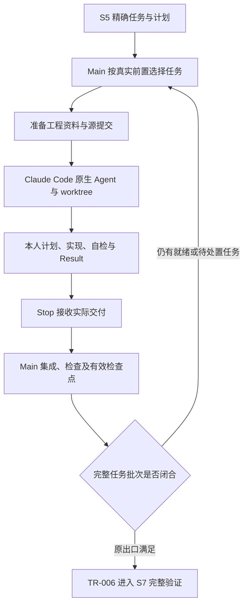

# L3-S6 构建

S6 将 S5 审查通过的任务转为真实实现、自检依据和 Main 中可独立验证的交付。Main 组织分工、处理依赖并集成成果；Builder 在实际工作区完成本人计划、实现和检查；Claude Code 负责子代理的创建、执行、消息、恢复和结束。

本阶段承接 [S5 文档验证](L3-S5-document-verification.md)，完成后由 [S7](L3-S7-verification-round.md)独立验证产品。任务的粒度、输入、范围与完成判据来自 [S4](L3-S4-task-split.md)，原生派发、状态和工作区的共用规则分别见 [L4 工程衔接](../l4-mechanisms/L4-agent-dispatch-governance.md)、[状态机制](../l4-mechanisms/L4-state-transition-core.md)和 [Worktree 机制](../l4-mechanisms/L4-worktree-governance.md)。

## 1. 从规格承诺到真实交付

### 1.1 S6 要建立三类事实

S5 说明“这一批规格一致且足以执行”，还没有让功能进入产品。S6 要把承诺转成三个可以被后续责任检查的对象：

| 事实 | 要交代什么 | 为什么必要 |
| --- | --- | --- |
| 实现 | 哪些实际代码、测试、配置或迁移进入共同开发目标 | 私人分支有代码，不等于产品具备能力 |
| 执行 | 谁承担本次任务，实际做了什么、检查了什么，哪些条件尚未成立 | 不能从“已完成”的文字推断工作发生 |
| 可复验交接 | 条款、完成条件、实际变化和验证入口如何对应 | S7 需要独立判断，不能只复述 Builder 的结论 |

实现者自测提供快速反馈，Main 集成证明成果能进入共同目标，S7 再独立判断交付质量。三者互相承接，但任何一层都不能借下一层存在而省略自己的责任。

### 1.2 工程治理承接工作，不接管平台运行

S6 需要持久的任务、输入、责任、结果和集成事实，以便长会话、并发或失败后继续工作。它不需要在 Claude Code 原生 Agent 外再建一套创建、激活、首写批准、等待和结束机制。

专业计划应在实现前形成，帮助 Builder 暴露误解和风险；保存计划后即可在既有授权内连续实现。真正的需求变化、规格改变或明确审批仍由原领域处理，不能由一份计划或一次 Hook 自动批准。

这一选择承载 [L1](../l1-principles/L1-design-principles.md)的 D1、D2、D4 与 D6：事实外置，观测进入自然交接，产物引导专业判断，独立责任分别成立。字段要有实际消费者，额外手续要能解释防止哪种真实失效。

### 1.3 分清几种完成

| 事实 | 含义 | 还缺什么 |
| --- | --- | --- |
| 工程资料已准备 | 当前任务与输入登记，准确 brief 已生成 | 平台实际派发和专业工作 |
| 原生 Agent 已启动或恢复 | 平台正在处理一个上下文 | 本人实际交付及领域接收 |
| Result 已接收 | 原消费者保存了这次专业结果和来源 | 可能仍有本人未完成条件，或等待 Main 集成 |
| 本人交付完成 | 本人承诺、自检和完成判断成立，无未处置偏差或阻塞 | Main 的独立集成责任 |
| Main 集成有效 | 匹配的成果已进入绑定目标，必要检查及检查点有效 | 其他批次任务和阶段出口 |
| S6 完成 | TR-003 精确任务集逐项满足原出口，TR-006 提交 | S7 的独立完整验证 |

工作进度沿共用五态表达，专业结论和集成状态是另外的事实。不能让一个 `done` 同时代表平台退出、报告存在、代码合入与产品验收。

## 2. 输入边界、参与者与产物

### 2.1 使用 S5 建立的准确批次

正常入口为 `building`，前提是 TR-003 已实际提交。任务数量和范围由审查过的准确集合决定，不能在执行中只挑容易完成的 TASK，或把未准备任务从分母中删除。

| 输入 | 在 S6 中的用途 |
| --- | --- |
| 当前授权 REQ 与开发目标 | 保持业务含义、验收和实际集成分支 |
| TR-003 锁定的 TASK 与整体计划 | 确定完整交付集、本人范围、依赖、资源顺序和完成条件 |
| 共同契约、模型与必要设计 | 解释本端条款、实际协议、失败、状态与不变量 |
| 适用模块行为包及真实 CASE | 提供输入、分支、fixture 和判据，保留模块回归义务 |
| 当前项目源代码及工程方法 | 定位入口、真实接线、构建和测试方式 |
| 原 Assignment Record | 关联本次工程 owner、角色、修订、输入、范围与交付合同 |
| 实际开发起点和 Git 来源 | 保证隔离执行读到正确版本，并为后续差异计算保留依据 |

共同 S6 起点由 TR-003 保存，用于向 S7 说明整批构建带来的实际变化；某个任务的原生 worktree 起点则来自该次准备固定的 Main 提交。二者用途不同，不能用当前 HEAD、REQ 最早绑定提交或第一张任务的起点互相替换。

### 2.2 分工按实际写入责任选择

| 参与者 | 本人职责 | 需要交接的对象 |
| --- | --- | --- |
| Main | 选择就绪任务、派发、处理冲突与真实阻塞、集成、运行必要 Main 检查并闭合批次 | 准确 brief；集成结果及阶段输入 |
| `backend-builder` | 后端实现、适用迁移、本人单元或集成测试 | 实现提交、专业计划与 Result |
| `frontend-builder` | 前端实现、适用组件和本端测试 | 实现提交、专业计划与 Result |
| `test-builder` | 指定测试、fixture、辅助工具或测试基础设施 | 测试产物、实际执行及其判据依据 |
| Claude Code | 原生上下文、执行、消息、等待、恢复和工作区隔离 | 实际返回及平台事件 |
| Hook 与领域消费者 | 按准确任务引用读取本人产物，交原 Writer 接收 | 原接收事实、具体缺项或阻塞交接 |
| Main 集成器 | 核对来源、真实差异、范围、目标及检查，保存检查点 | 可核验的 Main 集成事实 |

后端任务拥有本人的测试，不因此变成 test-builder；独立测试任务也不能顺手改产品实现来让测试通过。Delivery、QA 和 E2E 的独立结论由后续相应责任产生，不是 Builder 的另一个交付名目。

### 2.3 工程文件长什么样

系统按本次 Assignment 和修订提供实际路径。以下仅展示关系，不能将示例身份抄为当前任务：

```text
Main 控制根
├── docs/dev/tasks/TASK-017-01.md        # 已审查任务与实际链接
├── .claude/assignments/native/<id>/r1/
│   ├── task.md                         # 交给原生 Agent 的准确简报
│   └── source.json                     # 固定的准备源提交
└── Runtime、接收产物与集成检查点         # 由原 Writer 和集成器维护

实际原生 worktree
├── 本任务实现和测试                      # 按项目纪律提交
└── .claude/assignments/native/<id>/r1/
    ├── plan.json                       # Builder 的私人专业计划
    └── result.json                     # Builder 的私人专业结果
```

私人 plan/result 不作为产品强制加入 Git。Main 保存接收后的权威副本和关联，Worker 不复制 Runtime 与 journal 形成第二写者。实际提交只包含本人合法产品，不能因交付格式需要而提交整个 `.claude`。

## 3. Main 按真实前置持续安排工作

### 3.1 先看就绪与待接收，再决定派发

Main 从已审查整体计划和实时事实看：哪些任务等待依赖、哪些已经在做、哪些结果待集成、哪些真正可派发。`loop-harness s6 status --root <Main> --capacity <总槽位>` 提供当前投影；未声明容量时查看就绪，不据此声称已经选出实际并发批次。

公开容量参数是实际总并发槽位，不是剩余名额。未提供容量时，投影显示容量未知，保留就绪任务，不计算推荐批次；这不增加登记容量的动作、工具许可或原 `s6 prepare` 的前置。Main 按真实资源选择就绪任务，仍由原准备入口核对就绪条件。显式声明零容量表示没有推荐槽位，与未知分别显示。容量、平台资源和 Main 接收积压影响安排，但不改变任务分母。需要额外调度建议时消费当前建议与配置，不能恢复未经实现证明的固定并发数或一套手算代理数量公式。

准备入口会核对实际任务是否就绪，工程登记也保护当前写入责任；这些都不代表平台自动保留了槽位或创建了 Agent。Main 使用原生平台能力完成实际派发和等待。

### 3.2 波次不是全批屏障

依赖从真实产物推导。前项当前专业交付和本人完成成立、必要 Main 集成及匹配检查点有效，才释放消费者；Builder 返回或一个已合并但未检查的提交分别都不够。

延续 S4 订单导出示例：

- 01 实现服务，04 实现按共同协议调用的命令端，两者可以在独立写域内并行。
- 01 已接收并有效集成后，02 可接通正式入口，即使无关的 04 仍在工作。
- 03 消费服务和入口的实际实现，应等待自己声明的 01、02 前置。

04 使用共同 Schema 不意味着它必须等待服务实现；若实际需要新生成客户端或其他真实产物，则应已有对应前置。Main 发现原计划漏边或写域冲突，应处理真实规划影响，不能临时把一个目录名字当新依赖。

### 3.3 并行与集成分别控制风险

一张 TASK 保持一个明确当前写 owner。工作区隔离避免直接覆盖，但不能消除共同文件、共享可变资源、合并语义或运行环境冲突。Main 应优先明确所有权和可隔离资源，必要顺序按原计划执行。

可以并行实现，Main 的 Git 集成仍需按真实目标串行处理。已经返回的成果应及时接收和集成，避免不断增派而让待消费结果积压。具体背压或建议配置按实际系统能力使用，不把建议误写成新的平台调度服务。

## 4. 准备的是工程交接，不是第二套启动机制

<a id="dispatch-execution"></a>

### 4.1 从就绪 TASK 生成准确简报

Main 在当前绑定开发目标上提交必要输入，再使用：

```text
loop-harness s6 prepare --root <Main> --task <TASK> --role <Builder-role>
```

入口读取已登记的 `waves-v1` 计划及实时就绪事实，取得本任务准确来源、读集、写入范围、完成条件和检查。它建立本次工程记录与源提交，生成完整 brief，交 Main 原生派发。

Main 不需要先指定官方 Agent/Team ID。现有结构中的 owner、workgroup 或 grouping 名称用于工程关联，不要求创建平台 Team。`s6 prepare` 不启动进程，不预建原生工作区，也不证明 Builder 已阅读或正在实现。

### 4.2 简报必须让执行者能够连续工作

简报应给出：实际 TASK 和读序、角色及必要方法、准确范围、Done when、本人检查、工作区起点，以及 plan/result 的确定路径和完整专业形状。不能只给一个空数组或一个“返回报告”的名字，让 Builder 猜嵌套字段。

方法交付必须落实到实际加载位置：角色 frontmatter 只预加载恒常核心，brief 给原登记方法的准确路径及角色的专项触发条件。数据库、协议、安全等专项按本 TASK 的真实内容读取，不因为有 Builder 身份就默认加载所有技能。未分类的风险由执行者根据明确条件判断，系统不能将未知项声明为已完成判断。内容归属和交付时机遵循 [Agent 指引分层](../l4-mechanisms/L4-agent-guidance.md#s5-s6-guidance)。

Done when 是本次本人条件。系统从 TASK 收尾契约提取可识别的专业断言，机器维护的范围关联不要求作者再抄；Main 如需明确表达本人条件，仍须忠实于原任务，不以覆盖参数减少承诺。无法识别某条自由文本，不表示业务条件已经不适用。

当前准备从原登记来源读取版本和摘要，按角色投影默认技能，生成内部身份、数量及校验时间；Main 不手填同一组机器事实。识别到的任务检查装配为 Main 合并后检查及其 CheckProfiles，采用整树输入、禁止复用，fixtures／dependencies 文件集合为空，不要求作者为正常准备补文件 SHA。Worker 声明空的 runner 检查集。专业上仍要求 Builder 运行本人实际自检，在 Result 说明命令、结果和未执行原因；空 runner 配置不是免检，也不是已机械证明全部本人检查。

### 4.3 重复准备保留原来源

准备过程固定实际源提交。登记或资料发布中断后，使用原草稿、原记录与原源提交继续，不在恢复时重新抓取一个较新的 HEAD 冒充同一次准备。

重复调用返回当前准确 brief；角色、输入、条件或原责任实际不同，需由 Main 按修订或返工处理。不能覆盖旧来源、刷新清单摘要，或同时为同一责任启动原生与旧 launcher 两条执行链。

## 5. 用原生工作区承载实际写入

### 5.1 Main 交付正确起点

写入任务使用 Claude Code 原生 worktree。当前设置使用 `worktree.baseRef: head`，因此 Main 派发前确认自己就在 REQ 绑定开发分支，必要输入已经提交。准备后 Main 若前进，不重置 Main 或重新捕获 source；由 brief 在输入阅读前说明首次未开始且干净时的准确固定源对齐。

正常恢复与首次对齐分别说明：在原正确来源上已有本人 Plan、提交或未提交工作，是继续本人责任的常态，不因 HEAD 不再等于 base 而停工或重做对齐。保存原成果并继续未完成工作；来源确实无法确认或混入其他输入时才交 Main。原接收检查 base 的祖先关系不机械证明首次阅读时刻，不把猜测的 commit 作者或新登记当恢复许可。

worktree 不继承 Main 未提交或仅暂存的文件。一个契约在 Main 编辑器里已经改好，不表示隔离执行可以读到它；相应正式来源需按原流程提交并对齐，不能依靠软链接整个控制目录补齐。

Main 将准确 brief 引用及原生隔离要求带入实际 Agent 任务。前台、后台、消息和 resume 使用平台能力；后台启动返回一个句柄，不等于任务已交付。

### 5.2 Builder 在本人执行根工作

Builder 从实际 TASK 按必要链接展开，确认自己读的是哪份规格、能改哪些产品、怎样判断完成。控制根和执行根不同：前者保存 Runtime、原接收和 Main 集成事实，后者保存实际实现和私人草稿。

brief 应分别标明这两个根的用途：原 brief 和安装方法可以从准确控制路径读取；TASK、规格及产品读集按固定源提交在本人 worktree 中读取，给出明确的 worktree 相对路径。Main 后续集成不能改变本责任的来源。不要用 Main 的活动绝对产品路径充当冻结读集，也不要要求 Builder 寻找 brief 未提供的 `source_root`/`input_read_order` 字段。

专业结果应返回准确 Main brief 和实际 worktree 中 Result 的绝对路径。相同角色可以并发承担不同任务，平台恢复也可以产生新 actor；关联依靠原任务及真实来源，不能按角色名、启动顺序或“只有一个待办”猜测。

必要上下文和工程方法按任务实际风险使用：本端条款、共同操作、模型、CASE，再按迁移、权限、并发或失败问题补充方法。不能要求先递归读完整协议才能开工，也不能以某个惯例索引缺失制造新的准入门。

## 6. Builder 先形成可验证的实施计划

### 6.1 计划回答真实专业问题

计划不复述 Runtime 身份，而是回答：本任务要交付什么、准备改变什么、每个关键条件用什么判据证明、实际前置是否成立，以及已发现哪些风险或阻塞。

| 专业字段 | 本人要说明的内容 | 系统核对的边界 |
| --- | --- | --- |
| `objective` | 一个准确交付目标及其业务含义 | 非空不证明理解正确 |
| `planned_paths` | 实际准备改动的产品或测试位置 | 必须落在登记范围，不能扩张 TASK |
| `assertion_checks` | 每条断言、可观察判据和对应 Done when | 完成条件覆盖与稳定索引，不执行自然语言 |
| `risks_blockers` | 未知条件、关键假设及真实阻塞 | 不能靠填空数组隐藏已知问题 |

当前原生准备在 TASK 前置已经满足后建立单任务工作组，其工作组内 Assignment 依赖集合为空。这不表示 TASK 没有依赖，也不应把上游 TASK ID 再填成一组未经登记的 Assignment 依赖。Builder 仍要从真实资料确认必需前置，发现实际缺失就交 Main 处理。

已知的工作组内 Assignment 依赖由简报作为只读输入说明，原接收器从 Record 自动带入 canonical Plan；Builder 的私人 Plan 和 Result 均不填写 `dependencies`，也无需读内部 manifest 或转抄空集合。旧私人 Plan 若显式携带该字段，原消费者仍要求它准确匹配登记集合，错误值不能借兼容路径进入接收。两份文件的专业字段说明分别紧邻其形状。一般环境、输入或与 Main 协作的条件用专业说明表达；真正尚未解决的风险和阻塞仍写入 `risks_blockers`，不能为了匹配依赖集合而隐去。

### 6.2 用断言连接完成条件和检查

Done when 的索引从 0 开始，以本次 brief 的实际顺序为准。每个条件至少有对应计划断言，不能只计划最容易完成的一项。判据应指明输入、观察对象和预期结果，不是“跑完命令就行”。

下面只展示一个服务行为条件的填写形状。假定本次示意 brief 的第 0 项是“导出只包含授权范围的数据，并拒绝越权请求”；真实任务还须覆盖它的全部其他完成条件。文件和命令均为示意，不是本仓库已经实现或执行的证明。

```json
{
  "objective": "兑现订单导出服务的授权范围与越权拒绝行为。",
  "planned_paths": [
    "internal/export/service.go",
    "internal/export/service_test.go"
  ],
  "assertion_checks": [
    {
      "assertion": "导出只包含授权范围的数据，并拒绝越权请求。",
      "oracle": "给定两个组织的订单，授权请求只返回本人组织的数据；越权请求得到契约规定的拒绝。",
      "done_when_indexes": [0]
    }
  ],
  "risks_blockers": []
}
```

范围隔离、数据保护和失败路径若是另列的 Done when，要分别映射，不能因这个例子只有一条就遗漏。涉及事务或副作用的条件需要实际状态判据，成功响应不能替代它。

### 6.3 保存计划后连续实现

专业计划应在实现前由本人形成并保存，然后连续工作，不等待 generic PLAN_REPORT 回读、begin、activation 或 Main 再次授意。普通工具事件不为这一步发放权限。

当前原生接收会在 Stop 同时读取计划与结果，并核对二者关系。它能拒绝范围、关联和完成条件映射缺项，但不能证明计划的真实撰写时序、文件阅读或测试执行；更不能补造“实现前已批准”。提前计划是专业纪律，实际来源与独立集成是另外的保证。

## 7. 实现与本人检查形成快速反馈

### 7.1 从完成条件落到真实调用链

Builder 按断言定位实际入口、服务或事务、持久化和结果返回，再完成约定改动。行为变化应有能暴露原错误的测试或复现，适用时观察从失败到通过；若原检查已经通过，如实记录，不为叙事完整伪造一个红灯。

服务任务使用正式服务入口和真实状态判据，浏览器任务保留应有真实交互验证安排。测试任务遵守锁定 CASE 的 oracle，不为了让断言通过修改业务期望；发现产品错误而本责任无产品写域，应交接具体事实。

实际实现可能需要调整内部做法，但不因此取得更改接口承诺、需求范围或验收阈值的权力。Scope 外的邻近问题可以记录，不能顺手混进本人提交。

### 7.2 三层检查分别产生事实

| 层次 | 对象与目的 | 必须留下的事实 |
| --- | --- | --- |
| Builder 本人检查 | 本人改动和任务条件，尽早定位错误 | 实际命令、受测内容、结果、未执行项及原因 |
| Main 集成检查 | 合并后的共同开发树及必要交互 | 原配置命令、真实运行回执、受测提交和检查点 |
| S7 独立验证 | 当前完整交付和适用风险维度 | 独立结论、发现及当前完整轮依据 |

同一昂贵检查不必无差别地在每张任务重复，但这种取舍要保留各层独有的反馈。Main 的重跑不替 Builder 自测，Builder 的通过也不代表合并树通过。修改模块当前真相包时，完整模块回归分母仍成立。

### 7.3 证据必须说明实际做了什么

在 Result 的 `summary` 或完成条件的 `rationale` 记录实际命令与结果；适用时引用真实测试文件、日志或其他已有材料。未运行要说明原因，环境不可用与产品断言失败分别表达，都不能写成通过。

可用日志路径应属于本人范围或实际提供的读取路径。不能为了满足证据字段发明一份文件，也不能临时扩大写域。引用一个测试源文件能证明检查位置，但不能独自证明该测试已经运行或断言为真。

## 8. 用 Result 交付实际判断

### 8.1 结果逐项对应原计划

Result 保留摘要、每条原计划断言的依据、风险与偏差，以及对全部 Done when 的完成判断。原生私人 Result 使用 `plan_assertion_index` 指向本人原 Plan 的断言顺序，不再逐字抄写 `assertion` 和 `oracle`。原接收者先验证 Plan，再把准确原文本投影到既有 canonical Result，交原 Schema 和领域消费者校验；索引不代表断言已经成立。

每个条件仍由作者填写 `done_when_index`、`judgment` 和 `rationale`。省略的 `plan_assertion_indexes` 从 Plan 的 `done_when_indexes` 反向关联取得，不重复抄写同一关系。显式提供的旧字段继续按原合同核对，不能覆盖错值来让它通过；重复、越界或缺失断言、没有证据、没有作者判断均不因此获得完成资格。完整旧 assertion/oracle 格式及已准备旧 brief 仍保持原兼容，不改写已接受来源。

`evidence_refs` 是实际 worktree 内存在的相对文件引用，落在本任务写域或明确 Read paths；不是命令、输出文字、描述、行号、锚点或 URL。执行命令和观察写在摘要或理由，真实文件引用承担可定位来源的责任。

延续 §6 的单条件示例，以下仅演示完成格式；其中运行结果是示意，只有执行者实际观察后才能填写：

```json
{
  "summary": "完成服务授权范围与越权拒绝实现；实际执行 go test ./internal/export -count=1，通过对应服务测试。",
  "assertion_evidence": [
    {
      "plan_assertion_index": 0,
      "evidence_refs": ["internal/export/service_test.go"]
    }
  ],
  "risks_blockers": [],
  "scope_deviations": [],
  "closing_assessment": {
    "disposition": "complete",
    "conditions": [
      {
        "done_when_index": 0,
        "judgment": "satisfied",
        "rationale": "授权与拒绝用例均符合共同判据，执行命令及结果见摘要。"
      }
    ]
  }
}
```

真实 brief 含多个条件时，计划和 Result 都要完整覆盖。不能用一条“全部完成”把数据保护、错误路径或必要检查从判断中消失。

### 8.2 完整格式可以表达尚未完成

`closing_assessment.disposition` 使用 `complete / incomplete / blocked`；各条件用 `satisfied / incomplete / blocked` 判断，并关联实际计划断言、解释理由。真实风险、阻塞或范围偏差要保留。

Result 的 `risks_blockers` 或 `scope_deviations` 非空会阻止完成与集成。已解决问题、信息性范围说明和非阻塞限制应在 `summary`／完成判断理由中完整解释，不能把字段同时用作普通免责声明。仍未满足的职责是真实未完成或阻塞，不能挪到说明后宣称完成；原受控 Result 修订保留旧判断和同一 Git 来源。

原消费者可以接收结构有效的 incomplete/blocked 结果，但它们不会使本人条件或阶段门自动满足。结果已接收与本人真正完成分别判断；Main 集成也不能把未满足的专业条件改写成通过。

产品提交完成后，保存本人 Result，返回准确 brief 和实际 Result 路径。机器身份、修订摘要、实际提交关联、证据标识和接收时间由原适配器生成，作者不另手写第二套机器报告。

## 9. Start / Stop 在哪里衔接

### 9.1 工具事件不管理原生执行

| 时点 | 工程衔接 | 责任边界 |
| --- | --- | --- |
| Main 原生派发 | 传准确 brief、隔离与交付要求 | 实际启动由 Claude Code 完成 |
| `SubagentStart` | 给短提示，保留实际平台观察 | 不猜 TASK，不批准开工，不准备工作区 |
| Worker 普通工具与消息 | 正常读写、测试和保存 | 不接收 Result，不登记首写或激活 |
| `SubagentStop` | 定位本人实际产物，交原消费者或反馈缺项 | 不承担长合并、Main 全套检查和清理 |
| Main 返回后 | 核对原接收并显式集成 | 不等待第二次 Stop 才接手 |

同一角色并发不能用角色名绑定，异步启动返回也不能当作结束事件。准确关联不足时由 Main 澄清，不能借用他人的结果。

### 9.2 Stop 接收的是实际产物

原接线按准确 brief 选择唯一当前责任，从 Hook 的实际工作区或明确的绝对 Result 引用找到真实 Git worktree。它核对同库来源、原准备起点、实际分支和当前工程记录，再读取本人的计划与结果。

专业 JSON 合入原机器结构后，分别按原计划和结果 Schema 分支给出具体字段诊断，再交原 Result Writer。机器保存不可变计划、答案和真实证据关联；正文收尾文字不作为报告替身，用户任务引用也不直接变成 PASS。

同一次实际交付重复 Stop 应复用原接收；已完成或退役责任的迟到事件不重开它。平台恢复产生不同 actor 时，实际审计记录可以变化，工程责任不因此平白新建一份。

### 9.3 真实阻塞与错误重试都有边界

Main 对已接收但本人未完成的完整 Result，应直接获得其原专业 disposition、风险/阻塞、范围偏差与未满足条件；最小 blocked 的未接收诊断不能替代此分支。投影读取原接受事实，不扫描私人文件或重跑整套集成校验；无法读取原接受来源时给准确失败与原诊断入口。本人 complete 与 Main 集成资格仍分别判断。

S6→S7 的提示内容、接收者和事件时点按 [分层编排](../l4-mechanisms/L4-agent-guidance.md#s6-s7-guidance) 统一推导。Start 不能因存在待执行 S6 登记而给未知 agent 分配实现责任。阻塞或接收失败须把准确原因和原引用交到 Main 的模型可读反馈；诊断不产生完成回执，已退役责任不能被泛化的“尚无回执”提示重新启动。

接收器只把准确私人产物中的可补文件、JSON 与专业字段缺项反馈为本人继续补齐；系统来源、准备、控制面和未知故障直接保留诊断交 Main。`stop_hook_active` 用于避免无限循环，放行后仍由 Main 处理未完成工作；实际错误边界见 [L4 原生接收](../l4-mechanisms/L4-agent-dispatch-governance.md)。缺计划但已有明确实际 blocker 的专业结果可以诚实交回 Main，不强造完成回执。

Builder 收到的 brief 必须直接说明正常完成、形成 Plan 前受阻和已有 Plan 后受阻三种交付。真实阻塞的最低 Result 包含说明当前进展/未完成工作的 `summary`、非空真实原因 `risks_blockers`，以及 `closing_assessment.disposition: blocked`，保存到原 Result 路径并返回原 brief 与实际 Result 绝对引用。已有 Plan 和真实证据保留；没有完成的检查不编造 evidence，不为退出补一个虚假计划。只有口头 blocker 而缺 Result 时，反馈须指出这个准确路径及最小形状。阻塞交接沿原来源与责任核对，不放宽正常完成的 Plan、证据、条件和集成校验。

最小阻塞形状是未完成工作的交接，不是完整 Result 的免检入口。既有完整 `blocked` 报告仍按原专业报告合同校验、记录未完成结果；它的额外字段、证据和关联不能被最小分支忽略。接收一份有效的未完成报告仍不等于完成或可集成。

这类阻塞交接只说明 Main 已得到具体问题，不能推断 Runtime 已登记成功完成、自动取消工作或已经满足 TR-006。Main 保留实际 worktree 与未完成事项，决定补环境、修订责任或返回规划。本人无需因无关同事、未来 S7 或 Main 集成尚未完成而继续空转。

## 10. Main 用真实成果完成语义集成

### 10.1 接收后显式接手

Main 从原生返回及原接收记录取得本次真实成果，沿现有 `runtime task-integrate` 入口处理实际 Assignment 和工程 owner。它们来自原记录，不是 Main 临时选择的平台身份。

集成前核对当前任务、修订、结果、实际 source commit、worktree、目标分支和范围。原结果固定实际源提交；Builder 返回后又提交的新变化不能继续借旧 Result 进入 Main。

### 10.2 Inspect、合并、检查与接收各有作用

| 工序 | 核对或产生的事实 | 失败时保留什么 |
| --- | --- | --- |
| Inspect | 正确当前 Result、实际 source/target、工作区状态、提交、真实差异、锁定路径及冲突 | 原成果与具体未满足条件 |
| 锁内再核对 | Inspect 后来源、merge base、结果或目标是否变化 | 不用旧快照悄悄放行新变化 |
| 非 squash 合并 | 实际 source 进入 REQ 绑定开发分支，可追溯父提交 | 真实 merge 及恢复位置 |
| Main 检查 | 在约定位置运行准确配置命令，记录真实受测树、返回及日志 | 失败命令、日志和已发生合并 |
| verified 与 ACK | 匹配本次修订、Result 内容和 Git 来源的有效检查点 | 可恢复的原接收事实 |
| 安全清理 | 本次已接收资源可回收，额外修改不丢失 | 清理缺项不伪装成检查失败 |

真实 changed paths 由 Git 计算，并在集成锁内与当前登记写域及禁止修改的来源对账，不只信 Result 自述。实际检查点绑定准确 Result 路径及内容摘要；仅时间没变，不能说明检查仍适用于已经改过的答案。

当前新原生准备使用 `post_merge`：Main 必需检查在实际合并树上运行。不能拿 Worker 树的自测代替，也不能将旧执行其他检查位置配置静默改成此模式。具体检查执行与环境约束见 [L4 检查机制](../l4-mechanisms/L4-workspace-execution-profiles.md)。

### 10.3 检查为空与检查通过不能混淆

已配置命令应由真实 runner 执行并保存对应回执；缺 runner、命令失败、来源变化或受测树不明确，都不能形成有效通过。原配置为空时，集成器不会凭空新增测试；这只表示该记录没有声明相应命令，不证明测试已发生。

Main 仍须判断配置是否漏掉任务要求或必要联合检查，按原责任修正。不能为了通过出口清空检查，也不能将专业文字中的“检查通过”自动当作工具执行回执。

### 10.4 已接收产物不依赖私人缓存永久存活

Stop 已在 Main 持久保存并校验专业产物后，平台可能清理原生工作区或其中的私人文件。恢复应使用原实际 Git 来源、已接受产物和原检查点，不要求 Builder 重造一遍历史答案。

私人 plan/result 若仍存在，其内容必须与已接受交付一致；额外文件或编辑过的答案不能冒充原两份例外。缓存消失也不能代替正确 Git 提交、实际目标、范围和必要 Main 检查。未接收产物仍需真实作者来源，不能借用另一人的已接受答案。

## 11. 失败后沿真实责任继续

### 11.1 先区分哪类问题

| 问题 | 后续动作 | 不应采取的捷径 |
| --- | --- | --- |
| 本人范围内实现或自测失败 | 保留失败依据，修正并重跑适用检查，形成真实结果 | 改 oracle 或声明未来 QA 会补 |
| 外部环境、权限或前置暂缺 | 说明具体阻塞和未完成条件，Main 补输入或协调真实责任 | 伪造 PASS、靠反复 Stop 试出通过 |
| 专业产物字段或文件引用错误 | 按原 Schema 的具体分支修正本人产物 | 手填机器身份或放宽 Schema |
| 需要新的当前交付修订 | Main 使用原 Assignment 修订与恢复入口 | 原地重新激活旧 owner、覆盖已接受计划 |
| TASK、契约、设计不能共同成立 | 记录影响，REQ 不变时沿 TR-007 等原规划路径处理 | 执行者静默改冻结规格 |
| 需求含义或验收必须改变 | 给人具体问题和影响，沿真实 amendment 边界 | 借普通修订扩大业务授权 |
| Main 合并或检查失败 | 保留 source、target、merge、日志与检查点，定位未完成工序 | reset、stash 或强删用户及未接收成果 |

### 11.2 交付修订保留原历史

当前原生返工准备通过 `s6 prepare --revise-assignment <id> --revision-intent-key <stable-key>` 交原 revision Writer，保留旧 Result、检查点和 worktree，形成新的准确修订与交付位置。稳定意图用于幂等接续，不是作者自行生成的新业务身份。

新修订需要实际原返工依据、当前原记录和有效来源，不能任意改输入后重放旧成功。当前准备保留原任务及角色，并为新责任建立工程 owner；它不将旧执行原地重新激活。平台实际恢复或新派发仍由 Main 使用原生能力安排。

这里的“修订”限定为同一份已审查 TASK 下的执行纠偏：TASK 的 ID、路径、版本和内容保持原值，修正真实实现、结果或原执行输入允许纠正的部分，再用原新修订完成 Main 集成和检查。它不负责改写 TASK 的目标、范围或完成条件，也不会原地重新激活旧 owner。

正式 TASK、契约或设计发生矛盾时，REQ 不变的规格问题由 Main 沿 TR-007 等原入口返回规划，重新形成材料并接受独立审查。这个职责归属不等于当前版本已实现任意同代 TASK 替换：原 S6 起点保存首次 TR-003 的精确 TASK 集合，现有 Record revision 与产品读取仍要求这份来源一致。不能把再次登记文件或又一次 TR-003、状态写成 locked、刷新 fingerprint 当成已经具备新 TASK 的完整执行来源，也不能要求作者自行补一份“重锁证明”。支持这类替换还需明确原批次与后继责任的真实衔接；普通执行恢复不推定它成立。

重复 `s6 prepare` 只有在当前锁定批次仍准确包含原 TASK、当前 Main 的已提交 TASK 字节与原 Record 一致时才返回旧 brief。检查只针对该任务，准备的源提交仍取原 `source.json`，不因 Main 有无关后续提交而重取 HEAD。TASK 已变化、来源缺失或身份不再唯一时，保原 brief、准备记录和已收结果，直接交 Main 区分恢复原来源与正式规格处置；Builder 不反复改 hash 或重新提交旧答案。

### 11.3 已发生的合并不因重试重复执行

检查中断或失败后，原检查点区分已合并、待验证、已接收和待清理。重试恢复缺的工序，不把一份原 merge 再合一遍。新 Result 或相关来源变化需要重新核验，不能沿用旧通过。

若 Git 合并已发生、merged 检查点写入前进程中断，原 ready 仍保留准确 target／source 和责任。Main 的合法后继提交不要求 Builder 重新交付；原恢复在有界第一父历史中辨认准确双父合并，继续原 Record／Result、范围和实际检查。找回的是已经发生的合并，验证仍在当前 Main 提交执行。不能把 source 已集成造成的 merge base 变化当成新任务，也不能遗漏 ready 中已钉住的 Result 来源。具体范围、父关系与无法证明时的保留规则见 [Worktree 治理](../l4-mechanisms/L4-worktree-governance.md#111-已有-merge-receipt-与丢失-merge-receipt)。

已经完成的历史集成不因 Main 后续普通提交无限重新检查，但目标历史被重写、原 merge 不可达、来源或匹配结果不再成立时，要撤回相应后继资格并保留现场。检查点丢失或工作区不见，都不能单凭现象推断“已经集成”。

清理失败只恢复清理，不因此续跑已完成 Builder。不自动删除无归属资源，也不借恢复重启平台代理或复制控制状态。

## 12. 精确批次闭合，再交给 S7

### 12.1 对每个锁定任务判断

原 `GATE-BUILDER-BATCH-READY` 及 TR-006 使用 TR-003 的精确非空任务集，不扫描当前几份成功报告来反推分母。每张任务都需要当前合法交付、有效本人完成判断、无未处置范围偏差，并具备匹配的 Main 集成和必要检查事实。

一个有效 Result 尚未集成，不能结束阶段；一个实际 merge 已通过检查，但本人仍声明完成条件未满足，同样不能释放消费者或让全批通过。未派发、缺记录、失效证据和未知来源都不能按“没有失败”当作完成。



阶段门和原事务实际成功后才进入 S7，不要求先在 building 阶段伪造 Delivery 团队或 S7 PASS 作为 S6 出口。S7 的计划应消费真实已集成变化、风险和锁定规格。

最后一次有效集成的完成接续应检查原整批 Gate，通过原 TR-006 进入 S7，并在同次交接给 Main 当前 ReviewPlan 与 guide。未闭合时给真实剩余责任；转换失败或已转换但材料准备失败时分别保留已成立事实，给具名恢复入口。不以额外普通工具调用触发迁移，也不要求重交已接收 Result 或重复合并来重试交接。

### 12.2 保留整批实际变化，而非只留最后成功摘要

S7 的产品变化面从原 TR-003 共同起点到最终 Main 计算，包含删除、历史失败残留及后继修复的实际影响。任务证据列表不能代替这个完整 Git 分母，最后一个成功任务的 base 也不能代表整批起点。

S9 后的影响处置可能使某些 S6 证据失去当前质量资格，却不抹除它已经贡献的 Git 历史。限定的历史贡献读取仍核对原登记、不可变计划与结果、证据及真实 Main 来源，只用于解释产品形成，不把失效记录恢复为当前 PASS。

原生专业计划可以通过原已接受事实核验，不能在下游重新要求补一份并未发生的 readback/activation。S7 必须重新审查当前完整表面，不从 Builder 自测或历史接收直接生成干净轮。

## 13. 观测应指出缺什么、由谁接手

| 观察位置 | 要解释的问题 | 下一责任 |
| --- | --- | --- |
| 锁定批次与实时投影 | 哪些任务就绪、等待、执行中或待集成，实际容量是什么 | Main 选择并持续安排 |
| 准备记录与准确 brief | 本次来源、范围、条件是否明确，准备中断在哪一步 | Main/system 恢复原资料 |
| 原生 Start/Stop 与交接诊断 | 是否实际开始或返回，准确引用是否唯一，缺哪个产物字段 | Builder 补本人缺项或真实交回阻塞 |
| Result 接收及本人收尾判断 | 是未交、已接收但未完成，还是本人已完成 | 本人实际缺项与 Main 等待项分开 |
| Inspect、检查日志与原检查点 | 是 dirty、冲突、越界、命令失败，还是已合并待恢复 | Main 处理实际未完成工序 |
| 依赖和 TR-006 缺项 | 谁还没有有效集成，是否漏了整批任务或本人条件 | 对应当前 owner，不缩分母 |
| S6 共同起点与产品变化面 | S7 要独立验证的真实范围从哪里来 | 原来源读取与 S7 规划 |

接收、集成耗时和待消费积压帮助 Main 判断反馈是否及时、并行是否超过消费能力；它们不是另一个平台存活探针。没有 Stop 不能推断代理死亡，日志存在也不能自行宣布完成。

反馈应给准确 TASK、Assignment 修订、实际来源、缺失条件和下一动作，不要求作者维护长消息哈希链。本人 JSON、额外字段与 Schema 缺项应指出实际 Plan 或 Result 路径及具体字段；专业字段误放另一份文件不能泛称为需要作者补齐的机器元数据。工作状态和证据资格从权威事实投影；冻结 TASK 和计划不回填 owner、复选框或执行历史。

尚无准备记录时，下一步应指出当前就绪 TASK 及 `s6 prepare`；有准确 brief 而无交付时，指出原生派发/恢复，并由 Main 结合平台实际执行判断是否等待；已接收待集成时，给原集成动作。不得把“未准备”说成“等待已派发 Builder”，也不能要求 Main 在原准备已负责登记后另跑一次 register-workgroup。这些区别来自既有进度与接收事实，不新增提示专用状态机。

## 14. 实现落点与能力边界

| 设计责任 | 主要落点 | 实际核对重点 |
| --- | --- | --- |
| 准备、角色与来源 | [s6_prepare](../../internal/cli/s6_prepare.go)、[当前原生入口](../../internal/cli/native_s6.go)、[交付路径](../../internal/assignmentrecord/native.go) | 精确任务、源提交、专业形状及幂等恢复 |
| 原生方法与角色 | [派发方法](../../skills/agent-dispatch/SKILL.md)、[后端](../../agents/backend-builder.md)、[前端](../../agents/frontend-builder.md)、[测试](../../agents/test-builder.md) | 当前原生合同与冻结兼容指引的适用边界 |
| 计划与专业完成判断 | [计划校验](../../internal/plancheckpoint/validate.go)、[Result 结构](../../internal/assignmentresult/answer.go) | 范围、断言、全部完成条件和真实判断 |
| 原 Result 接收 | [完成消费者](../../internal/assignment/completion_canonical.go)、[准确原接收](../../internal/assignmentresult/accepted.go) | 当前记录、专业内容、实际证据及不可变来源 |
| Main 集成 | [Inspect](../../internal/integration/inspect.go)、[Integrate](../../internal/integration/integrate.go)、[原生文件边界](../../internal/integration/native_delivery.go) | 真实 Git 差异、目标、配置检查和恢复 |
| 接收与批次投影 | [本人/集成事实](../../internal/qualitygate/canonical_builder_result.go)、[批次门](../../internal/qualitygate/evaluator.go)、[实际转换](../../internal/transition/engine.go) | 本人完成、Main 集成及精确 TR-006 分母 |
| 原集成出口接续 | [S6 交接](../../internal/cli/s6_handoff.go)、[S7 材料准备](../../internal/cli/review_plan_questionnaire.go) | 同次原 Gate/TR-006、准确 ReviewPlan/guide、已成立事实及具名幂等恢复 |
| 责任交付与反馈 | [S6 原生诊断](../../internal/cli/native_s6_diagnostic.go)、[Main 返回](../../internal/cli/native_main_return.go)、[观察提示](../../internal/hook/s6_context.go) | 准确 actor/brief 边界、blocked/字段反馈/接收故障、只减展示重复不改变业务资格 |
| 固定源对齐指引 | [原生源指引](../../internal/cli/native_s6_source.go) | 派发延迟后的准确原起点、仅未开始且干净时普通 Git 新分支对齐、已有工作保留 |
| 调度、修订与下游来源 | [实时投影](../../internal/dispatch)、[修订准备](../../internal/cli/s6_prepare_revision.go)、[共同起点](../../internal/productbaseline/s6_main_start.go)、[产品表面](../../internal/buildsurface) | 实际依赖、原记录修订和完整变化面 |

需要明确的限制：

- 结构有效、证据文件存在和专业 `complete` 不机械证明判据为真；当前普通 Worker 空 runner 配置不提供全部本人测试的执行背书。Main 检查及 S7 独立验证不能省略。
- TASK 自由文本到检查命令及 Done when 的解析有约定范围，不能承诺任意自然语言都被提取。Main 与 Builder 要核对实际 brief 是否忠实，缺项不能靠清空条件解决。
- 原生接收一起核对 plan/result，不证明事前形成时间；Start 与普通工具也不产生开工批准或读完文件的证明。
- 三类 Builder 预载稳定核心方法，专项按实际输入触发；适用性仍需专业判断，不能声称系统已自动判定所有方法。只有原登记旧执行使用冻结兼容恢复，不能据此给新原生任务增加激活手续。
- 固定源对齐由准确 brief 指导 Builder 在未开始且干净的原生 worktree 中执行普通 Git；Hook 不自动 reset 或推测首次阅读时刻。已从原正确起点开始的本人工作保留并正常继续，只有来源不明、混入其他来源或原输入丢失才交 Main 恢复。接收端原来源校验不等于机械证明作者始终遵循了阅读顺序。
- 当前正式产品来源读取要求 TASK 集合与首次 TR-003 锁定的路径、版本及字节准确一致；普通 Assignment 修订只支持保原 TASK 的执行纠偏。同代正式 TASK 替换尚未贯通完整来源与后继责任，不要求作者造重锁证明，也不把返回规划说成已经具备无缝续跑能力。
- 已接受且持久化在 Main 的交付不要求私人缓存永久存在；未接受工作及真实 Git 来源仍不可缺失。历史贡献的有限读取也不代表恢复其当前质量资格。
- 本章描述已接线的工程合同；机械测试、实际 Claude Code 运行和专业产品验收分别证明各自范围，不能相互代签。

S6 的完成应能够解释：完整任务集是什么，谁真正交付了哪些产物，哪些本人条件和 Main 检查已经成立，失败如何保留和恢复，以及 S7 获得的实际产品范围。更多执行状态或更长报告不能替代这些事实。
