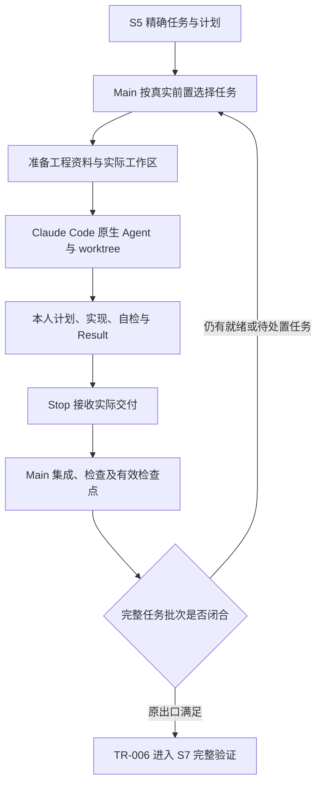

# L3-S6 构建

S6 将 S5 审查通过的任务转为真实实现、自检依据和 Main 中可独立验证的交付。Main 组织分工、处理依赖并集成成果；Builder 在实际工作区完成本人计划、实现和检查；Claude Code 负责子代理的创建、执行、消息、恢复和结束。

本阶段承接 [S5 文档验证](L3-S5-document-verification.md)，完成后由 [S7](L3-S7-verification-round.md)独立验证产品。任务的粒度、输入、范围与完成判据来自 [S4](L3-S4-task-split.md)，原生派发、状态和工作区的共用规则分别见 [L4 工程衔接](../l4-mechanisms/L4-agent-dispatch-governance.md)、[状态机制](../l4-mechanisms/L4-state-transition-core.md)和 [Worktree 机制](../l4-mechanisms/L4-worktree-governance.md)。

## 1. 从规格承诺到真实交付

### 1.1 S6 要建立三类事实

S5 说明“这一批规格一致且足以执行”，还没有让功能进入产品。S6 要把承诺转成三个可以被后续责任检查的对象：

| 事实 | 要交代什么 | 为什么必要 |
| --- | --- | --- |
| 实现 | 哪些实际代码、测试、配置或迁移进入共同开发目标 | 私人分支有代码，不等于产品具备能力 |
| 执行 | 谁承担本次任务，实际做了什么、检查了什么，哪些条件尚未成立 | 不能从“已完成”的文字推断工作发生 |
| 可复验交接 | 条款、完成条件、实际变化和验证入口如何对应 | S7 需要独立判断，不能只复述 Builder 的结论 |

实现者自测提供快速反馈，Main 集成证明成果能进入共同目标，S7 再独立判断交付质量。三者互相承接，但任何一层都不能借下一层存在而省略自己的责任。

### 1.2 工程治理承接工作，不接管平台运行

S6 需要持久的任务、输入、责任、结果和集成事实，以便长会话、并发或失败后继续工作。它不需要在 Claude Code 原生 Agent 外再建一套创建、激活、首写批准、等待和结束机制。

专业计划应在实现前形成，帮助 Builder 暴露误解和风险；保存计划后即可在既有授权内连续实现。真正的需求变化、规格改变或明确审批仍由原领域处理，不能由一份计划或一次 Hook 自动批准。

这一选择承载 [L1](../l1-principles/L1-design-principles.md)的 D1、D2、D4 与 D6：事实外置，观测进入自然交接，产物引导专业判断，独立责任分别成立。字段要有实际消费者，额外手续要能解释防止哪种真实失效。

### 1.3 分清几种完成

| 事实 | 含义 | 还缺什么 |
| --- | --- | --- |
| 工程资料已准备 | 当前任务与输入登记，准确 brief 已生成 | 平台实际派发和专业工作 |
| 原生 Agent 已启动或恢复 | 平台正在处理一个上下文 | 本人实际交付及领域接收 |
| Result 已接收 | 原消费者保存了这次专业结果和来源 | 可能仍有本人未完成条件，或等待 Main 集成 |
| 本人交付完成 | 本人按已有完成判断表达承诺、自检及条件成立；风险与范围说明按原意交接 | Main 的独立集成责任 |
| Main 集成有效 | 匹配的成果已进入绑定目标，必要检查及检查点有效 | 其他批次任务和阶段出口 |
| S6 完成 | TR-003 精确任务集逐项满足原出口，TR-006 提交 | S7 的独立完整验证 |

工作进度沿共用五态表达，专业结论和集成状态是另外的事实。不能让一个 `done` 同时代表平台退出、报告存在、代码合入与产品验收。

## 2. 输入边界、参与者与产物

### 2.1 使用 S5 建立的准确批次

正常入口为 `building`，前提是 TR-003 已实际提交。任务数量和范围由审查过的准确集合决定，不能在执行中只挑容易完成的 TASK，或把未准备任务从分母中删除。

| 输入 | 在 S6 中的用途 |
| --- | --- |
| 当前授权 REQ 与开发目标 | 保持业务含义、验收和实际集成分支 |
| TR-003 锁定的 TASK 与整体计划 | 确定完整交付集、本人范围、依赖、资源顺序和完成条件 |
| 共同契约、模型与必要设计 | 解释本端条款、实际协议、失败、状态与不变量 |
| 适用模块行为包及真实 CASE | 提供输入、分支、fixture 和判据，保留模块回归义务 |
| 当前项目源代码及工程方法 | 定位入口、真实接线、构建和测试方式 |
| 原 Assignment Record | 关联本次工程 owner、角色、修订、输入、范围与交付合同 |
| 实际开发起点和 Git 来源 | 保证隔离执行读到正确版本，并为后续差异计算保留依据 |

共同 S6 起点由 TR-003 保存，用于向 S7 说明整批构建带来的实际变化；某个任务的原生 worktree 起点则来自该次准备固定的 Main 提交。二者用途不同，不能用当前 HEAD、REQ 最早绑定提交或第一张任务的起点互相替换。

### 2.2 分工按实际写入责任选择

| 参与者 | 本人职责 | 需要交接的对象 |
| --- | --- | --- |
| Main | 选择就绪任务、派发、处理冲突与真实阻塞、集成、运行必要 Main 检查并闭合批次 | 准确 brief；集成结果及阶段输入 |
| `backend-builder` | 后端实现、适用迁移、本人单元或集成测试 | 实现提交、专业计划与 Result |
| `frontend-builder` | 前端实现、适用组件和本端测试 | 实现提交、专业计划与 Result |
| `test-builder` | 指定测试、fixture、辅助工具或测试基础设施 | 测试产物、实际执行及其判据依据 |
| Claude Code | 原生上下文、执行、消息、等待、恢复和工作区隔离 | 实际返回及平台事件 |
| Hook 与领域消费者 | 按准确任务引用读取本人产物，交原 Writer 接收 | 原接收事实、具体缺项或阻塞交接 |
| Main 集成器 | 核对来源、真实差异、范围、目标及检查，保存检查点 | 可核验的 Main 集成事实 |

后端任务拥有本人的测试，不因此变成 test-builder；独立测试任务也不能顺手改产品实现来让测试通过。Delivery、QA 和 E2E 的独立结论由后续相应责任产生，不是 Builder 的另一个交付名目。

### 2.3 工程文件长什么样

系统按本次 Assignment 和修订提供实际路径。以下仅展示关系，不能将示例身份抄为当前任务：

```text
Main 控制根
├── docs/dev/tasks/TASK-017-01.md        # 已审查任务与实际链接
├── .claude/assignments/native/<id>/r1/
│   ├── task.md                         # 交给原生 Agent 的准确简报
│   └── 原有准备记录                     # 既有责任和实际资料关联
└── Runtime、接收产物与集成检查点         # 由原 Writer 和集成器维护

实际原生 worktree
├── 本任务实现和测试                      # 按项目纪律提交
└── .claude/assignments/native/<id>/r1/
    ├── plan.json                       # Builder 的私人专业计划
    └── result.json                     # Builder 的私人专业结果
```

私人 plan/result 不作为产品强制加入 Git。Main 保存接收后的权威副本和关联，Worker 不复制 Runtime 与 journal 形成第二写者。实际提交只包含本人合法产品，不能因交付格式需要而提交整个 `.claude`。

## 3. Main 按真实前置持续安排工作

### 3.1 先看就绪与待接收，再决定派发

Main 从已审查整体计划和实时事实看：哪些任务等待依赖、哪些已经在做、哪些结果待集成、哪些真正可派发。`loop-harness s6 status --root <Main> --capacity <总槽位>` 提供当前投影；未声明容量时查看就绪，不据此声称已经选出实际并发批次。

公开容量参数是实际总并发槽位，不是剩余名额。未提供容量时，投影显示容量未知，保留就绪任务，不计算推荐批次；这不增加登记容量的动作、工具许可或原 `s6 prepare` 的前置。Main 按真实资源选择就绪任务，仍由原准备入口核对就绪条件。显式声明零容量表示没有推荐槽位，与未知分别显示。容量、平台资源和 Main 接收积压影响安排，但不改变任务分母。需要额外调度建议时消费当前建议与配置，不能恢复未经实现证明的固定并发数或一套手算代理数量公式。

准备入口会核对实际任务是否就绪，工程登记也保护当前写入责任；这些都不代表平台自动保留了槽位或创建了 Agent。Main 使用原生平台能力完成实际派发和等待。

### 3.2 波次不是全批屏障

依赖从真实产物推导。前项当前专业交付和本人完成成立、必要 Main 集成及匹配检查点有效，才释放消费者；Builder 返回或一个已合并但未检查的提交分别都不够。

延续 S4 订单导出示例：

- 01 实现服务，04 实现按共同协议调用的命令端，两者可以在独立写域内并行。
- 01 已接收并有效集成后，02 可接通正式入口，即使无关的 04 仍在工作。
- 03 消费服务和入口的实际实现，应等待自己声明的 01、02 前置。

04 使用共同 Schema 不意味着它必须等待服务实现；若实际需要新生成客户端或其他真实产物，则应已有对应前置。Main 发现原计划漏边或写域冲突，应处理真实规划影响，不能临时把一个目录名字当新依赖。

### 3.3 并行与集成分别控制风险

一张 TASK 保持一个明确当前写 owner。工作区隔离避免直接覆盖，但不能消除共同文件、共享可变资源、合并语义或运行环境冲突。Main 应优先明确所有权和可隔离资源，必要顺序按原计划执行。

可以并行实现，Main 的 Git 集成仍需按真实目标串行处理。已经返回的成果应及时接收和集成，避免不断增派而让待消费结果积压。具体背压或建议配置按实际系统能力使用，不把建议误写成新的平台调度服务。

## 4. 准备的是工程交接，不是第二套启动机制

<a id="dispatch-execution"></a>

### 4.1 从就绪 TASK 生成准确简报

Main 在当前绑定开发目标上提交必要输入，再使用：

```text
loop-harness s6 prepare --root <Main> --task <TASK> --role <Builder-role>
```

入口读取已登记的 `waves-v1` 计划及实时就绪事实，取得本任务准确来源、读集、写入范围、完成条件和检查。它建立本次工程责任和必要资料关联，生成完整 brief，交 Main 原生派发。真实开发起点由 Main 和原生工作区安排，Hook 不登记或核对源提交 OID。

S4 登记不携带摘要时，status、prepare 和原 Assignment Writer 仍使用已登记的 REQ／代际／TASK 身份、实际计划与材料接续；旧登记的 SHA 存在、缺失或格式不同都不构成派发资格。当前原材料缺失时准确指出路径和读取错误，不声称发生了历史内容漂移，也不要求重交 S4／S5 或补摘要；已发行责任的重试、修订沿原记录和真实返工关系继续。实际变化由 Main 按专业影响处置，系统不以替代性的全文件对比认证历史。完整接口和验收见[工作流收敛 §3.3.5](../l4-mechanisms/L4-workflow-convergence.md#335-s6-交付至-s7-验证的进入接收和退出)。

Main 不需要先指定官方 Agent/Team ID。现有结构中的 owner、workgroup 或 grouping 名称用于工程关联，不要求创建平台 Team。`s6 prepare` 不启动进程，不预建原生工作区，也不证明 Builder 已阅读或正在实现。

### 4.2 简报必须让执行者能够连续工作

简报应给出：实际 TASK 和读序、角色及必要方法、准确范围、Done when、本人检查、工作区起点，以及 plan/result 的确定路径和完整专业形状。不能只给一个空数组或一个“返回报告”的名字，让 Builder 猜嵌套字段。

方法交付必须落实到实际加载位置：角色 frontmatter 只预加载恒常核心，brief 给原登记方法的准确路径及角色的专项触发条件。数据库、协议、安全等专项按本 TASK 的真实内容读取，不因为有 Builder 身份就默认加载所有技能。未分类的风险由执行者根据明确条件判断，系统不能将未知项声明为已完成判断。内容归属和交付时机遵循 [Agent 指引分层](../l4-mechanisms/L4-agent-guidance.md#s5-s6-guidance)。

Done when 是本次本人条件。系统从 TASK 收尾契约提取可识别的专业断言，机器维护的范围关联不要求作者再抄；Main 如需明确表达本人条件，仍须忠实于原任务，不以覆盖参数减少承诺。无法识别某条自由文本，不表示业务条件已经不适用。

准备从已接收的原 TASK、实际分工和资料路径提供版本与专业输入，按角色投影默认技能及既有责任；Hook 不计算、登记或核验来源 hash／SHA、内容摘要或 Git 对象 ID，也不让 Main 或 Builder 代为填写。识别到的任务检查装配为 Main 合并后检查及其 CheckProfiles，采用整树输入、禁止复用，fixtures／dependencies 文件集合为空，不要求作者为正常准备补文件 SHA。Worker 声明空的 runner 检查集。专业上仍要求 Builder 运行本人实际自检，在 Result 说明命令、结果和未执行原因；空 runner 配置不是免检，也不是已机械证明全部本人检查。

### 4.3 重复准备保留原来源

Main 按本人任务和实际工作区提供合适的工程起点及准确输入。登记或资料发布中断后，系统沿原责任、原草稿和原记录续未完成准备，不把当前其他责任当作旧来源；不采集、登记或校验源提交 OID 作为准备或恢复资格。

重复调用返回当前准确 brief；角色、输入、条件或原责任实际不同，Main 按修订或返工处理。原记录和已收工作保留，不同时为同一责任启动原生与旧 launcher 两条执行链；Hook 不借重算或校验清单散列判断是否允许继续。

## 5. 用原生工作区承载实际写入

### 5.1 Main 交付正确起点

写入任务使用 Claude Code 原生 worktree。Main 派发前确认实际开发分支和必要输入可供作者使用，并在 brief 中说明任务、资料及工作区入口；Main 若继续其他工作，不重置本人或 Builder 已有成果。Hook 不登记或验证 worktree 起点的 Git OID，也不以来源摘要授予写入或接收资格。

正常恢复时已有本人 Plan、提交或未提交工作，按原责任保留成果并继续；Hook 不读取 Git HEAD、计算或比较 commit OID、检查祖先关系作为接收或恢复资格。实际输入不足、工作区来源未知或混入其他工作时交 Main 判断，不从同名目录或平台 actor 猜选。系统不因此声称能证明作者首次阅读时刻或代码字节未变。

worktree 不继承 Main 未提交或仅暂存的文件。一个契约在 Main 编辑器里已经改好，不表示隔离执行可以读到它；相应正式来源需按原流程提交并对齐，不能依靠软链接整个控制目录补齐。

Main 将准确 brief 引用及原生隔离要求带入实际 Agent 任务。前台、后台、消息和 resume 使用平台能力；后台启动返回一个句柄，不等于任务已交付。

### 5.2 Builder 在本人执行根工作

Builder 从实际 TASK 按必要链接展开，确认自己读的是哪份规格、能改哪些产品、怎样判断完成。控制根和执行根不同：前者保存 Runtime、原接收和 Main 集成事实，后者保存实际实现和私人草稿。

brief 应分别标明这两个根的用途：原 brief 和安装方法可以从准确控制路径读取；TASK、规格及产品读集在本人 worktree 中按原任务给定的实际路径读取；Main 后续集成不擅自改写已发行责任。不要用 Main 的活动绝对产品路径充当冻结读集，也不要要求 Builder 寻找 brief 未提供的 `source_root`/`input_read_order` 字段。

专业结果应返回准确 Main brief 和实际 worktree 中 Result 的绝对路径。相同角色可以并发承担不同任务，平台恢复也可以产生新 actor；关联依靠原任务及真实来源，不能按角色名、启动顺序或“只有一个待办”猜测。

必要上下文和工程方法按任务实际风险使用：本端条款、共同操作、模型、CASE，再按迁移、权限、并发或失败问题补充方法。不能要求先递归读完整协议才能开工，也不能以某个惯例索引缺失制造新的准入门。

## 6. Builder 先形成可验证的实施计划

### 6.1 计划回答真实专业问题

计划不复述 Runtime 身份，而是回答：本任务要交付什么、准备改变什么、每个关键条件用什么判据证明、实际前置是否成立，以及已发现哪些风险或阻塞。

| 专业字段 | 本人要说明的内容 | 系统核对的边界 |
| --- | --- | --- |
| `objective` | 一个准确交付目标及其业务含义 | 非空不证明理解正确 |
| `planned_paths` | 实际准备改动的产品或测试位置 | 必须落在登记范围，不能扩张 TASK |
| `assertion_checks` | 每条断言、可观察判据和对应 Done when | 完成条件覆盖与稳定索引，不执行自然语言 |
| `risks_blockers` | 未知条件、关键假设及真实阻塞 | 不能靠填空数组隐藏已知问题 |

当前原生准备在 TASK 前置已经满足后建立单任务工作组，其工作组内 Assignment 依赖集合为空。这不表示 TASK 没有依赖，也不应把上游 TASK ID 再填成一组未经登记的 Assignment 依赖。Builder 仍要从真实资料确认必需前置，发现实际缺失就交 Main 处理。

已知的工作组内 Assignment 依赖由简报作为只读输入说明，原接收器从 Record 自动带入 canonical Plan；Builder 不需要在私人 Plan 或 Result 转抄 `dependencies`、读取内部 manifest 或补空集合。旧私人 Plan 即使显式携带该机器字段，也保留原卷，调度与内部投影仍使用 Record 的真实依赖，不要求作者为此修稿。两份文件的专业字段说明分别紧邻其形状。一般环境、输入或与 Main 协作的条件用专业说明表达；真正尚未解决的风险和阻塞仍写入 `risks_blockers`，不能为了匹配依赖集合而隐去。

### 6.2 用断言连接完成条件和检查

Done when 的索引从 0 开始，以本次 brief 的实际顺序为准。每个条件至少有对应计划断言，不能只计划最容易完成的一项。判据应指明输入、观察对象和预期结果，不是“跑完命令就行”。

下面只展示一个服务行为条件的填写形状。假定本次示意 brief 的第 0 项是“导出只包含授权范围的数据，并拒绝越权请求”；真实任务还须覆盖它的全部其他完成条件。文件和命令均为示意，不是本仓库已经实现或执行的证明。

```json
{
  "objective": "兑现订单导出服务的授权范围与越权拒绝行为。",
  "planned_paths": [
    "internal/export/service.go",
    "internal/export/service_test.go"
  ],
  "assertion_checks": [
    {
      "assertion": "导出只包含授权范围的数据，并拒绝越权请求。",
      "oracle": "给定两个组织的订单，授权请求只返回本人组织的数据；越权请求得到契约规定的拒绝。",
      "done_when_indexes": [0]
    }
  ],
  "risks_blockers": []
}
```

范围隔离、数据保护和失败路径若是另列的 Done when，要分别映射，不能因这个例子只有一条就遗漏。涉及事务或副作用的条件需要实际状态判据，成功响应不能替代它。

### 6.3 保存计划后连续实现

专业计划应在实现前由本人形成并保存，然后连续工作，不等待 generic PLAN_REPORT 回读、begin、activation 或 Main 再次授意。普通工具事件不为这一步发放权限。

当前原生接收会在 Stop 同时读取计划与结果，并核对二者关系。它能拒绝范围、关联和完成条件映射缺项，但不能证明计划的真实撰写时序、文件阅读或测试执行；更不能补造“实现前已批准”。提前计划是专业纪律，实际来源与独立集成是另外的保证。

## 7. 实现与本人检查形成快速反馈

### 7.1 从完成条件落到真实调用链

Builder 按断言定位实际入口、服务或事务、持久化和结果返回，再完成约定改动。行为变化应有能暴露原错误的测试或复现，适用时观察从失败到通过；若原检查已经通过，如实记录，不为叙事完整伪造一个红灯。

服务任务使用正式服务入口和真实状态判据，浏览器任务保留应有真实交互验证安排。测试任务遵守锁定 CASE 的 oracle，不为了让断言通过修改业务期望；发现产品错误而本责任无产品写域，应交接具体事实。

实际实现可能需要调整内部做法，但不因此取得更改接口承诺、需求范围或验收阈值的权力。Scope 外的邻近问题可以记录，不能顺手混进本人提交。

### 7.2 三层检查分别产生事实

| 层次 | 对象与目的 | 必须留下的事实 |
| --- | --- | --- |
| Builder 本人检查 | 本人改动和任务条件，尽早定位错误 | 实际命令、受测内容、结果、未执行项及原因 |
| Main 集成检查 | 合并后的共同开发树及必要交互 | 原配置命令、真实运行回执、受测提交和检查点 |
| S7 独立验证 | 当前完整交付和适用风险维度 | 独立结论、发现及当前完整轮依据 |

同一昂贵检查不必无差别地在每张任务重复，但这种取舍要保留各层独有的反馈。Main 的重跑不替 Builder 自测，Builder 的通过也不代表合并树通过。修改模块当前真相包时，完整模块回归分母仍成立。

### 7.3 证据必须说明实际做了什么

在 Result 的 `summary` 或完成条件的 `rationale` 记录实际命令与结果；适用时引用真实测试文件、日志或其他已有材料。未运行要说明原因，环境不可用与产品断言失败分别表达，都不能写成通过。

可用日志路径应属于本人范围或实际提供的读取路径。不能为了满足证据字段发明一份文件，也不能临时扩大写域。引用一个测试源文件能证明检查位置，但不能独自证明该测试已经运行或断言为真。

## 8. 用 Result 交付实际判断

### 8.1 结果逐项对应原计划

Result 保留摘要、每条原计划断言的依据、风险与偏差，以及对全部 Done when 的完成判断。原生私人 Result 使用 `plan_assertion_index` 指向本人原 Plan 的断言顺序，不再逐字抄写 `assertion` 和 `oracle`。原接收者先验证 Plan，再把准确原文本投影到既有 canonical Result，交原 Schema 和领域消费者校验；索引不代表断言已经成立。

每个条件仍由作者填写 `done_when_index`、`judgment` 和 `rationale`。省略的 `plan_assertion_indexes` 从 Plan 的 `done_when_indexes` 反向取得，不重复抄写；真实缺失、越界、无作者判断按当前专业合同处理。删除旧 assertion／oracle 格式及旧 brief 的兼容解析，不借此增加机器证明。

本人应如实说明执行的命令、观察和可用材料；可定位的真实文件引用有助于 Main 理解结果。`evidence_refs` 中已有命令、输出或其他可理解表达不因不是现存文件路径而拒收，也不在接收时重读、散列或认证引用。接收保留本人表达，不证明命令确已运行；Main 的实际集成与必要检查另行承担。

延续 §6 的单条件示例，以下仅演示完成格式；其中运行结果是示意，只有执行者实际观察后才能填写：

```json
{
  "summary": "完成服务授权范围与越权拒绝实现；实际执行 go test ./internal/export -count=1，通过对应服务测试。",
  "assertion_evidence": [
    {
      "plan_assertion_index": 0,
      "evidence_refs": ["internal/export/service_test.go"]
    }
  ],
  "risks_blockers": [],
  "scope_deviations": [],
  "closing_assessment": {
    "disposition": "complete",
    "conditions": [
      {
        "done_when_index": 0,
        "judgment": "satisfied",
        "rationale": "授权与拒绝用例均符合共同判据，执行命令及结果见摘要。"
      }
    ]
  }
}
```

真实 brief 含多个条件时，计划和 Result 都要完整覆盖。不能用一条“全部完成”把数据保护、错误路径或必要检查从判断中消失。

### 8.2 完整格式可以表达尚未完成

`closing_assessment.disposition` 使用 `complete / incomplete / blocked`；各条件用 `satisfied / incomplete / blocked` 判断，并关联实际计划断言、解释理由。真实风险、阻塞或范围偏差要保留。

`risks_blockers` 与 `scope_deviations` 保留本人原话并交 Main 理解；它们可以包含尚需注意的风险、假设、限制、信息性范围说明或真实问题，非空不等于本人未完成、自动阻止集成或未经批准。系统不得按列表是否为空、关键词或额外机器分类推测阻塞或审批状态，也不得要求作者把非阻塞说明移到其他字段或删去以换取通过。本人已有 `disposition` 和各条件判断表达 `complete`、`incomplete` 或 `blocked`；仍未满足的职责应如实表达，不能借保留说明伪称完成。真实范围偏差是否需要处理由 Main 基于原 TASK、实际变化及已有责任判断，保留说明不表示系统批准了偏差；真实越写域、合并冲突和 Main 检查失败仍按各自实际结果处理，不增设审批字段、证明或作者交付。原受控 Result 修订保留旧判断和同一实际来源，不以 Git OID 或散列认证来源。

原消费者可以接收结构有效的 incomplete/blocked 结果，但它们不会使本人条件或阶段门自动满足。结果已接收与本人真正完成分别判断；Main 集成也不能把未满足的专业条件改写成通过。

本人正常保存 Result 并返回准确 brief 和实际 Result 路径；实际产品变化通常沿原 Git 分支交 Main 集成，但提交产品变化与本人答卷接收是不同事实，不为答卷另加提交／登记动作。原适配器以已有实际责任与版本关联本人交付并记录接收时间，不计算或登记文件散列、修订摘要、Git OID 或派生散列身份；作者不手写第二套机器报告。

## 9. Start / Stop 在哪里衔接

### 9.1 工具事件不管理原生执行

| 时点 | 工程衔接 | 责任边界 |
| --- | --- | --- |
| Main 原生派发 | 传准确 brief、隔离与交付要求 | 实际启动由 Claude Code 完成 |
| `SubagentStart` | 给短提示，保留实际平台观察 | 不猜 TASK，不批准开工，不准备工作区 |
| Worker 普通工具与消息 | 正常读写、测试和保存 | 不接收 Result，不登记首写或激活 |
| `SubagentStop` | 定位本人实际产物，交原消费者或反馈缺项 | 不承担长合并、Main 全套检查和清理 |
| Main 返回后 | 核对原接收并显式集成 | 不等待第二次 Stop 才接手 |

同一角色并发不能用角色名绑定，异步启动返回也不能当作结束事件。准确关联不足时由 Main 澄清，不能借用他人的结果。

S6 Builder 按当前原生派发取得本人题面及路径；SubagentStop 调用当前消费者接收本人原卷。删除 frozen execution 的观察、接收与恢复分支，不以旧协议建立第二条作者路径；正常工具及本人专业工作保持原样。

### 9.2 Stop 接收的是实际产物

原接线按准确 brief 和既有实际派发关联选择本人责任，从已知作者工作区或明确 Result 路径读取本人计划与结果。Hook 不扫描 Git、登记或比对 HEAD／base／commit OID、检查祖先关系或逐文件散列作为接收资格；来源未知时保留原卷和已收事实，由 Main／系统处理。

专业 JSON 合入原机器结构后，分别按原计划和结果 Schema 分支给出具体字段诊断，再交原 Result Writer。机器保存不可变计划、答案和真实证据关联；正文收尾文字不作为报告替身，用户任务引用也不直接变成 PASS。

同一次实际交付重复 Stop 应复用原接收；已完成或退役责任的迟到事件不重开它。平台恢复产生不同 actor 时，实际审计记录可以变化，工程责任不因此平白新建一份。

### 9.3 真实阻塞与错误重试都有边界

Main 对已接收但本人未完成的完整 Result，应直接获得其原专业 disposition、风险/阻塞、范围偏差与未满足条件；最小 blocked 的未接收诊断不能替代此分支。投影读取原接受事实，不扫描私人文件或重跑整套集成校验；无法读取原接受来源时给准确失败与原诊断入口。本人 complete 与 Main 集成资格仍分别判断。

S6→S7 的提示内容、接收者和事件时点按 [分层编排](../l4-mechanisms/L4-agent-guidance.md#s6-s7-guidance) 统一推导。Start 不能因存在待执行 S6 登记而给未知 agent 分配实现责任。阻塞或接收失败须把准确原因和原引用交到 Main 的模型可读反馈；诊断不产生完成回执，已退役责任不能被泛化的“尚无回执”提示重新启动。

接收器只把准确私人产物中的可补文件、JSON 与专业字段缺项反馈为本人继续补齐；系统来源、准备、控制面和未知故障直接保留诊断交 Main。`stop_hook_active` 用于避免无限循环，放行后仍由 Main 处理未完成工作；实际错误边界见 [L4 原生接收](../l4-mechanisms/L4-agent-dispatch-governance.md)。缺计划但已有明确实际 blocker 的专业结果可以诚实交回 Main，不强造完成回执。

Builder 收到的 brief 必须直接说明正常完成、形成 Plan 前受阻和已有 Plan 后受阻三种交付。真实阻塞的最低 Result 包含说明当前进展/未完成工作的 `summary`、非空真实原因 `risks_blockers`，以及 `closing_assessment.disposition: blocked`，保存到原 Result 路径并返回原 brief 与实际 Result 绝对引用。已有 Plan 和真实证据保留；没有完成的检查不编造 evidence，不为退出补一个虚假计划。只有口头 blocker 而缺 Result 时，反馈须指出这个准确路径及最小形状。阻塞交接沿原来源与责任核对，不放宽正常完成的 Plan、证据、条件和集成校验。

最小阻塞形状是未完成工作的交接，不是完整 Result 的免检入口。既有完整 `blocked` 报告仍按原专业报告合同校验、记录未完成结果；它的额外字段、证据和关联不能被最小分支忽略。接收一份有效的未完成报告仍不等于完成或可集成。

这类阻塞交接只说明 Main 已得到具体问题，不能推断 Runtime 已登记成功完成、自动取消工作或已经满足 TR-006。Main 保留实际 worktree 与未完成事项，决定补环境、修订责任或返回规划。本人无需因无关同事、未来 S7 或 Main 集成尚未完成而继续空转。

## 10. Main 用真实成果完成语义集成

### 10.1 接收后显式接手

Main 从原生返回及原接收记录取得本次真实成果，沿原集成入口处理实际 Assignment 和工程 owner；现有 `runtime task-integrate` 的散列和 Git OID 依赖须按本合同移除后才能满足目标。工程责任来自原记录，不是 Main 临时选择的平台身份。

Main 在实际集成前理解当前任务、原结果、贡献来源、目标工作区和范围；新发生的变化由 Main 判断并安排必要检查，不能把旧结果冒充对新变化的本人判断。Hook 不登记或比对 source commit、Git OID 或内容 hash 来认证这些专业工作。

### 10.2 Inspect、合并、检查与接收各有作用

| 工序 | 核对或产生的事实 | 失败时保留什么 |
| --- | --- | --- |
| Inspect | 正确当前 Result、实际 source/target、工作区状态、提交、真实差异、锁定路径及冲突 | 原成果与具体未满足条件 |
| 工程变化处置 | Main 判断待合入内容、目标和冲突，按实际变化安排检查 | 保留原结果、现场和未完成责任 |
| 非 squash 合并 | 实际 source 进入 REQ 绑定开发分支，可追溯父提交 | 真实 merge 及恢复位置 |
| Main 检查 | 在约定位置运行准确配置命令，记录真实受测树、返回及日志 | 失败命令、日志和已发生合并 |
| verified 与 ACK | 关联本次原责任、实际集成与必要检查事实的有效检查点 | 可恢复的原接收事实 |
| 安全清理 | 本次已接收资源可回收，额外修改不丢失 | 清理缺项不伪装成检查失败 |

Main 可以正常使用 Git 理解真实变化、执行合并并作专业判断；Hook 不登记、散列或核对 Git OID、逐路径摘要和来源字节作为接收／集成资格。检查点关联原责任、真实操作及本人检查结果，不以 hash 冒充已审查或证明质量。若实际产品或结果后来改变，Main 按真实影响安排必要复核。

本次分支合并的内容与原工作区仍未包含的内容应在原集成反馈中分开：给 Main 可观察到的候选位置，不能凭 Git 分类推断文件一定属于交付或不属于交付。本人明确尚未交付的工作沿原责任处理，归属未知如实提示；不因为私人文件、工作区状态或观察失败新增接收／阶段门，也不自动提交、复制或删除文件。S7 使用现有原任务、本人结果、Main 集成事实及可用材料理解已知贡献和未知，不强求 ProductBaseline 或历史摘要，见[工作流收敛 §3.3.5](../l4-mechanisms/L4-workflow-convergence.md#335-s6-交付至-s7-验证的进入接收和退出)。

当前新原生准备使用 `post_merge`：Main 必需检查在实际合并树上运行。不能拿 Worker 树的自测代替，也不能将旧执行其他检查位置配置静默改成此模式。具体检查执行与环境约束见 [L4 检查机制](../l4-mechanisms/L4-workspace-execution-profiles.md)。

### 10.3 检查为空与检查通过不能混淆

已配置命令应由真实 runner 执行并保存对应回执；缺 runner、命令失败、来源变化或受测树不明确，都不能形成有效通过。原配置为空时，集成器不会凭空新增测试；这只表示该记录没有声明相应命令，不证明测试已发生。

Main 仍须判断配置是否漏掉任务要求或必要联合检查，按原责任修正。不能为了通过出口清空检查，也不能将专业文字中的“检查通过”自动当作工具执行回执。

### 10.4 已接收产物不依赖私人缓存永久存活

Stop 已在 Main 持久接收本人专业产物后，平台可能清理原生工作区或其中的私人文件。恢复复用原责任、已接受内容和原检查点，继续确实未完成的集成／检查／资源处置，不要求 Builder 重造历史答案；Hook 不以原 Git OID、SHA 或来源文件再次认证已收结果。

已收交付不依赖私人 plan/result 继续存在，也不重新读取或比对旧私人稿来确认接收；私稿后来变化不改写已收事实。本人确有后续专业修订时按原责任产生实际新交接。Main 仍负责实际目标、范围、贡献与必要检查；未接收产物须由真实作者交付，不能借用另一人的结果。

## 11. 失败后沿真实责任继续

### 11.1 先区分哪类问题

| 问题 | 后续动作 | 不应采取的捷径 |
| --- | --- | --- |
| 本人范围内实现或自测失败 | 保留失败依据，修正并重跑适用检查，形成真实结果 | 改 oracle 或声明未来 QA 会补 |
| 外部环境、权限或前置暂缺 | 说明具体阻塞和未完成条件，Main 补输入或协调真实责任 | 伪造 PASS、靠反复 Stop 试出通过 |
| 专业产物字段或文件引用错误 | 按原 Schema 的具体分支修正本人产物 | 手填机器身份或放宽 Schema |
| 需要新的当前交付修订 | Main 使用原 Assignment 修订与恢复入口 | 原地重新激活旧 owner、覆盖已接受计划 |
| TASK、契约、设计不能共同成立 | 记录影响，REQ 不变时沿 TR-007 等原规划路径处理 | 执行者静默改冻结规格 |
| 需求含义或验收必须改变 | 给人具体问题和影响，沿真实 amendment 边界 | 借普通修订扩大业务授权 |
| Main 合并或检查失败 | 保留 source、target、merge、日志与检查点，定位未完成工序 | reset、stash 或强删用户及未接收成果 |

### 11.2 交付修订保留原历史

当前原生返工准备通过 `s6 prepare --revise-assignment <id>` 交原 revision Writer，保留旧 Result、检查点和 worktree，形成新的准确修订与交付位置。系统根据原前驱责任在原 Writer 内完成幂等接续，不要求作者填写机器意图。

新修订需要实际原返工依据、当前原记录和有效来源，不能任意改输入后重放旧成功。当前准备保留原任务及角色，并为新责任建立工程 owner；它不将旧执行原地重新激活。平台实际恢复或新派发仍由 Main 使用原生能力安排。

这里的“修订”限定为同一份已审查 TASK 下的执行纠偏：TASK 的 ID、路径、版本和内容保持原值，修正真实实现、结果或原执行输入允许纠正的部分，再用原新修订完成 Main 集成和检查。它不负责改写 TASK 的目标、范围或完成条件，也不会原地重新激活旧 owner。

正式 TASK、契约或设计发生矛盾时，REQ 不变的规格问题由 Main 沿 TR-007 等原入口返回规划，重新形成材料并接受独立审查。这个职责归属不等于当前版本已实现任意同代 TASK 替换：原 S6 起点保存首次 TR-003 的精确 TASK 集合，现有 Record revision 与产品读取仍要求这份来源一致。不能把再次登记文件或又一次 TR-003、状态写成 locked、刷新 fingerprint 当成已经具备新 TASK 的完整执行来源，也不能要求作者自行补一份“重锁证明”。支持这类替换还需明确原批次与后继责任的真实衔接；普通执行恢复不推定它成立。

重复 `s6 prepare` 根据已有原任务、阶段入口和责任版本复用原 brief；不通过提交 OID、源文件 hash 或对账证书判定复用。若 Main 已知 TASK 或专业范围发生变化，应沿原修订／规格处置形成相应真实责任；来源缺失或关联无法确认时保留原记录和已收结果，交 Main／系统处理，不让 Builder 重交。未由系统记录的外部字节修改不能仅凭相同版本被机器独立发现。

### 11.3 已发生的合并不因重试重复执行

检查中断或失败后，原检查点区分已合并、待验证、已接收和待清理。重试恢复缺的工序，不把一份原 merge 再合一遍。新 Result 或相关来源变化需要重新核验，不能沿用旧通过。

若合并已发生但检查点未写入，中断后的系统保留已有原责任、来源位置和现场，交 Main 确认实际发生的操作并接续必要检查；不为补检查点让 Builder 重交，也不由 Hook 通过扫描 Git 父链、比较提交 OID 或重新散列 Result 自动认证合并。Main 可以使用正常 Git 工具理解现场并处理合并。已知实际变化影响原检查时，由 Main 判断后续工作；不能凭工作区消失或检查点缺失虚构已经完成，也不因此撤销已经成立的接收事实。

旧版本可能仅因 `risks_blockers` 或 `scope_deviations` 非空错误保存 `LOOP_S6_CLOSING_PENDING` 检查点，而且该写入可能覆盖此前的恢复状态。这个错误码本身不能证明尚未合并，也不能证明没有其他真实失败。若现有有效 Main 集成事实已记录合并，沿该已知边界接续实际缺失的检查或后继；若没有足够事实区分未合并与合并结果未知，保留未知并由 Main 使用既有集成／恢复入口理解现场、处理实际未完成工序。不得只凭错误码自动清空检查点或重复合并，不通过 SHA、hash、Git OID 或补充作者证明推断历史，也不要求 Builder 重新填写已收 Result。真实检查失败及合并结果未知继续按各自原事实处理；不把这些状态统统当作可自动清除的旧误挡。

清理失败只恢复确有授权且确需继续的资源处置，不因此续跑已完成 Builder。不自动删除无归属资源，也不借恢复重启平台代理或复制控制状态。已经接收、集成并完成必要检查和 ACK 后，工作区仍待清理是独立资源处置状态，不撤销这些事实、不阻止适用的 TR-006；反馈明确说明已成立的接收、集成、检查和 ACK、实际保留对象与原因，以及可继续进入 S7，不把检查后重试清理写成阶段必做事项，不要求 Builder 重交或额外操作。未知或未授权的私人内容保留；仅在有现有实际授权且确有资源处置需要时处理，不因原路径、忽略状态或已接收投影推定整树删除授权，详见[工作流收敛 §3.3.5](../l4-mechanisms/L4-workflow-convergence.md#335-s6-交付至-s7-验证的进入接收和退出)。

## 12. 精确批次闭合，再交给 S7

### 12.1 对每个锁定任务判断

原 `GATE-BUILDER-BATCH-READY` 及 TR-006 使用 TR-003 的精确非空任务集，不扫描当前几份成功报告来反推分母。每张任务都需要当前合法交付、有效本人完成判断，并具备匹配的 Main 集成和必要检查事实；Main 按原任务与实际变化处理真实范围问题。本人原卷有风险或范围说明不等于存在未处理偏差，不因相关列表非空追加阶段门、审批记录或证明，也不由系统自动宣称说明中的偏差已经批准。

一个有效 Result 尚未集成，不能结束阶段；一个实际 merge 已通过检查，但本人仍声明完成条件未满足，同样不能释放消费者或让全批通过。未派发、缺记录、失效证据和未知来源都不能按“没有失败”当作完成。



阶段门和原事务实际成功后才进入 S7，不要求先在 building 阶段伪造 Delivery 团队或 S7 PASS 作为 S6 出口。S7 的计划应消费真实已集成变化、风险和锁定规格。

最后一次有效集成的完成接续应检查原整批 Gate，通过原 TR-006 进入 S7，并在同次交接给 Main 当前 ReviewPlan 与 guide。未闭合时给真实剩余责任；转换失败或已转换但材料准备失败时分别保留已成立事实，给具名恢复入口。不以额外普通工具调用触发迁移，也不要求重交已接收 Result 或重复合并来重试交接。

### 12.2 保留整批实际变化，而非只留最后成功摘要

S7 的产品变化面由 Main 根据完整任务、实际集成、删除、失败残留及后续修复作专业判断；最后一个成功任务不能替代整批实际变化。Hook 不扫描产品树、登记 Git OID 或计算文件摘要来构造该范围。

S9 后的实际变化可能使部分 S6 判断不再适用，但不抹除先前本人交付或实际集成；原任务、结果和原关联用于解释产品形成，不读取或散列所有历史证据来认证旧来源，也不把旧记录恢复为当前 PASS。

原生专业计划可以通过原已接受事实核验，不能在下游重新要求补一份并未发生的 readback/activation。S7 必须重新审查当前完整表面，不从 Builder 自测或历史接收直接生成干净轮。

## 13. 观测应指出缺什么、由谁接手

| 观察位置 | 要解释的问题 | 下一责任 |
| --- | --- | --- |
| 锁定批次与实时投影 | 哪些任务就绪、等待、执行中或待集成，实际容量是什么 | Main 选择并持续安排 |
| 准备记录与准确 brief | 本次来源、范围、条件是否明确，准备中断在哪一步 | Main/system 恢复原资料 |
| 原生 Start/Stop 与交接诊断 | 是否实际开始或返回，准确引用是否唯一，缺哪个产物字段 | Builder 补本人缺项或真实交回阻塞 |
| Result 接收及本人收尾判断 | 是未交、已接收但未完成，还是本人已完成 | 本人实际缺项与 Main 等待项分开 |
| Inspect、检查日志与原检查点 | 是 dirty、冲突、越界、命令失败，还是已合并待恢复 | Main 处理实际未完成工序 |
| 依赖和 TR-006 缺项 | 谁还没有有效集成，是否漏了整批任务或本人条件 | 对应当前 owner，不缩分母 |
| S6 共同起点与产品变化面 | S7 要独立验证的真实范围从哪里来 | 原来源读取与 S7 规划 |

接收、集成耗时和待消费积压帮助 Main 判断反馈是否及时、并行是否超过消费能力；它们不是另一个平台存活探针。没有 Stop 不能推断代理死亡，日志存在也不能自行宣布完成。

反馈应给准确 TASK、Assignment 修订、实际来源、缺失条件和下一动作，不要求作者维护长消息哈希链。本人 JSON、额外字段与 Schema 缺项应指出实际 Plan 或 Result 路径及具体字段；专业字段误放另一份文件不能泛称为需要作者补齐的机器元数据。工作状态和证据资格从权威事实投影；冻结 TASK 和计划不回填 owner、复选框或执行历史。

尚无准备记录时，下一步应指出当前就绪 TASK 及 `s6 prepare`；有准确 brief 而无交付时，指出原生派发/恢复，并由 Main 结合平台实际执行判断是否等待；已接收待集成时，给原集成动作。不得把“未准备”说成“等待已派发 Builder”，也不能要求 Main 在原准备已负责登记后另跑一次 register-workgroup。这些区别来自既有进度与接收事实，不新增提示专用状态机。

## 14. 实现落点与能力边界

| 设计责任 | 主要落点 | 实际核对重点 |
| --- | --- | --- |
| 准备、角色与来源 | [s6_prepare](../../internal/cli/s6_prepare.go)、[当前原生入口](../../internal/cli/native_s6.go)、[交付路径](../../internal/assignmentrecord/native.go) | 原任务、实际工作区、专业形状及基于原责任和版本的幂等恢复；新 Hook 不登记或核验 Git OID／散列 |
| 原生方法与角色 | [派发方法](../../skills/agent-dispatch/SKILL.md)、[后端](../../agents/backend-builder.md)、[前端](../../agents/frontend-builder.md)、[测试](../../agents/test-builder.md) | 当前唯一原生合同及角色职责 |
| 计划与专业完成判断 | [计划校验](../../internal/plancheckpoint/validate.go)、[Result 结构](../../internal/assignmentresult/answer.go) | 范围、断言、全部完成条件和真实判断 |
| 原 Result 接收 | [完成消费者](../../internal/assignment/completion_canonical.go)、[准确原接收](../../internal/assignmentresult/accepted.go) | 当前记录、专业内容、实际证据及不可变来源 |
| Main 集成 | [Inspect](../../internal/integration/inspect.go)、[Integrate](../../internal/integration/integrate.go)、[原生文件边界](../../internal/integration/native_delivery.go) | 真实 Git 差异、目标、配置检查和恢复 |
| 接收与批次投影 | [本人/集成事实](../../internal/qualitygate/canonical_builder_result.go)、[批次门](../../internal/qualitygate/evaluator.go)、[实际转换](../../internal/transition/engine.go) | 本人完成、Main 集成及精确 TR-006 分母 |
| 原集成出口接续 | [S6 交接](../../internal/cli/s6_handoff.go)、[S7 材料准备](../../internal/cli/review_plan_questionnaire.go) | 同次原 Gate/TR-006、准确 ReviewPlan/guide、已成立事实及具名幂等恢复 |
| 责任交付与反馈 | [S6 原生诊断](../../internal/cli/native_s6_diagnostic.go)、[Main 返回](../../internal/cli/native_main_return.go)、[观察提示](../../internal/hook/s6_context.go) | 准确 actor/brief 边界、blocked/字段反馈/接收故障、只减展示重复不改变业务资格 |
| 既有工作区指引 | [原生源指引](../../internal/cli/native_s6_source.go) | Main 安排可用输入与工作区，保留已有工作；清除 Hook 的来源散列／OID 核验，不给作者增加对齐手续 |
| 调度、修订与下游来源 | [实时投影](../../internal/dispatch)、[修订准备](../../internal/cli/s6_prepare_revision.go)、[共同起点](../../internal/productbaseline/s6_main_start.go)、[产品表面](../../internal/buildsurface) | 实际依赖、原记录修订和完整变化面 |

需要明确的限制：

- 结构有效、证据文件存在和专业 `complete` 不机械证明判据为真；当前普通 Worker 空 runner 配置不提供全部本人测试的执行背书。Main 检查及 S7 独立验证不能省略。
- TASK 自由文本到检查命令及 Done when 的解析有约定范围，不能承诺任意自然语言都被提取。Main 与 Builder 要核对实际 brief 是否忠实，缺项不能靠清空条件解决。
- 原生接收一起核对 plan/result，不证明事前形成时间；Start 与普通工具也不产生开工批准或读完文件的证明。
- 三类 Builder 预载稳定核心方法，专项按实际输入触发；适用性由专业判断。只保留当前原生派发和接收链，不引入开工激活手续或旧 frozen 恢复分支。

S6 的完成应能够解释：完整任务集是什么，谁真正交付了哪些产物，哪些本人条件和 Main 检查已经成立，失败如何保留和恢复，以及 S7 获得的实际产品范围。更多执行状态或更长报告不能替代这些事实。
