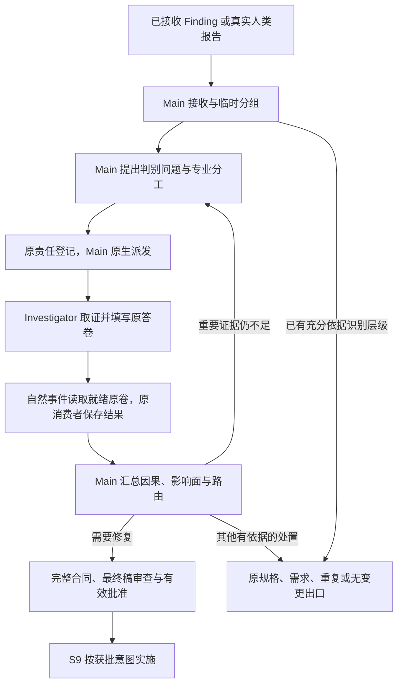

# L3-S8 发现调查与根因推导

## 1. 为什么发现之后不能直接派修

S7 已经确认实际观察与权威预期存在冲突，S8 要解释造成冲突的机制，并确定恢复哪个系统不变量才能完整解决。Finding 是“发生了什么”的事实，不能直接充当“为什么发生”和“应该怎样修”的结论。

例如，表单无法保存、保存后不显示、刷新后字段丢失和服务端解析告警，可能是四个独立问题，也可能共同来自前后端对同一字段的契约漂移。若按表象各派一个 Builder，容易形成默认值、重试、缓存刷新和字段别名四个局部补丁，真正的双重数据定义却继续存在。

S8 因而把观察与修改分开：保留每项原始事实，提出可证伪解释，用判别证据排除重要替代原因，建立完整因果链，再形成修复合同。S9 依据获批合同实施，不重新猜根因，也不能以“先改改看”代替调查。

调查的目标是最小完整根因修复所需的共识，不是最小代码差异。共识应说明触发条件、被破坏的不变量、错误机制、传播过程、受影响范围和漏检原因，既能解释已出现的表象，也能约束修复后的断言与回归。一个可疑行号、设计模式名称或临时能变绿的补丁都不足以完成这一目标。

本阶段承载[设计原则](../l1-principles/L1-design-principles.md)中深入理解、证据驱动、独立责任与可观测收敛的要求。与 [S7 完整验证轮](L3-S7-verification-round.md)的交接是“已确认现场进入原因调查”，与 [S9 修复](L3-S9-repair.md)的交接是“已证实原因和有效批准的修复意图进入实施”。

## 2. 职责与权威对象

### 2.1 三个长期对象，一条调查事实链

| 对象 | 权威内容 | 不能被当成什么 |
| --- | --- | --- |
| Finding，发现项 | S7 接收的不可变观察、真实现场与证据引用 | 已确认根因、修复授权或可覆盖的临时草稿 |
| InvestigationCase，调查案 | 来源集合、分组理由、假设与结果、因果模型、影响面、漏检原因和路由 | 另一个按文件排修复任务的 BUG 清单 |
| RepairContract，修复合同 | 经审查与有效批准的根因修复意图、完整范围及验证约束 | 尚未批准的建议、需求变更或发布授权 |

Hypothesis 是 Case 内待判别的假设，HypothesisResult 是针对该假设的专业结果，CausalModel 是 Main 汇总的因果解释。它们都有准确来源和可审计记录，但不各建独立生命周期。现场仍在原 Finding，证据仍在原文件与索引，不能复制进另一套“故障事件”实体后同时维护。

看板、发现台账和人读 BUG 报告应由这些事实投射。兼容 BUG 如有需要，只在合同获批后生成并保留 Case／Contract 来源；它不拥有独立的调查或修复授权。

### 2.2 Main、调查者与系统各做什么

| 参与者 | 本人责任 |
| --- | --- |
| Main／调查负责人 | 无损接收、提出分组与竞争假设、专业分工和原生派发、汇总因果、搜索完整影响、决定路由、准备合同与有效批准材料 |
| `investigator` | 执行本人被派发的判别问题，取得实际证据，说明支持、反驳或未决，以及能够和不能解释的表象 |
| 原发现者或授权替代者 | 解释已有现场；确有判别缺口时补充受控观察，追加原 Finding 的补充记录 |
| 合同技术审查者与有效授权主体 | 审阅最终真实合同，分别承担技术判断和批准权；角色是否独立按所选授权方式处理 |
| Claude Code | 创建、运行、消息与恢复原生子代理，不替代工程事实或因果判断 |
| Hook | 在自然事件准确选择当前责任，读取原答卷的可解析性、必要字段、就绪情况及其结论，调用原消费者并反馈结果 |
| 原消费者与 Runtime Writer | 一次保存当前专业答案，按答案条件执行原路由和交接；身份、状态、版本及幂等作为内部持久化关系维护 |

调查者不创建第二个 Case，不改 Main 路由，不批准自己的修复建议，也不顺手改产品。Main 不能代填调查者的专业结果；系统不能因为证据数足够或命令返回绿色就自动宣布假设成立。

Case 修订、合同修订和 Runtime `revision` 用途不同。前两者关联专业对象的版本，后者协调状态事务。身份、版本和已知责任关系由系统沿已有记录维护，作者填写专业判断。Hook 及其消费者不计算、登记或校验 Case、合同、答卷、证据的 hash／SHA、其他散列或 Git OID，也不以散列生成身份。内部一致性与防重复写入不是额外验证门禁，不要求作者抄录机器字段、补交证明或重新认证历史。

本人工作的共用五态为 `pending/active/blocked/done/cancelled`；Case 的 `investigating/contract_approved` 与假设结果的 `supported/refuted/inconclusive` 是领域事实。它们保留各自含义，不替代本人进度，也不再派生一套跨阶段工作状态。

### 2.3 调查允许产出证据，不能污染被调查对象

S8 对产品、正式测试、锁定规格与正式环境配置保持只读。它可以阅读代码和契约、查询可信日志与状态、比较数据、执行已有检查，或在明确隔离且安全的条件下开展控制实验并保存证据。

控制实验应改变所观察的输入或隔离实验条件，不能先改产品，再用修后的行为反推原根因。临时探针不是获准落地的产品修改；需要持久改变代码、测试、工具或项目配置时，先形成合同交给 S9。若诊断条件存在风险或需超出既有授权，先完成不依赖该条件的调查，再由原批准主体处理具体实验边界。

## 3. 从哪里进入，以及怎样保留原事实

### 3.1 S7 的原发现交接

常规入口是 S7 已接收答卷中的 Finding、实际观察及未完成范围；直接沿当前接收链交 S8，删除 ObservationBatch 历史兼容输入和批次证明接线。Main 如实保留发现和现场，不随意删选表象。

原消费者从当前交接读取本人实际需要的原发现，保存 Case 来源关系；不重新验证其他历史、重算 S7 专业结论或逐证据核 Git／摘要。Main 与 Investigator 按本次问题需要阅读期望来源、实际观察、失败边界和证据，专业阅读不是 Hook 接收前置门。

产品阻断的命题和 P0 紧急停止时未观察的命题保留为未完成范围，不能在调查中误当作已验证行为；Main 按无需变更、修复或其他实际处置安排后续验证，不预设一定需要修复。本人实际 Finding 连同现场和安全缺口交调查；缺口不是重新执行危险操作的授权，也不因缺口额外要求机器认证发现。

接收后建立的发现台账是查阅视图，关联每项 Finding、基线、最后正常点、首次异常点、候选原因、原发现者、补充证据和处置。台账不新增权威状态文件，也不能通过“已归并”删除表象。

### 3.2 消费现场，不默认重新证明症状

调查者首先从 `last_good_checkpoint → wall_action → first_bad_checkpoint` 阅读，关联终态、逐步证据、状态差异、请求或执行追踪。应区分三个工作视图：

- 失败边界：最早在哪个边界偏离了哪项要求。
- 跨层路径：从入口、请求或命令，到服务、状态和持久化，哪些节点已有观察，哪些仍是推断。
- 证据缺口：哪个未知事实会改变原因判断，怎样以最小安全操作取得它。

`journey_summary` 帮助快速理解，不代替原步骤与证据；相同报错或相同撞墙位置只是线索，不证明共同根因。QA／交付的静态检查发现同样是一等输入，使用原阅读入口和调用／数据流，不要求伪造浏览器旅程。

已有事实足以判断时直接使用。仅需解释证据含义、环境或来源时请求澄清；只有一个明确判别问题缺少必要观察时，才安排补充实验。没有再复现，不足以抹去原来已被确认的一次发生。

### 3.3 人类报告与 S9 回流

S11 的真实缺陷决定可经 TR-027 打开调查。没有 S7 Finding 时直接使用人的实际描述和原决定，不伪造批次、Claim 或 Finding。原消费者沿已消费决定建立 Case 来源，来源 Finding 集合为空，批次字段不填入 Case；专业工作按实际需要读取原产品材料。

人类报告、专业调查结论和修复授权承担三种责任。原决定说明“人报告了什么”，并不证明候选原因成立，也不授权任意修复。Investigator 仍作真实判别，Main 负责因果、影响和路由判断；确需批准时记录原批准主体的真实决定。空 Finding Case 可以沿同一原合同流程进入 S9，无需先去 S7 获取一个编号。

题目交付原报告准确路径及已有来源，调查者引用原决定 ID 或路径。系统保留原来源事实，不在每次结果或批准时遍历 Case 历史、重新证明冻结产品或要求作者补 SHA。必要材料实际缺失或专业观察揭示基线变化时，向 Main 交接具体缺口和影响；不让调查者猜引用、重报问题或伪造材料。

S9 定向复验出现非 `blocked` 失败时，保留本人实际结论，由 Main／S8 判断是否需要携可用失败观察回原 Case 重查因果；仅有 `fail` 而原因未分类时保留未知。实际重查保留原 Finding 集合与旧合同历史，并依据已有新事实说明其对旧判断的挑战。纯环境或执行前提阻塞先在 S9 恢复，不应一律制造新根因。详细恢复见 §12。

## 4. 候选分组必须可被证据推翻

### 4.1 分组是调查起点，不能先宣判同根

可用来建立候选组的线索包括同一对象或请求、相邻时间窗、相同契约、不变量、读写或序列化路径、共同触发输入，以及一次判别实验可能同时解释的几个表象。Main 在 `grouping_rationale` 写明为什么值得一起调查，同时保留哪些联系尚未证明。

同一页面、同一文件、相似错误文本、同一个发现者或相同自动指纹，都不足以将多个表象确认为同根。调查中若发现独立机制，应拆清原因、受影响面和修复约束；若证据证明同一机制跨多个表象，则把每项表象明确映射到该机制，而不是保留一个代表项后丢弃其余。

确认同根至少要有同一被破坏不变量、证据支持的错误机制、能解释每项来源的传播链，以及相容的完整修复边界和断言。一个表象也可能同时受主因和促成因素影响，不能为方便台账强行选择一个原因。

### 4.2 可逆分组原则与当前落地范围

原因判断应允许依据新证据调整分组，保留拆分、合并、重复关联的理由与原事实来源。已有接收内容不覆盖；新的实际发现可作为原责任的后续事实交 Main 判断，不要求预先固定一份永不增加的发现全集。

当前 Runtime 维护一个活动 Case，现有实现依赖原批次固定来源集合，并不自动具备新设计的晚到发现接续能力。S7 首个 Finding 已交 S8 后，其余已派发 Reviewer 的原答卷仍按 S7 原责任接收；新发现交 Main，Main 可将实际材料补入当前调查或按真实范围安排后续调查。不重开 S7、不另造 Batch／登记表；既有来源内容不改写。若合同已获批准，新事实不会自动改变该批准，Main 依据实际影响处理原修订和必要决定。实现前须补通原接收和该交接，不能凭本文宣称已可用。

遇到混合原因时，Main 应先在原 Case 内把假设、解释集合与未解释项分清；若需要独立 Case 或不相容路由，显式处理原权威与恢复边界，不能删掉难解释项或擅造多案指针。后续完善机制也必须保持每项来源有去向，而不是扩充一套平行台账。

## 5. 用可证伪假设组织调查

### 5.1 先定义什么观察能区分解释

“可能是缓存”“应该抽一个工厂”不是可派发的专业问题。一个 Hypothesis 至少要有：

| 字段 | 要回答的问题 |
| --- | --- |
| `statement` | 在什么条件下，哪种机制导致了哪项偏差 |
| `invariant` | 本应保持的契约或系统不变量是什么 |
| `discriminator` | 比较哪些事实或做什么安全实验，能够区分这个解释与竞争解释 |
| `expected_outcomes.support` | 哪种具体观察支持该假设 |
| `expected_outcomes.refute` | 哪种具体观察反驳该假设 |
| `source_finding_ids` | 它试图解释原 Case 的哪些表象 |
| `evidence_refs` | 提出该问题依赖的实际证据，不是未来希望取得的结果 |

以字段丢失为例，Main 可以先建立以下竞争解释，而不是按四个报错分别派修：

| 候选机制 | 优先使用的判别事实 |
| --- | --- |
| 表单状态到请求载荷的映射丢字段 | 同次操作在表单状态、映射输出和发送边界的字段差异 |
| 前后端对字段名称、类型或空值语义不一致 | 权威契约、客户端类型、实际请求与服务端解码的差异 |
| 服务端到领域或持久化的映射丢字段 | 解码后、服务层、仓储和写入结果之间的差异 |
| 保存成功但响应或缓存回填覆盖了状态 | 持久化、响应、缓存与渲染状态的先后关系 |

这些是假设方向，不是要求每次都派四个人。已有证据已经排除某方向时记录理由；几个问题共享相同阅读集合时可协调执行，但每个实际问题仍须有准确责任与可辨别结果。

纯静态质量发现也要这样处理。例如重复分支可能来自缺失的稳定扩展边界，也可能是两种不应合并的业务差异。调查应核对变化轴、项目惯用法和失效风险，不能把“没有使用某模式”直接转换成根因或强制重构合同。

### 5.2 Main 的专业题目长什么样

Main 的假设工序接收专业问题数组。新行不需要自拟 Hypothesis 或 Assignment ID；系统生成原格式身份，已有行保留原身份以区分重放、新问题与冲突。下面是一行的示意，实际来源必须使用当前 Case 的真实 Finding，以及其准确冻结来源、有效登记证据或其他已支持的真实证据引用：

```json
[
  {
    "statement": "必填字段在客户端共享映射层被丢弃，服务端尚未收到该字段。",
    "invariant": "符合当前契约的有效输入必须完整保留到发送边界。",
    "discriminator": "比较同次调用中表单状态、共享映射输出与发送前载荷，核对映射过滤规则。",
    "expected_outcomes": {
      "support": "字段在表单状态存在，在映射输出首次消失，发送前已缺失。",
      "refute": "映射输出和发送载荷均保留字段，首次异常发生在服务端或回填之后。"
    },
    "source_finding_ids": ["finding-field-loss"],
    "evidence_refs": ["ev-field-boundary"]
  }
]
```

`agent_id` 可由 Main 作为工程 owner 选择填写；未选时原流程可给出默认责任名。它不用于伪造平台身份。分工应考虑实际专业能力、阅读范围、实验环境、数据与资源冲突，以及谁需要保持独立判断。

### 5.3 竞争解释由 Main 按实际风险判断

关键替代解释应由专业工作处理，支持结论不能只因为“暂时没被反驳”。Main 根据真实材料判断哪些竞争机制值得判别，已有观察能否区分，或者为何没有可信替代；不为凑数量制造一个容易反驳的假设。

既有 `competing_hypothesis_assessment` 或 `no_competing_hypothesis` 用于表达 Main 的判断和理由，不是两条机器证明路线。Main 可以引用已取得结果说明竞争解释怎样处置，不要求至少一项 `refuted`、所有假设必须完成或所有历史问题必须逐项取得支持／反驳才允许选择出口。重要未知会影响决定时，由 Main 继续调查并如实交接。

Investigator 在 `new_hypotheses` 提出的只是建议。系统原样保存，Main 根据是否会改变原因、范围或路线判断决定是否登记并实际派发。建议不自动变成新 Hypothesis／Assignment，不自动增加阶段退出条件。

## 6. 判别取证怎样开展

调查先读原 Case、Finding 与现场边界，再有针对性地阅读契约、实现、测试和运行证据。不能从整个仓库漫游，直到找到一段看起来可疑的代码后倒推解释。

可采用的方法包括同次调用不同边界的值比较、契约与类型对照、日志与状态关联、读写传播追踪、已有测试判据检查，以及安全隔离的控制实验。每项方法都要说明比较对象、控制条件、预期区分结果和停止条件。证据证明到哪里，判断就停在哪里。

澄清已有证据与取得新观察应分别安排：

| 工作 | 何时需要 | 输出 |
| --- | --- | --- |
| 澄清 | 现有引用、环境或证据含义不清，但不需重新执行 | 对原 Finding 追加解释与准确引用 |
| 补充观察 | 某已登记假设存在会改变判断的证据缺口 | 绑定假设、判别条件及支持／反驳预期的新观察与证据 |

只有补充或澄清原 Finding 现场才通过 FindingSupplement 追加，不重写原 `observed` 或现场；这类工作由原发现者或 Main 安排的明确授权替代者完成。Investigator 为本人判别取得的新日志、比较和控制实验观察，直接随原 HypothesisResult 提交真实文件引用，不先转交原发现者，也不另写 Supplement。人类来源没有 Finding 时同样走本人判别结果。不能因为联系不上原发现者就把已确认现场判成不存在。

新观察必须保留原基线或能证明等价的快照条件，尤其注意账号、数据、缓存、时序和外部依赖。无法安全重建时记录缺口与对判断的影响；P0 的安全缺口不要求冒险重做。临时诊断动作本身若改变了观察条件，也须如实记录，不能把变化后的结果冒充原始发生过程。

当前调度以已登记假设及其 Assignment 为责任单位。上下文相容的问题可以由 Main 协调相同或不同原生上下文执行，实际答卷仍逐个绑定，不能把多个独立责任合并为一份泛化报告。独立检查可并行，存在前置证据、互斥环境或共享资源时按真实依赖排序；没有质量层面的固定调查人数配额。

## 7. 题目交付、原生派发与结果接收



图中因果汇总和批准均有明确责任人，不由箭头所代表的工具事件自动作出判断。其他出口的实际条件与当前适配范围见 §11、§14。

### 7.1 Main 按工序完成自己的材料

系统渐进提供 Main 的准确工序文件，而不是要求一次填满 Case 的所有字段：

| 工序 | Main 填写 | 原消费者做什么 |
| --- | --- | --- |
| 接收 | `grouping_rationale` | 从已接收 Finding 或真实人类决定直接带出来源，建立临时 Case；不以兼容 BUG 为入口 |
| 假设与分工 | 专业问题数组、必要的 owner 选择 | 注册原 Hypothesis 和工程责任，提供实际任务、题干与答卷来源 |
| 因果与路由 | 原因、因果对象、影响面、漏检原因、路由与理由 | 在原 Case 修订中保存原答案，按所选条件接续出口 |
| 修复合同 | 修复不变量、范围、单元和验证断言 | 投射含原 Case 绑定的最终合同稿，等待有效批准 |

Main 的工序文件是对应专业对象，不统一包装成 Worker `answer`。保存后沿原消费者接收，不再让 Main 将相同内容拆成若干信封或重复登记命令。准确路径缺失、来源无法读或准备失败时，Main／系统修复具体接线缺口，不能让作者猜 ID、拼摘要或自行发行另一套答卷。

准备发生在原阶段入口、责任发行或具体缺失的恢复入口，向作者提供准确路径；普通事件不重复准备整套材料。各工序使用既有专业表达：接收工序的分组理由、问题数组中的实际问题与安排、因果工序的原因及路由、合同工序的修复意图。未填写、占位、明确待调查等可解析内容仍可为草稿或合法未终结表达，空数组也不能自行解释为已完成调查或无需修复。题面未定义统一最终标记时，作者正常保存既有表达即可，系统保存能明确识别的事实并交接未决责任，不另加必填结论、结束语或提交动作，不推断作者内心完成时刻。自然事件看到当前原答卷就绪时，调用原消费者一次保存并接续原工序。已有匹配授权时原批准消费者记录并应用既存真实决定，不能由 Hook 自行作出批准。

Main 保存问题数组后，原流程逐项登记假设和责任，同次尽可能完成后继；前几项成功、后项失败时保留原数组与已完成事实，由 Main／系统沿该工序已有恢复入口只接续未完成部分，不要求作者再次保存未变内容。反馈明确未完成项与实际接手人，没有执行者时不宣称会自行恢复。改变已登记题意或 owner 属于真实修订，不能把一次恢复变成覆盖已派任务。

登记完成不代表平台已经启动调查者。Main 仍须使用 Claude Code 原生 Agent 实际启动或恢复，并把该责任的准确题干与私人答卷引用、实际目标和只读边界放进任务。两个调查者角色相同也不能靠角色名分配队列。

### 7.2 自然事件只消费当前原答卷

`SubagentStart` 提供简短提醒，Main 原生任务交付准确责任与原答卷路径；系统从当前登记关系和本次任务确定责任，不靠角色名、唯一候选、返回次序或 cwd 猜选，也不要求作者重复声明身份。删除旧 execution／bootstrap 兼容接线。

Investigator 读取原题目、Case、Hypothesis、必要 Finding 与证据，执行本人判别并保存原私人答案。Hook 在适用的自然 Pre／实际保存后的 Post／SubagentStop 等事件读取当前原答卷，未就绪不接收，就绪则调用同一原 HypothesisResult 消费者。事件是接收时机，不增加保存信号、返回证明或第二次作者动作；精确接线由 [Hook 机制](../l4-mechanisms/L4-hook-platform-wiring.md)统一定义。

Hook 只核可解析性、必要字段、就绪情况与本卷结论；Hook 和原消费者不计算、登记或校验任何输入、答卷、回执、证据及来源的散列或 Git OID，也不机械认证根因真伪或因果闭合。来源关系由已有登记随原记录保存，不扩成平台身份认证或工具许可。未知或多义责任交 Main／系统处理，不借 Main 答案补 Worker 结果。

### 7.3 原消费者一次保存，接续只补未完成部分

原消费者将当前答案与已有 Hypothesis／Assignment 关联，保存结果及回执到原 Case，按答案条件接续原工序。身份、状态、版本、并发和幂等是内部持久化职责；不是先证明全部来源、所有同伴已答或历史证据仍可重建后才允许保存的资格门。`new_hypotheses` 保留为建议，只有 Main 决定采用后才登记新责任。

同伴新增结果不使本人原卷失效；本人问题或实际专业输入改变时由 Main 明确处理。已接收结果不再作为填答任务。响应丢失时读原回执，后继失败只恢复未完成部分，不唤醒已履职调查者重交，也不要求私人 answer／view 永久存在。

重复事件复用原接受事实；同身份异文不覆盖已接受内容，真正新的判断由原修订工序处理。已收 blocked 或未完成交接仍保留原专业责任；Main 原安排或可准确归属该原责任的本人自然继续后，系统沿原关联接续当前新尝试，自然事件接收本人正常保存的新观察，不要求先等待 Main 登记。旧结果保留，不能将旧 blocked 重放当成解除，也不要求作者另交恢复证明或执行 resume／submit。这些内部约束不要求在普通观察时重新读取所有历史、散列证据或重跑专业检查。

本人结果被保存不代表原因已证明或 S8 已完成。`supported` 是作者的专业结论；Main 路由、真实批准和阶段交接分别由原责任作出。共同机制见[原生子代理治理](../l4-mechanisms/L4-agent-dispatch-governance.md)及[阶段答卷](../l4-mechanisms/L4-stage-form.md)。

## 8. 调查结果应表达什么

调查者只修改原答卷的 `answer`，保留题干。答卷顶层仅保留 `title`、`instruction`、`read`、`questions`、`answer` 五个字段，不要把 view packet 的 `packet_id`、`template_id`、`binding`、`inputs`、`draft`、`view_path` 或 `answer_path` 抄入答卷。其字段包括实际方法、证据、原现场边界、实际观察、判别或反事实、`supported`／`refuted`／`inconclusive`、能解释与不能解释的 Finding，以及可选的新假设建议。

`source_boundary_refs` 用本人能够清楚识别的原 Finding、决定或准确路径说明调查起点；现有 `finding:<原ID>` 或指针可继续使用，但不要求作者为接收满足某一种来源编码或逐项机器验指针。执行证据在原答卷中按实际可读材料说明。人类来源没有 Finding 时，如实表达即可，不制造占位 Finding。

证据引用用于让 Main 和实际审查者理解真实观察。已有证据 ID、`runtime:<id>`、原 Finding 冻结引用和真实文件路径保持原语义，不要求同一来源重新登记别名。执行锚 `scheme://...` 本身不证明运行，引用数量和字段齐全也不证明因果成立。

本次新日志或观察文件可保存在本人实际可用位置，原答卷引用能让下游理解并找到的材料；不要求作者计算摘要、登记证据或填写来源证书；Hook 及原消费者也不计算、登记或校验任何引用文件的散列或 Git OID。文件保留实际命令、条件、观察和必要截断说明；无实际文件时如实说明缺口，不编造引用。

系统已保存的原证据与已发行题目继续沿原路径和责任使用，不重新计算、登记或校验任何历史 hash／SHA，也不要求 Main 先证明每份材料符合当前模板才能创建首个问题、保存结果或选择路由。专业阅读发现文件缺失、条件变化或内容矛盾时，Main 判断其对本次结论的影响，恢复必要材料或继续调查；Hook 不代读全部证据并重算结论。现行设计不承诺机器保证每份证据真实性或根因正确。

下面是一个**反驳服务端丢字段假设**的专业 `answer` 示意。它确认异常在发送前已经存在，没有越权宣布另一个假设已成立：

```json
{
  "method": "读取同次操作的表单、映射输出与发送前记录，并与服务端接收边界对照。",
  "evidence_refs": ["ev-field-boundary"],
  "source_boundary_refs": ["finding:finding-field-loss#/encounter/first_bad_checkpoint"],
  "observed": "字段在表单状态存在，映射输出与发送前载荷已缺失；服务端尚未参与首次偏差。",
  "counterfactual_or_discriminator": "若服务端首先丢字段，发送前载荷应完整；实际观察不满足这一必要条件。",
  "result": "refuted",
  "explains_finding_ids": [],
  "does_not_explain": ["finding-field-loss"],
  "new_hypotheses": []
}
```

证据不足或判别受阻时使用 `inconclusive`，在 `method`／`observed` 写清实际已做、尚未执行、具体阻塞、缺少什么和 Main 下一步。不要另造 blocker 字段或第二份报告。必需材料根本不存在时先报告准备缺口，不能虚构证据以满足交卷。

`explains_finding_ids` 和 `does_not_explain` 使用本 Case 来源，彼此不重复，帮助 Main 理解解释范围；不是机器覆盖闭合门。新假设建议应尽量说明问题、不变量、判别及现有依据，Main 决定采用时再完善到可派发问题；留空建议不影响本人交付，已有建议也不自动要求全部调查。

## 9. 从假设结果形成完整因果解释

### 9.1 区分原因、条件与传播

Main 汇总相关已收结果，判断矛盾和未解释项的影响，再形成因果模型。应连通：

```text
实际触发条件 → 被破坏的权威／不变量 → 错误机制
            → 传播路径 → 每项来源表象 → 完整影响面 → 漏检原因
```

| 概念 | 数据契约偏差中的例子 |
| --- | --- |
| 主根因 | 同一业务字段由两套未受约束的定义维护，变化后发生语义漂移 |
| 触发条件 | 新字段进入其中一条写路径，另一条映射未更新 |
| 促成因素 | 缺失字段静默降级，没有明确验证错误 |
| 传播 | 载荷丢值、持久化为空、响应和缓存继续传播缺失值 |
| 表象 | 保存或显示偏差、刷新后丢失等实际 Finding |
| 漏检原因 | 契约检查缺失，现有测试只检查响应成功 |

不能把触发条件、受害组件和所有促成因素都叫作根因。代码位置是机制证据；根因陈述还需解释为何在既定条件下出现偏差、恢复什么约束能消除复发，以及哪些相邻路径没有受影响及其理由。

每个进入模型的来源 Finding 都应有解释。支持结果不足以解释全部来源时继续调查；重要替代解释仍未决时不能靠“最可能”进入 S9。反事实可以来自可信现场、契约比较、静态路径和安全控制实验，不要求先写修复补丁才能成立。

### 9.2 影响面与漏检原因不能写成空泛结论

影响面 `blast_radius` 搜索同一机制可能污染的入口、模型、序列化、存储、历史数据、缓存、消息、异步任务、权限与审计、CASE／PATH、已有通过证据、生成器和共享类型。它不是待改文件计数。至少列出具体路径或表面，并解释为何纳入、哪些邻接面排除以及依据。当前自由对象推荐使用 `paths`、`inclusion_reason` 与 `excluded_surfaces`；排除项按 `surface`、`reason`、`evidence_refs` 表达。空排除集合可以是 `[]`，不能编造已排除表面。

漏检原因 `detection_gap` 解释本应在哪一层提前发现、已有机制为何没有拦住、修复后应新增或加强什么判据。当前结构使用 `gap_type` 区分 `test`、`contract`、`type`、`monitoring`、`process`，并提供实际证据。推荐在同一对象的 `explanation` 写漏检机制，在 `missing_assertion` 写具体缺少或需加强的判据。因果对象可在 `evidence_refs` 关联实际证据。这些是自由专业对象的推荐表达位置，不新增机械必填门。只写“补测试”“提高质量”无法形成有效验证合同。

S8 给出预期影响与修复边界，S9 再根据真实修复差异形成最终 ChangeImpact 并处理受影响证据；不能在调查阶段宣称最终差异已经完整。

### 9.3 Main 作专业收口，机器不认证因果

Main 依据原结果和必要材料，在现有因果与路由答卷中记录原因、因果解释、影响面、漏检原因、处理选择和理由。Main 判断现有材料是否足以选择 S9 修复、原 S7 无变更复查或其他实际出口；需要补判别时再登记所需问题。

未解释集合、假设状态和来源关联用于导航，不成为逐题完成、逐 Finding 解释 ID 闭合、至少一项反驳、全部建议落地或所有历史证据有效的机器门。无关、被后续材料解决或已不影响决定的旧问题不产生永久否决权。Main 应在原理由中诚实说明重要未知如何影响路线，不能用机器接受代替判断，也不能把未知改写为支持。

`inconclusive` 是已接收的真实结论，说明该次未能支持或反驳；它本身不表示本人尚未履职。本人是否结束按已有责任和实际交接判断，未知交 Main 处理，不强迫原调查者继续，也不因该结论重读或要求保留已收私人原稿。实际 blocked 或未完成也能返回 Main；返回不等于修复条件成立。Main 和实际审查者负责判断因果边、替代解释、完整范围与修复层级，系统只保存他们的真实答案并按所选条件执行原交接。

## 10. 怎样形成能够执行的修复合同

### 10.1 从原因推导修复意图

RepairContract 固定三组共识：

| 部分 | 要固定的内容 |
| --- | --- |
| 原因 | 已确认的主根因、被破坏的不变量、Case 因果模型及实际证据来源 |
| 范围 | 架构修复意图、全部来源、修复单元、预期与禁止写面、兼容迁移和回滚要求 |
| 验证 | 表象断言、根因不变量断言、漏检补强断言、回归面与停止／升级条件 |

修复要恢复共同机制，而不是让第一个报错消失。若根因是双重数据定义，合理意图可能是明确唯一字段权威、统一受影响映射、清除必要的重复定义、处理历史数据与兼容窗口，并补上跨边界断言。若事实只支持一处局部映射缺陷，也不应借此扩大为没有依据的全项目重构。

合同应明确禁止能够掩盖问题的捷径，如用 UI 默认值隐藏丢值、失败时显示成功、静默吞异常、逐页面加别名、只改预期让错误变绿，或只验证一个表象。对促成因素是否修复，按其对不变量和复发风险的必要性说明理由。

S9 可以设计实现步骤、选择适当技术细节，但不能重新定义获批意图、删改断言或扩大业务范围。实现中出现会改变该共识的新事实，应停止受影响工作并按原调查或规格变更路线处理。

### 10.2 修复单元与三层断言

`repair_units` 需要真实可执行的 `scope`、`assertion_ids`、必要依赖与资源约束。数组中的三层断言依次映射为 `symptom-1`、`root-1`、`gap-1` 等原位置 ID，或使用明确的 `all` 归属。ID 是断言索引，不能替代具体业务预期。三个数组各自从 1 编号；`all` 单独作为数组唯一元素，表示该单元承担全部断言。每条断言应有真实单元负责，`depends_on` 引用本合同已有单元 ID 且无循环，`resource_locks` 仅按实际互斥资源选填。

表象断言证明原问题得到消除，根因断言证明恢复了正确机制，漏检断言证明以后能及时发现同类偏差。三者不能只保留同一条“页面正常”检查。回归面还应覆盖受影响的邻接路径，兼容迁移写清数据与旧消费者如何处理，停止条件写清何时应交回调查或升级授权。

`scope`、`prospective_scope` 和 `forbidden_scope` 使用仓库相对文件或目录路径；目录包含其后代，不使用 glob。单元范围应位于允许面内并避开禁止面。禁止默认值掩盖错误等行为约束写入 `architecture_intent`，触发暂停或升级的条件写入 `stop_escalation_conditions`；不要把自然语言行为禁令当作 `forbidden_scope` 路径。

以下为 Main 合同工序的专业内容示意；系统另外从 Case 带出身份、版本、准确 Finding 集合、主根因与因果引用，不由作者重抄批准信息：

```json
{
  "violated_invariant": "符合已锁契约的订单字段在有效输入到发送边界之间必须完整保留。",
  "architecture_intent": "让请求映射以现有权威契约为依据，消除与契约脱节的字段过滤规则，并对该边界建立稳定验证。",
  "repair_units": [
    {
      "id": "repair-unit-mapping",
      "description": "修正共享请求映射，移除造成必填字段丢失的重复规则。",
      "scope": ["web/src/orders/payload.ts"],
      "assertion_ids": ["root-1"]
    },
    {
      "id": "repair-unit-regression",
      "description": "为字段保留和真实提交旅程补充有判据的回归。",
      "scope": ["web/src/orders/payload.test.ts", "web/e2e/orders"],
      "assertion_ids": ["symptom-1", "gap-1"],
      "depends_on": ["repair-unit-mapping"]
    }
  ],
  "prospective_scope": ["web/src/orders", "web/e2e/orders"],
  "forbidden_scope": ["docs/requirements", "docs/contracts"],
  "compatibility_migration": "维持当前接口字段与语义；若调查发现历史数据需要迁移，停止并补充完整合同及相应授权。",
  "symptom_assertions": ["finding-field-loss 对应的有效提交保留该字段，响应与后续读取符合原场景判据。"],
  "root_invariant_assertions": ["共享请求映射与当前权威契约一致，有效必填字段不会被独立过滤规则丢弃。"],
  "detection_gap_assertions": ["回归在字段被过滤时可靠失败，并检查请求内容而非只检查成功响应。"],
  "regression_surfaces": ["订单有效提交", "订单拒绝分支及禁止副作用"],
  "stop_escalation_conditions": ["需要改变锁定契约、扩大产品写面或改变业务语义时停止，交 Main 重新调查和履行原批准条件。"]
}
```

这是结构示例，不是对这些文件或修复原因的实际判断。Main 与实际审查者负责确认真实范围、单元依赖和断言归属能够指导 S9；不能将完整执行意图拖给 Builder 猜测。必要字段可解析不等于合同专业质量已获机器保证。

### 10.3 原合同、实际审查与真实批准

Main 保存现有合同工序的专业内容，原消费者沿 Case 保存合同并提供可审的准确稿件。确需人批准时，复用原决定／授权入口记录人的真实选择和必要理由；Main 如实承接，沉默、空选择、保存动作和机器建议都不构成批准。不新增最终答卷、批准封套或第二份总结来证明 S8 完成。

原授权有逐稿人类批准、有限需求委托和绑定时固定项目策略三类，各自保留真实范围与指定责任。Main 查明本次适用授权；无现成有效授权时先准备到可审状态，再交实际授权主体。有限授权下由原指定 Driver 判断需求语义、范围、可逆性与证据是否充分；Driver 就是 Main 时由 Main 本人作判断，否则 Main 交付原稿并忠实记录其意见。技术判断仍要实际完成：Main 或该授权方式已有指定审查主体阅读准确合同，判断原因、修复范围、不变量与复验安排；逐稿人类批准由原人类批准者决定，有限委托与固定策略仍按原授权主体和边界作决定。按既有规则可以兼任时由同一人承担技术判断与批准，不增设人头。技术意见和真实决定随原合同工序及原决定入口承接，不能以保存动作替代其中任一责任。

批准针对真实呈现的原合同，不迁移到改变后的修复意图。原合同工序保存一次实际呈现的合同对象及其 Case／合同身份和版本，原决定入口保存真实授权主体、决定和该对象关联；原 Writer 按既有责任与版本防止重复消费。Hook、原决定、schema、Case／合同消费者及 S9 读取均不计算、登记或校验合同、批准或证据的 SHA／hash、其他散列或 Git OID，也不将批准身份改用另一种散列。已知修复意图改变时形成实际新版本并按原授权办理，不让旧决定背书新对象；缺少原呈现内容或关联时保留事实及未知，交 Main／系统处理，不重建或伪造旧批准。Main 与实际审查者判断内容是否成立，机器不凭路径和版本声称能发现未被记录的外部字节修改。

原批准成功后保存既有 Case／Contract 和进入 S9 `repair_readback` 的交接；后续材料准备失败沿同一事实补未完成部分，不重新批准或重复耗预算。未获真实必要批准时可以交接当前 blocked 与准确待决定事项，不能伪造通过。

撤销委托或修改策略影响后续新批准，不抹除已经成立的合同事实；紧急停止处理实际活动责任。需求修改、破坏性操作与 S11 发布仍由各自实际授权承担。共同边界见[受限执行与授权](../l4-mechanisms/L4-workspace-execution-profiles.md)。

## 11. 选择正确出口，而不是一律派修

### 11.1 一份 Case 保留一个明确路由

| `route` | 专业成立条件与下一责任 |
| --- | --- |
| `s9_repair` | 实现、测试、工具或项目配置需要修改；根因、完整合同和有效批准成立后交 S9 |
| `s2_spec_rework` | REQ 不变，设计、原型、契约或任务事实需要更正；回 S2，重建受影响规格与验证依据 |
| `human_req_change` | 正确行为需要改变锁定需求；进入真实人类暂停与需求修订路径 |
| `s7_no_change` | 有确定证据解释全部报告且无需改变任何产物；原消费者打开新的完整 S7 轮 |
| `investigate_more` | 原因、证据、解释集合或修复准备不足；留在同一 Case 继续有针对性的调查 |
| `duplicate` | 已有规范 Case 的因果模型和修复约束完整覆盖该问题；保存准确关联并跟随原责任 |

选择 `s7_no_change` 时，Main 在原 `route_reason` 中解释实际观察、为何产品／规格／测试／配置等产物都无需修改，以及什么证据会推翻这一判断。它不需要完整 S9 因果对象或修复合同，也不是把尚未解释的问题改称通过；理由的可信度由专业阅读与后续完整 S7 判断，不另建自然语言裁判或证明表。

测试、夹具、harness 或判据本身有缺陷，只要需要持久修改，就应进入相应修复，不能因“不改产品代码”直接判无需修复。Main 选择重复时应确认规范 Case 实际覆盖本问题，不能只根据名称相似关闭；系统保存其原关联，不重新证明规范 Case 的全部历史。

证据不足属于 `investigate_more`，不属于误报。无需变更的处置必须解释原观察为何成立、实际偏差如何解释以及为什么所有相关产物都无需修改。Main 对该出口作真实专业判断；系统不另外要求一套无需变更的证明包，也不把后续 S7 计划当作当前问题已通过。

### 11.2 路由登记、路由消费与批准分别成立

Main 保存既有因果与路由答卷后，原消费者一次保存专业答案，并按所选条件接续原 `UpdateCaseRoute`／`ConsumeCaseRoute` 或合同批准工序。内部登记、消费和准备可分步持久化，不要求 Main 再保存同一内容、执行手动路由命令或新增最终答卷来触发后继。

原路由消费沿已有 `S8-ROUTE-CONSUME` 实际出口，不仅因生命周期存在 TR-022／TR-023 就声称执行了同名转换。反馈分别说明已保存决定、已完成交接和未完成准备；部分失败保留已成立事实，提供原接手入口。

无变更消费沿本次实际进入关系准备新的原 ReviewPlan、Claims、Assignments 和当前调查展示，进入新的 `verification.running`，不增加完整验证次数；旧轮记录以及仍在途或未完成责任的作者、原路径、派发与接收关系继续保留，不能随当前指针清除。Main 按实际安全与输入适用性安排旧责任继续、真实取消或重新安排，旧轮晚到结果沿原责任接收，并按 S7 §11.1 判断其对当前调查或新轮的影响，不充当新轮完成结论。它不会产生新的 PASS 或 CleanRound。规格返工回 `planning.design`，需要重跑受影响的契约、任务与验证链。需求变更在真实暂停边界处理，普通路由消费不能代替人类锁定新 REQ。

原 S9 合同批准同时保存权威合同与阶段交接，不要求调查者再提交通用完成报告。人读 BUG、工作材料与后续准备失败时，从同一批准事实重试相应投射，不重新审批相同内容，也不回滚成“尚未调查”。

### 11.3 混合原因遵守权威层级

若一个批次的不同问题涉及不同层级，应先处理使当前依据失效的决策：需求变化优先交人，需求不变的规格纠正先回 S2；剩余可修复部分才能在仍有效的依据上安排。只有全部问题均有证据说明无需任何产物变化时，才能整体走无变更新轮。

这是专业交接原则。当前单活动 Case 没有完整多案自动聚合能力，不能宣称系统会自动替 Main 合并各案路由或计算完整跨案修复 DAG。出现不相容出口时显式暴露边界，不让多个请求事件竞争或删掉阻碍进度的来源。

## 12. 调查怎样继续、重试与恢复

### 12.1 同一案内按需要继续调查

Main 判断重要未知仍影响决定时，复用原问题列表追加所需判别并实际派发，说明补什么缺口；不覆盖旧题、旧结果，也不要求先登记 `investigate_more` 才能工作。该路线记录继续调查的实际选择，不成为额外开工或阶段退出门。相同答卷重放保持幂等；`investigate_more` 是非终态，Main 后续在原问卷形成的新判断仍由原消费者接收，不能仅因曾保存继续调查就当作覆盖终态拒绝。真实终态和批准对象的保护继续适用，改变修复合同仍履行实际需要的原批准。

新调查不生成、累计或展示调查重入次数，不显示剩余额度，不以次数要求新批准或其他处置。Main 依据实际问题与专业判断决定继续、调整方法或交接真实阻塞，不要求新引用、不同证据 hash、不同摘要或历史结果位置证明“进展”。同一材料可以支持新的专业判断，机器不按数量替 Main 判断调查价值。

新调查不生成、累计或读取旧重入计数作为流程资格，删除旧重入协议及兼容恢复接线。已派发 Investigator 的当前机制原 Case 责任在阶段切换后自然晚到时，沿原 packet 和责任保存本人结果并交 Main，不改写其他 Case、自动撤回批准或归给新责任。关联无法确定时保留现场与未知，不让作者重交；当前接收、Case Writer、真实批准与下游须共同接通。

### 12.2 S9 失败回原 Case 重查因果

非 `blocked` 的实际定向失败可通过原重查入口，将本人已收结果和必要原证据引用交给 `causal_reassessment_refs`；是否需要重查由 Main／S8 依据实际失败判断，原因未分类时保留未知，不自动断定同一根因或撤销批准。原入口不计算、登记或校验失败记录和引用的散列。实际进入重查后，新修订保留原 Finding 集合和路由历史，撤下当前合同指针，让旧已批准意图不再被当成本次实施依据；旧批准事实及已发行责任不因此消失。后续注册新 Hypothesis 和准备新 S9 Session 时，原事务在调整当前 repair 指针前保留已有旧 Session／Plan、已发行 packet／owner、在途与已收结果的必要原关联，旧结果仍沿原责任接收并交 Main，不冒充新合同的结论。旧关联不足时保留现场与未知，不要求作者重交，也不使无关新责任承担证明门；共享 Runtime／journal 本身无法安全写入时按实际系统故障恢复。

重查应针对失败挑战的因果边、未覆盖表象或影响面，不能把旧调查全文重交一次当成新增证据。新的合同需要重新履行准确内容的审查与批准；旧批准不能迁移到改变后的修复意图。

`blocked` 失败先留在 S9 消除环境或验证前提障碍，再按原独立复验路径取得结果。执行没能开始不证明根因错误，不应无条件触发因果重开。

### 12.3 失败时保留什么、由谁处理

| 失败 | 正确恢复 |
| --- | --- |
| 原发现交接缺失或当前指针无法解析 | Main／系统恢复原 S7 交接；不要求作者补制批次证明或重算 S7 结论 |
| 找不到准确题干或原独立来源 | Main／系统恢复真实准备与来源，不猜路径或借 Main 答案 |
| 假设数组部分登记成功 | 保存原专业问题，重试未完成部分，复用已提交责任 |
| 本人结果字段或边界错误 | 按原反馈修正接收所需的类型或缺项；具体来源含义由作者与 Main 判断 |
| 本人结果已接受但响应丢失 | Main 读取原回执，后继只补未完成部分，不重造私人答案、不重派本人或同伴责任 |
| Case 已因本人题意或来源变化而失效 | Main 处理原修订／恢复，新内容不能冒充旧答卷重放 |
| 专业工作发现基线实际变化 | Main 判断对原因和范围的影响，保留旧来源，必要时恢复或重新调查；不改历史给新内容背书 |
| 合同保存但未获有效批准 | 保留可审最终稿，处理具体缺少的授权或审查；不能代填人类决定 |
| 批准已提交、S9 材料准备失败 | 从原批准回执继续后续准备，不能重花预算或要求作者重新签相同稿 |
| 原路线已消费后再次保存旧工序 | 只说明它不再是当前责任，不假称重新接收或给新基线历史签字 |

批准、Case 修订及 Runtime 指针由原 Writer 维护事务与恢复，不能用改本地副本绕过已成立事实。失败先读已有回执和实际未完成部分；原材料仍存在时保留，缺失时准确交接，不重造历史字节或补签旧答卷。来源或产品实际变化若影响专业结论，由 Main 判断并走原修订／调查，普通 Hook 不为证明无变化遍历历史或全部现场。

## 13. 观测应帮助判断调查是否在收敛

| 观察点 | 需要看见的事实 | 帮助定位的问题 |
| --- | --- | --- |
| 接收与当前来源 | 原 Finding／人类报告、已知现场、Case 路径与实际缺口 | 是交接丢失，还是原因尚不清楚；不要求另造 Batch 或完整来源集合证明 |
| 假设与工程登记 | 具体问题、判别、owner、已登记任务与待实际派发责任 | 已准备但未启动，还是已经开始取证 |
| 原生结束与回执 | 准确引用、接受／拒绝原因、原 Case 结果及同伴进度 | 平台运行、来源交付和专业答案错误的区别 |
| 因果看板 | supported／refuted／inconclusive、未解释集合、新证据、路由历史和基线警告 | 是否只是反复重述，而没有排除重要替代原因 |
| 合同与批准 | 实际呈现的原合同及版本、真实审查和授权决定、已批准对象关联 | 技术未就绪、缺授权与批准后接续失败的区别；不计算或登记散列 |
| 下游返回 | 原定向失败、重查引用、新判别与旧合同失效关系 | 执行阻塞、修复不完整与根因判断错误的区别 |

正常入口直接提供本人准确工序路径；`runtime investigation status` 是原恢复诊断入口，不应成为每位调查者先遍历底层命令才能领题的前置。当前 Case 修订与 Runtime journal 已记录接收、问题、结果、路由和批准等事件；看板读取原事实，不制造执行成功。

维护时还应观察首次建案所需补现场次数、从接收到首个有效判别的时间、无目的症状重跑比例、未解释项滞留、受控补充观察比例、根因重开和合同在 S9 被迫重写的原因。这些指标帮助发现资料或设计缺陷，不是全部已经自动采集的承诺，也不能用“发现减少”“假设更多”代替质量结论。

## 14. 现有落点与实现边界

| 环节 | 现有主要落点与应承担的职责 |
| --- | --- |
| 输入与初始 Case | [intake.go](../../internal/investigation/intake.go)、[原人类来源](../../internal/investigation/human_source.go)：复用原 S7／S11 交接，保存来源 |
| Main 专业答案 | [接收与问题](../../internal/cli/investigation_lead_questionnaire.go)、[因果与路由](../../internal/cli/investigation_lead_disposition.go)、[合同](../../internal/cli/investigation_lead_contract.go)：提供现有工序和准确路径 |
| Investigator 原卷 | [题目](../../internal/schema/assets/stage-form-s8-template.json)、[原答卷](../../internal/workpacket/hypothesis_result.go)、[原接收器](../../internal/investigation/hypothesis_result_packet.go)：保存本人真实结论和可选建议 |
| 自然事件 | [监听器](../../internal/cli/s8_questionnaire_listener.go)、[原生交接](../../internal/cli/native_review_hooks.go)：准确选择当前责任，读取就绪原卷并调用原消费者 |
| 路由与批准 | [Case 工作流](../../internal/investigation/case_workflow.go)、[路由消费](../../internal/investigation/route_consume.go)、[批准事务](../../internal/investigation/contract.go)：一次保存并按答案条件交接，维护内部幂等 |
| 原证据交接 | [原证据接收](../../internal/investigation/evidence_attestation.go)：承接已有来源和必要文件交接，不做全历史真实性证明 |

这些链接用于定位现有实现，不表示实现已经符合修订后的合同。使用入口见[主会话协议](../../docs/control/agent-protocol.md#s8)、[调查角色](../../agents/investigator.md)、[bug-resolution](../../skills/bug-resolution/SKILL.md)与[有限修复授权](../../docs/bounded-repair-autonomy.md)。消费者、模板或技能若仍要求全假设机器收口、逐来源摘要复核、自动采用新假设或仅 Stop 才接收，应按本阶段责任直接删除或重写冲突规则。

当前实现仅有一个活动 Case，且要求固定来源集合；这属于实施时必须改造的现状，不是晚到 Finding 的拒收条件，也不意味着需要构造任意多案自动调度。当前链保留已接收事实，新的实际发现交 Main；删除旧 execution／旧格式兼容入口，不让其成为另一套接收机制。

S8 的专业质量由 Investigator、Main 和实际审查者的履职负责，机器不保证根因正确、影响面完整或每份证据真实。文档修订、自动化夹具、真实平台交接与产品因果判断分别具有证据范围，不能互相代签。

## 15. 指引分层与组合验收

### 15.1 各层只承担原职责

| 层次 | 应交付的内容 | 不能新增的义务 |
| --- | --- | --- |
| 本阶段规范 | 来源、专业分工、原答卷、处理选择及真实交接 | 用字段数量或历史证明认证因果 |
| AGENTS／Skill／角色 | 调查方法、产品只读边界、实际派发和当前原入口导航 | 通用 PLAN、首写激活、固定竞争假设数量、全部建议必查或另一套阶段出口 |
| Main 工序与模板 | 原接收、问题、因果路由和合同的专业问题、准确保存路径 | 手抄身份／SHA、新增最终答卷、重复登记原答案 |
| Investigator 题目 | 冻结判别问题、所需材料、原答案位置；实际方法、观察、结论和建议 | 替 Main 决定路由或批准，自动把建议升级为责任 |
| Hook | 自然事件准确选择当前责任，只读原卷的可解析性、必要字段、就绪及结论，调用原消费者并反馈 | 重算因果、验证每份专业证据、遍历其他历史、阻止真实未完成返回 |
| 原消费者／Writer | 一次保存并按答案条件转换，维护身份／状态／版本／幂等和部分成功恢复 | 把内部持久化关系变成新的作者验证手续 |
| 实际批准与下游 | 需要时记录真实人决定；复用原 S9 或原 S7 交接 | 用机器核证据替代人决定，重交相同材料制造推进 |

当前题目应独立说明本人做什么、填哪些专业字段、保存在哪里以及谁接手。原 `discriminator` 承载特有实验条件、停止条件和未决条件，`expected_outcomes` 承载支持／反驳预期；不让作者猜造未支持字段。Main 问卷保留原专业对象，Investigator 保留原卷 `answer` 形状，不为统一外观增加包装。

专业方法按实际问题选用，案例经验不提升为每次必须做的任务。FindingSupplement 只补原现场，新判别直接交原结果；不能强加 S7 Claims、全模块比例、修改测试或额外证明。合同范围和断言等执行信息应在原合同题目中说明清楚，推荐表达不新增硬性 schema 门。

### 15.2 未完成也能真实交接

原卷未就绪、材料缺失、结论 `inconclusive` 或实际 blocked 时，首次原生返回即可交 Main，保留原路径、实际已做、缺项和具体下一责任。不要求假造支持／PASS、另造 blocker 字段、补齐无关假设或再次 Stop。Main 决定恢复必要来源、继续判别、处理实际授权或组织后继。

允许返回不等于阶段完成。S8 只有原 Main 处理选择和适用的真实批准成立后才执行相应原出口；系统故障或未完成准备从已保存事实恢复，不撤销已履职结果，也不将无关工具事件、再次保存或额外作者证明变成后继条件。

### 15.3 最小组合验收

| 场景 | 必须观察到的结果 |
| --- | --- |
| 正常 Investigator 保存与返回 | 自然事件准确选当前责任，原卷一次接收；Main 得到实际结果，重复事件不重复写入 |
| 当前原卷缺字段、不可解析或未就绪 | 原文件得到准确反馈，可返回真实未完成，不产生完成事实 |
| Investigator 建议新假设 | 原样保留建议；Main 未采用时不登记新责任、不阻断原选择，采用后只登记实际所需问题 |
| Main 因果与路由保存 | 原消费者按本人结论接续原 S9 合同／批准或原 S7 出口；不索取新最终答卷、不重算因果或历史证据 |
| 必要人决定 | 未决定保持等待，真实决定按原入口记录，专业证据由本人和实际审查者判断 |
| 真实 blocked／inconclusive | Main 收到准确缺口，原历史不伪装 PASS；inconclusive 不自动表示本人未履职，已收原稿丢失仍可复用回执；需要时沿原责任自然继续 |
| 部分成功与重放 | 已接收结果／批准保留，仅补未完成交接；不重复消耗实际授权预算、不重复建立验证责任或要求同伴重做 |
| 当前机制的在途责任 | 已发行责任及已收事实由当前唯一消费者沿原关联处理，不保留旧格式／旧恢复接线 |
| S9 失败及旧责任回流 | 未分类 `fail` 保留未知交 Main／S8 判断；实际重查时保留旧批准、已发行和在途关联，调整当前指针后旧答卷仍按原责任接收，不给新合同投 PASS |
| 成本 | 只读当前必要原卷和已有交接，不随无关历史或证据数量增长逐项重验；不增加作者动作 |

文档检查核对现行正文、模板、Skill、Hook 指引、答卷、消费者和验收的职责一致性，直接移除被替代要求。实际接线按以上最小正常与负例验证；本次只改设计时如实记录实现待同步，不用文字或模拟专业答案宣称真实因果质量已获保证。
