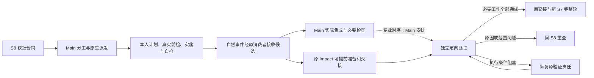

# L3-S9 根因修复与可信度重建

2026-10-30 合同更新：S9 与 S7／S8 统一采用答卷驱动的低成本接收。本文定义目标设计，未宣称现有代码、安装投影或真实全链已经实现；旧已发行材料与已接收事实保持有效。

## 1. 修复完成为什么需要超过一次代码修改

S8 已经解释问题机制，并以获批 RepairContract 固定要恢复的不变量和完整修复意图。S9 将这个意图变成真实实现、必要检查和可独立复验的交付，不重新猜原因，也不把修复意图降成“让第一个报错消失”。

局部补丁可能掩盖表象，却保留造成复发的机制。例如请求映射丢字段，页面默认值能改善显示，单独加别名也可能让一次请求成功，但重复字段定义、其他消费者和缺失的契约检查仍可能继续出错。完整修复要对准已确认原因，覆盖受影响消费者和必要兼容责任，并补上原来漏检的判据。

因此，S9 的完成需要连通五种事实：本人实施与自检、实际贡献被接收、Main 必要集成与检查、变更后的证据影响处置、独立定向复验。它们不能被一个“completed”或绿色测试数替代。成功之后仍回到新的完整 S7，确认修复后的整体交付成立。

S9 继承 [S8 调查](L3-S8-finding-investigation.md)形成的准确原因与批准意图，承载[设计原则](../l1-principles/L1-design-principles.md)中的统一事实、独立责任与有界纠错要求。它不代替需求修改、规格签署或发布授权；相应判断仍归原主体和阶段。

本阶段和其自然事件调用的原消费者、Writer、状态、恢复及后继不计算、登记或校验任何散列，包括 hash／SHA、散列形式的 `digest`／`fingerprint` 和 Git 对象 ID，也不通过更换字段名或算法保留相同机制。真实批准、实际集成、独立复验和本人结论仍分别由原责任承担；去除摘要不表示可以推断这些工作已经发生。旧记录中已有散列值只作为历史原字段读取，不重新计算、登记或作为继续资格。以下是阶段目标合同，现有实现及其依赖仍须同步改造和验证。



图中实际集成、检查与复验的顺序表达专业责任，不是要求机器先验证 Main 完成或新增完成信号的派发门；原 Impact 和后继材料可提前准备并交接。

## 2. 输入、参与者与几种不同的完成

### 2.1 从获批合同开始

输入应让实施者明白“为什么修、修到哪里、怎样证明”，而不是只拿到一个文件列表：

| 输入 | 在 S9 中的用途 |
| --- | --- |
| 当前批准 RepairContract | 确定主根因、被破坏的不变量、架构意图、范围、修复单元、断言和停止条件 |
| 原 InvestigationCase | 理解支持与排除原因的证据、影响范围、漏检原因及仍明确保留的不确定性 |
| 原 Finding 与补充现场，或原人类缺陷报告 | 了解实际偏差、修前事实、角色与数据条件，保持逐项复验的连续性 |
| 准确需求、设计与契约 | 维持正确行为和已批准边界，避免实现时悄悄改预期 |
| 真实代码、测试与工程环境 | 选择实施路径、前检、自检、集成检查和运行位置 |
| 当前执行与贡献事实 | 明确谁在做什么、依赖是否满足、哪些成果已接收或已集成 |

合同保存不等于批准，S9 不能在批准前先实施试探。S8 按本次适用授权完成对实际呈现合同的审查和真实决定，原消费者保存决定与该 Case、合同对象及原版本的关联；S9 沿这一已成立事实进入，不让 Main 再审批一次相同意图。合同实质变化时，旧决定不自动批准新意图。已收决定或原对象不可恢复时保留已知事实与具体未知，交 Main／原责任处理；不得从同名文件、路径或旧散列猜测批准，也不要求作者重交证明。实施发现根因、范围或断言确实有问题时，明确交回原调查／规格路径，而不是边改合同边写代码。

由 S11 人类缺陷决定进入的 Case 可以没有 Finding 或 ObservationBatch。S8 完成实际调查并取得适用批准后，S9 直接读取原批准合同；不要求作者制造 Finding 或为原报告与产品基线补机器证明。空来源集合只反映报告的实际形态，实际修复范围与独立验证由相应专业责任承担。

### 2.2 责任分工

| 参与者 | 本人责任 |
| --- | --- |
| Main／修复负责人 | 阅读批准目标、选择专业分工与依赖、真实原生派发、处理阻塞、集成、必要 Main 检查、影响判断和阶段交接 |
| Builder | 理解本人单元与断言，制定计划、做真实前检、实施或测试、自检并交付本人专业结果 |
| 独立定向验证者 | 在修复后产品上验证全部必要断言，报告实际观察、未执行事项和结论 |
| Claude Code | 提供原生上下文、worktree、运行、消息与恢复 |
| 原消费者与 Runtime Writer | 提供准确题干和产物位置，读取本人原答卷，单次核解析、必要字段、就绪与结论并保存，按完成事实接续阶段 |

Main 不代写 Worker 的私人专业答案；Builder 不自行给出独立复验或整轮通过。原发现者可提供专业连续性，但实际验证者仍须未参与被复验实现与合并，不能用相同角色名或不同 ID 代替真实独立分工。

### 2.2.1 从原责任到下一责任的无散列接线

| 工序 | 作者和原材料 | 接收事实、下一个责任与接线 |
| --- | --- | --- |
| 获批意图与分工 | Main 读取 S8 真实批准的原合同及实际 Case、范围和断言，形成原 Session／Plan，向 Builder 交准确 brief 与本人答卷路径 | 沿已保存的真实批准决定、合同实际内容和对应原版本承接，不用合同文件散列生成身份、定位题目或认证资格；合同实质变化不能自动继承旧批准。原 S8 批准消费者、`internal/repair/contract.go`、Session／Plan 准备器及其类型、schema 和读取方共同支持该关系。 |
| Builder 计划和结果 | Builder 在原位置分别保存本人 PlanReport 与 Result，实际实施和自检；本人可如实返回 blocked | 自然 Pre、成功 Post 与 Stop 调本人原消费者，Plan 可单独接收，Result 不因 Plan 的非关键缺项拒收。原责任、实际内容与已收事实由既有 Writer 保存；不对题面、来源、答案、packet 或证据计算／登记散列。`internal/cli/native_s9.go`、`internal/submission/repair_plan_report.go`、`repair_result.go`、`internal/repair/issued_plan_report.go`、`issued_repair_result.go` 与 packet／receipt schema 同步。 |
| Main 实际工程工作与影响 | Main 取得本人已收贡献、已知工作位置与目标，实际集成和检查，并在原 Impact 说明变化与影响；空 Impact 合法且可提前接收 | 原返回反馈真实已知事实，Main 按实际工作自然更新原 Impact；结果接收不证明 Main 已集成。真实 Git 工作由 Main／Builder 自主完成，Hook 及其消费者不计算、登记或比较 Git OID。`native_main_return.go`、`s9_handoff_projection.go`、`repair_lead_questionnaire.go`、`s9_questionnaire_observer.go`、Impact 类型及原消费者共同接线。 |
| 独立复验与 S7 后继 | Main 按实际工程进度安排独立验证者，交原合同、实际产品、必要断言和本人 Targeted 原卷；验证者填写本人真实总体结论 | 本人原消费者自然接收；仍适用责任的通过结论满足原出口时，系统按已有 Handoff 准备新的完整 S7；失败／blocked 交 Main 或 S8。Targeted、Handoff、S7 seed 与下游不依赖任何散列字段、Final／Changeset 或额外提交。`native_s9.go`、`repair_verifier_dispatch_questionnaire.go`、`internal/repair/targeted_receipts.go`、`runtime.go`、`handoff.go`、`s7_seed.go` 及 S7 消费者共同承接。 |

原 Session、Plan、Assignment 和具体派发关联区分实际责任，真实阶段进入及原 Writer 事件区分新责任；由系统复用现有非散列身份与版本关系，不能用合同、答案或事件内容的散列生成新的 ID／路径，也不要求作者抄身份或注册一次。实际被批准的合同内容应在原领域事实中可靠保留，并关联当时的真实决定；内容未知或原材料不可用时保留未知交 Main，不重新计算旧摘要、不推断批准或让作者补证明。同一交付重复观察复用已收事实，仅真实新表达保存新事实，未完成后继独立续接；并发和中断由原 Writer 的锁、版本与事务承担，不能将未完成反馈包装成专业缺项。

### 2.2.2 同次接续、新 Session 与旧责任并存

Session 是一次实际修复责任的组织关系；当前指针只指出 Main 当前工作的 Session，不代表其他已发行责任消失。已能确定同次重试或恢复时，沿原 Session、Plan、已发行责任和已收事实接续。确有新的获批 Contract／Case 或同一获批合同下的明确新尝试时，系统为真实新责任建立 Session；合同相同不能吞掉真实新尝试，不同调用字符串、原基线缺失或历史散列也不能自行证明新尝试成立。

| 事实或事件 | 系统接线及交接 |
| --- | --- |
| 新责任成立，旧责任仍在途或已有结果 | 原 Writer 在同一锁／事务中保留旧 Session、Plan、已发行 packet／owner、必要执行坐标与已收引用的原关联，再发布新当前指针。已接收事实与原文件保持不变；系统为新 Plan 的真实责任自动避开已登记身份和路径冲突，同次重试复用已保存映射，不让作者登记、改名或复制身份。 |
| 旧 Plan 已发行、本人晚到 | 自然事件复用该入口已有的任务、brief、最终消息、路径或工作区坐标，以及 Runtime 已保存的原派发、packet 和 owner 关联；能确定原责任时定位本人原卷，不要求每个事件同时提供所有坐标。原消费者接收并保存旧 Plan，按该旧责任的实际未完成后继沿原 packet、owner 和可用上下文准备本人 Result；已有发行事实则复用，真实阻塞不虚构发行，不用当前新 Plan 代替，也不把旧 Plan 写入新 Session 的进度。Plan 仍在途时可能尚无 execution，不能要求先建立 execution 才接收。 |
| 旧 Result 晚到或已收后重放 | 各自然事件复用自身已有任务、brief、最终消息、路径或工作区等坐标，以及已保存的原 packet、owner 和可用执行关联；能确定旧责任即可交原消费者，不要求每个事件同时携带所有坐标。接收的旧本人内容、真实 Finding、blocked 和未完成事项交 Main。同次重放复用原已收事实，只续其未完成后继；不覆盖新 execution、当前责任或新 Session 的检查与 PASS。旧成功只表达旧责任当时的结果。 |
| 原关联或材料不能确定 | 保留原文件、已知事实与具体未知，交 Main／原责任处理；不认领同名文件、不凭角色、目录或唯一候选猜选，不伪造已收、批准或 PASS。旧材料未知本身只影响确实依赖该事实的责任，不反向堵塞已明确且不依赖它的新责任。若共享 Runtime／journal 损坏或尚未完成的 pending 无法判断，原 Writer 无法安全写入时如实报告共享系统故障并沿原入口恢复，不能承诺写入成功或要求作者重交。 |

已有原执行可用时，选择器以该责任既有的 Assignment、owner、执行代际和实际工作位置等坐标区分对应执行；这些是内部选责依据，不是要求所有 native 作者先登记 execution，也不证明本人工作或材料真实性。`write_paths` 等专业属性变化不等于另一个执行；旧轮数、SHA／hash、Git OID、全 execution／全文件比较均不能成为身份或接收资格。确有不同原执行或 owner 时不得错投；无法区分时保持未知，不转嫁为作者补证明。

旧 Plan 接收、旧 Result 发行与接收、已收事实和 Main 反馈必须共同沿原关联接线；仅保留旧文件或移除当前指针保护不能保证旧责任可接续。原 Writer 在并发和中断下复用既有事务及已登记事实，未登记占位保留未知并选择独立可用位置，不读取、覆盖或删除未知文件；不新建作者账本或让未完成的历史恢复阻挡无关工作。普通无关事件快速返回，只有明确旧事件或未完成后继才按需读取该原责任的必要材料，不遍历全历史认证。

### 2.3 分清工程事实与平台执行

RepairSession 是围绕批准合同组织修复资料、结果与后续交接的领域记录，不是 Claude Code 平台会话，也不是额外的启动预约。RepairPlan 将合同单元变成可分派责任；它与 Builder 的专业 PlanReport 用途不同。

Session／Plan 文件中的初始状态保留创建时含义，不能据此判定实时工作仍停在规划。当前进度看原 Runtime 责任、已接收产物及实际集成事实，不能手改这些快照追平状态。

| 事实 | 已说明什么 | 尚不能说明什么 |
| --- | --- | --- |
| 原责任与题干准备完成 | 对象、工程 owner 和准确专业输入可交付 | 平台已经启动或本人已理解 |
| 专业 PlanReport 形成 | 本人有实施思路与实际前检记录 | 后续修改、自检或集成已经完成 |
| RepairResult 候选接收 | 本人实际专业结果与返回贡献已经记录 | Main 已集成、Final 已成立 |
| Main 集成与 Final | 对应实际交付进入目标，并记录必要检查结果 | 整批影响和独立定向复验已经完成 |
| Targeted 通过 | 已接收独立验证者对本人责任的通过结论 | 机器已证明实际复验、新 S7 已通过或获得发布授权 |
| Handoff 与新 S7 入口 | 系统按原出口结论交接，完整验证需要重新开始 | 机器已证明各方实际工作，或新 S7 已经通过 |

共用工作五态仍是 `pending/active/blocked/done/cancelled`。修复工序、专业判定、贡献集成和整个阶段出口是不同事实，不能再造一套通用激活／完成协议把它们揉在一起。

## 3. 把修复意图编译为责任与依赖

### 3.1 先读不变量，再安排实施单元

Main 从合同的修复单元、作用范围、断言和依赖出发，辨认权威源、生成物、消费者、测试、兼容与迁移步骤，再选择 backend-builder、frontend-builder 或 test-builder。不能先规定“前后端各一个人”，再将批准意图切碎塞进角色。

若一个根机制涉及公共模型及多个消费者，应按契约形成机制安排依赖：权威模型先明确，消费者在可用基线上对齐，必要数据处理按兼容顺序实施，检测与回归由明确责任完成。两个单元可以并行，前提是输入已经就绪、写面和共享资源不冲突，且中间状态不会产生新的双重权威或不可运行产品。

同一单元需要密切共享上下文和原子修改时，应保持一致实施；不同信任边界、破坏性操作、工具环境或独立验证责任需要分开。并行度随实际依赖、写冲突、测试资源和平台容量变化，不是固定人数或先收齐所有人计划的屏障。

### 3.2 当前编译与 Main 的选择

当前原编译器通常为每个合同 `repair_unit` 生成一个 `RepairAssignment`，带出 scope、`depends_on`、`resource_locks` 和所承担断言。`assertion_ids` 必须明确列出，或用原 `all` 声明展开；不能默认为每项任务复制整份合同全部断言，从而失去单元责任。

这份计划是实际专业分工的基础，不代表已有任意多合同批次和高级责任合并能力。需要调整单元粒度时，必须保持获批意图及可消费映射；不能在实施中私下合并或删除责任，留下无法解释的完成分母。

Main 在准确分工工序中选择角色和工程 owner，由原消费者登记并准备专业简报。系统已知身份、版本、路径和关联自动带出；作者不用为换取开工反复复制哈希或制作额外登记信封。登记成功仍需 Main 通过 Claude Code 原生 Agent 真正派发。已登记依赖由原 Plan／TASK 交付，Builder 不再重抄一份依赖集合；新分工不要求 `check_location`，Main 检查由实际集成工序承接。

## 4. 原生工作区与专业材料怎样交付

### 4.1 任务交给平台，专业输入交给本人

新写入责任由 Main 携准确简报使用原生 Agent 的 worktree 隔离。简报交付本人单元、断言、实际资料、计划与结果准确位置、依赖及停止条件。Main 的真实派发任务同时传递本实例用户明确的限制；例如用户只要求仿真占位时，不开展真实产品开发，但不能自行推导出禁止普通工具、临时辅助脚本或隔离项目中流程必需的文档提交。实例约束不改写通用 Builder 职责；只在 Main 任务中保留限制，不算已经传给 Worker。

Main 提供 Main 控制根下可读的原 brief／题干绝对路径，明确它们是只读控制材料。责任识别允许的等价引用见 §6.2；控制根相对引用不表示 Worker cwd 中存在该文件。Worker 在本人工作区的准确位置保存 PlanReport 和 Result；Main 不代填，隔离 Worker 不写共享 Main 答卷。产品提交只包含真实交付，不为答卷格式提交整个 `.claude`。

新责任沿已有准备入口给出唯一作者路径，例如 `.loop-submissions/native-s9/<原Plan packet>/plan.json` 和 `result.json`；占位路径不能当本次任务路径。作者填写顶层专业字段，不创建另一套 typed／flat 作者副本，也不兼填内部信封、binding、摘要、基线或平台身份。已有原 packet、pin 和路径作为原责任的已有坐标使用；系统准备与安全持久化仅是内部手段，不变成作者开工或交卷动作。

原稿是否 tracked、staged、ignored 或 Git `??` 均不属于答卷接收资格。不检查项目、父目录、info 或 global ignore 来决定本人能否交卷，不要求改 ignore、搬卷、提交、seal、done、marker 或空 commit。本人可保存检查日志与私人中间产物，不要求逐文件引用或登记。平台可能回收 worktree，Main 应在实际交接时保存必要材料；框架不以 Git 状态承诺私人文件必然保留。

### 4.2 原准备和已发行责任连续使用

实际工作区应包含已准备的工程输入及已满足的依赖，由 Main 在派发和集成中正确安排。系统不在每次自然事件重核共同 Git 起点、branch、base、HEAD、来源 pin 或全套执行定义。

准备、并发和重入复用已确定责任与准确路径；已发行材料和已接收事实继续有效，不因模板升级或当前 HEAD 改变要求重发、重存或补证。未发行的准备文件不代表责任已派发。分工已登记但题面尚未准备时，保留既有事实并交 Main 准确缺口；同次其他独立责任继续，不因一个准备失败让其他作者重交。

删除历史 generic、C／D、issued／冻结材料的兼容启动、接收、source 与恢复接线；当前原生派发、本人答卷和当前消费者组成唯一工作链。用户业务数据及已成立专业事实保留；同一现行链的晚到责任沿原 packet 与派发关联接收，关联确实未知交 Main，不猜 owner、角色或目录，也不要求作者补证明。

## 5. Builder 怎样计划、前检和实施

### 5.1 先形成自己的计划，再连续工作

Builder 先阅读获批不变量、本人单元、必要断言、实际代码入口和原现场，确定实施顺序、预期修改、消费者、测试及停止条件。专业 PlanReport 记录 `plan`、实际 `red_checks` 和适用的 `proposed_paths`，在实际工作树的指定位置保存。专业模板按本责任必要问题保留字段，不将现有所有字段自动视为必填；仅用于派生身份、来源或完整性证明的字段删除，系统已知信息不由作者重抄。

计划应先于本人实施形成，但保存计划不是额外授权，也不要求等待其他 Builder 的计划。默认在既有授权内继续修复、自检和交付；真正高风险步骤或合同明确批准点仍依原条件处理。缺计划由明确提醒和原反馈处理，不能在 Stop 倒填一个时间来伪造事前工作。

下面是私人专业计划的结构示例，命令、结果和路径均须替换为本人真实工作：

```json
{
  "plan": "复核共享请求映射与已锁契约的差异，修正本单元字段过滤并检查调用方；补强字段保留判据，完成自检。若需要修改锁定契约或扩大批准范围，停止并交 Main 判断。",
  "red_checks": [
    {
      "name": "字段保留前检",
      "command": "npm test -- payload",
      "result": "fail",
      "evidence_refs": ["logs/payload-before.txt"]
    }
  ],
  "proposed_paths": ["web/src/orders/payload.ts"]
}
```

`red_checks` 是保留的字段名，实际结果可为 `pass`、`fail` 或 `blocked`。检查已经通过、问题不能在当前数据下重现，或没有执行条件，都应如实说明；不能为了形式修改产品来造红。结果若挑战了批准原因或正确行为，交 Main 判断是否回 S8，不由“非红”自动否定整个责任。

`command` 记录已经运行或实际尝试的前检，不是冻结给 Main 未来执行的命令。一次前检失败也不能代替后续逐断言的真实观察。无产品修改的合法测试责任可以用 `proposed_paths=[]`，不强造文件或空提交。

### 5.2 实施完整根因修复

每项修复单元都应持续回答：恢复了哪个不变量，解决哪些来源表象，哪些消费者和数据必须一起处理，什么检查能证明没有只遮住症状。

实施应落实获批的权威归属与交互边界，处理必要的生成物、客户端、服务端、持久化或异步出口。遇到重复定义、兼容别名或过渡双写时，遵守合同给出的责任、条件和退出安排；不能把临时分叉当成永久修复，也不能借“统一机制”扩为未经分析的大范围重构。

测试应保护错误机制：优先在最靠近权威与边界的层面建立可靠判据，再按需要补集成或真实入口回归。只有特定字面输入通过、只检查成功响应或放宽原预期，都不能证明漏检已经补上。采用隔离变体、回退夹具或等价反例时记录其真实用途，不能在目标产品上制造危险回归来凑证明。

兼容、迁移、回滚与发布顺序按合同中的实际义务处理。无需迁移时不制造迁移／回滚双引用；需要迁移时则要说明真实执行、幂等与数据保护、失败停止及恢复安排。提供一个引用不等于迁移或回滚能力已经验证。

## 6. 专业结果与自然事件接收

### 6.1 本人交付记录应如实表达完成与缺口

Builder 完成实施或测试、自检后，在指定私人 Result 写本人判断、逐断言修前观察、逐单元实施、自检证据、检测补强产物、偏差和残余风险。它不是 Main 集成报告，也不是独立 Targeted。下表表达专业内容与现有字段的对应，不把每个历史字段或证据引用都提升为接收必填；只保留判断本人责任是否就绪所需的内容，证明类派生字段不保留为作者手续。

| 专业字段 | 内容 |
| --- | --- |
| `verdict` | `completed`、`blocked`、`contract_conflict` 或 `stale`，由本人据实际工作判断 |
| `before_fix_results` | 对题干中本责任实际断言的修前观察及证据；`observed_red` 是历史名称，不要求编造失败 |
| `unit_results` | 原 unit ID、真实 `pass/fail/blocked`、实施或测试摘要、证据与恢复的不变量 |
| `detection_gap_artifacts`、`evidence_refs` | 实际文件或输出引用的字符串数组，引用形式不证明已经执行 |
| `scope_deviations`、`residual_risks` | 已知偏差和未完成原因，没有时明确 `[]` |
| `migration_ref`、`rollback_ref` | 实际需要的已有依据；不适用时可为空字符串，不强制成对 |

Worker 应在专业摘要和证据中说明本人真正运行的检查及结果，不能因为结果题形没有让作者重抄机器检查清单就省略自检。系统带出的 Main 检查也不代替 Worker 的实际验证。

例如，一项仅承担 `root-1` 的映射修复单元可以形成下列专业 Result；示例不代表仓库中已发生这些事实：

```json
{
  "verdict": "completed",
  "before_fix_results": [
    {
      "assertion_id": "root-1",
      "observed_red": "修前共享过滤规则未包含当前必填字段，原载荷对照显示其在发送前消失。",
      "evidence_refs": ["logs/payload-before.txt"]
    }
  ],
  "unit_results": [
    {
      "unit_id": "repair-unit-mapping",
      "status": "pass",
      "implementation_summary": "映射已对齐现有契约；本人运行 npm test -- payload，字段保留检查通过，输出见所引日志。",
      "evidence_refs": ["logs/payload-after.txt"],
      "restored_invariant_refs": ["root-1"]
    }
  ],
  "detection_gap_artifacts": [],
  "evidence_refs": ["logs/payload-before.txt", "logs/payload-after.txt"],
  "scope_deviations": [],
  "residual_risks": [],
  "migration_ref": "",
  "rollback_ref": ""
}
```

这只完成本单元的职责；另有测试单元或独立复验时仍须真实执行。`completed` 不关闭问题、不宣布 CleanRound，也不授权跳过 Main 集成。失败或阻塞报告可以交接，结构错误仍需修正；本人对实际缺口应如实表达并交 Main，系统不通过额外证据或机器推断来认证专业陈述。

### 6.2 自然事件接收原作者产物，不代作专业判断

按 [工作流收敛 §3.3.1](../l4-mechanisms/L4-workflow-convergence.md)，S7／S8／S9 共用答卷驱动合同：自然事件从已有当前任务和原责任坐标准确选责，只读取该作者该责任的原答卷，单次完成解析、必要字段、就绪状态及结论检查并保存接收事实，再按完成事实自动分流。系统不重新证明代码、证据内容或实际检查是否发生，不回读证据文件、不归档后散列取证，也不把证据机器证明、baseline／SHA、typed／flat 比对、Candidate／Final 再核验串成接收前置链。

文件不存在、草稿未就绪或字段缺失时保留原稿，反馈实际文件与字段。可解析的占位、计划中的检查和明确待继续内容不自动成为完成结论；合法 blocked 或其他非终结表达可以交接，不能因未完成专业工作而拒绝记录其真实结论。没有统一最终标记的原题面继续使用既有专业表达，作者正常保存即可，不要求补 ready、结束语或其他必填项；系统只识别可见事实，未决交 Main，不猜作者是否还想编辑。正常保存、工具成功、Stop 或 `completed` 字样本身不等于完成；解析与必要内容成立后，结论才驱动下一责任。系统接受专业陈述，不认证其真实性和充分性；Builder、Main 与独立验证者分别承担本人实施、自检、集成、影响和实际复验责任。

可理解的 Plan 即可按原意接收，`red_checks`、各项证据引用和 `proposed_paths` 的非关键缺项不构成拒收资格；实际前检与实施仍由 Builder 按专业责任完成。Result 的真实 `blocked`／`contract_conflict` 可以独立先接收，不能因为 Plan 缺失、未就绪或存在非关键缺项而跳过 Result。

Plan 可单独接收并保存，Builder 无需等接收回执、其他 Builder 或额外批准即可继续原授权实施。`SubagentStop` 即使尚无 Result，也接收已就绪 Plan，把“Plan 已收，Result 未完成”与下一责任交 Main；Result 是否存在或其 Git 状态均不是 Plan 前提。Plan 接收不虚构 Result、Candidate、Final 或平台执行完成。

| 自然事件 | 观察和接续范围 |
| --- | --- |
| `PreToolUse` | 按事件准确关联的当前或旧责任与完成事实，必要时读取本人原卷；已收直接进入其实际后继，不作为普通工具 ACL |
| 成功 `PostToolUse` | 补充观察事件准确关联的原卷，覆盖 Pre 早于保存的时序；其他成功事件也可观察，但工具成功不证明保存或专业完成 |
| Worker `SubagentStop` | 兜底本人原卷并交接真实结果或未完成事实；不要求返回路径、再 Stop、补 Plan 或凑结论才可退出 |
| Main 的 Agent 返回／恢复 | 使用已有接收事实安排原责任的未完成部分；真实完成返回若准确关联原责任且本次尚未接收，系统按 [Hook §5.3](../l4-mechanisms/L4-hook-platform-wiring.md#53-stop-兜底接收与正确责任交接)复用同一原消费者兜底。普通 Main 阅读和 Main 自己的 Stop 不代填或抢收 Worker 答卷，异步启动不冒充完成 |

责任选择复用既有 authority 路由确定的 Main 控制根及事件准确关联的当前或旧原责任，不按角色、唯一候选、最近文件、Main 同名稿或目录扫描猜选。对原 brief 完整相对路径 `r`，`<Main控制根>/r`、`r`、`./r` 为同一责任的等价引用，相对引用以控制根为基准。保留 [Hook §3.2](../l4-mechanisms/L4-hook-platform-wiring.md#32-任务内容和转录各有用途)的完整 token 和真实 user task／最新有效任务语义：仅在真实 user task（含实际派发 prompt）中，完整引用后一个 `.` 且随后为文本结束或空白，可作句末标点；`.backup`、`./child`、`..` 及其他路径前后缀不能剥点匹配。系统用反引号或独立行交付准确路径。同责任多种写法去重；已有派发关系明确属于本次执行的多项本人责任分别处理，多个引用共现但无法确定其归属时报告未知，不猜 basename、`../`、其他绝对根、环境变量或 URL。

各事件使用其已有任务、最终消息与来源坐标，不把某一入口专有凭据增加为所有入口的共同前提。原 SubagentStop 可沿已有绝对 brief 最终消息、准确 Result 引用或 cwd 的原识别方式继续，不新增 child transcript、返回路径或平台所有权证明门槛。等价引用只用于定位责任，不宣称证明 actor 所有权或证据真实性。独立 Targeted 按本人原责任直接接收，不依赖 Builder 答卷、索引或展示读取成功。选责不足或歧义交 Main 具体缺口，不让作者另填登记或制造事件。

已接收 Plan／Result 后原稿或 brief 丢失，保留接收事实并交实际后继；不重建工作区、不重派已交付 Builder、不让本人重交。Plan 已收而 Result 尚未交付时，沿原准备恢复必要引导；原坐标不足则交 Main 准确材料故障，不从当前 HEAD 猜补。缺显示材料与缺专业输入分别说明，不以重生成文案冒充历史原字节。

真实 `blocked`／`contract_conflict` 即使缺 Plan 也如实交 Main，说明已收事实、本人原因及缺口，不强迫补 Plan 后才能结束，也不冒充本人完成或 Final。已有本人 Result 的具体 `residual_risks` 可原文交接；来源未识别、文件损坏或原因缺失就报告实际未知，不编造 blocker。反馈通过已有事件和 Main 原责任入口传递，不另发状态表；Hook 输出与 Main 实际收到的渠道分别验收。

## 7. Candidate、Main 集成与 Final 为什么分开

### 7.1 接收本人贡献不等于集成完成

本人 Result 就绪时保存其专业内容和既有责任关联，Candidate 表示“已交付，待 Main 集成”。它与 Final 表达不同真实工作，不是作者另交的两张证明表。系统依据保存的完成事实分流，不每次事件重收 Result、比对 flat／typed 或检查候选摘要。

Main 及时接手候选，不等待 Final 才集成；Main 不续填 Worker 私人空卷。真实未完成和原因冲突沿原责任交接，历史 blocker 不自动表示当前仍阻塞。

### 7.2 Main 执行真实集成与必要检查

Main 阅读真实贡献，处理依赖与合并冲突，把合法产品变化集成到目标，在实际集成产品运行必要检查，利用已有专业记录如实保留命令、工作目录、实际结果及所检对象，供实际后继理解。已有自然记录足够时不重复填写；这项专业责任不要求 Impact 添设必填字段、额外检查表、回执或机器凭证，也不由 Hook 认证检查已执行。必要检查不得用 Plan 前检命令、空配置、旧 PASS 或专业自述代替。失败与未运行如实报告，必要时安排有依据的返工。

这些工程工作由 Main 使用实际工具完成，不藏在 Hook 或保存回调。Main 接手 Candidate 时即可准备原 ChangeImpact 和已有贡献材料，不要求先造 Final，也不把提前准备题目当成整批完成。原 Impact 的自由说明可记录集成、检查、变化和未完成项；已有自然记录足够时不必重复填写，说明及 `change_types=[]`、`decisions=[]` 均不成为接收门。`changed_artifacts` 表达实际变化路径，S7 使用路径作为 Claim 来源与覆盖线索；没有可用引用允许空集合，不以摘要设门。当前 Impact 消费、S7 seed、ReviewPlan 类型／schema、注册和 S10 消费共同接通；删除旧格式兼容和冻结引用证明链。

当前消费者保存 Main 原 Impact 及已有真实工作记录；不为旧 Final 维持兼容投影，也不要求先生成、登记 Final 才接收 Impact、准备 Targeted 或继续流程。系统不通过空卷或自然语言推断 Main 已实际合并或检查；未知和未完成交 Main，不要求作者补信号。不以摘要、HEAD 一致性、执行代际或日志回读锁住集成；实际工程命令仍可使用，但不是额外提交协议。实际集成、检查与独立复验由各自责任承担。

Main 集成后中断，已有完成事实保留，只继续未完成的记录、影响或交接；对现场不明确的合并或检查由 Main 调查，不自动重合并、伪造检查或要求 Builder 重交。原 Impact 可在 Main 接手 Candidate 时准备，Final 与 Impact 复用同一原记录的实际表达，不循环等待另一张答卷。已有 Final 的历史执行直接继续原 Impact；资源清理独立处理，清理 pending 不截断已就绪专业后继。准备失败保留已有 Final、原 ACK 与原稿，清理重试不重收 Final、不重跑已完成检查、不覆盖 Impact。

后续新增产品变化需要实际判断和适用检查。历史 Final 记录当时工作，不能替当前全部产品背书，也不因后续变化撤销原交付事实。资源回收沿真实授权处理；新文件和未知资源保留现场交 Main，不以强删制造完成。

### 7.3 无产品改动不要求伪造贡献

合法测试责任或已满足的行为可以没有产品差异和新提交；仍做本人实际工作、Main 必要检查、影响判断与全部必要断言的独立复验。整批无需修改时，Changeset／Impact 的变化集合如实为空；Main 可解释依据，但解释或非空理由不是接收前提，不制造空 commit、模式修改或无关文件。

无改动 worktree 被平台回收时，已接收专业事实继续有效；Main 使用已有材料和实际产品完成后继，不要求树或私人原稿继续存在。未接收的缺失答卷不能冒充已交付。零 diff 不等于 CleanRound，仍须进入新 S7。

### 7.4 原工作记录与历史 Final 的后继使用

Main 使用 §7.2 的原卷可选说明或已有自然记录如实表达实际变化；已有 Final 可按原关系复用，缺少 Final 不阻断原 Impact 或后继。同一实际批次保留每项有效贡献，同一路径后续变化按原 last-wins 合并，不将旧 Session 的贡献自动归入新批次。Impact 与 Handoff 复用已保存事实，不重新扫描 Session 或产品目录、不重算完整摘要链。系统保存关联供导航，不认证实际变化集合的完整性；Main 对遗漏、删除、配置和依赖变化负责。

本人结果中的路径／状态、原入口实际取得的 Git 比较材料和无法判断变化是不同事实。前两者按各自来源提供给 Main；既没有可用比较材料也没有足够已收事实时，自动变化范围为未知，不能把空数组解释成已确认无变化、把整个工作树称为新增，或凭全树认证重建基线。Changeset 是已有可知事实的可选投影；未知不阻止本人答卷接收、原 Impact 或其他不依赖该变化事实的后继，Main 对实际需要判断的变化继续承担责任。

状态查询只投射已有事实，区分未交卷、待接收、待集成与已完成；不能因文件存在就声称已接收。Builder 与 verifier 分工复用已有责任锚点，系统派生各自所需坐标，不要求作者复制 ID 或维护另一张表。

## 8. ChangeImpact 怎样重建证据可信度

### 8.1 对已知实际变化作专业判断

合同中的预期影响是规划输入。Main 基于真实集成、实际检查和已交付贡献，复用原 ChangeImpact 答卷与 §7.2 的可选说明或已有自然记录承接实际工作及变化，再判断行为、契约、消费者、数据、配置、依赖与旧验证的影响；系统复用已有的原记录供影响消费，不从说明语义推定完成，不要求 Main 先交另一张表。已有 Final 时可按原关系复用，缺少 Final 不阻断影响接收；系统复用已有事实提供材料，不再读取代码或证据来机器认证判断。缺问卷时沿原准备入口恢复，保留已有答案与 Final，不让作者手拼机器编号。

Main 填写 `change_types`、`decisions`、升级层级与证据处置；已知身份、来源、路径和时间由系统提供。无产品变化允许 `change_types=[]`、`decisions=[]`；专业上仍判断依据与必要重验，不能为接收强造处置或非空理由。影响处置有 `invalidate`、`supersede`、`retain`、`reverify` 四种含义：失效旧依据、由新事实替代、有据保留、需要新观察。计划重验不能写成已经通过，专业偏差不能由作者自行批准。

空数组既可能是合法无变化或无处置，也可能只是系统预置模板；新旧题都允许 Pre、成功 Post、Stop 按原内容直接接收，不要求准确保存事件、改写 `null`、补说明、重存或另设 ready。我们接受可能提前接收模板、提前准备后继的歧义，不声称机器能识别 Main 心理或杜绝提前推进。接收只记录当时可见内容，不自动证明 Main 已完成实际集成与检查、所有 Builder 已交付或独立复验已执行；Main、Builder 和独立验证者按原专业责任完成工作，框架不为此增设证明门。

Main 在原 Impact 责任内可继续自然更新同一原卷；自然事件观察更新，保留先前接收并以新表达作为当前判断，不要求重存旧内容。提前接收不关闭在途 Builder，也不以已有 `impact_ref` 阻止后续贡献交 Main 或后续判断；后续变化需要实际影响判断，旧空卷不能自动替其背书。是否仍需观察复用已有 Main 原责任、在途 Builder 和实际专业流程；空卷已收、已有 `impact_ref` 或阶段切换不能单独认定责任结束。信息不足时优先允许自然更新，不要求作者另行登记状态或开启新尝试。已结束且无后续工作的责任可快速返回，活跃责任的必要观察计入成本。

### 8.2 原题形中的专业决定

以下仅展示原 ChangeImpact 请求中需要 Main 填写的专业部分；实际工作在系统给出的原文件保留其他已知字段：

```json
{
  "change_types": ["implementation"],
  "decisions": [
    {
      "source_id": "web/src/orders/payload.ts",
      "target_id": "order-submit",
      "relation": "uses-request-mapping",
      "rule_id": "IM-REQUEST-MAPPING",
      "decision": "reverify",
      "responsibility_id": null,
      "scope": ["web/src/orders/payload.ts"],
      "rationale": "提交入口依赖已改变的映射，应重新验证有效字段保留及拒绝分支，旧成功响应不足以证明当前行为。",
      "recovery_evidence": ["logs/payload-after.txt"]
    }
  ],
  "escalation_level": "assignment",
  "invalidated_evidence_ids": [],
  "superseded_evidence_ids": [],
  "retained_evidence_ids": []
}
```

`source_id` 是实际变化或来源，`target_id` 是受影响对象，`relation` 表达依赖，`decision` 才是处置。`rule_id` 可沿已有规则表达本次依赖判断；没有实际规则时不为接收另造标签或登记规则。已有证据 ID 只引用真实对象；文件或输出路径也只是定位依据，不等于已执行或已恢复。

### 8.3 记录判断与应用失效分别可见

系统单次读取原影响答卷，核必要字段、就绪与结论，保存判断并应用其中的失效／替代／保留／重验决定；Main 按实际专业时序安排独立复验，未完成项仍由 Main 处理。准备或派发不以机器证明集成已完成为前置。它不回读证据池、精确匹配全账本或重证 Session 基线，也不证明理由足够。Main 负责遗漏与实际规格变化，独立验证和新 S7 负责后续实际观察。

证据质量失效不抹去曾经发生的交付。原结果仍记录当时工作，但不继续为已变化产品背书；无变化事实或不完整工作不能靠一份 Impact 自动完成。

## 9. 独立定向复验怎样恢复局部可信度

### 9.1 人与对象都要独立、准确

Main 选择未参与对应实现与合并的验证者，交付修复后实际产品、原 Contract／Case、已有 Impact／实际工作材料、必要断言和停止条件原文；已有历史 Final 可提供，但不作为派发或接收前置。原发现者可提供专业连续性，角色名和不同 ID 不能证明实际独立。

独立 Targeted 使用原准确责任与作者路径，只交本人 Targeted 答卷，不交 Builder Plan／Result，不修改产品来取得 PASS。Main 准确说明产品、运行位置和本实例限制；独立上下文读取实际最终产品。系统从已有责任提供路径及必要关联，不让作者计算 sourceDigest、复制版本、提交身份声明或维护来源协议。

自然事件定位该独立原责任后只读本人原卷，按 §6.2 单次检查与保存；不以 Builder 适配、TASK／manifest 散列、pin、Git `??`、HEAD/index、目录冲突或实时 Final 摘要作为 Targeted 资格。无法定位原责任就反馈实际缺口；实际独立、正确产品和完整复验由 Main 与验证者承担，框架不冒充已经机器证明。

### 9.2 复验全部必要断言

定向验证包含三层核心问题：原表象是否消除，根因不变量是否恢复，漏检机制是否得到补强；再完成适用兼容、迁移、回滚与影响处置要求。不能只读 Builder 总结或只复跑一条单元测试就宣布全部通过。

系统给出 `symptom-N`、`root-N`、`gap-N` 等原槽位和断言原文，供独立验证者思考与报告真实结果。专业上仍需完成全部必要复验；缺观察应如实说明并由 Main 安排继续，不能用足够数量或额外观察掩盖失败。这些专业问题不是逐槽位机器验收表：系统不逐项比对合同集合、按缺少某条观察拒收，或用语义猜测改判本人总体结论。反馈指出可见的实际缺口，不把专业完整性指导变成新增字段或覆盖校验。

原 Targeted 上下文同时交付获批合同的 `stop_escalation_conditions` 原文与准确来源。Main 的复验交接和携带准确 Targeted 引用的原生启动都使用这项材料，不按角色名称猜责任。自由文本停止条件由独立复验者结合实际观察判断；它不是第四组必填断言，不要求作者复制合同摘要、下标或第二份评估数组，也不能据一个布尔值证明已经正确理解。

触发条件说明需要扩范围或改合同，就在原结果、原因和证据中明确报告 `scope_changed`，沿原 S8 重查与批准路径处理；真实环境原因使用 `blocked` 并保留未执行项。不能把触发条件仅记为残余风险后仍宣称 PASS。必要材料不可读或实际变化时由 Main 恢复原输入，不要求独立者改写正确答案。

下面展示原 Targeted 请求中的专业内容，不是另一个 Worker `answer` 信封；实际在提供的请求中保留系统关联字段：

```json
{
  "assertion_results": [
    {"assertion_id": "symptom-1", "result": "pass", "evidence_refs": ["logs/order-journey.txt"]},
    {"assertion_id": "root-1", "result": "pass", "evidence_refs": ["logs/mapping-invariant.txt"]},
    {"assertion_id": "gap-1", "result": "pass", "evidence_refs": ["logs/regression-discriminator.txt"]}
  ],
  "result": "pass",
  "failure_class": ""
}
```

每条引用应定位本人的实际观察或输出。未执行、失败或阻塞时如实填写 `fail`／`blocked`，整体结论也保留实际非通过；不能把示例 PASS 当默认答案。原卷已有可理解总体结论时，未填写的单项 `result`、缺失或为空的非关键 `evidence_refs` 不能拒收；缺观察、未执行和未知按原文交 Main，不为通过机器校验补造单项 PASS 或证据。`continuity_reason` 与 `scope_compliance` 是可选兼容元数据，不能要求作者编造非空或 pass 来换取接收。记录时间由系统保存；接收时间不证明检查已经执行，真实观察由本人承担。作者无需追加时间、连续性证明或回执。

### 9.3 记录报告与允许推进是两件事

系统保存独立报告，并按该责任当前答卷的就绪与结论自动分流。独立验证者对必要断言作专业判断；已知仍适用且实际须完成的各项独立责任均已有本人通过结论时，系统按原出口自动接续 Handoff 与新 S7。已知仍适用责任未交、blocked 或失败时保留其真实结论与未完成部分并交相应责任，不以其他人的 PASS 替代。已取消或被真实替换的责任不因残留 owner 而等待其 PASS；适用性未知如实交 Main，不猜取消或通过，也不增加取消证明或等待门。真实 `fail` 没有可选 `failure_class` 时仍可接收，原因保持未知、交 Main／S8 判断，不默认 `fail_same_cause` 或猜因果。系统不逐断言重算覆盖或回读日志、代码来认证观察真实性，实际复验由独立验证者负责。

原 Targeted 报告只保存一次。多责任分流可在当前 Targeted 引用行保存内部可选的 `performing_assignment_id` 和 `result`，它们不是作者字段或新必填；删除旧 Runtime schema、旧 path／sha 引用解析和兼容入口。历史专业内容保留为数据；当前所需结果不可判断时如实交 Main，不伪造 PASS、要求作者重交或重建证明链。

原 Targeted 结论属于本人当时已接收的责任与专业工作。Main 后续更新 Impact 或 Builder 晚到时，保留原历史和已知关联，不把旧 PASS 描述为覆盖新变化；本人仍可沿原责任自然表达后续结果，由 Main 基于实际变化安排必要后续，不新增 Impact hash、一律重验、等待所有 Builder、手动确认或新增作者步骤。

环境恢复后，Main 的原安排或可准确归属原责任的本人自然继续都可接续新尝试；独立者正常保存新的实际结果，系统沿原责任在自然事件接收，不要求先等 Main 登记。旧 blocked 保留历史，不永久阻断新结论，也不被重放假称恢复。非环境失败按实际原因交回 S8，不能无限修补错误因果模型。定向 PASS 仅建立修复合同的局部专业结论，完整交付仍由新 S7 验证。

## 10. 完成出口与新的完整验证轮

### 10.1 从实际完成事实自动交接

本人实施／测试与自检、Main 集成与检查、专业影响判断及独立必要复验仍是完整 S9 工作。框架按各自原答卷保存的完成事实推进，不认证代码、证据或实际执行。最后一项已知仍适用责任的 Targeted 通过且 §9.3 的原出口条件满足后，系统消费已收直接结论、原 Impact 与所需已有材料，自动接续原 Handoff、保存本次实际验证关联并准备新 S7；未知的责任适用性按 §9.3 交 Main，不另设等待或补证明门。作者无需 submit、重存、手工 create／commit、额外交接答卷或唤醒已履职 Worker。新链不要求先生成 Final、Changeset 或与之相关的来源证明；已有 Final／Changeset／Handoff 作为真实历史可以复用，但不造空伪记录。Handoff 准备器、类型、schema、原 Writer、seed 和 S7/S10 实际消费者必须共同承接此合同，不能只放宽一个 schema 或将旧投影继续设为资格。

内部持久化需要幂等和安全：重复事件只继续未完成后继，不重复建立验证责任、不覆盖已收历史。Targeted 已收但 Handoff／S7 准备失败时保留已收结果，由原收尾入口重入，只补系统未完成部分。状态查询只读，不通过重验旧卷或重跑业务链制造进度。进入新 S7 后，普通 Main 事件不因旧 route 仍在就持续准备无关旧 S9；真正晚到的 Builder 仍沿准确原责任接收，不能以当前阶段一律关闭旧 S9 入口。仅读取本次实际未完后继需要的信息，不重扫无关历史。

### 10.2 新 S7 验证完整交付

新 S7 使用修复后完整产品及需求／TASK／Claim 范围，包含原交付、失败残留、删除和本次修复，不只复看最后一个修复文件。框架复用已有事实给出 seed 与原 ReviewPlan 答卷，不以每次重建完整 baseline、SHA 或锁集证明作为新一轮准入；实际产品、范围与覆盖由 Main、Planner 和独立 Reviewer 负责。

Handoff 清除旧验证通过的当前投射，沿新的原 ReviewPlan 关联开启完整验证，不生成或累计审查轮数，也不生成新的 Delivery／QA／E2E PASS。seed 是机器已知材料与待专业细化问题，不等于已完成计划；Main 在原 ReviewPlan 保存一次专业规划，接收后自动分流，无额外登记。`PLANNER-REFINE` 表示 `assertion`、`oracle`、`method` 仍待完善；`cold_start` 是覆盖起点，不强制浏览器。适用 E2E 的 `behavior_surface` 根据真实来源选择 `browser` 或 `non_browser`，不适用时保留有据 N/A 并移除相应 Assignment。

S9 Handoff、seed 与共享转换必须保持本次实际进入、原 ReviewPlan 身份和题面路径的一致关系；已提交后重试复用该身份，未提交的准备不冒称已进入 S7。现有先准备 seed 再写 Handoff 的具体事务接线和中断恢复仍须核实，不能从本设计推定已支持某种事件身份方案。目标与兼容边界见[工作流收敛 §3.3.3](../l4-mechanisms/L4-workflow-convergence.md#333-实际验证身份与不计数的接续)。

### 10.3 实际用户约束与人类决策

用户明确设定限制，或需要改变需求、授权与发布决定时，保留已完成事实，将真实待决事项交原主体；空选择不是授权。系统不为答卷接收、Handoff 或准备新 S7 生成、累计或展示审查轮数，不计算默认轮数预算或产生额外审批。原真实决定到达后继续未完成交接，不重交专业结果。

## 11. 失败应回到能解决它的责任

| 情形 | 下一责任 |
| --- | --- |
| 本人检查或修复未完成 | Builder 保留真实报告与阻塞，Main 根据明确缺口安排原责任继续 |
| 需要的实施范围或合同断言与获批原因冲突 | 停止受影响工作，由 Main 回 S8 修订原因或合同，不由 Builder 自行扩权 |
| 实际规格错误但 REQ 不变 | 回 S2 重建正确依据及受影响验证 |
| 正确行为需要改变锁定需求 | 原人类暂停与需求修订路线 |
| Main 集成冲突或检查失败 | Main 处理实际集成／验证，必要时安排有依据的返工，不代写 Worker 结果 |
| Targeted 的环境／权限／依赖阻塞 | 保留原验证责任，恢复条件后提交真实独立新尝试 |
| 定向结果表明原根因仍在、原因改变或范围判断失效 | 携实际失败观察回同一 S8 Case，重新判别并形成需要的新合同；只有 `fail` 而原因未分类时保留未知，由 Main／S8 判断，不机器补成同一根因 |
| 来源或阶段已变，旧答卷不再当前 | 已发行责任的晚到答卷仍沿原关联接收并交 Main；实际需要的修订或恢复沿原责任处理，不能借旧回执给新内容签字 |

S9 的非 `blocked` 定向失败保留本人实际结论与原因；原因未知时由 Main／S8 判断下一责任，不能由机器默认根因或直接撤销合同。实际进入原因果重查时，保留原 Finding 集合、实际失败观察、可用证据及原批准和旧在途责任关联，撤下旧合同的当前绑定，再按实际调查形成需要的新假设与合同。环境阻塞不证明原因错误，不能无条件走相同回流。

已经发生的专业计划、结果、检查和批准不能在事后补造。跳过前置工作时如实记录偏差及其影响，保持可恢复事实，而不增加另一个开工协议来假装历史已正确。

## 12. 重放、阻塞解决与历史执行恢复

### 12.1 按完成事实分流

| 已保存事实 | 本次处理 |
| --- | --- |
| 无就绪答卷 | 只观察该责任原卷，保留草稿或反馈必要缺项；不阻止普通工作与真实退出 |
| Plan 已收、Result 未交 | Builder 连续实施；返回时交 Main 已收计划与实际未完成责任 |
| Result 已收、Main 未集成 | 直接交 Main 原贡献，不再读取、适配或认证 Builder 原稿 |
| Main 实际工作已记录、Final／影响未完成 | 复用原 Impact 中已保存表达，接续未完成的集成检查或影响处理，资源清理独立处理 |
| Impact 已收、Targeted 未完成 | 继续原独立验证责任，blocked 如实交 Main |
| Targeted 通过、交接未完成 | 只续 Handoff／新 S7 准备，不重跑独立观察 |
| 后继已完成 | 投射既有结果，不重收、不重复建立验证责任、不再验证旧输入 |

内部写入中断复用已保存完成事实和原责任，不遍历 Candidate 历史、重建固定 typed 输入或再次核 flat、baseline、SHA、证据摘要。安全读取、原子保存与防止同事件重复写入是实现内部手段，不添加新作者表、状态机或完成信号。已收后修改属于原专业修订或新尝试，不能悄悄覆盖旧事实；系统不靠每次回读旧原稿发现改写或保证实时漂移完整性。

### 12.2 独立复验的环境恢复

blocked 记录具体原因、未执行项和接手人；解除由实际有能力的责任人处理。条件恢复后，Main 的原恢复／重新安排或准确归属原责任的本人自然继续都可使系统接续当前新尝试；独立验证者正常保存真实新结果，自然事件接收新尝试，旧已收记录不改写，不增加等待 Main、登记或恢复信号。该边界也适用于 Builder 或 Main 尚未完成的原责任，不将某次 blocked 已收误作整项责任结束。解除声明不是 PASS，相同 blocked 重放不改变结论；不要求另交恢复证明、手动 resume 再 submit 或补表。

### 12.3 历史执行与平台生命周期

同一当前机制中已发行且尚在途的责任及已接收结果按 §2.2.2 继续；切换 Session、迟到 Stop、材料清理或模板变化不撤销已成立事实。删除旧 launcher、bootstrap、C 保源包、D 原稿状态、冻结恢复坐标及其兼容消费；保留业务和专业材料，不借当前同名卷冒充其他责任。

平台管理子代理创建、运行、消息、取消与回收；Hook 不重启 Worker，不隐藏长检查或合并，不以普通工具事件实施 ACL、阶段锁或全来源证明。资源清理待处理与专业接收分别报告，未授权资源不自动删除。

## 13. 怎样观察修复是否在收敛

观察原责任是否准确交付、本人计划与实际前检是否有用、真实根因是否修复、Main 是否及时集成与检查、影响是否覆盖实际消费者、独立断言是否完整，以及 Targeted 通过后是否自动进入新 S7。状态查询投射已有事实和明确接手人，不制造工作。

运行成本按同一合法任务计量：正常事件只定位本次准确关联的责任；需接收时读取本人原卷，单次解析及必要检查后保存。已收且责任已结束、没有新尝试或未完后继时快速返回，不重读旧原稿、证据或扫描工作区／历史；活跃 Impact 按 §8.1 和 L4 的例外观察当前原卷及该责任当前已收对象，未完成责任的本人自然继续也按原责任观察新表达。Plan 单独接收不牵动 Result，Targeted 不读取 Builder 答卷。作者只自然保存现有专业答卷，不研究恢复命令以完成正常路径；真实后续表达可以继续保存，不要求为接收重存旧答案。

质量观察看同类问题复发、原因反复变化、消费者遗漏、Main 集成积压与无意义重复检查；不以工具调用数、文件数、造红数量或人头配额评价专业质量。

## 14. 职责组合、保证边界与验收

### 14.1 模板、Skill、brief、Hook 与答卷各司其职

| 载体 | 应承担的职责 |
| --- | --- |
| 本阶段规范与共享 L4 | 定义目标、专业责任、必要工作、完成语义和跨阶段交接；明确机器检查边界 |
| 专业模板 | 提供有用的问题、必要字段、实际结论和不适用的表达；不预填专业 PASS，不复制系统已知关联 |
| Skill／角色方法 | 指导调查、实施、集成、影响或独立验证方法，导航当前题面；独立 Targeted 不承接 Builder Plan／Result |
| brief／真实派发 | 交付本人目标、依赖、输入、准确作者路径、停止条件与本实例用户限制；只读题干与私人答卷分清 |
| Hook | 在自然事件定位原责任、单次读取与核必要字段、就绪和结论、保存并自动分流；准确返回未完成事实 |
| 作者原答卷 | 只记录本人实际专业计划、工作、观察、结论及缺口；不同责任不互相代填 |
| Runtime／内部持久化 | 保存已有完成事实、幂等续未完成后继及状态投射；不另造作者证明与许可生命周期 |

相同义务只在其权威处定义，其他载体导航或实例化；模板、Skill 与 brief 不能分别创造另一套字段、提交时机或接收条件。安装材料、动态 next_action、真实派发和反馈需要一起对齐；单改正文不表示接线完成。

### 14.2 明确保留的专业义务与放弃的机器保证

真实根因修复、自检、Main 集成及必要检查、影响处置、独立必要复验、正确授权与新 S7 完整验证继续由对应专业主体履行。系统只确认原答卷可解析、必要内容、就绪与结论，并保存该陈述。

框架不再保证答卷或证据的防伪、来源字节完整性、实时产品／baseline 漂移完整性、实际命令执行、Git 贡献完整性或身份标签背后的真实独立。此前 C／D、typed／Candidate／Final、摘要、归档和来源链的机器保证不能继续写成已保留；已有历史结果不因此失效，也不能把旧保证重新作为新接收资格。Main、Builder 与独立验证者依实际材料承担这些专业判断，相关遗漏由实际复验及新 S7 发现；接受这项取舍是本次成本收敛的明确边界。

### 14.3 组合验收与实现边界

| 代表场景 | 应观察的组合结果 |
| --- | --- |
| 真实批准与入口恢复 | 原 Case／Finding 或人类报告、原合同及实际决定沿原关联进入；未批准不实施，实质修订履行适用批准，批准已成立而准备失败仅续未完成后继；材料未知不伪造批准或要求散列证明 |
| Builder 保存 Plan 后继续工作 | 原题面与私人路径一致，单独接收 Plan，不等待 Result 或回执；无需重存、submit 或补表 |
| 空 Impact 与后续自然更新 | 新旧 `[]` 可经 Pre／Post／Stop 接收，允许提前观察模板；不由空卷标记 Main 工作完成或关闭在途 Builder，Main 后续自然编辑与后来贡献仍可接续 |
| Result 正常完成／无产品变化 | 单次核原卷并保存 Candidate，交 Main 实际集成与检查；无变化不制造提交，仍有独立复验 |
| Git ignored／tracked／staged 答卷 | 路径与原责任准确、答卷就绪即沿同一接收合同，不因 Git 状态另设资格 |
| blocked／contract_conflict／缺 Plan 的返回 | 首次真实返回可结束并把具体缺口交 Main，不伪造完成、不以补卷制造第二次 Stop |
| 连续 Pre／Post／Stop 与重入 | 依据已存完成事实，只补未完成后继；不回读已收旧卷、证据、Git、typed 或历史候选来重认证 |
| 独立 Targeted 通过 | Pre／成功 Post／Stop 只读本人原卷，按必要结构与本人总体结论自动 Handoff→新 S7；非关键观察和引用缺项不拒收，不重算逐断言覆盖，无 Final／Changeset／Builder 证明前置或额外交接答卷 |
| Targeted 多责任与旧已收记录 | 已知仍适用责任分别按本人直接结论分流；另一项未交、blocked 或失败时不由已收 PASS 代替，真实已取消责任不等待，适用性未知交 Main 而不另设等待门。受支持 Runtime 读取原路径及可选直接结论，不重算、校验或重新登记历史散列；缺材料保留已收与未知，不人工 restore／重交 |
| Targeted `fail` 未分类 | 接收真实失败，原因未知交 Main／S8，不机器默认同一根因，也不强迫补分类 |
| Impact 更新或 Builder 晚到 | targeted、ready、新 S7 各阶段保留原责任和历史，按准确关联自然接收；不让旧 PASS 为新贡献背书、不增加 hash 或强制新尝试门 |
| 实际变化不可确定 | 区分已收本人路径／状态、实际 Git 比较及未知；不把空变化当作已证实 clean，不构造全树基线，原 Impact、接收和不依赖未知事实的后继可继续 |
| Targeted blocked 与恢复 | 原原因和未执行项如实交接，恢复后收真实新尝试，旧重放不伪装解除 |
| 交接／准备故障和清理 pending | 已收事实保留，只恢复系统缺失后继；清理不阻断已就绪影响或新 S7，资源不擅自删除 |
| 真实新 Session 与旧在途 | 真实 Writer 创建新责任；分别覆盖旧 Plan 切换前接收或切换后晚到，沿旧责任发行 Result，旧 Result 在新 Result 前后晚到并交 Main；各自重放不重复接收，旧结果不污染新指针、执行或 PASS |
| 新旧身份、并发与恢复 | 相同 unit 的新旧责任可区分，同次重试复用原映射；并发、写文件后中断、未知占位及旧 packet／journal／execution／原稿缺失均保留已知事实和现场，不猜身份、不覆盖、不挡无关责任 |
| 执行选责与低成本 | 错误 owner 或可辨别的不同执行不得错投；`write_paths`、历史摘要／Git OID 任意值及无轮数不成为资格。未登记 execution 的原生旧 Plan 仍可接续；普通无关事件不扫描历史 |
| 整段原入口及写入 | 实际安装题面→S8 已批准原合同→Builder 原 Plan／Result→Main 原 Impact→独立 Targeted→Handoff／新 S7，逐段观察 Hook、原消费者、状态、journal、pending、回执与新产物：不计算、登记、校验散列或散列形式 ID；旧记录可继续且不重算旧值，普通工具权限不收窄 |

验收覆盖模板／Skill／brief／Hook／答卷与 Main 接手提示的完整组合，既检查成功，也检查缺字段、未知责任与真实未完成交接。读文件、解析和消费者调用次数应证明上述成本边界；领域夹具、真实平台运行与产品业务验证分别说明范围，模拟答案不证明专业真实性。

本次为设计合同更新，不宣称现有实现、完整安装或真实 S9→S7 已满足。后续实现应删除旧资格和重复认证消费者，并同步 [主会话协议](../../docs/control/agent-protocol.md#s9)、[bug-resolution](../../skills/bug-resolution/SKILL.md)、Plan／Result／Impact／Targeted 题面、native brief、Hook／Runtime 分流和 Main 集成提示；历史持久化所需读取仅为承接已有事实，不再恢复旧质量资格链。现有代码索引不是现行设计义务，不能由旧实现反向补回已删除要求。
