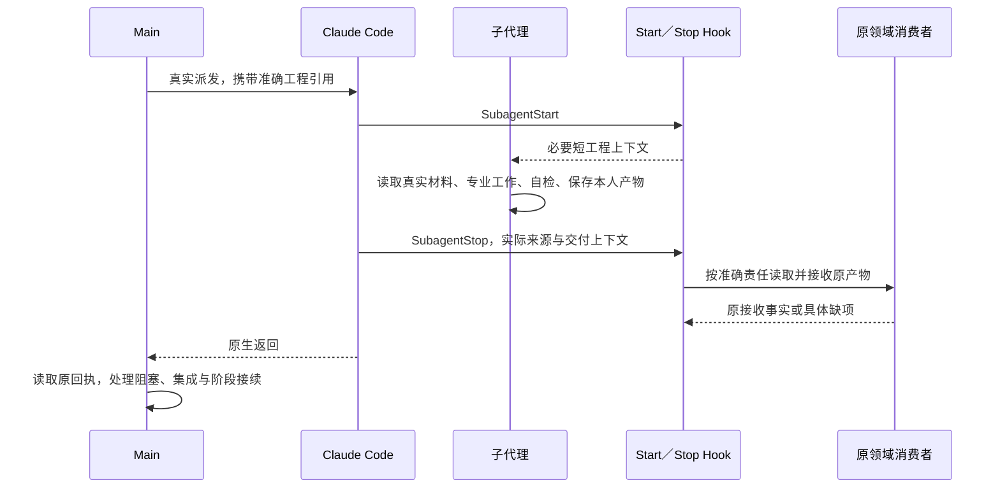

# L4 子代理工程衔接

## 1. 为什么工程治理需要与原生执行分开

委派工作的价值在于获得独立上下文、专业能力、并行工作或独立背书。要让这些价值成立，Main 必须交出明确责任和真实材料，执行者必须完成实际工作，结果还要被集成或下游专业消费者使用。一次 Agent 调用本身不会完成这条工程链。

Claude Code 已经管理子代理的创建、执行、消息、等待、恢复和返回。若框架再维护一套 Team、读回、批准、激活、首写许可和运行状态，就容易把“工程责任已登记”误当作“平台已经执行”，或让已经运行的 Worker 等待一个多余许可。Main 也可能以为自己在等结果，实际却只派出了一次计划汇报。

因此，本机制将工程输入与工程交付放在原生生命周期两端衔接。平台负责真实执行；Main 负责明确工作、真实派发及接续；领域消费者与 Runtime Writer 负责工程事实。计划、独立性、来源、检查和人的决定仍由其原工程责任承担。

这承接 [L1](../l1-principles/L1-design-principles.md) 的权威分离、自然路径观测、正向反馈、独立背书和明确消费者。L3 说明各阶段需要哪些专业工作，本篇说明它们怎样共用原生子代理能力；不再定义一套平台调度协议。

## 2. 每一方拥有什么事实

| 所有者 | 承担的责任与事实 | 与其他部分的关系 |
| --- | --- | --- |
| Claude Code | 创建或恢复子代理、前后台执行、平台身份、消息、等待、结束和原生返回 | Main 使用其实际能力，不以 Runtime 状态模拟执行 |
| Main | 专业分工、任务自包含、真实输入、准确引用、实际派发、依赖与容量安排、阻塞处理、集成和阶段收口 | Main 保持原主责，不替 Worker 填写专业结论 |
| 角色与技能 | 专业能力、方法、职责边界及产物要求 | 工作说明选择适用内容，不增设通用启动手续 |
| SubagentStart | 观察实际开始，提供必要短工程上下文 | 此时平台已经创建执行，不产生批准或开工状态 |
| SubagentStop | 读取本人已有产物，关联原责任，调用原领域消费者并反馈具体缺项 | 记录本次工程交付，不管理平台存活 |
| 原领域消费者与 Writer | 当前关联、专业答案接收、来源及必要工程条件、持久化记录 | 各领域保留实际检查范围，不外加通用认证层 |
| 原阶段门与人类入口 | 判断阶段能否推进，消费相应真实决定 | 原生结束、答案完整和人的授权分别成立 |

工程 owner 是专业责任名，平台 actor 是一次实际执行的来源标识；二者不要求相等。Runtime 记录哪项责任提交了什么，平台记录谁实际运行，两类事实通过准确交付关联。

工作状态、专业结论、接收、集成、阶段游标和平台执行状态也应分别表达。字段属于哪类事实及写入规则见[事务核心](L4-state-transition-core.md)；责任修订、对象版本和旧交付见[修订机制](L4-revision-usage.md)。

## 3. Main 怎样把责任交成一项可执行工作

### 3.1 先判断委派带来的实际收益

Main 需要判断工作能否自包含、输入是否可读、完成条件是否清楚，以及委派是否带来专业化、隔离、并行或独立性收益。高度交织的细小协调工作可以留在 Main；需要独立审查的责任则应真实交给不同执行者，不能因省去协调而由作者自签。

正式责任与辅助研究要区分。S0 的方案研究、S2 的技术调查或 S10 的资料整理，可以使用原生子代理帮助 Main；它们不自动成为 Builder、Reviewer 或已获批准的领域任务。Main 仍按原阶段消费者汇总实际成果。

角色数量不代表覆盖数量。S7 可以由同类角色承担不同独立验证面，实际责任由已登记 Claim 与分工确定；容量只改变执行顺序，不取消必要工作。

### 3.2 工作说明必须携带准确工程入口

原生任务应交付以下关系：当前责任为何存在；需要读取什么真实材料；工作范围与专业方法；实际完成条件和检查；准确的题目、brief 或答案位置；原生返回要携带什么；后续由谁接续。

准备入口提供已知关联和准确路径，Main 将其原样带入实际派发。角色名、单个待办、队列顺序和平台 ID 都不能替代这一任务关联。同一角色可能同时承担多项责任，也可能在恢复后面对新的题目。

例如，一项 S6 任务的交付说明应让 Builder 理解：

> 读取原准备输出的准确 brief 和实际 TASK 及其输入；在平台创建的本人 worktree 中先记录专业计划，再实施、自检、提交产品并保存本人 Result。返回这个准确 brief 的绝对引用和本人 Result 的绝对路径。Main 接收后承担原集成与必要检查。

这里描述任务结构，实际路径与专业字段必须来自本次准备输出。不能把示例路径、他人的答案或旧卷当成本人的工作材料。

### 3.3 工程准备与平台执行分别发生

S6 的 `s6 prepare --task … --role …` 登记原责任、固定输入并交付 brief；S5／S7／S8 从原登记与题目准备交付各人的 view／answer；S9 按批准合同、原分工及工序交付专业 brief 或定向验证题目。这些动作准备工程资料，不创建 Claude 进程。

随后 Main 通过 Claude Code 原生 Agent 实际派发。产品写入责任使用原生 worktree 隔离；新 S7 Reviewer／S9 独立 Targeted 的本轮正式主线是共享 Main checkout 的独立原生上下文，读取真实最终产品并填写各自普通唯一直卷。独立上下文不等于必须另建 worktree，Main 不代填结论。准确作者路径和新旧来源协议分别由 S7 issued 模板 SHA 与 Targeted 原责任 source contract 固定，不按文件存在猜测。Main 不能以“已登记”代替“已派发”，Hook 也不代 Main 启动。

实际 native worktree 只有在原消费者已有可验证 source binding 时才可接收；缺少绑定则反馈准确未接收，不把 cwd 或 Main 同名答案当资格。保留现有 frozen 责任的准确来源，不为支持只读角色直接套用 Builder Plan／Result adapter。共享 checkout 的控制原卷只沿原责任准确 proof 投影，不全目录忽略，不新增作者复制、提交、done 或普通工具限制。

## 4. 一项正常责任怎样完成交接

图中的工程接收与平台返回是不同事实。Hook 接收不能证明平台执行已彻底结束；平台返回也不能证明专业交付已接受或 Main 已集成。

普通 Worker 工具事件保持安静。执行者无需等一次 Write、消息或工具回执来激活自己，也无需在专业计划之后机械等待 Main 回复“可以开工”。原明确批准要求仍在其原领域成立，不能由 Start 或普通保存产生。

本机制只将 `SubagentStart` 和 `SubagentStop` 作为新 Worker 的工程生命周期接入点，用户所说的 end 对应后者。其他 Hook 仍可服务 Main 的阶段答卷、恢复和诊断，不能把删除的执行管理移到普通工具或消息事件中。

## 5. SubagentStart 补充什么，为什么不猜任务

官方 Start 事件提供平台身份与类型等字段，可注入 `additionalContext`；它不提供完整派发 Prompt，也不能阻止子代理创建。Main 因而必须在真实任务中携带准确工程引用。[官方 Start 定义](https://code.claude.com/docs/en/hooks#subagentstart)

当前适配器的 Start 提示强调当前专业路径、本人产物、真实检查与返回方式，不根据同角色或单个待办推断专属任务。需要长说明时，短上下文保留准确入口，由执行者读取实际 brief、view 和专业材料。

Start 不是“已读完”的证明，不自动登记一个 running／active 状态，不生成计划批准，也不重新分配责任。恢复时再次收到 Start，只补实际上下文，不能抹掉已经接收的成果或增加新尝试。

没有正式工程关联的 Explore、Plan、研究或其他原生工作继续按本次任务执行。系统可说明不要猜测正式责任；不能因缺少 Builder Assignment 就阻止无关原生研究。

实际事件身份可沿已有 Hook 审计记录保留。审计失败要作为可见诊断处理，不能因此制造一份替代执行记录或把平台已经创建的事实写成“未获启动许可”。

## 6. 本人工作怎样保持专业性和连续性

### 6.1 先读实际输入，再形成专业产物

任务中的 brief、view 与角色方法帮助执行者理解工作；真正判断仍来自实际 REQ、设计、契约、TASK、代码、场景、观察或批准合同。可读摘要不能替代必要来源，也不能因题目已预填机器字段就默认专业结论。

只读工作仍需要真实审查或调查。S5 的发现要定位材料偏差，S7 要判断本人 Claim，S8 要用判别观察支持或反驳假设。写入工作则须按真实范围实施并自检。专业方法与各阶段完成条件由对应 L3 定义。

角色继承 Claude Code 的原生工具能力，不维护框架工具白名单或黑名单。只读验证指不修改被审产品与已冻结治理事实，不禁止用 Edit、Write 或脚本完成本人答卷。工具名称不决定工程授权；真实批准、任务范围、专业独立性、来源和阶段门仍由原责任及消费者判定。用户的实际平台权限配置继续适用，角色目录校验不要求为了格式完整而填写工具 ACL。

### 6.2 计划保留为工作，取消通用握手

S6／S9 实施者本人在工作前形成专业计划，然后继续实施和实际检查。计划与结果记录不同事实，不必为它们再各交一份通用 PLAN、消息信封、读回或激活证明。

Stop 同次接收计划和结果，不等于机器证明了计划撰写时间，也不能补造前置批准。发现未先计划应诚实说明偏差。原责任明确要求真正批准时，必须满足其原批准条件；任务指引不能把这些要求隐去。

当前 S6 brief 给出计划、断言、oracle、完成条件索引与 Result 结构；S9 brief 给出本人三字段 PlanReport、真实前检及 Result 专业形状。作者填写真实内容，机器关联与接收记录由原适配器承担，详见[阶段答卷](L4-stage-form.md)。

### 6.3 平台原生能力管理前后台与等待

前台调用未返回时，Worker 已可按任务工作；后台启动通知只说明平台接受了执行。Main 按真实平台状态安排其他工作或等待，不以固定时间推断完成、死亡或应重派。

原生消息用于必要沟通和纠偏，不要求周期性重复进度或把计划写成一次终止回答。适用的子代理可通过平台恢复保留上下文；具体能力见[官方子代理说明](https://code.claude.com/docs/en/sub-agents#resume-subagents)。框架不建立活性轮询、租约或自行重启进程。

## 7. Stop 怎样定位本人责任

### 7.1 准确引用优先于身份猜测

Stop 使用原任务上下文、实际返回引用及当前已登记责任确定唯一候选。当前实现按完整引用边界匹配 brief、view 或 answer；仅出现同名角色、TASK 文字或路径子串不足以代签。

候选还要符合本领域的当前 Runtime、代际、阶段入口、轮次、Case／Session／Plan 或后继责任条件。具体条件由原消费者承担，不能把所有领域统一成一个新身份对象或全历史认证流程。

无准确匹配时，保留原生结果交 Main；同时命中多个真实责任时，也交 Main 解决。S9 同时带 Builder brief 与 Targeted 答案的返回，同样不能因先检查了 Builder 就替其签收。

### 7.2 实际来源根与控制根分别定位

平台回调的 cwd 可能仍是父工作区。写入责任返回本人 Result 的绝对路径，使接收器可以从同一仓库实际 worktree 中定位来源，再验证原工程关系；不能只按 cwd 借 Main 的同名文件。

Runtime、journal 和原接收事实保留在绑定的控制根。本人工作区保存产品与私人专业文件，不复制一份可写 Runtime 再靠 Git 合并。控制根无法唯一解析或原来源丢失时，问题应交 Main／系统准备责任处理。

已有独立安装或冻结 execution 继续读取其原登记根。已冻结来源不自动回落 Main，路径相同也不表示内容和接收身份相同。

### 7.3 恢复后的新任务与旧引用

恢复到新责任或新卷时，Main 应交付当前准确引用，Worker 返回这次实际使用的引用。平台 actor 变化本身不产生新工程责任；是否产生新责任或修订，由原领域变化决定。

S5／S6／S7／S8／S9 复用同一有界任务读取器：读取最多 4 MiB 的 transcript 尾段，选择包含本责任准确引用的最新实际 user 任务，忽略 tool_result 中的旧引用，并保留最终文字用于歧义判断。S6 用当前工程记录的准确 brief，S9 同时考虑 Builder brief 和独立 Targeted 路径；不会因为先检查某个分支就抢收另一责任。

转录不可读或尾段没有准确引用时，只能使用可读原任务和最终文字作有限回退，不承诺恢复任意长历史。Main 仍应交付当前准确引用，Worker 返回实际使用的 brief／Result 或问卷路径；多个真正责任并存时保留歧义交 Main，不能凭角色、队列或返回次序猜测。

## 8. Stop 接收什么，反馈给谁

### 8.1 接原消费者，保留专业语义

官方 Stop 事件提供本人 transcript 路径、最终文字和 `stop_hook_active` 等信息。使用 `SubagentHandback` 的执行中，最终文字可能只是收尾；它不是所交报告。阻断反馈回到当前子代理，不能冒充通知父会话的渠道。[官方 Stop 定义](https://code.claude.com/docs/en/hooks#subagentstop)

因此，正常接收读取本人准确专业文件和原证据，而不是仅凭最后一句 PASS。Handback 的文字可以帮助交接，但不能为捕获一份报告，再把 PostToolUse(SubagentHandback／SendMessage) 变成第三个结果接入点。

Stop 适配器调用本责任原消费者。题目、来源、实际检查、状态和修订按该消费者的实际范围处理；不新造通用 Result、接收账本或另一套任务状态机。

### 8.2 本人缺项与后继责任分别处理

本人遗漏具体且能补齐的产物字段，可以收到准确修正反馈。真实 blocker、负向专业结论和未完成说明则按原语义交接；不能为正常返回强造 PASS。

同事尚未交付、Main 尚未集成、后继阶段未完成，都不属于已经交付者的续跑理由。Stop 不执行长测试、合并、工作区准备或新平台派发；这些工作交原 owner。

原生适配器在准确私人文件与原字段校验边界保留本人可修的错误，反馈具体字段、实际产物位置与原责任。首次 Stop 是否要求本人继续，由原阶段交接合同决定，不由通用错误类别统一强制。原阶段采用首次纠正时，以退出码 2 给出实际缺项；`stop_hook_active` 已为真时停止反复阻断，由 Main 接续。S9 按 [S9 §14.2](../l3-stages/L3-S9-repair.md#142-收尾未完成返回与恢复边界) 在首次 native 返回将真实未完成工作和具体拒错交 Main，不以第二次 Stop 或凑齐结论作为退出条件；原消费者继续拒收不合格结果。S6／S9 对部分无计划但有实际 blocker 的交接还有独立返回分支，放行均不创建完成回执。

来源、控制面、准备和 Writer 故障，以及没有充分依据归给作者的错误，默认直接交 Main，保留原诊断、准确对象与已有产物。接收失败不能冒充完成；也不能仅按错误字符串猜测归属，要求本人无限续跑来补偿系统故障。原字段错误沿接收器传递，适配器不再重读整份答案来判断错误类别。

### 8.3 反馈与原回执分别读取

Stop 的诊断反馈属于当前子代理，不充当父会话通知。Main 的 `PostToolUse(Agent/Task)` 沿现有工具返回上下文提供接收摘要：除下述限定 S9 原消费者接续外保持只读；先按实际派发 prompt 的准确引用查询原责任，prompt 没有准确关联时才考虑返回文字中的引用；多项真正责任仍有歧义时交 Main 处理，不按角色或平台 actor 猜绑。

摘要读取原接收记录，不读取或接收 Worker 私人答案。S5 即使已经推进到 S6，仍可按原 packet 查询回执；S7／S8 读取各自原回执；S9 区分 PlanReport、Builder Result 与 Targeted，不能将计划已接收说成整个 Builder 已完成。S6 复用原 Runtime 单责任提示，带出已登记 Result 的准确位置；提示本身不重验全部产品证据，也不替代原 task-receipt、Main 检查与集成。

后台派发可能在工作完成前即时返回；此时没有接收事实不等于执行失败，Main 继续可开展的工作，依据实际原生执行和 Stop 诊断处理，不制造工具事件等待，也不猜测重派。这个出口不创建消息总线、ACK、第二份交接报告或完成状态；无法读取原回执时明确交 Main 保留现场调查。实际平台是否将此上下文交给模型，仍须真实运行验证。

接受了本人交付、可结束本人执行、Main 已接收并集成、阶段出口成立，是不同完成点。原回执及具体阶段解释这些差别；平台事件本身不会把它们同时置为 done。

## 9. 各阶段怎样使用这套衔接

| 阶段责任 | 本人实际工作与产物 | Stop 接收 | Main 后续工作 |
| --- | --- | --- | --- |
| [S5](../l3-stages/L3-S5-document-verification.md) | 独立审查规格一致性或任务可执行性，填原结论与真实发现 | 原 S5 Submission | 汇总两路当前判断，按原门锁定或返工 |
| [S6](../l3-stages/L3-S6-build.md) | 本人专业 Plan、实际实现／自检、产品提交与 Result | 原 Assignment Result／完成消费者 | 原集成、Main 必要检查、确认与清理、完整批次出口 |
| [S7](../l3-stages/L3-S7-verification-round.md) | 本人 Claim／视角的真实验证、Result、Finding 与必要现场 | 原 ReviewResult | 按计划依赖继续，形成完整本轮收口 |
| [S8](../l3-stages/L3-S8-finding-investigation.md) | 假设判别、观察、证据和 HypothesisResult | 原 HypothesisResult | 因果汇总、Case 路由、修复合同及真实批准 |
| [S9 Builder](../l3-stages/L3-S9-repair.md) | 本人 PlanReport、真实前检／修复／自检、专业 Result | 原 PlanReport 与 RepairResult | 实际集成与检查、专业影响判断、独立复验及返回 S7 |
| S9 Targeted | 独立检查实际修复树及 Contract 断言，填原定向验证卷 | 原 TargetedReverification | 完成必要后继责任，原 Handoff 出口准备新 S7 |

S0～S4、S10、S11 的辅助专业协作同样使用原生平台；其正式 Main 答卷与人类入口仍由各自原消费者承接。本表列的是已接入正式 Worker 产物的路径，不为其余阶段增设专属派发器。

Main 的规划、Case、分工、影响和验收是 Main 自己的工作；可以通过其原保存消费者接收。Main 普通消息、读取或保存不得扫描抢收 Worker 私人答案。反过来，Worker 的原生 Stop 也不替 Main 填后续卷。

## 10. 写入任务的 Git 来源与 Main 集成

### 10.1 平台创建 worktree，工程保留真实起点

S6／S9 的输入以真实、已提交 Main 基线和原专业来源为依据。S6 准备固定实际 Main HEAD，并要求平台从包含该输入的 HEAD 创建本人 worktree；S9 还要考虑准备与实际创建之间依赖集成已使 Main 前进的情况。

Worker 在本人 worktree 保存私人计划／结果，只提交实际产品。私人卷、Runtime 和 journal 不应被强制加入产品 Git 来满足交接手续。实际提交、范围、未完成事项及后续集成条件仍按原领域校验。

当前接收器需要实际 Git 来源和真实分支，不能把 Main 文件当本人 Result。它记录交付坐标用于原集成，不从这些坐标反推出平台启动或批准事实。

### 10.2 S6 的原交付链

S6 Stop 读取本人计划与 Result，合入系统已知机器关联，校验原专业结构，再发布必要原产物并调用原完成消费者。工程记录中的实际 worktree、分支和起点用于后续 Integrator；作者不另交一个启动事件。

Main 随后显式执行原 task-integrate，在实际合并树上运行必要检查，形成原确认及清理。Builder 自检不会代替 Main 检查；原已接收 Result 也不能单独释放尚未完成的依赖。

### 10.3 S9 的原交付链

S9 的 Main 题目是只读输入。Builder 在本人 worktree 保存三字段专业 PlanReport 与 Result；Stop 导入这份实际 Plan payload 到原接收位置，再调用原 PlanReport 和 Result 消费者。导入是适配器传递本人事实，不是 Main 模型代答，也不要求 Worker 跨隔离写 Main。

返回后，适配器可记录 `native_delivery`：实际工作树、分支、基线及原责任关联，用于原 Result／集成消费者。它不含 bootstrap 或预留平台 session，不创建、启动或恢复 Agent。首次确定的来源按原重试保留，不能每次随 Main HEAD 漂移。

候选接收后 Main 做真实集成及所选必要检查，再形成最终 Result。Main 影响判断和独立 Targeted 是后续不同专业责任；Targeted PASS 也不直接跳到 S10，完成后仍进入新完整 S7。

更完整的范围、失败现场、集成和清理解释见[Worktree 治理](L4-worktree-governance.md)，保留执行根配置见[执行环境机制](L4-workspace-execution-profiles.md)。

## 11. 整体派发计划怎样支持持续释放

### 11.1 计划是工作偏序，平台负责实际执行

S4 在原 REQ 任务索引中交付 `waves-v1` 整体派发计划，S5 审查，S6 消费。每个非取消 TASK 恰好出现一次，目标、范围、完成条件和检查继续引用 TASK；计划补充波次、资源与必要先后理由。

任务依赖与资源顺序联合无环。同波默认可并行，共享只读源不自动构成依赖；无法隔离的写入、稀缺资源和真实产物依赖，需要清楚说明顺序。资源依赖不能为了画整齐波次凭空增加。

计划固定要做哪些工作及为什么这样安排；运行中的进度和平台状态从实际事实投影，不回填审签计划，也不让平台 task list 成为新的工程权威。具体作者方法见 [S4](../l3-stages/L3-S4-task-split.md)和[派发规则](../../docs/rules/dispatch-plan.md)。

### 11.2 接收、完成与集成共同释放真实依赖

S6 候选需要原任务及计划已登记、来源当前适用、实际前置满足且无未解冲突。当前依赖释放读取前置的工程 done 与 verified integration，不能仅凭 Worker 返回、Result 已登记或单独 Main 合并事实释放。

例如，甲依赖任务一，乙依赖任务二：任务一已完成并经 Main 验证集成，而任务二仍在运行，甲可以先开始；不需要等整波所有成员齐交。容量不足时，甲仍是符合工程条件的候选，只是当前未安排平台执行。

当前 `Eligible` 表示工程条件允许，`Dispatchable` 再考虑实际给定容量。建议优先级用于选择候选，不是新授权。Main 根据真实容量、冲突与接收积压安排原生派发；不会因建议中没列出某项就删除该责任。

### 11.3 保留覆盖，避免形成第二调度器

S7 保留全部必要 Claim 与独立验证面，S9 保留批准修复和必要复验。平台容量、token 或等待成本可以改变安排，不能把未做工作改成不适用或通过，也不授权无限扩大责任集合。

工程建议不自动创建代理、轮询活性或唤醒后续责任。当前新 S6 已在 Main 指引中避开旧 slot／capacity 接线，Main 使用原 brief 与集成事实继续。旧建议投影只在其支持入口有意义，不能作为所有原生任务的额外派发门。

## 12. 重放、阻塞、替换和来源丢失

### 12.1 同一交付重放原事实

重复 Stop 应由原消费者复用同一接收，不重复登记或推进。平台恢复产生不同 actor，也不改变原责任内容。同身份不同内容、责任被修订、换轮换代或被替换时，仍走原领域变化规则，不能把旧 PASS 绑定新输入。

S6 已关闭责任与 S9 已集成清理来源有明确迟到 Stop 处理。私人 worktree 被清理后，不应因此把已经完成的责任重新派出。当前已接收原产物持久化与后续 Git 来源验证各有用途，不能简单等同为“所有缓存删除后任何保存都能重放”。

### 12.2 阻塞先交真实现场

缺输入、环境失败、契约冲突或实施未完成时，本人说明实际 blocker、已做观察和剩余工作。能够交接的真实阻塞可以结束本次原生执行；没有完成回执时，也不能把它写成已完成贡献。

Main 结合原责任处理：补输入、解决环境、按原修订纠偏、走规格变更或等待真正人意。互不受影响的工作可继续，不能让一个阻塞无差别冻结整个阶段。

### 12.3 恢复平台与修订工程责任分别判断

Main 先看平台的实际执行与可恢复性，再看原产物及回执。可恢复同一上下文时使用原生恢复；原上下文确实不可恢复时，按原责任和有效现场重新交付。仅因暂时无消息、UI 隐藏、一次 Stop 或未收到 Stop，都不足以推断死亡并自动创建替代者。

改变 owner、范围、输入或原专业责任的行为，使用原修订记录，保留已接收同伴工作、原结果和失效范围。纯平台 actor 变化不需要新建 alias 表或工程任务。原 Task 源重锁等边界仍以对应 S6／修订篇为准，不能从 Assignment revision 自动推导全部来源已重签。

### 12.4 已接收事实与未接收来源分别恢复

未接收的产物需要准确实际来源。已登记独立根丢失不能回落 Main 借卷；S9 新私人 Plan 不存在时也不能拿 Main 草稿充当本人计划。若原 Plan 已接受，当前适配器有按原不可变回执继续的边界，而不是重做专业工作。

已有冻结执行只服务原记录，保留原作者根、输入、批准和恢复入口。新普通责任不同时进入旧 launcher 与原生派发两条路径，也不把旧执行迁移成一份伪造的新批准。

## 13. 观测怎样帮助 Main 理解交接

| 观察面 | 应回答的问题 | 不能据此推导什么 |
| --- | --- | --- |
| 实际 Agent 调用和原生返回 | 是否真实派发，平台返回什么、是否仍在运行或可恢复 | 工程登记等于启动，后台接受等于完成 |
| 原 Start／Stop payload 与已有 Hook 审计 | 哪次实际来源经过哪个工程接入点 | actor 等于 owner，Start 代表批准或已读 |
| 准确任务引用及来源根 | 本次交付属于哪项责任，实际文件从哪里读取 | 同角色或同名文件可以互借 |
| 原接收、证据与当前回执 | 哪份交付已接受、本人是否完成、还有谁负责什么 | 一份回执代表全阶段或真实产品验收 |
| Git 来源、集成检查点与 Main 检查 | 哪份贡献进入什么树，必要检查是否真的完成 | 本人 PASS 等于合并树 PASS |
| 原错误及恢复反馈 | 本人缺项、系统准备、Main 集成或人的等待卡在哪里 | 没有日志等于未执行，日志缺失等于可以重派 |

可选诊断采样只解释其实际支持的责任，未知类型和平台 actor 不匹配保持未知。它不成为结果接收、重新派发或活性监管的依据。提示去重与停滞诊断的实际范围见[手续收敛](L4-procedure-reduction.md)。

观测次数与工程次数要分开。重复平台回调、并发其他 owner 的写入和多个结果帧都可能发生；是否重复接收应读原事实，不能仅用相邻 Runtime revision 变化归因某个普通工具。

## 14. 实现对应、现有边界与验证

### 14.1 当前接线

| 责任 | 当前落点 |
| --- | --- |
| 原生接线优先、控制根解析 | [run.go](../../internal/cli/run.go)、[native_s6.go](../../internal/cli/native_s6.go) |
| S6 工程准备及原生交付 | [s6_prepare.go](../../internal/cli/s6_prepare.go)、[native_s6.go](../../internal/cli/native_s6.go) |
| S5／S7／S8 精确引用与原消费者 | [native_review_hooks.go](../../internal/cli/native_review_hooks.go) |
| S9 私人 Plan／Result、返回 Git 来源与独立 Targeted | [native_s9.go](../../internal/cli/native_s9.go) |
| 历史已锚定 C source-v1 来源兼容 | [native_s9_source.go](../../internal/cli/native_s9_source.go)、[原来源保全与复核](../../internal/repair/native_s9_source.go) |
| 原领域接收及回执 | [submission](../../internal/submission)、[assignment](../../internal/assignment) |
| TASK 偏序、依赖释放及候选投影 | [dispatch/board.go](../../internal/dispatch/board.go)、[semantic/dispatch_plan.go](../../internal/semantic/dispatch_plan.go) |
| Main 与角色的实际使用说明 | [agent-dispatch](../../skills/agent-dispatch/SKILL.md)、[agent-protocol](../../docs/control/agent-protocol.md)、[角色定义](../../agents) |

新 S9 Builder 的 D 合同由原 pin／brief 固定准确普通原稿 `.loop-submissions/native-s9/<原Plan packet>/plan.json` 和同目录 `result.json`；原 packet、AnswerPath／digest、typed 机器输入及旧 frozen 坐标不改，作者仍只填本人原有专业产物。系统核准确原稿路径未被 ignore、非 tracked／base 产品且真实 `??`，并按责任和原字节投影原稿。原 PlanReport 回执、pin 和登记执行共同确定该 packet 的本人私人运行产物区，区内未追踪中间产物不因缺引用而成为产品变化；这不排除整个 `.loop-submissions`、其他 packet 或真实产品 diff。被引用证据仍按原来源捕获与校验。平台默认生命周期不接管；原稿至少保留至来源后继结束与原 verified／ACK／cleanup_pending，不在 Stop 提前删最后一份原稿。原回收授权成立后，本责任私人运行产物可随该工作区回收，不新增作者清理手续。

原 Stop 沿准确责任和实际来源进入原 Plan／Result／Candidate；actor 仅记录真实事件，不建立独立 actor→worktree 所有权证明。仅无失败的 Main Agent／Task completed Post、准确派发 prompt 唯一原 brief、返回 agentId 非空且非 Main，并满足相应来源证明时，可在原预算内续同一原 source／attempt。D 核同次结构化 worktreePath／worktreeBranch、原 execution 和冻结 pin 摘要，缺字段不从 prose 猜源；既有 C 核原 retained Stop actor 与已锚不可变来源。已保存 typed 优先、已收幂等，不从 prose／角色／目录首次造源、不要求作者重存或再 Stop。普通高频 Pre／Post 继续当前信息和原 Writer 恢复，不因完整 JSON 首次接收 Worker；Main 真实保存的原工序仍保留自身接收合同。Main 长集成／检查不进入 Stop。

新 D 不默认创建 source-v1／ref；历史实际 C 锚及旧 frozen 继续原读取与冲突规则，不能移动旧稿或追溯升级。S7 Reviewer、S9 独立 Targeted 沿各自原题、原作者根和消费者，S6／S8／S10 的专业合同不扩展。精确接收、ignored 清理与先 Impact 后独立资源收尾见 [S9 §6.2](../l3-stages/L3-S9-repair.md#62-stop-接收原作者产物不代作专业判断)及 [Worktree §9.2](L4-worktree-governance.md#92-清理只处理确切已接收资源)。D 接线及完整平台验证仍待完成，有限 changed／nochange 隔离证据不替代真实 blocked、Targeted→fresh S7、OS sandbox、并发与安装验收。

这些入口复用原领域机制，没有新增 actor 注册表、通用 Result 或平台启动器。任务读取与错误反馈受前述准确引用、有限读取和责任归属边界约束；Main 工具返回可提供原回执摘要；父会话是否实际看到仍须实际平台验证，不能由 Stop 的 stderr 推定。具名冻结恢复入口继续服务原记录；维护时沿公开调用链判断，不能看到旧 helper 就将其重新提升为正常前置。

S8 无 Finding 的人类问题虽然可以准备调查材料，当前结果来源与合同链仍有批次依赖。S6 的正式 TASK 源重锁、S7 的真实验证覆盖、S9 的全批无差异交付、S10／S11 的真实专业和人意条件，也不能因原生派发接通就声称解决。具体差距留在各自 L3，本机制不代替其专业判断。

### 14.2 验证应覆盖真实失败方式

自动化要检查：Start 无确切责任不猜；普通 Worker 工具无接收或激活；Main 不抢收；同角色并发和相似路径不串卷；新旧责任和多重引用不误收；本人字段缺项有准确反馈；真实 blocker 可交接；重放及清理后迟到 Stop 不重复；来源丢失不借卷；Main 集成和阶段门仍单独成立。

真实 Claude Code 验证还要确认实际派发、前台／后台、原生恢复、Hook payload、Handback 收尾与返回，以及 Main 能否据实际结果接续。机械调用和合成前置只证明其覆盖范围，不能代替真实宿主或业务质量。

模拟答卷适合检查接线和流转，必须明示没有真实实施、审查或调查。有限实测也只证明相应源码、平台和用例；不能把旧报告存在、测试数量或本篇完整性当成当前完整原生矩阵已经通过。
