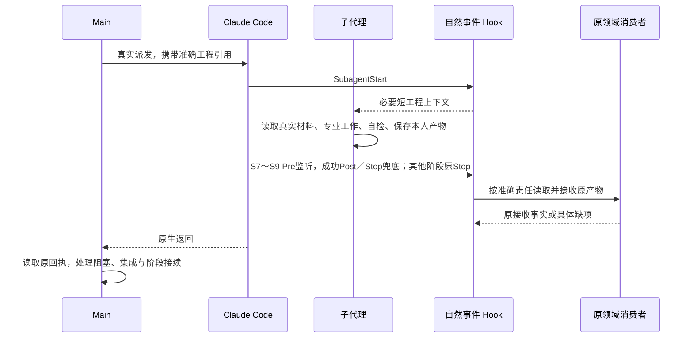

# L4 子代理工程衔接

## 1. 为什么工程治理需要与原生执行分开

委派工作的价值在于获得独立上下文、专业能力、并行工作或独立背书。要让这些价值成立，Main 必须交出明确责任和真实材料，执行者必须完成实际工作，结果还要被集成或下游专业消费者使用。一次 Agent 调用本身不会完成这条工程链。

Claude Code 已经管理子代理的创建、执行、消息、等待、恢复和返回。若框架再维护一套 Team、读回、批准、激活、首写许可和运行状态，就容易把“工程责任已登记”误当作“平台已经执行”，或让已经运行的 Worker 等待一个多余许可。Main 也可能以为自己在等结果，实际却只派出了一次计划汇报。

因此，本机制将工程输入与工程交付放在原生生命周期两端衔接。平台负责真实执行；Main 负责明确工作、真实派发及接续；领域消费者与 Runtime Writer 负责工程事实。计划、独立性、来源、检查和人的决定仍由其原工程责任承担。

这承接 [L1](../l1-principles/L1-design-principles.md) 的权威分离、自然路径观测、正向反馈、独立背书和明确消费者。L3 说明各阶段需要哪些专业工作，本篇说明它们怎样共用原生子代理能力；不再定义一套平台调度协议。

## 2. 每一方拥有什么事实

| 所有者 | 承担的责任与事实 | 与其他部分的关系 |
| --- | --- | --- |
| Claude Code | 创建或恢复子代理、前后台执行、平台身份、消息、等待、结束和原生返回 | Main 使用其实际能力，不以 Runtime 状态模拟执行 |
| Main | 专业分工、任务自包含、真实输入、准确引用、实际派发、依赖与容量安排、阻塞处理、集成和阶段收口 | Main 保持原主责，不替 Worker 填写专业结论 |
| 角色与技能 | 专业能力、方法、职责边界及产物要求 | 工作说明选择适用内容，不增设通用启动手续 |
| SubagentStart | 观察实际开始，提供必要短工程上下文 | 此时平台已经创建执行，不产生批准或开工状态 |
| 自然事件 Hook | S7～S9 的 Pre 监听当前原卷，成功 Post／Stop 兜底；S5／S6 保留原 Stop 接收 | 保存本次交付并反馈缺项，不管理平台存活或激活责任 |
| 原领域消费者与 Writer | S7～S9 最小结构与结论一次保存、按答案接续；其他阶段沿原消费合同 | 身份、状态、并发与幂等是内部持久化，不外加专业证明层 |
| 原阶段门与人类入口 | 判断阶段能否推进，消费相应真实决定 | 原生结束、答案完整和人的授权分别成立 |

工程 owner 是专业责任名，平台 actor 是一次实际执行的来源标识；二者不要求相等。Runtime 记录哪项责任提交了什么，平台记录谁实际运行，两类事实通过准确交付关联。

工作状态、专业结论、接收、集成、阶段游标和平台执行状态也应分别表达。字段属于哪类事实及写入规则见[事务核心](L4-state-transition-core.md)；责任修订、对象版本和旧交付见[修订机制](L4-revision-usage.md)。

## 3. Main 怎样把责任交成一项可执行工作

### 3.1 先判断委派带来的实际收益

Main 需要判断工作能否自包含、输入是否可读、完成条件是否清楚，以及委派是否带来专业化、隔离、并行或独立性收益。高度交织的细小协调工作可以留在 Main；需要独立审查的责任则应真实交给不同执行者，不能因省去协调而由作者自签。

正式责任与辅助研究要区分。S0 的方案研究、S2 的技术调查或 S10 的资料整理，可以使用原生子代理帮助 Main；它们不自动成为 Builder、Reviewer 或已获批准的领域任务。Main 仍按原阶段消费者汇总实际成果。

角色数量不代表覆盖数量。S7 可以由同类角色承担不同独立验证面，实际责任由已登记 Claim 与分工确定；容量只改变执行顺序，不取消必要工作。

### 3.2 工作说明必须携带准确工程入口

原生任务应交付以下关系：当前责任为何存在；需要读取什么真实材料；工作范围与专业方法；实际完成条件和检查；准确的题目、brief 或答案位置；必要的原生交接内容；后续由谁接续。S7～S9 在派发时即确定原答卷位置，不把返回引用作为额外接收信号。

准备入口提供已知关联和准确路径，Main 将其原样带入实际派发。角色名、单个待办、队列顺序和平台 ID 都不能替代这一任务关联。同一角色可能同时承担多项责任，也可能在恢复后面对新的题目。

例如，一项 S6 任务的交付说明应让 Builder 理解：

> 读取原准备输出的准确 brief 和实际 TASK 及其输入；在平台创建的本人 worktree 中先记录专业计划，再实施、自检、提交产品并保存本人 Result。返回这个准确 brief 的绝对引用和本人 Result 的绝对路径。Main 接收后承担原集成与必要检查。

这里描述任务结构，实际路径与专业字段必须来自本次准备输出。不能把示例路径、他人的答案或旧卷当成本人的工作材料。

### 3.3 工程准备与平台执行分别发生

S6 的 `s6 prepare --task … --role …` 登记原责任、固定输入并交付 brief；S5／S7／S8 从原登记与题目准备交付各人的 view／answer；S9 按批准合同、原分工及工序交付专业 brief 或定向验证题目。这些动作准备工程资料，不创建 Claude 进程。

随后 Main 通过 Claude Code 原生 Agent 实际派发。产品写入责任使用原生 worktree 隔离；S7 Reviewer、S8 Investigator、S9 独立 Targeted 使用实际安排的独立上下文和各自原卷，不因独立性另加机器身份、worktree 注册或来源证明。Main 不能以已登记替代已派发，也不能代填本人结论。

原任务和已有登记交付准确作者路径及控制根；新模板用于新责任，旧发行材料和原来源关系继续使用，不按文件存在与否猜版本。S0～S11 的 Hook 与原消费者均不计算、登记或校验模板 SHA、source proof、证据散列或 Git OID；S7～S9 接收也不核 Git／ignore 状态。真实来源与独立性由作者、Main 和实际审查履职；实际材料缺失交 Main／系统处理，不借同名卷或虚构来源。

S5／S6 使用各自当前原生题面和 Stop 接收；删除旧 frozen 启动、来源和恢复接线，不将只读角色套成 Builder Plan／Result。

## 4. 一项正常责任怎样完成交接

图中的工程接收与平台返回是不同事实。Hook 接收不能证明平台执行已彻底结束；平台返回也不能证明专业交付已接受或 Main 已集成。

S7～S9 普通工具事件监听当前责任的就绪原卷，不激活责任、不增加权限。S5／S6 普通 Worker 工具仍不接收答案。执行者无需等 Write、消息或工具回执开工，计划后在原授权内继续工作；真正批准仍须真实发生，Start 和保存不能代签。

`SubagentStart` 提供短上下文；S7～S9 的 `PreToolUse`、成功 `PostToolUse` 与 `SubagentStop` 复用同一当前责任和原消费者，最小检查并一次保存、自动接续。其余阶段保持原保存／Stop 路径。接收监听不接管平台执行，不新增消息接入、轮询、首写许可或执行管理。

## 5. SubagentStart 补充什么，为什么不猜任务

官方 Start 事件提供平台身份与类型等字段，可注入 `additionalContext`；它不提供完整派发 Prompt，也不能阻止子代理创建。Main 因而必须在真实任务中携带准确工程引用。[官方 Start 定义](https://code.claude.com/docs/en/hooks#subagentstart)

当前适配器的 Start 提示强调当前专业路径、本人产物、真实检查与返回方式，不根据同角色或单个待办推断专属任务。需要长说明时，短上下文保留准确入口，由执行者读取实际 brief、view 和专业材料。

Start 不是“已读完”的证明，不自动登记一个 running／active 状态，不生成计划批准，也不重新分配责任。恢复时再次收到 Start，只补实际上下文，不能抹掉已经接收的成果或增加新尝试。

没有正式工程关联的 Explore、Plan、研究或其他原生工作继续按本次任务执行。系统可说明不要猜测正式责任；不能因缺少 Builder Assignment 就阻止无关原生研究。

实际事件身份可沿已有 Hook 审计记录保留。审计失败要作为可见诊断处理，不能因此制造一份替代执行记录或把平台已经创建的事实写成“未获启动许可”。

## 6. 本人工作怎样保持专业性和连续性

### 6.1 先读实际输入，再形成专业产物

任务中的 brief、view 与角色方法帮助执行者理解工作；真正判断仍来自实际 REQ、设计、契约、TASK、代码、场景、观察或批准合同。可读摘要不能替代必要来源，也不能因题目已预填机器字段就默认专业结论。

只读工作仍需要真实审查或调查。S5 的发现要定位材料偏差，S7 要判断本人 Claim，S8 要用判别观察支持或反驳假设。写入工作则须按真实范围实施并自检。专业方法与各阶段完成条件由对应 L3 定义。

角色继承 Claude Code 的原生工具能力，不维护框架工具白名单或黑名单。只读验证指不修改被审产品与已冻结治理事实，不禁止用 Edit、Write 或脚本完成本人答卷。工具名称不决定工程授权；S7～S9 的真实批准、范围、独立性与来源由实际责任履行，原消费者保存结论并有限分流，不重新证明专业事实。其他阶段沿原责任与消费者判定。用户的实际平台权限配置继续适用，角色目录校验不要求为了格式完整而填写工具 ACL。

### 6.2 计划保留为工作，取消通用握手

S6／S9 实施者本人在工作前形成专业计划，然后继续实施和实际检查。计划与结果记录不同事实，不必为它们再各交一份通用 PLAN、消息信封、读回或激活证明。

S9 Plan 就绪时可以单独接收并继续原授权实施，不等待 Result、回执或额外批准；Pre 监听，成功 Post／Stop 兜底。S6 保留原 Stop 同次交付规则。事件接收不证明计划撰写时间，也不能补造前置批准。发现未先计划应诚实说明偏差。原责任明确要求真正批准时，必须满足其原批准条件；任务指引不能把这些要求隐去。

当前 S6 brief 给出计划、断言、oracle、完成条件索引与 Result 结构；S9 brief 给出本人三字段 PlanReport、真实前检及 Result 专业形状。作者填写真实内容，机器关联与接收记录由原适配器承担，详见[阶段答卷](L4-stage-form.md)。

### 6.3 平台原生能力管理前后台与等待

前台调用未返回时，Worker 已可按任务工作；后台启动通知只说明平台接受了执行。Main 按真实平台状态安排其他工作或等待，不以固定时间推断完成、死亡或应重派。

原生消息用于必要沟通和纠偏，不要求周期性重复进度或把计划写成一次终止回答。适用的子代理可通过平台恢复保留上下文；具体能力见[官方子代理说明](https://code.claude.com/docs/en/sub-agents#resume-subagents)。框架不建立活性轮询、租约或自行重启进程。

## 7. 自然事件怎样定位本人责任

### 7.1 准确引用优先于身份猜测

S7～S9 Pre／成功 Post／Stop 从当前原任务和已有登记关联定位本人原卷，完整 brief／view／answer 引用用于准确关联，不要求作者返回引用证明。仅同名角色、TASK 文字、路径子串、唯一候选或返回顺序均不足以猜选。S5／S6 保留原 Stop 任务和返回引用选择。

当前 Runtime、阶段和 Case／Session／Plan 等已有实际关系帮助确定当前责任；不生成、累计或兼容读取旧数字轮次。S7～S9 只读取所需关联和最小接收状态，不展开身份、全历史或批次资格认证；其他阶段沿当前原消费者条件处理。

无准确匹配或真实派发的责任集合无法确定时，保留原生结果并交 Main／系统处理；不能按路径出现顺序猜选。已有实际派发关系明确表明同一执行承担多项本人责任时，各责任沿其原卷和原消费者分别接收，某项失败不吞掉其他已确定责任。自由文本同时出现多个引用并不自动证明多项派发，背景引用也不自动取得责任。S9 的 Builder 与独立 Targeted 仍按各自本人责任接收，不能因先检查某一分支而替另一人签收。

### 7.2 实际来源根与控制根分别定位

平台回调 cwd 可能仍是父工作区。S7～S9 的原任务和已有责任关系提供准确卷位置与实际作者根，不能只按 cwd、角色或同名文件猜选，也不要求返回绝对路径来取得接收资格。S6 写入责任保留原 Result 绝对引用和实际 worktree 关联。

Runtime、journal 和原接收事实保留在绑定的控制根。本人工作区保存产品与私人专业文件，不复制一份可写 Runtime 再靠 Git 合并。控制根无法唯一解析或原来源丢失时，问题应交 Main／系统准备责任处理。

已有独立安装或冻结 execution 继续读取其原登记根。已冻结来源不自动回落 Main，路径相同也不表示内容和接收身份相同。

### 7.3 恢复后的新任务与旧引用

恢复到新责任或新卷时，Main 交付当前准确引用；S7～S9 不再把 Worker 返回该引用作为接收前置，S5／S6 沿原返回约定。平台 actor 变化本身不产生新工程责任；是否产生新责任或修订，由原领域变化决定。

S5／S6／S7／S8／S9 复用同一有界任务读取器：读取最多 4 MiB 的 transcript 尾段，选择包含本责任准确引用的最新实际 user 任务，忽略 tool_result 中的旧引用，并保留最终文字用于歧义判断。S6 用当前工程记录的准确 brief，S9 同时考虑 Builder brief 和独立 Targeted 路径；不会因为先检查某个分支就抢收另一责任。

转录不可读或尾段没有准确引用时，只能使用可读原任务和最终文字作有限回退，不承诺恢复任意长历史。Main 仍交付当前准确引用，S7～S9 从原任务／登记选择原卷，不索取新身份或返回证明；S5／S6 沿原返回规则。多项责任是否同属本次执行按已有派发关系确定；明确属于本次执行的各自接收，无法区分背景与当前责任时交 Main／系统，不凭角色、队列或次序猜测。现有单项 packet 索引和文本引用不自动提供可判定的多责任集合。

## 8. 原答卷怎样接收，反馈给谁

### 8.1 接原消费者，保留专业语义

官方 Stop 事件提供本人 transcript 路径、最终文字和 `stop_hook_active` 等信息。使用 `SubagentHandback` 的执行中，最终文字可能只是收尾；它不是所交报告。阻断反馈回到当前子代理，不能冒充通知父会话的渠道。[官方 Stop 定义](https://code.claude.com/docs/en/hooks#subagentstop)

S7～S9 自然监听只读取当前责任原答卷，单次核可解析、题面真正必要字段、就绪及结论；原消费者可靠保存一次并按已收结论接续。它不读原证据、逐 Git／hash、不重算覆盖、因果、修复充分性或独立性。S5／S6 原 Stop 沿各自专业文件和原消费者处理。

Handback／SendMessage 文字可帮助交接，不新增结果通道、报告或接收账本。Stop 是三阶段原消费的兜底，Pre 与成功 Post 可以先完成；已收则读取事实，不再打开私人卷。Main 集成和长检查仍由 Main 实际执行。

### 8.2 本人缺项与后继责任分别处理

本人遗漏具体且能补齐的产物字段，可以收到准确修正反馈。真实 blocker、负向专业结论和未完成说明则按原语义交接；不能为正常返回强造 PASS。

同事尚未交付、Main 尚未集成、后继阶段未完成，都不属于已经交付者的续跑理由。Stop 不执行长测试、合并、工作区准备或新平台派发；这些工作交原 owner。

S7～S9 首次原生返回即可交接真实 blocked、未完成、未就绪和具体字段错误，不靠再次 Stop 或虚构结论迫使退出；未就绪不产生接收／完成事实。Main 获得原责任、准确卷位置、已有事实和具体下一责任。S5／S6 是否首次纠正继续沿原阶段合同；采用阻断时只给实际缺项，不反复要求无法完成的工作。

来源、控制面、准备和 Writer 故障，以及没有充分依据归给作者的错误，默认直接交 Main，保留原诊断、准确对象与已有产物。接收失败不能冒充完成；也不能仅按错误字符串猜测归属，要求本人无限续跑来补偿系统故障。原字段错误沿接收器传递，适配器不再重读整份答案来判断错误类别。

### 8.3 反馈与原回执分别读取

Stop 的诊断反馈属于当前子代理，不充当父会话通知。Main 的 `PostToolUse(Agent/Task)` 沿现有工具返回上下文提供接收摘要：S7～S9 可按当前责任兜底消费就绪原卷并接续，其他阶段保持只读；先按实际派发 prompt 的准确引用查询原责任，prompt 没有准确关联时才考虑返回文字中的引用；多项真正责任仍有歧义时交 Main 处理，不按角色或平台 actor 猜绑。

已收摘要读取原接收事实，不再读取私人答案。S7～S9 未收时可沿同一最小消费者兜底，不能为摘要重验来源、全部证据或历史。S5 即使已推进到 S6 仍按原 packet 查回执。S9 区分 PlanReport、Result 与 Targeted，计划已收不代表整个 Builder 完成。S6 复用原 Runtime 单责任提示，带出已登记 Result 的准确位置；提示本身不重验全部产品证据，也不替代原 task-receipt、Main 检查与集成。

后台派发可能在工作完成前即时返回；此时没有接收事实不等于执行失败，Main 继续可开展的工作，依据实际原生执行和 Stop 诊断处理，不制造工具事件等待，也不猜测重派。这个出口不创建消息总线、ACK、第二份交接报告或完成状态；无法读取原回执时明确交 Main 保留现场调查。实际平台是否将此上下文交给模型，仍须真实运行验证。

接受了本人交付、可结束本人执行、Main 已接收并集成、阶段出口成立，是不同完成点。原回执及具体阶段解释这些差别；平台事件本身不会把它们同时置为 done。

## 9. 各阶段怎样使用这套衔接

| 阶段责任 | 本人实际工作与产物 | 原消费者及自然时机 | Main 后续工作 |
| --- | --- | --- | --- |
| [S5](../l3-stages/L3-S5-document-verification.md) | 独立审查规格一致性或任务可执行性，填原结论与真实发现 | 原 S5 Submission | 汇总两路当前判断，按原门锁定或返工 |
| [S6](../l3-stages/L3-S6-build.md) | 本人专业 Plan、实际实现／自检、产品提交与 Result | 原 Assignment Result／完成消费者 | 原集成、Main 必要检查、确认与清理、完整批次出口 |
| [S7](../l3-stages/L3-S7-verification-round.md) | 本人 Claim／视角的真实验证、Result、Finding 与必要现场 | Pre 监听，成功 Post／Stop 兜底接原 ReviewResult | 按原必要责任和已收结论交 S8／S10，不重算覆盖或额外干净轮证明 |
| [S8](../l3-stages/L3-S8-finding-investigation.md) | 假设判别、观察、证据和 HypothesisResult | Pre 监听，成功 Post／Stop 兜底接原 HypothesisResult | Main 判断因果与路由，建议不自动登记或成为门槛；原合同与真实批准接续 |
| [S9 Builder](../l3-stages/L3-S9-repair.md) | 本人 PlanReport、真实前检／修复／自检、专业 Result | Pre 监听，成功 Post／Stop 兜底；Plan／Result 独立接收 | 实际集成与检查、原影响判断、独立复验及返回 S7 |
| S9 Targeted | 独立检查实际修复树及 Contract 断言，填原定向验证卷 | Pre 监听，成功 Post／Stop 兜底接原 Targeted | 按真实通过结论接续原 Handoff，准备新 S7；不新增 Handoff 答卷 |

S0～S4、S10、S11 的辅助专业协作同样使用原生平台；其正式 Main 答卷与人类入口仍由各自原消费者承接。本表列的是已接入正式 Worker 产物的路径，不为其余阶段增设专属派发器。

Main 的规划、Case、分工、影响和验收仍是本人责任。S7～S9 自然事件只消费本次准确原责任，不扫描或抢收其他 Worker 私人答案；其他阶段保持原保存／Stop 边界。Worker 接收不替 Main 填后续卷。

## 10. 写入任务的 Git 来源与 Main 集成

### 10.1 平台创建 worktree，工程保留真实起点

S6 由 Main 安排实际工作资料、分支和可用 worktree；S9 由 Main 提供真实合同和当前实施输入，考虑依赖集成后的实际起点。这些安排服务工程工作，不由 Hook 读取、登记或核对 HEAD／Git OID、baseline／SHA 作为接收资格。

Worker 在本人 worktree 保存私人计划／结果，只提交实际产品。私人卷、Runtime 和 journal 不应被强制加入产品 Git 来满足交接手续。S6 与 S9 的作者和 Main 负责真实产品提交、范围、集成和未完成事项；消费者按原责任保存专业答案，不另以 Git 对象或散列证明资格。

S6 按原责任接收本人交付，Main 继续使用实际 Git 工作区和分支进行真实集成与检查；Hook 不登记或核对 Git OID 或来源散列。S9 复用已有责任的实际交付坐标供 Main 集成，不在普通接收事件查 Git、ignore、分支或每份证据 hash；不能用 Main 文件冒充本人 Result，也不据坐标推导启动、批准或专业质量。

### 10.2 S6 的原交付链

S6 Stop 读取本人计划与 Result，合入系统已知机器关联，校验原专业结构，再发布必要原产物并调用原完成消费者。工程记录中的实际 worktree、分支和起点用于后续 Integrator；作者不另交一个启动事件。

Main 随后显式执行原 task-integrate，在实际合并树上运行必要检查，形成原确认及清理。Builder 自检不会代替 Main 检查；原已接收 Result 也不能单独释放尚未完成的依赖。

### 10.3 S9 的原交付链

S9 Main 题目是只读输入，Builder 在原准确位置保存本人 Plan／Result。Pre 监听，成功 Post／Stop 兜底；Plan 就绪独立保存后连续实施，Result、Main 原影响与 Targeted 分别按责任保存。原消费者不增 flat／typed 原稿副本，不以 Result 存在或 Git 状态作为 Plan 接收条件。

已有 `native_delivery` 等实际交付关系可以服务 Main 集成和后继，不能展开来源谱系、pin／actor／execution／分支 hash 的资格证明链。Candidate 表达已交付待集成，Final 表达 Main 实际完成的集成与检查，不是再次核证的两张证明表。

Main 实际集成并运行所需检查，按真实工作作影响判断与安排独立 Targeted；原 Impact 和后继可提前准备、自然接收，机器不以先有 Main 完成证明或 Final 作前置；通过后原 Handoff 准备新的完整 S7，不直接跳 S10、不新增最后答卷。系统只保存本人结论和内部关系，不保证实施、自检、因果或断言充分性。

更完整的范围、失败现场、集成和清理解释见[Worktree 治理](L4-worktree-governance.md)，保留执行根配置见[执行环境机制](L4-workspace-execution-profiles.md)。

## 11. 整体派发计划怎样支持持续释放

### 11.1 计划是工作偏序，平台负责实际执行

S4 在原 REQ 任务索引中交付 `waves-v1` 整体派发计划，S5 审查，S6 消费。每个非取消 TASK 恰好出现一次，目标、范围、完成条件和检查继续引用 TASK；计划补充波次、资源与必要先后理由。

任务依赖与资源顺序联合无环。同波默认可并行，共享只读源不自动构成依赖；无法隔离的写入、稀缺资源和真实产物依赖，需要清楚说明顺序。资源依赖不能为了画整齐波次凭空增加。

计划固定要做哪些工作及为什么这样安排；运行中的进度和平台状态从实际事实投影，不回填审签计划，也不让平台 task list 成为新的工程权威。具体作者方法见 [S4](../l3-stages/L3-S4-task-split.md)和[派发规则](../../docs/rules/dispatch-plan.md)。

### 11.2 接收、完成与集成共同释放真实依赖

S6 候选需要原任务及计划已登记、来源当前适用、实际前置满足且无未解冲突。当前依赖释放读取前置的工程 done 与 verified integration，不能仅凭 Worker 返回、Result 已登记或单独 Main 合并事实释放。

例如，甲依赖任务一，乙依赖任务二：任务一已完成并经 Main 验证集成，而任务二仍在运行，甲可以先开始；不需要等整波所有成员齐交。容量不足时，甲仍是符合工程条件的候选，只是当前未安排平台执行。

当前 `Eligible` 表示工程条件允许，`Dispatchable` 再考虑实际给定容量。建议优先级用于选择候选，不是新授权。Main 根据真实容量、冲突与接收积压安排原生派发；不会因建议中没列出某项就删除该责任。

### 11.3 保留覆盖，避免形成第二调度器

S7 保留全部必要 Claim 与独立验证面，S9 保留批准修复和必要复验。平台容量、token 或等待成本可以改变安排，不能把未做工作改成不适用或通过，也不授权无限扩大责任集合。

工程建议不自动创建代理、轮询活性或唤醒后续责任。当前新 S6 已在 Main 指引中避开旧 slot／capacity 接线，Main 使用原 brief 与集成事实继续。旧建议投影只在其支持入口有意义，不能作为所有原生任务的额外派发门。

## 12. 重放、阻塞、替换和来源丢失

### 12.1 同一交付重放原事实

S7～S9 重复 Pre／Post／Stop 只读原接收事实，续未完成后继，不再打开原卷或调用完整接收；S5／S6 重复 Stop 继续各自原幂等。平台恢复产生不同 actor，也不改变原责任内容。同身份不同内容、责任被修订、换轮换代或被替换时，仍走原领域变化规则，不能把旧 PASS 绑定新输入。

S6 已关闭责任与 S9 已集成清理来源有明确迟到 Stop 处理。私人 worktree 被清理后，不应因此把已经完成的责任重新派出。S7～S9 已收事实不依赖私人原稿／worktree 仍存在或字节未变；真正新内容走原修订。S6 后续 Git 来源和保存重放仍保持原范围。

### 12.2 阻塞先交真实现场

缺输入、环境失败、契约冲突或实施未完成时，本人说明实际 blocker、已做观察和剩余工作。能够交接的真实阻塞可以结束本次原生执行；没有完成回执时，也不能把它写成已完成贡献。

Main 结合原责任处理：补输入、解决环境、按原修订纠偏、走规格变更或等待真正人意。互不受影响的工作可继续，不能让一个阻塞无差别冻结整个阶段。

### 12.3 恢复平台与修订工程责任分别判断

Main 先看平台的实际执行与可恢复性，再看原产物及回执。可恢复同一上下文时使用原生恢复；原上下文确实不可恢复时，按原责任和有效现场重新交付。仅因暂时无消息、UI 隐藏、一次 Stop 或未收到 Stop，都不足以推断死亡并自动创建替代者。

改变 owner、范围、输入或原专业责任的行为，使用原修订记录，保留已接收同伴工作、原结果和失效范围。纯平台 actor 变化不需要新建 alias 表或工程任务。原 Task 源重锁等边界仍以对应 S6／修订篇为准，不能从 Assignment revision 自动推导全部来源已重签。

### 12.4 已接收事实与未接收来源分别恢复

未接收原卷实际不存在时交接具体缺口，不借 Main 同名卷或草稿冒充；S7～S9 不要求为此补身份／来源证书。已经接受的 Plan、Result 或其他原答案沿原事实接续，不重新读旧稿、核摘要或重做专业工作。S5／S6 未接收来源沿原合同恢复。

已有冻结执行只服务原记录，保留原作者根、输入、批准和恢复入口。新普通责任不同时进入旧 launcher 与原生派发两条路径，也不把旧执行迁移成一份伪造的新批准。

## 13. 观测怎样帮助 Main 理解交接

| 观察面 | 应回答的问题 | 不能据此推导什么 |
| --- | --- | --- |
| 实际 Agent 调用和原生返回 | 是否真实派发，平台返回什么、是否仍在运行或可恢复 | 工程登记等于启动，后台接受等于完成 |
| 原 Start／Stop payload 与已有 Hook 审计 | 哪次实际来源经过哪个工程接入点 | actor 等于 owner，Start 代表批准或已读 |
| 准确任务引用及来源根 | 本次交付属于哪项责任，实际文件从哪里读取 | 同角色或同名文件可以互借 |
| 原接收、证据与当前回执 | 哪份交付已接受、本人是否完成、还有谁负责什么 | 一份回执代表全阶段或真实产品验收 |
| Git 来源、集成检查点与 Main 检查 | 哪份贡献进入什么树，必要检查是否真的完成 | 本人 PASS 等于合并树 PASS |
| 原错误及恢复反馈 | 本人缺项、系统准备、Main 集成或人的等待卡在哪里 | 没有日志等于未执行，日志缺失等于可以重派 |

可选诊断采样只解释其实际支持的责任，未知类型和平台 actor 不匹配保持未知。它不成为结果接收、重新派发或活性监管的依据。提示去重与停滞诊断的实际范围见[手续收敛](L4-procedure-reduction.md)。

观测次数与工程次数要分开。重复平台回调、并发其他 owner 的写入和多个结果帧都可能发生；是否重复接收应读原事实，不能仅用相邻 Runtime revision 变化归因某个普通工具。

## 14. 实现对应、现有边界与验证

### 14.1 当前接线

| 责任 | 当前落点 |
| --- | --- |
| 原生接线优先、控制根解析 | [run.go](../../internal/cli/run.go)、[native_s6.go](../../internal/cli/native_s6.go) |
| S6 工程准备及原生交付 | [s6_prepare.go](../../internal/cli/s6_prepare.go)、[native_s6.go](../../internal/cli/native_s6.go) |
| S5／S7／S8 精确引用与原消费者 | [native_review_hooks.go](../../internal/cli/native_review_hooks.go) |
| S9 私人 Plan／Result、返回 Git 来源与独立 Targeted | [native_s9.go](../../internal/cli/native_s9.go) |
| 历史已锚定 C source-v1 来源兼容 | [native_s9_source.go](../../internal/cli/native_s9_source.go)、[原来源保全与复核](../../internal/repair/native_s9_source.go) |
| 原领域接收及回执 | [submission](../../internal/submission)、[assignment](../../internal/assignment) |
| TASK 偏序、依赖释放及候选投影 | [dispatch/board.go](../../internal/dispatch/board.go)、[semantic/dispatch_plan.go](../../internal/semantic/dispatch_plan.go) |
| Main 与角色的实际使用说明 | [agent-dispatch](../../skills/agent-dispatch/SKILL.md)、[agent-protocol](../../docs/control/agent-protocol.md)、[角色定义](../../agents) |

S7／S8／S9 的目标接线是当前原责任和原答卷→Pre 监听→成功 Post／Stop 兜底→原消费者一次最小检查和保存→按结论自动后继。现有文件只作为实现定位，不宣称代码已符合目标。高频事件不做平台生命周期、Git／ignore 扫描、逐证据摘要、typed／flat 比对或全来源复核。

删除 S9 旧 D／C／frozen 的 pin、source-v1、retained actor、typed 接收和兼容恢复接线；当前原生派发、原专业答卷与唯一消费者承担接收和后继。保留实际用户数据和已成立专业事实，当前机制中的在途责任沿原关联接续，不增作者证明。

Main 集成、必要检查和真实批准继续由本人完成，系统保存这些不同专业责任的结论，不机器保证质量。工作区回收沿已有实际授权，不因未引用副产物新增反向门禁或逐文件证明。原出口见 [S9 §6.2](../l3-stages/L3-S9-repair.md#62-自然事件接收原作者产物不代作专业判断)与 [Worktree 治理](L4-worktree-governance.md)。

这些入口复用原领域机制，没有新增 actor 注册表、通用 Result 或平台启动器。任务读取与错误反馈受前述准确引用、有限读取和责任归属边界约束；Main 工具返回可提供原回执摘要；父会话是否实际看到仍须实际平台验证，不能由 Stop 的 stderr 推定。具名冻结恢复入口继续服务原记录；维护时沿公开调用链判断，不能看到旧 helper 就将其重新提升为正常前置。

S8 没有 Finding 的人类问题复用 S11 原已消费决定，相关 Finding 数组为空，不要求伪造批次或再次证明冻结产品基线；Main 判断原因与处理并记录必要真实批准。S6 正式 TASK 源重锁、S7 真实覆盖、S9 无差异交付、S10／S11 专业和人意条件，都不能因原生接线存在就宣称真实完成。具体差距留在各自 L3，本机制不代替其专业判断。

### 14.2 验证应覆盖真实失败方式

自动化检查：Start 无确切责任不猜；S7／S8／S9 Pre 监听与成功 Post／Stop 同路兜底；S5／S6 普通工具不接收或激活；同角色与相似路径不串卷；只读当前卷、必要结构和结论一次保存；已收事实不重验，私人旧稿缺失不阻断后继；S8 建议未采用不生新责任；真实 blocked 可首次返回、不造 PASS；部分成功只续未完成后继；Main 集成、实际检查和真实批准分别成立。成本核对当前原卷读取、消费者调用与耗时，不因无关历史／证据增长增加工作。

真实 Claude Code 验证还要确认实际派发、前台／后台、原生恢复、Hook payload、Handback 收尾与返回，以及 Main 能否据实际结果接续。机械调用和合成前置只证明其覆盖范围，不能代替真实宿主或业务质量。

模拟答卷适合检查接线和流转，必须明示没有真实实施、审查或调查。有限实测也只证明相应源码、平台和用例；不能把旧报告存在、测试数量或本篇完整性当成当前完整原生矩阵已经通过。
