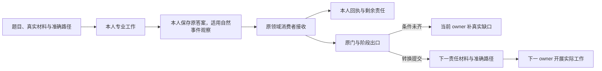

# L4 阶段答卷与专业接收

## 1. 答卷为什么要在工作开始前说明清楚

任务交给 Agent 后，如果只有“做完后汇报”，执行者容易不知道要读哪些真实材料、按什么标准判断、结果写在哪里，Main 也难以区分一句总结、实际交付和已经接收的工程事实。要求作者事后补身份证明、哈希、登记命令和第二份总结，只会把专业判断淹没在手续里。

阶段答卷把当前责任的预期提前交给执行者：为什么做、需要什么输入、回答哪些问题、交付哪些真实产物、怎样表达未完成，以及准确保存和交接位置。作者沿这些要求开展工作，系统将其答案交给原领域消费者，维护工程事实并反馈剩余责任。

答卷只承担具体责任的交付，不重新定义入口恢复、阶段合同或专业方法。这些来源及 Hook、反馈之间的分工见 [Agent 指引的分层与交付](L4-agent-guidance.md)；变更作者字段或交接方式时，应同步原接收者及其投影，保留已签发材料的兼容边界。

答卷是专业交互界面，不是新的工作流引擎、启动许可或第二份 Runtime。它不能仅凭表格填满证明实际工作发生，也不能把人的批准变成默认值。[L1](../l1-principles/L1-design-principles.md)中的引导性产物、明确反馈和职责分工是其设计依据；状态与原子写入见[事务核心](L4-state-transition-core.md)，内部序号及对象变化见[修订机制](L4-revision-usage.md)。

## 2. 题目、答案、产物和回执如何配合

### 2.1 分清五种对象

| 对象 | 承担什么 | 谁提供或维护 |
| --- | --- | --- |
| 工作要求与题目 | 当前目标、工序、阅读目的、专业问题、输出条件和交接方式 | 原阶段／责任准备入口与 Main 的真实分工 |
| 已登记工作包 `packet` | 将题目与原责任、输入、对象版本和准确位置关联 | 原发行器与 Runtime，不由作者手写身份 |
| 作者草稿与答案 | 实际判断、观察、计划、产物引用和未完成原因 | 当前责任本人 |
| 专业产物及领域记录 | 设计、文档、结果、发现、合同或报告等原阶段事实 | 作者完成实际内容，由原消费者记录必要关联 |
| 接收回执与进度投影 | 说明是否接收、本人是否完成、阶段在哪里、还有谁负责什么 | 原接收／消费记录派生，作者不另填 |

一个答案中写了产物路径，不代表该产物已存在或已按原要求接收；一份产物存在，也不自动登记领域事实。原消费者连接两者，Runtime Writer 持久化它承担的关联。

有工作包的责任，其 packet、view、draft 和登记记录各有用途：工作包固定已知输入与关联，可读 view 便于理解题目，draft 是本人填写界面，接收后产生原领域事实。可读副本损坏、作者文件未填、领域登记失败，是不同问题。

### 2.2 按责任和工序交付，不按阶段数硬造文件

同一阶段可以有多位 reviewer、多项任务或多个专业步骤；S9 的计划、本人结果、Main 影响判断和独立复验也不是同一责任。答卷数量应由这些实际责任决定，不要求“每阶段恰好一份 JSON”。

当前不同阶段使用已有工作包、专业 JSON、原报告或人类申请，并没有一套覆盖所有阶段的统一 forms 目录作为生产权威。需要汇总时，投影已有事实即可；不能让多位作者共同覆盖整份汇总，也不能让汇总再成为一张必须提交的完成凭据。

### 2.3 系统带已知信息，作者承担真实判断

系统提供能从原事实确定的 Runtime、代际、实际验证计划、责任、对象版本、输入引用、路径及题干；不生成、累计或兼容读取审查轮数。作者填写真正需要本人工作才能得到的结论、依据和内容。

专业字段中的“预期”或“断言”也不能统一交机器推导：S7 Planner 需要形成真实 Claim 与 oracle；S6／S9 实施者需要制定本人可执行计划；S10 则读取已经存在的需求承诺并判断实际兑现。系统不能从文件名补造这些判断，更不能自动填 PASS。

作者不需要抄机器哈希、生成证据封套、计算 revision 或再交一份重复总结。若现有输入或题目缺失，反馈准确缺口与系统准备责任，而不是让作者反猜内部字段。

### 2.4 机器事实必须由系统承接

这一边界同样约束 Main 的分工材料、发现项引用、合同批准和恢复入口，不能只优化 Worker 的 `answer`，却要求 Main 在上游重新组装内部协议。各阶段沿已有原责任和实际对象准备材料、接收当前本人交付并继续后继；Writer 维护必要关联、并发和幂等。Hook 及其原消费者不计算、登记或校验任何散列，也不替代专业判断或增加工具权限门。

| 内容 | 作者职责 | 系统职责 |
| --- | --- | --- |
| 需求、设计、计划、范围、风险、观察、结论和人员分工 | 开展真实专业工作，作出选择并说明依据 | 交付准确材料和字段形状，不推断专业通过 |
| Runtime、代际、阶段进入、原验证计划、责任及原对象关联 | 使用提供的当前责任，不另造关联 | 从原权威事实绑定；内部 CAS 和 revision 不交给作者计算 |
| 原来源路径、实际对象、修订与工作产物 | 选择真正使用的专业材料，完成本人实际工作 | 复用原责任和已有对象关系保存原答案；不计算、登记或校验 SHA、工作包摘要或 Git OID，不能据路径声称字节未变 |
| 已登记依赖、角色默认技能、准确输出位置和内部编号 | 判断真实任务依赖、额外专业技能与分工 | 投影已确定集合与默认配置，生成内部标识，不重复索取同一事实 |
| 数量、校验结果、校验时间、接收状态和派生指标 | 提供真正需要专业判断的容量或风险约束 | 从实际分工和接收派生计数与状态，由真实校验产生结果和时间 |
| 人类批准的具体对象 | 如实承接人的实际决定及必要理由 | 固定真实呈现对象，关联并保存真实决定和一次消费；S8 不为批准再次认证全部专业证据 |

作者不需要复制 Runtime、运行散列工具或填写机器封套。所有阶段的题面、schema、自然 Hook 及原消费者均不要求或预填散列，也不在内部计算、登记、校验摘要或用其他算法换名保留；机器字段格式不能拒绝可理解的本人原答卷。旧记录中的原路径与已成立事实继续读取，不重算旧散列或让作者重交。

正常界面沿原文件和消费者收敛：准备器提供已知字段与专业问题，作者只改专业内容，适配器补齐内部对象并交原 Writer。已有正确入口直接复用；缺少准备时修复该入口，不新增一份元数据答卷、登记表、启动命令、通用封套或必读检查清单。兼容恢复接口可以保留显式断言参数，但不能把它们重新推荐为正常阶段的前置。

### 2.5 原对象关联不替代专业判断

S0～S11 首次接收保存实际消费的原答案、本人责任与必要结论，所需文件沿原产物责任交接，不新增散列或来源证明。后续事件读取已保存事实，不重算旧散列或把私人旧稿存在当成已收条件；真实专业变化由原修订／返工处理，不静默改写历史。

发现项的本地文件引用由作者选择真实路径，必要交接保留已有捕获信息和来源语义；自动化不能从文件存在推断命令已执行。S7～S9 的执行真实性、证据适用性及引用含义由作者、Main 与实际审查负责，普通事件不再次逐文件核摘要、Git、ignore 或全部产品树。旧独立工作区材料沿原来源使用，不借 Main 同名文件；无法确定的历史保持未知，不用今天字节伪造旧事实。

系统先把真实合同交给实际批准主体，再沿原入口记录其决定。合同变更后原决定不能自动批准新意图。S8 技术审查、受限委托与人类批准由实际责任履行，内部对象关联与预算一次消费不扩成再次证明专业内容的门禁。

### 2.6 复杂度审查先于扩展

每个新增作者字段都必须回答：它需要什么专业判断，系统为什么不能从原事实取得，交给谁消费，以及删除它会失去哪项实际责任。无法回答时不增加字段。每项修复先检查能否删掉冗余输入、复用原投影或在原消费者内部绑定，再考虑必要适配；不能为了保持旧 DTO 原样而要求作者维护内部数据。

验收必须从未经维护者补齐机器字段的正常入口开始，覆盖准确材料准备、专业填写、本人交接、原消费者接收和下一责任。测试夹具预先生成完整 SHA、身份和时间后直接调用底层消费者，只能证明该消费者，不证明问卷已经减负。S0～S11 的负例检查错误责任、不可解析或真正必要字段缺失、重复事件、原后继和真实批准对象变化；不保留逐历史来源散列证明或以 SHA 格式为验收条件。

## 3. 按原责任连接自然事件与接收

| 当前责任 | 专业交付 | 正常接收边界 |
| --- | --- | --- |
| S7／S8／S9 Main 与 Worker | 在实际派发的准确位置保存本人原计划、结果、专业判断或决定 | `PreToolUse` 监听就绪原卷，成功 `PostToolUse`／`SubagentStop` 兜底，均调用同一原消费者 |
| 其他阶段 Main 本人规划、验收等 | 完成专业工作，保存系统给出的当前答案 | Main 的成功保存监听，调用本责任原消费者 |
| S5／S6 新原生 Worker | 读取 Main 真实任务，在本人准确位置保存，原生返回实际引用 | `SubagentStop` 调本责任原消费者，普通工具不接收或激活 |
| 人类决定 | 人先明确选择，Main 如实填写原字段 | 对应原人类入口及既有消费规则；S8 仍须真实决定，监听不能代填 |
| 旧独立 execution | 删除冻结执行根、作者位置适配与兼容接收；当前责任由当前原生题面和唯一消费者处理 |

S7～S9 的普通工具可承载自然监听，无需额外保存信号、返回路径证明或再 Stop。事件仅从当前实际任务和已有责任关联定位原答卷，检查可解析性、解释交接和分流确需的结构及专业结论；未就绪不接收，已接收无未完后继则快速返回。它不激活责任、不增加权限，也不借 Main 普通阅读抢收另一个 Worker 的卷。Main 收到真实完成的 Agent／Task 返回时，若原派发关联准确、该次尚未接收，系统可沿该 Worker 的本人原路径调用同一原消费者兜底，向 Main 反馈实际接收及后继；启动返回不触发接收，不能靠角色、返回顺序或唯一候选猜责任。

Main 必须真实派发，携带准确 view／answer 或专业 brief 引用。Claude Code 管理平台执行、消息、工作区及恢复；Hook 从本次真实任务确定当前原责任，不要求平台 actor 字符串等于工程 owner，也不通过角色、唯一候选或返回顺序猜任务。多个真实责任引用仍有歧义时交 Main／系统解决，不任选一份。

原消费者一次保存当前答案，按已接收结论、原计划必要责任和已有真实批准作有限分流。身份、状态、版本、并发与幂等是内部持久化语义，不是额外证明资格。接收不重新计算覆盖、因果、证据有效性、修复充分性或专业独立，不新增 Main 证明答卷、最终报告或独立收据表。

删除旧兼容保存函数与 execution 字段，不让 Worker 走通用 PLAN、AgentBegin、Team、首写激活或启动许可。完整任务交付与工作区安排见[子代理工程衔接](L4-agent-dispatch-governance.md)和 [Worktree 治理](L4-worktree-governance.md)。

## 4. 一份可开展工作的题目应该长什么样

### 4.1 工作说明与字段形状一起交付

题目应让作者理解以下内容，而不必先读完全部实现协议：

- 当前责任是什么，为什么需要这项判断或交付。
- 当前工序及其真实前置，例如先计划、后实施，修复依据已批准合同。
- 按目的排列的有限读序、当前适用材料与实际入口。
- 必要断言、观察对象、允许结论及具体未完成怎样表达。
- 实际答案结构，必要嵌套字段、枚举与条件示例。
- 完整准确的保存路径，产物属于哪个工作区，怎样原生返回或正常保存。
- 本人完成后交给谁，哪些后续工作不应由本人重复做。

Schema 约束字段，不自动提供好问题。只给一个空数组或 `oneOf` 失败，通常不足以解释作者要做什么；题目与反馈应展开必要形状，并与实际消费者一致。没有真实材料时，不能生成一个貌似完整的占位计划来代替缺口。

### 4.2 以 S5 的专业答案为例

下面只展示现有答卷中的 `answer` 片段。作者在系统给出的完整原卷中填写，保留题目、阅读说明和准确来源；不是另建一份无关联报告。

```json
{
  "answer": {
    "conclusion": null,
    "findings": []
  }
}
```

这表示尚未判断，不是“没有发现所以通过”。实际审查发现任务缺少必要拒绝行为时，可以在原卷中表达：

```json
{
  "answer": {
    "conclusion": "fix_required",
    "findings": [
      {
        "path": "docs/dev/tasks/TASK-example.md#completion",
        "expected": "完成条件包含无权限请求被拒绝的验证责任。",
        "observed": "当前任务只列允许请求的成功路径，没有安排拒绝行为的检查。"
      }
    ]
  }
}
```

示例路径和观察都是虚构说明，不能当成本项目发现。专业结论要来自实际阅读；`pass` 使用无发现的空集合，负结论则给真实、可定位的偏差。缺 `observed` 的一条 Finding 没有回答清楚“到底看到了什么”。

### 4.3 不强制所有领域共享同一个外壳

S5 等工作包使用原 `answer`；S6 原生私人计划／结果使用其专业字段；S9 的私人 PlanReport、Main 影响 DTO、S10 Manifest 和 S11 决定申请各有原结构。不能为了通用化，再给它们套一层封套、summary、身份对象或“已读”证明。

外围题目保护有领域差别。S7～S9 保留原发行材料和责任，不为最小结构接收再精确比对固定题干字节或摘要；作者仍只填写专业部分，不能改写原责任。其他阶段的题干与现有字段读取规则沿原消费者处理，不能一律声称“改动任意题外字节都拒收”。

S7 Reviewer、S8 Investigator 和 S9 独立 Targeted 保留各自原答卷形状与实际独立责任。S7／S8 只填 issued questionnaire 的 `answer`，Targeted 只填原请求 DTO；不加 Builder Plan／Result、第二份 Main 作者稿、done、人工提交或来源证明。准确路径和当前责任由派发提供，沿原消费者接收。

新模板只用于新发行，已发行题目、已保存答案和原来源关联继续使用；不因模板 SHA、显示路径或封套升级要求旧作者重填。旧 packet／source contract 用于接续其真实旧责任，不作为新普通责任的准入门，也不按磁盘文件是否存在猜选版本。原材料实际缺失时说明具体系统恢复责任，不借 Main 同名卷补造。

这些界面与接收设计不保证真实执行、实际独立或产品正确，须由作者、Main 与真实审查承担。未落地事件接线和平台行为要单独验收，不仅凭模板存在宣称完成。

## 5. 准备、发行与渐进披露

### 5.1 先交准确材料，再真实执行

原责任入口或真实工序切换准备必要材料。对已有 packet 的责任，先由原发行记录确定工作包，再发布其 view 与独占草稿；草稿本身不是发行凭据。重放准备保留已填写内容，只在原支持范围内恢复缺失投影，不能覆盖作者答案或把已消费历史卷重建成新责任。

输入、owner、阶段入口和已有尝试共同定位当前责任，全局 Runtime revision 不作为随每次登记变化的发卷键。准确路径来自原登记／准备事实，不靠扫描目录找“最新 JSON”、从文件名猜 owner 或让作者手动领取。

Main 控制材料与本人答案分开：原生只读审查在 Main 根下使用本人独占原卷，原生实现／修复在本人实际 worktree 写专业产物；删除旧冻结作者根读取接线，不借 Main 同名文件猜作者责任。位置不同不产生第二份控制 Runtime。

### 5.2 现有准备入口有明确差别

| 责任 | 当前准备与普通观察边界 |
| --- | --- |
| S0／S1 | 原责任入口准备需求讨论／绑定材料；保存草稿不自动产生人的锁定或执行批准 |
| S2～S4 | 正常阶段入口与原成功出口准备；普通 Pre／Stop 读取当前题目；真实 Post 后有界补缺题，S2 复用原已签发模板并保留作者内容，已接收但丢失的答案不重建为空白；再次保存须恢复原文，具名出口恢复可使用原接收证据 |
| S5 | 原已登记审查责任由幂等 issuer 准备；Main 非 Stop 上下文可沿原发行器补齐；不是重造平台执行或激活 |
| S7 Main 计划 | 尚无当前计划时，现有非 Stop 上下文可准备专业草稿；Stop 不补建；草稿不产生已批准规划 |
| S7／S8 Worker | 原分工交付准确题目；普通 Pre 监听就绪原卷，成功 Post／Stop 兜底接收，不重新发行或激活 |
| S9 | 按原修复责任和实际工序准备，保留 Main／Worker 与计划／结果的不同位置；Pre 监听，成功 Post／Stop 兜底，不因普通观察重发材料 |
| S10／S11 | 原 TR-009／TR-015／TR-017 及相应恢复入口准备下一责任，普通 Pre／Stop 展示已有材料 |

这些差别必须据真实链路解释，不能把一处允许缺题恢复扩大为每次普通事件重发卷，也不能把另一处纯读取规则写成全阶段绝无准备动作。缺题时反馈预期准确路径、真实准备责任和具体错误，不要求作者猜目录或补元数据。

## 6. 保存或原生返回怎样进入原消费者

### 6.1 S7～S9 原卷监听与最小消费

三阶段的 `PreToolUse` 从本次实际任务和已有登记选择当前责任，读取本人原卷；仍需观察的 Main Impact 可再读取一次该责任当前已收对象以识别真实更新，不扫描历史。成功 `PostToolUse` 和 `SubagentStop` 沿同一选择和消费者兜底，不要求作者制造下一事件。脚本或 MCP 不显露保存路径时，也只检查已确定的当前原卷；不解析 shell 猜提交、不遍历目录找最新文件。Main 真实完成返回的系统兜底按 §3 的准确原责任处理；普通阅读不收别人的私人答案。

原消费者仅检查原卷能否解析、解释本人交接与分流确需的结构及专业结论，可靠保存一次并接续原出口；不把题面每个槽位、检查或证据引用变成接收门。未就绪不接收；真实 blocked、失败、未执行或 `inconclusive` 按原字段保存和交接，不要求制造 PASS 或新 blocker 证明。已接收事件复用原事实，后继失败只补未完成部分；仍活跃的 S9 Main Impact 按原责任自然观察当前卷的后续更新，不重验历史。

S7 以原计划必要责任与已收结论分流到 S8／S10；S8 由 Main 在原答卷判断原因和处置，Investigator 的新假设只作建议，由 Main 按实际需要决定采用，不自动登记责任或增加退出条件；S9 以本人原 Plan／Result、Main 实际集成与影响判断、独立 Targeted 结论接续新 S7。专业工作与必要真实批准仍由本人承担，机器不重新计算覆盖、因果、断言充分性或全部证据。

### 6.2 其他阶段保存与原生结束

其他阶段 Main 成功保存后，监听确定当前准确路径并交具名消费者；普通读取不构成新保存，工具失败也不构成成功交卷。Main 的观察略过其他 Worker 专业卷。原 S4 已接收且仍有 pending／no_transition 时，成功 Post 可接续原工作，即使工具是 Read；不把它改成新提交。

S5／S6 Worker 保存仍是本人产物落盘，原生返回沿准确题目或答案引用，由 `SubagentStop` 调用各自原消费者。Main 集成、必要检查和阶段收口分别成立，不能由一句“完成”替代。

Start 提供短上下文，不能证明已读材料；Stop 不能证明计划先于实施或实际独立。各阶段的真实先后、独立审查和必要检查继续履行，偏差如实报告，不补时间或激活字段制造事实。

### 6.3 按类型路由，接口不重复拥有状态

共用 registry 可以容纳多种已知 packet，具名 reader 只解释自己的子型；合法无关子型可交其他消费者，未知、重复或畸形记录不能静默当作不存在。S10／S11 等原报告和申请也不为进入这个 registry 新造通用类型。

适配服务连接作者输入和原 Writer，不另存一份领域状态机。S7～S9 消费者解释本次原卷的必要结构和结论，原 Writer 可靠保存答案及既有责任关联；不在适配器、内部消费者或转换层增加全历史、身份、scope、逐摘要或证据资格证明。其他阶段保留各自原字段与来源合同。

## 7. 草稿、负结论、本人完成与阶段完成

### 7.1 允许保存草稿，不推断默认结论

作者文件允许未回答状态，但各领域的“记录”含义不同。S5 未完成答案不会形成完整审查接收；S10 明确最终结论后仍可以登记包含 unknown 的真实报告，但不能按正向完成；S11 空选择不登记人类决定。

因此，不能用通用规则把所有空数组当作通过、把所有缺答都改成失败，或强迫每个草稿先登记一种阻塞。合法的无变化、无发现、不适用和真实未知可以交接；原因按本人实际已知表达，不为填分母虚构对象或追加必填证明。

S7～S9 的计划、调查、结果、处置与影响各沿原专业表达理解交接：计划表达本次安排，调查与结果表达本人观察和当前结论，处置表达 Main 判断及适用决定，影响表达实际变化及其影响，原 Impact 可提前接收或准备，实际判断由 Main 随工作自然更新。原卷已能表达这些含义时直接复用；模板和 brief 说明其交付含义，可提示先写过程、后形成整体判断，但不规定填写顺序。空数组或语法完整本身不能区分草稿与交接；一般没有足够原表达时保留未决。S9 原 Impact 的新旧空数组依 [收敛合同 §3.3.1](L4-workflow-convergence.md) 可直接接收，接受可能提前观察模板，不推算实际集成、检查或通过；活跃的同一原责任可自然更新。均不新增 ready、结束语或提交步骤。接收固定当次原内容，后续编辑不能追改已经保存的历史。

### 7.2 负结论可以是完整履职

S5 明确 `fix_required` 并交真实发现，可能已经完成本人的审查责任，同时触发规划返工；它没有使实现阶段通过。S7 Finding 是实际偏差，不是允许 Worker 直接开始修复的批准。S8 `inconclusive`、S9 blocked 或真实未完成可以交 Main，也不等于修复条件成立或定向复验通过。

消费者应区分“答案可接收”“本人工作完成”“仍有阻碍”“阶段出口成立”。不能只看一个 `accepted` 就让全阶段结束，也不能因全阶段等待同事、Main 或人，就让已完成者重复工作。

### 7.3 多个原完成点怎样配合



Hook 不在这一流程中代做长测试、合并或人类选择。S6／S9 的 Worker 交付、Main 集成和必要 Main 检查，S7 的单人结果与完整干净轮，S10 的工程结论与 S11 的真人授权，都需要分别成立。

## 8. 回执应该帮助谁做下一步

### 8.1 接受事实和当前效力分别表达

原回执应让读者知道：接受的是哪个责任，原产物在哪里，本人现在能否结束，阶段实际在哪里，还有什么由谁处理。当前回执可包含以下信息；并不要求所有领域再填成同一种外壳：

| 信息 | 解释目的 |
| --- | --- |
| `packet_id`／原登记标识及 `submission_key` | 定位原接收，不从答案文件存在反推 |
| `accepted` 与领域引用 | 哪项专业交付已经进入原事实 |
| `work_complete`／责任进度 | 本人是否完成，不代替 Main 或全阶段完成 |
| `current_stage` | 当前实际位置，旧回执不把游标拉回历史 |
| `waiting_on`、owner 与引用 | 同事、Main、系统恢复或人类还有哪项责任 |
| `field_errors` 与具体位置 | 哪个字段缺什么、实际值与可用修正方向 |
| `next_action` | 当前准确路径、下一责任与真实动作 |

这些字段是接收与状态投影，不是作者需要提交的新证明。专业判断、人类选择、资源状态和历史接受仍保持各自语义，工作进度使用原五态模型。

### 8.2 反馈要贴近问题

例如，S5 负结论缺少观察时，应定位 `/answer/findings/0/observed`，解释需要写出所引材料中的实际偏差；不能只给“Schema 不通过”或要求重读全部协议。S10 若仍有 unknown，应给出具体承诺和未完成依据，不能只显示 unknown 数量。

本人已完成则明确说明，并点名下一 owner；阶段未齐则说明实际缺哪项责任。已提交但系统接续失败时，反馈“本人交付已接收，由 Main 处理原接续”，而不是再次催作者填写。 S4／S5 沿已有 `consumer_owner`、`consumer_pending` 和 `waiting_on` 标明 Main 负责的原接续引用，仍由原接收事实决定本人进度，不另建状态。真实材料缺项由 Main 修复后沿原保存出口继续；技术中断可用已有具名恢复入口，不要求重存未变答案、制造工具事件或等待下一 Hook。

提交后反馈应区分刚提交的历史路径与下一份当前卷，不能把旧卷标签写成新的待填位置。完整路径不能因提示摘要预算而被裁掉；内部对象、修订和来源细节按诊断需要展开。

## 9. 并发、幂等和原阶段接续

### 9.1 独占输入，共享原控制面

并行作者各有自己的专业答案位置。原 Writer 合并的是各领域事实，不让两份过期整卷相互覆盖，也不把每份私人答案做成一份可合并 Runtime。

一次接收读取并固定本次实际消费的答案，持久化内容对应同一输入，不让内部不同层按同一路径各读一份不同字节。S7～S9 传递原答案与已有责任关联，不复制 flat／typed 多份原卷、不构造第二套 Candidate 证明；身份、版本、CAS 与一次写入作为内部实现维护，不追加资格校验或作者字段。

S7～S9 同一次已收交接的后续事件直接复用原事实，私人原稿缺失或后来编辑均不自动改写历史，也不触发重新认证旧稿、证据或全部事务。活跃的 S9 Main Impact 责任可按自然事件观察当前原卷更新，不视为重验旧接收。已收 blocked 与专业责任未完成分别保留：Main 原恢复／继续安排，或明确属于本人的自然继续，确定该责任当前的新尝试后，监听其当前原卷，保存新结果并保留旧 blocked。系统沿已有责任关系区分本次尝试，不要求作者另抄 ID、写恢复证明、resume／submit 或重存旧卷；不能将每次普通编辑猜作新尝试。真正修订与返工沿原责任处理；不以再次 Save、hash 比对或恢复旧私人文件作为已收后继的前提。其他阶段的实际新提交仍按各自同答和修订规则处理。调用复用、预算与事务衔接见 [Hook §10.2](L4-hook-platform-wiring.md#102-删除证明工作再合并必要读取)。

真正相同的答案按原领域语义比较。单纯 JSON 缩进差异不应产生新的专业结论；这不意味着任意调整数组顺序或修改固定题目都视为同答。当前 S5 等路径具有专业内容摘要与固定题目验证，其他消费者按其原契约处理。

同一责任、同一答案正常重放复用原接收；同身份不同内容按原冲突或修订规则处理。新尝试、换轮、换代、责任替换与失效都不能借“重试”让旧结论重新取得当前作用。

### 9.2 接收与出口分别恢复

S8 原工序若已接收但逐项登记或后续责任准备仅部分成功，保留已成立部分，同次尽可能续完；实际失败交 Main／系统沿已有后继继续原内容，不把再次保存或另造工具事件当恢复条件。没有实际执行者时明确剩余归属，不承诺后台自动完成。

S2～S4 等原 submission 接收保留原阶段入口及后续控制关联。已接受而门尚不就绪时，沿原接续继续；已离开阶段、已经被替换或已经完成转换时，不得事后追认旧空关联或再次提交出口。

S5 具名修订在原机制中生成后继并暂停旧资格，不能让旧 PASS 与同伴 PASS 跨过尚未回答的新责任。S10 可在同份现有报告中补实际内容并继续本步出口；S11 的已消费决定不能用作新入口选择。详细版本差异见修订机制。

一次逻辑接收可以有多个物理文件写入。原子领域提交、阶段转换、下一题准备和可读投影不必都在一个锁里；不能在持有 Writer 锁时递归调用另一 Writer，也不能仅为追求一个“通用提交”把真实集成或长检查搬进 Hook。

### 9.3 题干版本属于发行来源

保留真实专业历史和用户材料，不覆盖原题。当前 S7～S9 答卷由当前唯一消费者按必要结构与结论接收，删除旧模板版本读取和兼容接线；不要求作者补摘要、重填或恢复私人原稿。

其他阶段部分 canonical rebuild 使用内嵌模板，跨模板恢复仍按其原来源和具名恢复边界处理；未来模板修改不自动证明历史卷恢复已可用。原始固定材料实际缺失时保留未知并交系统恢复责任，不用当前模板冒充旧字节。各阶段都不能以题目升级抹除已接受事实或覆盖作者内容。

## 10. 故障恢复怎样保住已经发生的工作

### 10.1 不覆盖作者内容，不制造接受历史

| 故障 | 正确处理 |
| --- | --- |
| 已登记题目，派生 view／draft 缺失 | 原准备入口按支持范围恢复，保留已有作者内容 |
| 答案尚未完整 | 保持当前作者文件，给具体字段与实际缺项，不默认通过 |
| 产物已暂存，领域提交未确定 | 查原 Writer／pending／引用事实，再决定补完或安全清理 |
| 领域已接收，响应丢失 | 读取原回执与当前作用，不重复专业工作 |
| 领域已接收，阶段出口未完成 | 使用原接续与当前真实条件继续，不重复登记 |
| 转换已提交，下一题或报告输出失败 | 显示实际新游标与缺失输出，由系统准备责任处理 |
| 旧卷被替换、失效或来自旧轮 | 保留历史，交当前责任，不复活旧完成 |
| 源工作区或私人文件丢失 | 区分原独立回执读取与保存入口的实际前提，不借 Main 同名文件 |

S7～S9 已接收交接的重复事件与后继恢复复用原事实，不要求私人旧稿存在或字节未变，不重跑旧接收；仍活跃的 S9 Main Impact 可自然观察当前原卷的新表达。未完成责任恢复后的当前新尝试按 §9.1 接收新内容，不能覆盖历史；其他领域保存和回执入口保留各自实际前提。原材料缺失不能冒充已经执行的工作，也不能否定已保存事实。

### 10.2 恢复发行与接收索引需要原证据

已发行工作包、真实 owner、修订链、接收及消费记录，不能从专业文档或当前目录猜回。原完整 Runtime／journal 配对及其受支持检查点可提供恢复证据；检查点不是正常工作的新权威，也不应成为每次作者提交要填写的材料。

当前检查点机制在有已发行／接收等索引时，于原持久化标记清理前保存经过核对的配对，包含需要保全的事件历史。发布失败保留 pending，原 Writer 重试，而不是重新接收。恢复计划还需核对来源、当前身份及适用条件，不能通过重算一个摘要把未知历史改成已接受。

完整恢复按原能力和真实人类授权进行。文档导入只能恢复它明确支持的信息；无法证明的发行、平台执行和人的决定保持未知。原活跃操作和恢复边界见事务核心及各执行机制，不能把运行中的平台执行复制出来继续。

## 11. 人的决定与先后关系不由填写代签

S0 的需求锁定、S1 的执行绑定、S8 的合同批准和 S11 的发布选择，各消费自己的真实决定。保存一份写着 approve 的文件不凭空产生人的意图；已有明确人意也不应被系统重复索取或改成逐字命令证明。

S6／S9 写前计划、S8 批准后修复、S9 必要独立复验及 S11 人握发布出口，仍是实际工作要求。S7～S9 保存原答案与已有真实决定，真实发生顺序、专业独立和证据意义由作者、Main 与实际审查承担；其他阶段按原责任读取记录，也不能仅凭最终文本认证这些事实。发现遗漏与偏差应如实记录，不补造前置许可。

S11 正常申请只让 Main 如实承接人的选择与必要理由；系统维护当前关联和一次消费。没有选择就等待，不能以草稿完整、测试通过或超时替人批准。授权记录也不执行实际发布。

## 12. 各阶段怎样使用共同原则

| 阶段 | 作者真正交付什么 | 答卷与原机制的配合 |
| --- | --- | --- |
| [S0](../l3-stages/L3-S0-requirement-design.md) | 需求讨论、范围、成功标准与有权决定的实际确认 | 需求讨论材料服务形成共识，草稿不自动锁定 |
| [S1](../l3-stages/L3-S1-bind.md) | 真实启动意图与开发／发布目标 | 原绑定申请及人类入口维护授权，保存不代替决定 |
| [S2](../l3-stages/L3-S2-design.md) | 系统设计、相关场景与实际设计产物 | Main 当前设计答案引用实际产物，原设计消费者登记并接续 |
| [S3](../l3-stages/L3-S3-contracts.md) | 共享来源、协作约束、契约与适用性判断 | Main 原契约答卷解释产物和选择，不补造注册证明 |
| [S4](../l3-stages/L3-S4-task-split.md) | 可执行 TASK、完成条件、依赖与整体分工 | 原任务答卷与消费者形成可审查基线，已接受出口可接续 |
| [S5](../l3-stages/L3-S5-document-verification.md) | 独立审查结论和可定位发现 | 各 reviewer 独占原卷，原生结束调用原审查接收，不靠泛化保存激活 |
| [S6](../l3-stages/L3-S6-build.md) | 本人计划、真实实现、自检和贡献结果 | 原生工作区保存私人专业文件，Stop 原接收；Main 集成及检查另行成立 |
| [S7](../l3-stages/L3-S7-verification-round.md) | Main 专业计划，各验证者实际 Claim 判断与现场 | Pre 监听原卷，成功 Post／Stop 兜底；原消费者一次保存，按原计划必要责任和已收结论分流 |
| [S8](../l3-stages/L3-S8-finding-investigation.md) | 假设、判别观察、因果解释、路由与修复意图 | Pre 监听，成功 Post／Stop 兜底；Main 作专业处置，建议不自动变责任，确需批准时保存真实决定 |
| [S9](../l3-stages/L3-S9-repair.md) | 本人计划／修复、自检、Main 集成／影响及独立复验 | Pre 监听，成功 Post／Stop 兜底；原卷一次保存接续，不另造 typed 原卷、Impact 封套或 Handoff 答卷 |
| [S10](../l3-stages/L3-S10-acceptance-audit.md) | 验收与相关发布审计结论、真实风险 | Main 保存原 Manifest，系统派生报告与指标，未完成不能总体通过 |
| [S11](../l3-stages/L3-S11-release-gate.md) | 真人六选一处置与必要理由 | Main 如实保存原申请，原 Writer 记录与消费，批准不执行发布 |

表中专业内容仍由实际角色承担。模板和输入枚举减少遗漏，不自动证明覆盖充分性、证据真实性、独立性或风险已被接管。每阶段的具体方法和完成依据以对应 L3 为准，答卷层不另写一套替代门禁。

### 12.1 各阶段落实机器与专业边界

以下是各阶段实现、使用指引和验证必须共同遵循的方案。没有实际缺口的阶段保留现有结构，不为统一形式重写正常流程。

| 阶段 | 专业交互和系统承接方案 | 应核实的接缝与反例 |
| --- | --- | --- |
| S0 | 当前工作明确为需求共识、专业文档与实际锁定；没有锁定材料时不催填尚未准备的 S1 绑定问卷，不交付下一阶段的机器手续。 | 从新项目实际形成 REQ；草稿不默认锁定，缺少人的方向仍待人，不搜内部绑定文件。 |
| S1 | 保留需求选择、真实启动授权、开发分支和发布目标四项真实选择；唯一已知需求和已有目标由系统交付，REQ 摘要、内部身份、绑定回执和 revision 自动维护。 | 已明确的组合授权不重复索取；实际分支和提交仍由 Main 正常处理，来源漂移及无授权不能通过。 |
| S2 | 保留设计内容、适用场景、自审结论和实际架构路径；材料引用、来源版本与摘要由原设计接收器固定，场景的机器派生文件由原生成器维护。 | 服务／界面分支均能沿题目完成；不要求手建证据封套，不用空结论提前推进。 |
| S3 | 作者交付协作契约、共享模型及适用性判断；原消费者固定完整接收闭包并沿同一来源登记，不能让作者列摘要或为恢复重新签源。 | 接收后的模型／契约漂移拒绝；恢复原字节可继续，未接受的新文件不得混入。 |
| S4 | 作者判断任务粒度、范围、完成条件、真实依赖和波次；系统识别原实体、文件及已接受来源，不把源 SHA、登记版本或实际执行进度写回作者计划。 | 原任务索引、准确 TASK 实体和 S5 准备可直接交接，不让 Main 计算文件名到内部 ID 的规则；TASK 直接引用真实规则／架构／ADR 条款，不为可选工程约定分析另建含 SHA 的手工索引。已有完整冻结索引继续按原来源严格读取。 |
| S5 | 原 S5 入口在既有 manifest 位置准备机器段及两项必需专业责任，直接沿原登记与发行交付两份原卷，无未改清单确认。入口前已有专业分工时沿同一适配承接；默认登记后分工源即固定。Main 安排两个真正独立的原生上下文并交代项目风险，保持原整批责任。原适配器提供 Runtime／REQ／代际、完整已接受文档引用、版本／SHA、锚点 TASK、默认技能、生成编号、计数和真实校验时间。 | Main 无需读 Runtime 拼 DTO、算／抄 SHA、猜轮次或声明 validation=pass；已登记清单不能原位改写重签，误改应恢复原字节。正式规格／责任变化须依真实审查结论沿原返规划进入新 S5；不能伪造 finding 触发返工。同人签两项和来源漂移仍拒绝。 |
| S6 | 原 prepare 提供准确 brief、输入、Plan 与 Result 形状；已登记依赖作为只读材料交付，原接收器自动带入 canonical Plan，私人专业答卷不再询问 dependencies。两份答案的专业字段说明分别就近交付。容量未知只是不计算推荐批次，不是一项新的登记、许可或 prepare 前置。来源提交与内部贡献关联由原生交付和原消费者读取。 | 不让 Builder 转抄依赖，不把 Plan.dependencies 填入 Result，不制造依赖值或额外状态；工具正常可用，本人交付、Main 集成及阶段完成分别成立。 |
| S7 | 原入口交付当前计划和责任题目；Main 判断 Claim／oracle／分工，验证者填写真实观察。原消费者从原卷保存结果、发现与未完成，按必要责任和结论交 S8／S10，不重算覆盖或 CleanRound／ObservationBatch 证明。用户明确设定的预算或真实人类决定沿已有入口处理，不自动产生预算审批。 | Pre 正常监听，成功 Post／Stop 兜底；不用 status 制造题目、不让人算 SHA 或登记证据；来源可信和覆盖充分由专业履职承担。 |
| S8 | Main 与 Investigator 分别保存原专业答案，Main 判断因果、未知、范围与处理路线；新假设为建议，采用和派发由 Main 决定。确需批准时原入口保存真实人决定；已有授权关系由系统承接。 | 无强制反驳、逐题完成、全 Finding 解释 ID 闭合或逐历史核验门；无需新最终答卷，真实 blocked／inconclusive 可返回，批准不等于机器认证证据。 |
| S9 | 本人 Plan／Result、Main 实际集成与影响判断、独立 Targeted 各交原卷；原消费者一次保存并按结论接续新完整 S7。元数据、幂等和后继恢复由内部原记录维护。 | Plan 收后连续工作；真 no-change 不造提交；blocked 不造 PASS；不读每份 Git/hash、不增 flat／typed 多卷或 Handoff 答卷；真实集成、检查和独立复验仍须履行。 |
| S10 | 作者给需求兑现、专业审计、风险和最终结论；原入口准备当前身份，原消费者派生数量、覆盖指标、摘要、证据及报告。报告内专业来源由作者选择，系统已有材料应提供准确引用。 | 不复填 Runtime／轮次、摘要、统计、身份或第二份报告；unknown 和真实阻塞保留，完整填写不自动 PASS。 |
| S11 | 复用原申请与当前 S10 材料，Main 只根据真人意图填写 disposition 和必要 reason；系统负责当前对象、身份归属、时间、revision、记录及一次消费。 | 空选择等待，同答不重复业务，旧申请不用于新入口；批准仅到授权终态，不执行发布。 |

### 12.2 实施应沿原责任逐段收口

各阶段维护者先核 L3、使用入口、实际准备与原消费者，再决定修复或保留。阶段专属实现和回归分别负责，共用 Hook 路由、Schema、来源解析和 Writer 由同一机制责任协调，避免多个阶段各加一套字段填充、哈希规则或接收流程。阶段工作以正常入口能够使用且反例仍成立为完成条件，不能以增加了说明、底层测试已通过或模拟会话曾获人工补齐判定完成。

## 13. 观测、实现对应与适用边界

### 13.1 用什么判断工作卡在哪

| 观察位置 | 应保留的事实 | 帮助定位的问题 |
| --- | --- | --- |
| 当前题目与提示 | 责任、真实材料、专业形状、准确路径和交接方式 | 是准备缺失，还是作者尚未开展工作 |
| 正常保存／原生返回反馈 | 实际选择的责任、原接收结果、具体字段与来源问题 | 文件已保存但未接受，还是返回引用歧义 |
| 原领域记录及 Runtime 事件 | 原 packet／对象、代际、实际验证计划、owner、接收和消费关联 | 接收是否真实发生、重放是否重复业务 |
| 本人回执与当前阶段 | 当前完成依据、历史效力、等待 owner 和下一动作 | 本人是否还欠工作，还是后续责任待完成 |
| 原接续与准备结果 | 转换是否已提交、下一材料是否存在 | 领域成功、出口失败和输出失败分别在哪里 |
| 提交耗时、错误与诊断记录 | 实际调用及失败面，原状态关联 | 是否存在超时、重复观察或恢复接线问题 |

一次事件观察次数不等于唯一接收次数；S7～S9 已收交接复用原事实，不再次接收同一内容，未完后继单独续接；活跃 S9 Main Impact 的新表达按原责任自然观察。其他阶段重放可以增加调用观测而不增加工程事件。计数、Hook 日志与历史回执都不能替代专业真实性，也不能由没有日志推断平台一定执行或一定未执行。

### 13.2 当前代码落点

| 机制责任 | 当前落点 |
| --- | --- |
| 工作包、题目、专业字段及有界文件发布 | [workpacket](../../internal/workpacket) |
| 原领域适配、回执、恢复与具名修订 | [submission](../../internal/submission)、[Runtime 提交关联](../../internal/runtime/submission_control.go) |
| Main 保存路径选择与现有答卷提示 | [stage_answer.go](../../internal/cli/stage_answer.go)、[questionnaire_observer.go](../../internal/cli/questionnaire_observer.go) |
| 正常保存识别与当前入口材料 | [questionnaire_save.go](../../internal/cli/questionnaire_save.go)、[entry_questionnaire.go](../../internal/cli/entry_questionnaire.go) |
| S5 原生结束与 S7／S8 自然事件接原消费者 | [native_review_hooks.go](../../internal/cli/native_review_hooks.go)、[S7 计划监听](../../internal/cli/review_plan_pre_listener.go)、[S8 监听](../../internal/cli/s8_questionnaire_listener.go) |
| 原生实现／修复专业产物与定向验证 | [native_s6.go](../../internal/cli/native_s6.go)、[native_s9.go](../../internal/cli/native_s9.go) |
| Main 专业计划、验收与人类申请 | [ReviewPlan](../../internal/cli/review_plan_questionnaire.go)、[S10 报告](../../internal/cli/audit_questionnaire.go)、[S11 申请](../../internal/cli/human_release_questionnaire.go) |
| 原检查点与发行／接收索引恢复 | [runtime/checkpoint.go](../../internal/runtime/checkpoint.go)、[runtime/recovery.go](../../internal/runtime/recovery.go) |
| 原状态与事务、版本、事件接线 | [事务核心](L4-state-transition-core.md)、[修订机制](L4-revision-usage.md)、[Hook 接线](L4-hook-platform-wiring.md) |

### 13.3 不能从通用界面推导的能力

S5 原阶段入口承接 manifest 机器段与必需审查责任并交原卷，S6 私人计划不询问已登记依赖，S10／S11 沿各自原报告与决定接收。S7～S9 的现行目标是 Pre 监听本人原答卷、成功 Post／Stop 兜底，原消费者最小结构与结论一次保存，按原责任和真实决定接续。已有代码落点不代表已经完成此合同。

正常验收从准备出的原材料开始，只填专业内容，核当前责任选择、可解析与真正必要字段、真实负结论交接、重复事件不重复业务、已收事实不重验、后继部分失败与原入口恢复。S8 建议未采用不应生新责任；真实批准不得由草稿齐全推导。测试工厂补齐内部 DTO 或模拟专业答案不能证明真实工作质量。

这些接线不等于所有旧实例可用新包原地恢复。模板版本与旧卷重建的限制见 §9.3；真实 Claude 使用固定的安装包运行，包内尚未落地的界面仍可能要求旧手续。源码定向回归、安装检查与固定新包的真实原生全链验证必须分别报告，不能拿旧包中的脚本转抄成功证明当前正常输入已经减负。

当前各领域接收检查有真实差别。S3／S5 等固定题目比对、S2／S4 的现有字段读取、S9 专业结果对显示字段的处理、S10 对已报告未完成的读取以及 S11 的选择消费，不能被一个通用“表单验证通过”替代。模板名称、Schema 存在或辅助函数名，也不能证明全部历史来源均被重证。

S7～S9 不由通用表单层或领域消费者认证全部事件编号、执行字节、历史摘要或独立性。原发行／派发关系定位当前责任，作者、Main 与实际审查对专业内容负责；字段齐全与 Hook 成功均不证明业务质量。

S8 复用原 S7 发现或 S11 已消费缺陷决定，人类来源没有 Finding 时直接交原报告 ID／路径，相关 Finding 数组为空。Case 保存原来源关系，不遍历修订历史重证原报告或冻结产品基线。原 Finding 引用保持其类型和含义，不要求重新注册别名；必要文件交接承接真实来源，不将逐内容摘要核验变成结果或批准门。Main 在专业阅读发现材料缺失或变化时判断影响并交原恢复责任。

实例只按当前 Schema 与 packet 配置工作；删除旧格式读取和兼容恢复接线，历史专业与用户数据保留原样。无 Hook 环境沿当前明确支持的领域入口工作，但只保存文件不等于自动接线；交互原型不证明生产或真实平台通过。

实现和验证应分别检查：题目是否足以开展专业工作、原消费者是否正确接收、本人能否准确结束、下一 owner 是否能接续，以及实际平台和产品工作是否发生。统一界面的价值在于让这些责任更清楚，不是让它们消失。
