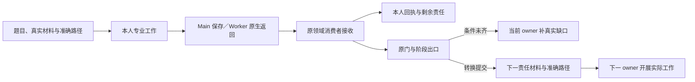

# L4 阶段答卷与专业接收

## 1. 答卷为什么要在工作开始前说明清楚

任务交给 Agent 后，如果只有“做完后汇报”，执行者容易不知道要读哪些真实材料、按什么标准判断、结果写在哪里，Main 也难以区分一句总结、实际交付和已经接收的工程事实。要求作者事后补身份证明、哈希、登记命令和第二份总结，只会把专业判断淹没在手续里。

阶段答卷把当前责任的预期提前交给执行者：为什么做、需要什么输入、回答哪些问题、交付哪些真实产物、怎样表达未完成，以及准确保存和交接位置。作者沿这些要求开展工作，系统将其答案交给原领域消费者，维护工程事实并反馈剩余责任。

答卷只承担具体责任的交付，不重新定义入口恢复、阶段合同或专业方法。这些来源及 Hook、反馈之间的分工见 [Agent 指引的分层与交付](L4-agent-guidance.md)；变更作者字段或交接方式时，应同步原接收者及其投影，保留已签发材料的兼容边界。

答卷是专业交互界面，不是新的工作流引擎、启动许可或第二份 Runtime。它不能仅凭表格填满证明实际工作发生，也不能把人的批准变成默认值。[L1](../l1-principles/L1-design-principles.md)中的引导性产物、明确反馈和职责分工是其设计依据；状态与原子写入见[事务核心](L4-state-transition-core.md)，内部序号及对象变化见[修订机制](L4-revision-usage.md)。

## 2. 题目、答案、产物和回执如何配合

### 2.1 分清五种对象

| 对象 | 承担什么 | 谁提供或维护 |
| --- | --- | --- |
| 工作要求与题目 | 当前目标、工序、阅读目的、专业问题、输出条件和交接方式 | 原阶段／责任准备入口与 Main 的真实分工 |
| 已登记工作包 `packet` | 将题目与原责任、输入、对象版本和准确位置关联 | 原发行器与 Runtime，不由作者手写身份 |
| 作者草稿与答案 | 实际判断、观察、计划、产物引用和未完成原因 | 当前责任本人 |
| 专业产物及领域记录 | 设计、文档、结果、发现、合同或报告等原阶段事实 | 作者完成实际内容，由原消费者记录必要关联 |
| 接收回执与进度投影 | 说明是否接收、本人是否完成、阶段在哪里、还有谁负责什么 | 原接收／消费记录派生，作者不另填 |

一个答案中写了产物路径，不代表该产物已存在或已按原要求接收；一份产物存在，也不自动登记领域事实。原消费者连接两者，Runtime Writer 持久化它承担的关联。

有工作包的责任，其 packet、view、draft 和登记记录各有用途：工作包固定已知输入与关联，可读 view 便于理解题目，draft 是本人填写界面，接收后产生原领域事实。可读副本损坏、作者文件未填、领域登记失败，是不同问题。

### 2.2 按责任和工序交付，不按阶段数硬造文件

同一阶段可以有多位 reviewer、多项任务或多个专业步骤；S9 的计划、本人结果、Main 影响判断和独立复验也不是同一责任。答卷数量应由这些实际责任决定，不要求“每阶段恰好一份 JSON”。

当前不同阶段使用已有工作包、专业 JSON、原报告或人类申请，并没有一套覆盖所有阶段的统一 forms 目录作为生产权威。需要汇总时，投影已有事实即可；不能让多位作者共同覆盖整份汇总，也不能让汇总再成为一张必须提交的完成凭据。

### 2.3 系统带已知信息，作者承担真实判断

系统提供能从原事实确定的 Runtime、代际、轮次、责任、对象版本、输入引用、路径及已有题干。作者填写真正需要本人工作才能得到的结论、依据和内容。

专业字段中的“预期”或“断言”也不能统一交机器推导：S7 Planner 需要形成真实 Claim 与 oracle；S6／S9 实施者需要制定本人可执行计划；S10 则读取已经存在的需求承诺并判断实际兑现。系统不能从文件名补造这些判断，更不能自动填 PASS。

作者不需要抄机器哈希、生成证据封套、计算 revision 或再交一份重复总结。若现有输入或题目缺失，反馈准确缺口与系统准备责任，而不是让作者反猜内部字段。

### 2.4 机器事实必须由系统承接

这一边界同样约束 Main 的分工材料、发现项引用、合同批准和恢复入口，不能只优化 Worker 的 `answer`，却要求 Main 在上游重新组装内部协议。已有来源、责任和版本由准备入口读取，文件摘要由 Hook 所连接的原领域适配器计算；Writer 在提交时核对当前绑定、原来源和必要的并发条件。Hook 连接这些职责，不替代领域消费者，也不因此增加工具权限门。

| 内容 | 作者职责 | 系统职责 |
| --- | --- | --- |
| 需求、设计、计划、范围、风险、观察、结论和人员分工 | 开展真实专业工作，作出选择并说明依据 | 交付准确材料和字段形状，不推断专业通过 |
| Runtime、代际、阶段进入、轮次、责任及原对象关联 | 使用提供的当前责任，不另造关联 | 从原权威事实绑定；内部 CAS 和 revision 不交给作者计算 |
| 来源路径、版本、SHA、工作包摘要、Git 提交和实际变更 | 选择真正使用的专业材料，返回实际产物路径 | 解析和读取原来源，计算并固定内容；接收时重新核验必要连续性 |
| 已登记依赖、角色默认技能、准确输出位置和内部编号 | 判断真实任务依赖、额外专业技能与分工 | 投影已确定集合与默认配置，生成内部标识，不重复索取同一事实 |
| 数量、校验结果、校验时间、接收状态和派生指标 | 提供真正需要专业判断的容量或风险约束 | 从实际分工和接收派生计数与状态，由真实校验产生结果和时间 |
| 人类批准的具体对象 | 如实承接人的实际决定及必要理由 | 在决定前固定呈现对象及摘要，接收时验证同一对象和一次消费 |

“去 Runtime 复制”“先运行 sha256sum 再粘贴”“写脚本生成整份机器封套”都不是正常作者输入设计。维护者可以用这些工具调查，系统内部也可以计算，但目标项目 agent 不得被要求用它们弥补准备器缺口。显示摘要供诊断、在原卷中保留预填关联、在内部 Schema 中要求完整摘要，均不意味着要求作者填写摘要。

正常界面沿原文件和消费者收敛：准备器提供已知字段与专业问题，作者只改专业内容，适配器补齐内部对象并交原 Writer。已有正确入口直接复用；缺少准备时修复该入口，不新增一份元数据答卷、登记表、启动命令、通用封套或必读检查清单。兼容恢复接口可以保留显式断言参数，但不能把它们重新推荐为正常阶段的前置。

### 2.5 自动计算必须保持来源语义

首次接收新产物时，系统可以读取实际文件并固定摘要；接收后则以原已固定字节为依据校验，不能重新计算当前字节后静默更新权威来源。源漂移与摘要填写错误是不同问题：前者由 Main／系统恢复原来源或沿原正式修订处理，后者应消除手填接口，而不是要求作者重新抄一遍。

发现项中的本地文件引用由作者选择路径，摘要、实际字节数和捕获元数据由原捕获／接收边界绑定。自动捕获只使用已有真实捕获事实，不能从一个文件存在推断命令已执行。原生独立工作区的来源在本人实际根读取，不借 Main 同名文件。已接受的引用保持其原身份；历史记录缺少当时的内容证明时，不能用今天的字节伪造历史摘要。

批准摘要也遵守这一先后关系。系统先固定提交给人的合同稿并准备其原决定入口，人只对所见对象作决定；合同变更后原决定不能自动跟随新摘要。技术审查、受限委托和人类批准各保留原有效性校验，不借“自动填充”代签批准或放松独立性。

### 2.6 复杂度审查先于扩展

每个新增作者字段都必须回答：它需要什么专业判断，系统为什么不能从原事实取得，交给谁消费，以及删除它会失去哪项实际责任。无法回答时不增加字段。每项修复先检查能否删掉冗余输入、复用原投影或在原消费者内部绑定，再考虑必要适配；不能为了保持旧 DTO 原样而要求作者维护内部数据。

验收必须从未经维护者补齐机器字段的正常入口开始，覆盖准确材料准备、专业填写、本人交接、原消费者接收和下一责任。测试夹具预先生成完整 SHA、身份和时间后直接调用底层消费者，只能证明该消费者，不证明问卷已经减负。真实来源漂移、过期责任、重复接收与批准对象变化仍需反例，不能靠降低来源约束取得“填写更简单”。

## 3. 两种正常接收路径怎样分工

| 当前责任 | 专业交付 | 正常接收边界 |
| --- | --- | --- |
| Main 本人规划、调查主责、影响、验收等 | 完成专业工作，保存系统给出的当前答案 | Main 的成功保存监听，调用本责任原消费者 |
| 新原生 Worker 的审查、实现、调查或修复 | 按 Main 真实任务读取题目，在本人准确位置保存，原生返回实际引用 | `SubagentStop` 调本责任原消费者 |
| 人类决定 | 人先明确选择，Main 如实填写原字段 | 对应原人类入口及其既有保存／消费规则 |
| 已登记旧独立 execution | 沿原冻结执行根、作者位置与恢复关联交付 | 保留其具名兼容接收，不转成新责任前提 |

新原生 Worker 的普通 Write、脚本、消息和工具返回不接收答案、不激活责任。Main 的普通读取、消息或保存也不能抢收 Worker 私人答案。这个边界同时适用于 S5／S7／S8 的产品只读工作和 S6／S9 的产品写入工作。

Main 必须真实派发，携带准确 view／answer 或专业 brief 引用。Claude Code 管理平台执行、消息、工作区及恢复；Hook 用实际返回中的准确引用关联原工程责任，不要求平台 actor 字符串等于工程 owner，也不通过角色名猜任务。多个真正责任引用仍然歧义时，应交 Main 解决，不能任选一份收卷。

已存在的兼容保存函数或执行字段不意味着新 Worker 要重新走通用 PLAN、读回、AgentBegin、Team 或启动许可。新原生接线优先；旧冻结记录按原边界恢复。完整任务交付与工作区安排见[子代理工程衔接](L4-agent-dispatch-governance.md)和 [Worktree 治理](L4-worktree-governance.md)。

## 4. 一份可开展工作的题目应该长什么样

### 4.1 工作说明与字段形状一起交付

题目应让作者理解以下内容，而不必先读完全部实现协议：

- 当前责任是什么，为什么需要这项判断或交付。
- 当前工序及其真实前置，例如先计划、后实施，修复依据已批准合同。
- 按目的排列的有限读序、当前适用材料与实际入口。
- 必要断言、观察对象、允许结论及具体未完成怎样表达。
- 实际答案结构，必要嵌套字段、枚举与条件示例。
- 完整准确的保存路径，产物属于哪个工作区，怎样原生返回或正常保存。
- 本人完成后交给谁，哪些后续工作不应由本人重复做。

Schema 约束字段，不自动提供好问题。只给一个空数组或 `oneOf` 失败，通常不足以解释作者要做什么；题目与反馈应展开必要形状，并与实际消费者一致。没有真实材料时，不能生成一个貌似完整的占位计划来代替缺口。

### 4.2 以 S5 的专业答案为例

下面只展示现有答卷中的 `answer` 片段。作者在系统给出的完整原卷中填写，保留题目、阅读说明和准确来源；不是另建一份无关联报告。

```json
{
  "answer": {
    "conclusion": null,
    "findings": []
  }
}
```

这表示尚未判断，不是“没有发现所以通过”。实际审查发现任务缺少必要拒绝行为时，可以在原卷中表达：

```json
{
  "answer": {
    "conclusion": "fix_required",
    "findings": [
      {
        "path": "docs/dev/tasks/TASK-example.md#completion",
        "expected": "完成条件包含无权限请求被拒绝的验证责任。",
        "observed": "当前任务只列允许请求的成功路径，没有安排拒绝行为的检查。"
      }
    ]
  }
}
```

示例路径和观察都是虚构说明，不能当成本项目发现。专业结论要来自实际阅读；`pass` 使用无发现的空集合，负结论则给真实、可定位的偏差。缺 `observed` 的一条 Finding 没有回答清楚“到底看到了什么”。

### 4.3 不强制所有领域共享同一个外壳

S5 等工作包使用原 `answer`；S6 原生私人计划／结果使用其专业字段；S9 的私人 PlanReport、Main 影响 DTO、S10 Manifest 和 S11 决定申请各有原结构。不能为了通用化，再给它们套一层封套、summary、身份对象或“已读”证明。

外围题目保护也有领域差别：部分消费者精确核对固定题干，部分读取现有专业字段。维护时必须核对本责任 Schema 与消费者，不能一律声称“改动任意题外字节都拒收”，也不能因此允许作者替换机器已确定的来源和责任。

S7 Reviewer 与 S9 独立 Targeted 的新普通作者卷沿各自原消费者处理，本轮正式主线是共享 Main checkout 中真正独立的原生上下文。S7 仍只答唯一 issued questionnaire 的 `answer`；Targeted 仍只答原独立请求 DTO。它们都不增加 Builder flat Plan／Result、第二份 Main 作者稿、done、人工提交或工具限制。准确路径、本人 source 与原产品对象分别由 [S7 §7.2](../l3-stages/L3-S7-verification-round.md#72-main-登记责任再由平台执行)和 [S9 §9.1](../l3-stages/L3-S9-repair.md#91-人与对象都要独立准确)固定。

S7 新模板 SHA 对应新普通 `AnswerPath`，保留旧模板字节并按旧 SHA 重建旧路径与 packet digest。Targeted 按原责任明确的 source contract 选择新旧路径，优先复用原权威来源，不能按磁盘存在与否猜版本。任何已发行或已接收数据均不因界面迁移重写。共享根仅凭原 issued／原责任准确 proof 识别单文件控制写面，核对未跟踪与非产品冲突；未知同目录文件、tracked/staged 同名仍可见，不宽排私人目录。

实际 native worktree 缺原已成立 source binding 时明确未接收，不借 Main 同名卷补齐；保留已有 frozen 来源资格。上述界面合同不自动证明普通路径的真实权限、Hook 可达性或完整阶段通过，须分别验证真实原生会话与原消费者。

## 5. 准备、发行与渐进披露

### 5.1 先交准确材料，再真实执行

原责任入口或真实工序切换准备必要材料。对已有 packet 的责任，先由原发行记录确定工作包，再发布其 view 与独占草稿；草稿本身不是发行凭据。重放准备保留已填写内容，只在原支持范围内恢复缺失投影，不能覆盖作者答案或把已消费历史卷重建成新责任。

输入、owner、阶段入口和已有尝试共同定位当前责任，全局 Runtime revision 不作为随每次登记变化的发卷键。准确路径来自原登记／准备事实，不靠扫描目录找“最新 JSON”、从文件名猜 owner 或让作者手动领取。

Main 控制材料与本人答案要分开：原生只读审查可以在 Main 根下使用各自独占的私人卷；原生实现／修复在本人实际 worktree 写专业产物。旧独立执行仍从原冻结作者根读取，缺源时不能借 Main 同名文件。位置不同不意味着产生第二份控制 Runtime。

### 5.2 现有准备入口有明确差别

| 责任 | 当前准备与普通观察边界 |
| --- | --- |
| S0／S1 | 原责任入口准备需求讨论／绑定材料；保存草稿不自动产生人的锁定或执行批准 |
| S2～S4 | 正常阶段入口与原成功出口准备；普通 Pre／Stop 读取当前题目；真实 Post 后有界补缺题，S2 复用原已签发模板并保留作者内容，已接收但丢失的答案不重建为空白；再次保存须恢复原文，具名出口恢复可使用原接收证据 |
| S5 | 原已登记审查责任由幂等 issuer 准备；Main 非 Stop 上下文可沿原发行器补齐；不是重造平台执行或激活 |
| S7 Main 计划 | 尚无当前计划时，现有非 Stop 上下文可准备专业草稿；Stop 不补建；草稿不产生已批准规划 |
| S7／S8 Worker | 依据原真实分工交付准确题目，Worker 普通工具不接收或重新激活 |
| S9 | 按已批准修复责任、依赖及原主责步骤准备，保留 Main／Worker 和计划／结果的不同位置 |
| S10／S11 | 原 TR-009／TR-015／TR-017 及相应恢复入口准备下一责任，普通 Pre／Stop 展示已有材料 |

这些差别必须据真实链路解释，不能把一处允许缺题恢复扩大为每次普通事件重发卷，也不能把另一处纯读取规则写成全阶段绝无准备动作。缺题时反馈预期准确路径、真实准备责任和具体错误，不要求作者猜目录或补元数据。

## 6. 保存或原生返回怎样进入原消费者

### 6.1 Main 保存监听

Main 成功保存后，监听先确定是否是当前准确专业路径，再交该责任的具名消费者。路径可以由工具输入提供；脚本或 MCP 未暴露路径时，现有观察器只检查当前已知卷及实际变化，不解析 shell 命令来猜提交，不遍历目录选最新文件。

普通读取不构成新保存，工具失败也不构成成功交卷。未变草稿、系统占位内容和已知同答有各自有界筛选；Main 的观察明确略过 Worker 专业卷。过滤只避免无意义接收，不能替作者判断专业完整性。

当前有一处接续例外：S4 已有接受记录且仍有原 pending／no_transition 出口时，Main 的成功 Post 可接续这项原工作，即使本次工具是 Read。它不把读取变成新提交，也不抢收 Worker。不能据此推广“普通工具随时可以交新卷”，也不能把所有成功工具事件描述成绝无业务作用。

### 6.2 Worker 原生结束

新原生 Worker 保存只是本人工作区中的产物落盘。返回应携带原准确题目或答案引用；`SubagentStop` 选择唯一对应原责任，保留本人实际来源根，调用原消费者。

S5／S7／S8 的原消费者分别接收审查、验证或调查专业答案；S6／S9 则将本人计划与实际实现结果交原贡献／修复消费者。Main 后续集成、必要检查和阶段收口各有责任，不能由 Worker 返回一句“完成”直接替代。

S9 独立定向验证也使用原准确专业卷及原消费者，原生返回可以沿该卷引用接收。它不同于 Main 的影响判断或汇总工作，不能用 Main 填了一个通过代替实际独立复验。

Start 提供短上下文，不能证明实际读完材料；Stop 也不能证明计划是在实施前写的。专业计划先于实施、真实独立审查和实际检查仍须履行，偏差如实报告，不通过补写时间或激活字段制造事实。

### 6.3 按类型路由，接口不重复拥有状态

共用 registry 可以容纳多种已知 packet，具名 reader 只解释自己的子型；合法无关子型可交其他消费者，未知、重复或畸形记录不能静默当作不存在。S10／S11 等原报告和申请也不为进入这个 registry 新造通用类型。

适配服务连接作者输入和原 Writer，不另存一份领域状态机。消费者按照本责任的字段、当前关联及必要来源检查解释答案，原 Writer 原子记录它承担的事实；不能在外面再增加一轮全历史、身份、scope 或证据资格认证。

## 7. 草稿、负结论、本人完成与阶段完成

### 7.1 允许保存草稿，不推断默认结论

作者文件允许未回答状态，但各领域的“记录”含义不同。S5 未完成答案不会形成完整审查接收；S10 明确最终结论后仍可以登记包含 unknown 的真实报告，但不能按正向完成；S11 空选择不登记人类决定。

因此，不能用通用规则把所有空数组当作通过、把所有缺答都改成失败，或强迫每个草稿先登记一种阻塞。未检查应保留未知及原因；不适用须符合真实对象与专业理由，不能为填分母虚构对象。

### 7.2 负结论可以是完整履职

S5 明确 `fix_required` 并交真实发现，可能已经完成本人的审查责任，同时触发规划返工；它没有使实现阶段通过。S7 Finding 是实际偏差，不是允许 Worker 直接开始修复的批准。S9 blocker 交接也不等于完整 Result 或定向复验通过。

消费者应区分“答案可接收”“本人工作完成”“仍有阻碍”“阶段出口成立”。不能只看一个 `accepted` 就让全阶段结束，也不能因全阶段等待同事、Main 或人，就让已完成者重复工作。

### 7.3 多个原完成点怎样配合



Hook 不在这一流程中代做长测试、合并或人类选择。S6／S9 的 Worker 交付、Main 集成和必要 Main 检查，S7 的单人结果与完整干净轮，S10 的工程结论与 S11 的真人授权，都需要分别成立。

## 8. 回执应该帮助谁做下一步

### 8.1 接受事实和当前效力分别表达

原回执应让读者知道：接受的是哪个责任，原产物在哪里，本人现在能否结束，阶段实际在哪里，还有什么由谁处理。当前回执可包含以下信息；并不要求所有领域再填成同一种外壳：

| 信息 | 解释目的 |
| --- | --- |
| `packet_id`／原登记标识及 `submission_key` | 定位原接收，不从答案文件存在反推 |
| `accepted` 与领域引用 | 哪项专业交付已经进入原事实 |
| `work_complete`／责任进度 | 本人是否完成，不代替 Main 或全阶段完成 |
| `current_stage` | 当前实际位置，旧回执不把游标拉回历史 |
| `waiting_on`、owner 与引用 | 同事、Main、系统恢复或人类还有哪项责任 |
| `field_errors` 与具体位置 | 哪个字段缺什么、实际值与可用修正方向 |
| `next_action` | 当前准确路径、下一责任与真实动作 |

这些字段是接收与状态投影，不是作者需要提交的新证明。专业判断、人类选择、资源状态和历史接受仍保持各自语义，工作进度使用原五态模型。

### 8.2 反馈要贴近问题

例如，S5 负结论缺少观察时，应定位 `/answer/findings/0/observed`，解释需要写出所引材料中的实际偏差；不能只给“Schema 不通过”或要求重读全部协议。S10 若仍有 unknown，应给出具体承诺和未完成依据，不能只显示 unknown 数量。

本人已完成则明确说明，并点名下一 owner；阶段未齐则说明实际缺哪项责任。已提交但系统接续失败时，反馈“本人交付已接收，由 Main 处理原接续”，而不是再次催作者填写。 S4／S5 沿已有 `consumer_owner`、`consumer_pending` 和 `waiting_on` 标明 Main 负责的原接续引用，仍由原接收事实决定本人进度，不另建状态。真实材料缺项由 Main 修复后沿原保存出口继续；技术中断可用已有具名恢复入口，不要求重存未变答案、制造工具事件或等待下一 Hook。

提交后反馈应区分刚提交的历史路径与下一份当前卷，不能把旧卷标签写成新的待填位置。完整路径不能因提示摘要预算而被裁掉；内部对象、修订和来源细节按诊断需要展开。

## 9. 并发、幂等和原阶段接续

### 9.1 独占输入，共享原控制面

并行作者各有自己的专业答案位置。原 Writer 合并的是各领域事实，不让两份过期整卷相互覆盖，也不把每份私人答案做成一份可合并 Runtime。

一次接收在原消费者边界读取并固定本次答案字节，连同实际来源根、路径、packet、owner 和原责任坐标传递给后续校验、候选构造及有限续跑。内部传递这份输入，不允许服务层先验一份文件、下层只凭路径重新打开另一份字节。作者不增加任何字段；框架继续按原来源合同核对身份与当前提交资格，固定输入本身不授予写权限。持久化结果和接收摘要必须对应实际消费的同一份答案。

这项要求只限定一次接收及其原输入续跑。作者下一次保存仍是新输入，按原同答／修订规则处理；回执查询或已接收后继恢复使用原接收事实，不依赖私人文件仍存在。明确要求提交答案的入口不能以历史回执掩盖不同内容。调用复用、预算与事务衔接见 [Hook §10.2](L4-hook-platform-wiring.md#102-各层工作与复用边界)。

真正相同的答案按原领域语义比较。单纯 JSON 缩进差异不应产生新的专业结论；这不意味着任意调整数组顺序或修改固定题目都视为同答。当前 S5 等路径具有专业内容摘要与固定题目验证，其他消费者按其原契约处理。

同一责任、同一答案正常重放复用原接收；同身份不同内容按原冲突或修订规则处理。新尝试、换轮、换代、责任替换与失效都不能借“重试”让旧结论重新取得当前作用。

### 9.2 接收与出口分别恢复

S2～S4 等原 submission 接收保留原阶段入口及后续控制关联。已接受而门尚不就绪时，沿原接续继续；已离开阶段、已经被替换或已经完成转换时，不得事后追认旧空关联或再次提交出口。

S5 具名修订在原机制中生成后继并暂停旧资格，不能让旧 PASS 与同伴 PASS 跨过尚未回答的新责任。S10 可在同份现有报告中补实际内容并继续本步出口；S11 的已消费决定不能用作新入口选择。详细版本差异见修订机制。

一次逻辑接收可以有多个物理文件写入。原子领域提交、阶段转换、下一题准备和可读投影不必都在一个锁里；不能在持有 Writer 锁时递归调用另一 Writer，也不能仅为追求一个“通用提交”把真实集成或长检查搬进 Hook。

### 9.3 题干版本属于发行来源

题目文字、字段说明和模板摘要也是已发行工作包的一部分。修正未来题目不能改写已经交给作者的题干，接收旧答卷时也不能用当前文案替换其固定来源。原作者文件、发行记录和摘要须保持对应；模板存在或名称未变不证明内容版本相同。

当前部分工作包的 canonical rebuild 直接使用二进制内嵌模板。因此，修改该模板后的新二进制对旧模板原卷的恢复并非已经成立的能力；不能通过跳过摘要、信任任意题干或临时登记模板别名解决。新的题干在新的准备边界使用，未收口的旧卷保留其原固定包和原恢复材料。跨模板版本恢复须单独核对真实发行来源、内容及接收约束，在完成相应验证前不热替换正在执行的包，也不宣称全部历史原卷已兼容。

## 10. 故障恢复怎样保住已经发生的工作

### 10.1 不覆盖作者内容，不制造接受历史

| 故障 | 正确处理 |
| --- | --- |
| 已登记题目，派生 view／draft 缺失 | 原准备入口按支持范围恢复，保留已有作者内容 |
| 答案尚未完整 | 保持当前作者文件，给具体字段与实际缺项，不默认通过 |
| 产物已暂存，领域提交未确定 | 查原 Writer／pending／引用事实，再决定补完或安全清理 |
| 领域已接收，响应丢失 | 读取原回执与当前作用，不重复专业工作 |
| 领域已接收，阶段出口未完成 | 使用原接续与当前真实条件继续，不重复登记 |
| 转换已提交，下一题或报告输出失败 | 显示实际新游标与缺失输出，由系统准备责任处理 |
| 旧卷被替换、失效或来自旧轮 | 保留历史，交当前责任，不复活旧完成 |
| 源工作区或私人文件丢失 | 区分原独立回执读取与保存入口的实际前提，不借 Main 同名文件 |

读取回执与再次保存不是同一个接口保证。S8 当前独立 Receipt 可读取原接受事实，Save 则仍读取原私人答案进行比对；其他领域也有各自前提。不能据“先查到了接受记录”就宣称任何 Save 都支持私有目录删除后的重放。能够恢复的事实和缺少的接线要分别反馈。

### 10.2 恢复发行与接收索引需要原证据

已发行工作包、真实 owner、修订链、接收及消费记录，不能从专业文档或当前目录猜回。原完整 Runtime／journal 配对及其受支持检查点可提供恢复证据；检查点不是正常工作的新权威，也不应成为每次作者提交要填写的材料。

当前检查点机制在有已发行／接收等索引时，于原持久化标记清理前保存经过核对的配对，包含需要保全的事件历史。发布失败保留 pending，原 Writer 重试，而不是重新接收。恢复计划还需核对来源、当前身份及适用条件，不能通过重算一个摘要把未知历史改成已接受。

完整恢复按原能力和真实人类授权进行。文档导入只能恢复它明确支持的信息；无法证明的发行、平台执行和人的决定保持未知。原活跃操作和恢复边界见事务核心及各执行机制，不能把运行中的平台执行复制出来继续。

## 11. 人的决定与先后关系不由填写代签

S0 的需求锁定、S1 的执行绑定、S8 的合同批准和 S11 的发布选择，各消费自己的真实决定。保存一份写着 approve 的文件不凭空产生人的意图；已有明确人意也不应被系统重复索取或改成逐字命令证明。

S6／S9 写前计划、S8 批准后修复、S9 必要独立复验及 S11 人握发布出口，仍是实际工作要求。接收可以核对相应原记录，却不能仅凭最终文本认证真实发生顺序或独立性。发现遗漏与偏差应如实记录，不补造前置许可。

S11 正常申请只让 Main 如实承接人的选择与必要理由；系统维护当前关联和一次消费。没有选择就等待，不能以草稿完整、测试通过或超时替人批准。授权记录也不执行实际发布。

## 12. 各阶段怎样使用共同原则

| 阶段 | 作者真正交付什么 | 答卷与原机制的配合 |
| --- | --- | --- |
| [S0](../l3-stages/L3-S0-requirement-design.md) | 需求讨论、范围、成功标准与有权决定的实际确认 | 需求讨论材料服务形成共识，草稿不自动锁定 |
| [S1](../l3-stages/L3-S1-bind.md) | 真实启动意图与开发／发布目标 | 原绑定申请及人类入口维护授权，保存不代替决定 |
| [S2](../l3-stages/L3-S2-design.md) | 系统设计、相关场景与实际设计产物 | Main 当前设计答案引用实际产物，原设计消费者登记并接续 |
| [S3](../l3-stages/L3-S3-contracts.md) | 共享来源、协作约束、契约与适用性判断 | Main 原契约答卷解释产物和选择，不补造注册证明 |
| [S4](../l3-stages/L3-S4-task-split.md) | 可执行 TASK、完成条件、依赖与整体分工 | 原任务答卷与消费者形成可审查基线，已接受出口可接续 |
| [S5](../l3-stages/L3-S5-document-verification.md) | 独立审查结论和可定位发现 | 各 reviewer 独占原卷，原生结束调用原审查接收，不靠泛化保存激活 |
| [S6](../l3-stages/L3-S6-build.md) | 本人计划、真实实现、自检和贡献结果 | 原生工作区保存私人专业文件，Stop 原接收；Main 集成及检查另行成立 |
| [S7](../l3-stages/L3-S7-verification-round.md) | Main 专业计划，各验证者实际 Claim 判断与现场 | 计划登记、本人 Result、Finding 与轮次收口各用原消费者 |
| [S8](../l3-stages/L3-S8-finding-investigation.md) | 假设、判别观察、因果解释、路由与修复意图 | Main 原主责材料与 Investigator 原卷分开，合同批准不是答案完整自动产生 |
| [S9](../l3-stages/L3-S9-repair.md) | 本人计划／修复、自检、Main 集成／影响及独立复验 | 原专业文件、原 DTO 与各自责任接收，不另造 Impact 封套或 Handoff 答卷 |
| [S10](../l3-stages/L3-S10-acceptance-audit.md) | 验收与相关发布审计结论、真实风险 | Main 保存原 Manifest，系统派生报告与指标，未完成不能总体通过 |
| [S11](../l3-stages/L3-S11-release-gate.md) | 真人六选一处置与必要理由 | Main 如实保存原申请，原 Writer 记录与消费，批准不执行发布 |

表中专业内容仍由实际角色承担。模板和输入枚举减少遗漏，不自动证明覆盖充分性、证据真实性、独立性或风险已被接管。每阶段的具体方法和完成依据以对应 L3 为准，答卷层不另写一套替代门禁。

### 12.1 各阶段落实机器与专业边界

以下是各阶段实现、使用指引和验证必须共同遵循的方案。没有实际缺口的阶段保留现有结构，不为统一形式重写正常流程。

| 阶段 | 专业交互和系统承接方案 | 应核实的接缝与反例 |
| --- | --- | --- |
| S0 | 当前工作明确为需求共识、专业文档与实际锁定；没有锁定材料时不催填尚未准备的 S1 绑定问卷，不交付下一阶段的机器手续。 | 从新项目实际形成 REQ；草稿不默认锁定，缺少人的方向仍待人，不搜内部绑定文件。 |
| S1 | 保留需求选择、真实启动授权、开发分支和发布目标四项真实选择；唯一已知需求和已有目标由系统交付，REQ 摘要、内部身份、绑定回执和 revision 自动维护。 | 已明确的组合授权不重复索取；实际分支和提交仍由 Main 正常处理，来源漂移及无授权不能通过。 |
| S2 | 保留设计内容、适用场景、自审结论和实际架构路径；材料引用、来源版本与摘要由原设计接收器固定，场景的机器派生文件由原生成器维护。 | 服务／界面分支均能沿题目完成；不要求手建证据封套，不用空结论提前推进。 |
| S3 | 作者交付协作契约、共享模型及适用性判断；原消费者固定完整接收闭包并沿同一来源登记，不能让作者列摘要或为恢复重新签源。 | 接收后的模型／契约漂移拒绝；恢复原字节可继续，未接受的新文件不得混入。 |
| S4 | 作者判断任务粒度、范围、完成条件、真实依赖和波次；系统识别原实体、文件及已接受来源，不把源 SHA、登记版本或实际执行进度写回作者计划。 | 原任务索引、准确 TASK 实体和 S5 准备可直接交接，不让 Main 计算文件名到内部 ID 的规则；TASK 直接引用真实规则／架构／ADR 条款，不为可选工程约定分析另建含 SHA 的手工索引。已有完整冻结索引继续按原来源严格读取。 |
| S5 | 原 S5 入口在既有 manifest 位置准备机器段及两项必需专业责任，直接沿原登记与发行交付两份原卷，无未改清单确认。入口前已有专业分工时沿同一适配承接；默认登记后分工源即固定。Main 安排两个真正独立的原生上下文并交代项目风险，保持原整批责任。原适配器提供 Runtime／REQ／代际、完整已接受文档引用、版本／SHA、锚点 TASK、默认技能、生成编号、计数和真实校验时间。 | Main 无需读 Runtime 拼 DTO、算／抄 SHA、猜轮次或声明 validation=pass；已登记清单不能原位改写重签，误改应恢复原字节。正式规格／责任变化须依真实审查结论沿原返规划进入新 S5；不能伪造 finding 触发返工。同人签两项和来源漂移仍拒绝。 |
| S6 | 原 prepare 提供准确 brief、输入、Plan 与 Result 形状；已登记依赖作为只读材料交付，原接收器自动带入 canonical Plan，私人专业答卷不再询问 dependencies。两份答案的专业字段说明分别就近交付。容量未知只是不计算推荐批次，不是一项新的登记、许可或 prepare 前置。来源提交与内部贡献关联由原生交付和原消费者读取。 | 不让 Builder 转抄依赖，不把 Plan.dependencies 填入 Result，不制造依赖值或额外状态；工具正常可用，本人交付、Main 集成及阶段完成分别成立。 |
| S7 | 原入口准备当前计划的机器基线和所有已登记责任的准确题目，Main 作 Claim／oracle／分工判断，验证者给实际观察。路径证据由原捕获／接收入口固定摘要和真实元数据，不催作者计算字符串；原生 Stop 接结果，原封存保来源。预算耗尽时，人只决定增额及实际新上限或返回治理并给理由，当前 Runtime／轮次／原上限／证据归属由原预算决定入口绑定，沿原 Writer 接收。 | 无维护者预填 SHA 也能给合法文件证据；不是反复运行只读 status 才拿齐题目；预算不得自动增加，不让人手抄内部轮次或先登记证据；保留源漂移、真实捕获、独立性、完整轮和跨入 S8 的检查。 |
| S8 | Main 和 Investigator 保留假设、判别、因果、路由、修复意图和真实批准判断；原消费者承接 Finding／Case／Contract 关联。最终合同固定后，由系统准备原批准对象的身份和 approval_hash，Main 只承接已有真实选择，不再手建和登记批准封套。 | 普通文件来源不为传递而另注册别名；合同变化使旧批准不适用，未选择不批准；受限技术审查不冒充人的决定。 |
| S9 | 原入口承接已批准合同、分工、PlanReport／Result、实际 Final、Impact 和独立 Targeted；系统投影原责任和实际变更、断言编号、来源、时间及交接关联。作者只填本人专业内容，不手算 SHA、连续性证明或 Handoff。 | 真 no-change 不制造提交、路径或模式变化；Main 集成与独立复验继续要求真实接收；不能因已知元数据缺失让本人重做专业判断。 |
| S10 | 作者给需求兑现、专业审计、风险和最终结论；原入口准备当前身份，原消费者派生数量、覆盖指标、摘要、证据及报告。报告内专业来源由作者选择，系统已有材料应提供准确引用。 | 不复填 Runtime／轮次、摘要、统计、身份或第二份报告；unknown 和真实阻塞保留，完整填写不自动 PASS。 |
| S11 | 复用原申请与当前 S10 材料，Main 只根据真人意图填写 disposition 和必要 reason；系统负责当前对象、身份归属、时间、revision、记录及一次消费。 | 空选择等待，同答不重复业务，旧申请不用于新入口；批准仅到授权终态，不执行发布。 |

### 12.2 实施应沿原责任逐段收口

各阶段维护者先核 L3、使用入口、实际准备与原消费者，再决定修复或保留。阶段专属实现和回归分别负责，共用 Hook 路由、Schema、来源解析和 Writer 由同一机制责任协调，避免多个阶段各加一套字段填充、哈希规则或接收流程。阶段工作以正常入口能够使用且反例仍成立为完成条件，不能以增加了说明、底层测试已通过或模拟会话曾获人工补齐判定完成。

## 13. 观测、实现对应与适用边界

### 13.1 用什么判断工作卡在哪

| 观察位置 | 应保留的事实 | 帮助定位的问题 |
| --- | --- | --- |
| 当前题目与提示 | 责任、真实材料、专业形状、准确路径和交接方式 | 是准备缺失，还是作者尚未开展工作 |
| 正常保存／原生返回反馈 | 实际选择的责任、原接收结果、具体字段与来源问题 | 文件已保存但未接受，还是返回引用歧义 |
| 原领域记录及 Runtime 事件 | 原 packet／对象、代际、轮次、owner、接收和消费关联 | 接收是否真实发生、重放是否重复业务 |
| 本人回执与当前阶段 | 当前完成依据、历史效力、等待 owner 和下一动作 | 本人是否还欠工作，还是后续责任待完成 |
| 原接续与准备结果 | 转换是否已提交、下一材料是否存在 | 领域成功、出口失败和输出失败分别在哪里 |
| 提交耗时、错误与诊断记录 | 实际调用及失败面，原状态关联 | 是否存在超时、重复观察或恢复接线问题 |

一次 Save 调用次数不等于唯一接收次数；重放可以增加调用观测而不增加工程事件。计数、Hook 日志与历史回执都不能替代专业真实性，也不能由没有日志推断平台一定执行或一定未执行。

### 13.2 当前代码落点

| 机制责任 | 当前落点 |
| --- | --- |
| 工作包、题目、专业字段及有界文件发布 | [workpacket](../../internal/workpacket) |
| 原领域适配、回执、恢复与具名修订 | [submission](../../internal/submission)、[Runtime 提交关联](../../internal/runtime/submission_control.go) |
| Main 保存路径选择与现有答卷提示 | [stage_answer.go](../../internal/cli/stage_answer.go)、[questionnaire_observer.go](../../internal/cli/questionnaire_observer.go) |
| 正常保存识别与当前入口材料 | [questionnaire_save.go](../../internal/cli/questionnaire_save.go)、[entry_questionnaire.go](../../internal/cli/entry_questionnaire.go) |
| S5／S7／S8 原生结束接原消费者 | [native_review_hooks.go](../../internal/cli/native_review_hooks.go) |
| 原生实现／修复专业产物与定向验证 | [native_s6.go](../../internal/cli/native_s6.go)、[native_s9.go](../../internal/cli/native_s9.go) |
| Main 专业计划、验收与人类申请 | [ReviewPlan](../../internal/cli/review_plan_questionnaire.go)、[S10 报告](../../internal/cli/audit_questionnaire.go)、[S11 申请](../../internal/cli/human_release_questionnaire.go) |
| 原检查点与发行／接收索引恢复 | [runtime/checkpoint.go](../../internal/runtime/checkpoint.go)、[runtime/recovery.go](../../internal/runtime/recovery.go) |
| 原状态与事务、版本、事件接线 | [事务核心](L4-state-transition-core.md)、[修订机制](L4-revision-usage.md)、[Hook 接线](L4-hook-platform-wiring.md) |

### 13.3 不能从通用界面推导的能力

S5 的原阶段入口承接 manifest 机器段与必需审查责任，并沿原登记和发行交付原卷；S7 的文件证据由原接收器固定摘要，已派发责任在原准备边界交齐题目，预算申请区分真实人意与系统绑定；S8 在最终合同固定后准备原批准对象，并承接受限授权的原机器关联。相应正常入口回归应从实际准备出的文件开始，只编辑专业内容，验证原 Writer、来源拒错和重复接收；直接由测试工厂补齐完整 DTO 不能替代该证据。S6 私人计划不询问已登记依赖，S9 不询问系统复验编号和接收时间，S10、S11 沿各自原报告及决定接收。

这些接线不等于所有旧实例可用新包原地恢复。模板版本与旧卷重建的限制见 §9.3；真实 Claude 使用固定的安装包运行，包内尚未落地的界面仍可能要求旧手续。源码定向回归、安装检查与固定新包的真实原生全链验证必须分别报告，不能拿旧包中的脚本转抄成功证明当前正常输入已经减负。

当前各领域接收检查有真实差别。S3／S5 等固定题目比对、S2／S4 的现有字段读取、S9 专业结果对显示字段的处理、S10 对已报告未完成的读取以及 S11 的选择消费，不能被一个通用“表单验证通过”替代。模板名称、Schema 存在或辅助函数名，也不能证明全部历史来源均被重证。

例如，当前 S9 packet 的恢复关联检查和执行输入构造并不在通用表单层认证全部事件编号／原始执行字节摘要；相关工程事实由原发行、执行与结果消费者按实际范围承担。字段齐全不等于完整来源证明。

S8 的领域消费者分别识别原 S7 批次和 S11 经 TR-027 消费的人类缺陷决定。人类来源没有 Finding 时，题目直接交付原报告 ID、路径及证据元数据，结果引用该原来源，Finding 数组保持为空；Case 通过原修订历史保存最初来源，合同通过原冻结产品基线和有效批准继续到 S9。表单不新增来源登记、作者编号或另一份交接报告；决定真实性、原来源与产品摘要核验仍由对应领域消费者承担，不能仅据题目准备成功推导调查结论或批准。

原 Finding 中合法的类型化来源不能在下游被降格成待注册的普通 ID。S8 题目保留原引用、来源 Finding 和适用内容摘要；发行、原来源连续性与结果消费共同校验，不要求作者重新登记同一文件。`finding_source` 是包内对原已接收来源的投影，不是一项新的 agent 手续，也不授予任意路径免检。内容来源仍检查仓库包含关系与实际摘要，观察性标记不伪装成内容或执行通过。

新实例按当前 Schema 与 packet 配置工作，旧格式按具名读取和恢复边界处理，不静默迁移旧 Runtime 或改写历史接收。无 Hook 环境可使用已有显式领域／恢复入口，但只保存文件不等于自动接线；交互原型只说明填写体验，不能证明生产阶段、原生平台或产品验收已通过。

实现和验证应分别检查：题目是否足以开展专业工作、原消费者是否正确接收、本人能否准确结束、下一 owner 是否能接续，以及实际平台和产品工作是否发生。统一界面的价值在于让这些责任更清楚，不是让它们消失。
