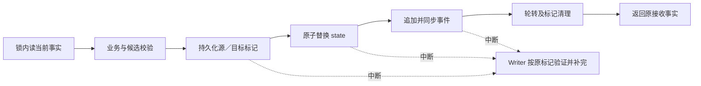

# L4 权威状态与转换事务核心

## 1. 共同事实为什么需要独立的事务核心

Main、多个原生子代理和 Hook 会在不同时间看到工程进展。一个文件已保存、一条返回消息写了“完成”、一次集成检查成功，都只是某个环节的事实；如果各入口据此自行解释整个工程已经完成，恢复和并发就会产生冲突：同一结果接收两次、旧责任被重新激活、阶段已经改变却仍按旧材料推进，或状态已经更新但事件没有落盘。

事务核心让这些参与者共享可定位的权威事实，并规定怎样改变事实、怎样识别重复、怎样在中断后恢复。它维护工程责任与生命周期，不接管 Claude Code 的子代理创建、执行和消息，也不替代专业消费者判断工作是否充分。

本篇承载 [L1](../l1-principles/L1-design-principles.md)中权威外置、明确分工和收敛可观测的原则。它解释“事实在哪里、怎样改变才成立、失败后凭什么恢复”。[修订使用](L4-revision-usage.md)展开内部提交协调，[阶段答卷](L4-stage-form.md)解释专业输入与接收，[运行时控制面](L4-runtime-control-plane.md)展开领域求值与反馈；[原生子代理衔接](L4-agent-dispatch-governance.md)另述真实执行和交付。

## 2. 权威记录、专业产物和显示各承担什么

### 2.1 状态与事件是一对记录

| 载体 | 保存什么 | 不能代替什么 |
| --- | --- | --- |
| `.claude/loop-state.json` | 当前 Runtime 身份、生命周期位置、代际、轮次、责任、登记及有效性等当前工程事实 | 不自动证明引用材料的自然语言内容真实充分 |
| `.claude/loop-events.jsonl` 及其轮转段 | 已发生的工程事件、提交关联和转换过程 | 不凭一段日志文字重建未发生的专业工作 |
| 专业文档、答案和执行产物 | 需求、设计、判断依据、实际观察、本人计划和交付内容 | 不通过文件存在自行改变工程状态 |
| 可读报告、状态投影、看板与 Hook 提示 | 解释已有事实、当前责任、具体缺口及下一动作 | 不成为另一个可独立修改的控制账本 |
| Claude Code 原生上下文与执行 | 实际子代理运行、消息、恢复和工作区行为 | 不因平台执行结束就自动证明领域接收或阶段完成 |

状态保存当前视图，事件保留其形成依据。正常业务提交使状态的 journal 游标与事件尾部对应，事件序号与 Runtime 内部提交关联。轮转后检查完整历史必须包括归档段；只查看活动文件的末尾或行数不足以判断历史完整性。

`last_transition` 是最近相关转换的快照，不是另一份事件全集。某些维护性或领域提交保留该快照，恢复时必须按相应事件契约处理，不能由“最近一次转换没有改变”推导没有新事实。

完整结构见 [Runtime Schema](../../internal/schema/assets/loop-state.schema.json)与[事件 Schema](../../internal/schema/assets/loop-event.schema.json)。结构合法只说明字段能够被读取，仍需要配对一致、原业务条件和专业事实分别成立。

### 2.2 权威根属于绑定工程

权威根由 REQ 的 `bound_req.workspace.project_root` 确定，可以本身就是 linked worktree。它不是固定的 Git 主 checkout，也不随 Worker 的当前目录变化。Worker 在本人工作区交付，原消费者将必要事实交回权威根；不能复制一对 Runtime 文件就成为第二个控制面。

正常 Writer 校验真实根路径及权威 state／journal 坐标，目录别名可按真实路径归一；文件别名不能给同一份状态另造独立锁与恢复标记。这样避免“两个路径看起来不同，实际写同一个文件”绕过串行化。

离线恢复有明确的恢复能力与暂存配对，仍受绑定工程及语义校验约束。普通 `--root`、`--state`、`--journal` 参数不能自动取得恢复资格。工作区和路径的具体配合见 [Worktree 治理](L4-worktree-governance.md)。

### 2.3 当前 Runtime 的几种关联轴

| 关联 | 解决的问题 |
| --- | --- |
| `runtime_id` | 这是不是同一个工程周期；修订数相同不代表身份相同 |
| `revision` 与 journal 序号 | 这次内部提交基于哪份事实，状态与事件如何配对 |
| `baseline.generation` | 当前锁定需求及其下游依据属于哪一代 |
| `review.round` | 验证结果、发现与干净轮属于哪次完整验证 |
| 生命周期 state／phase 与阶段入口事实 | 当前在哪里工作或等待，恢复或重入对应哪项责任 |
| 原对象、责任、owner 与已有尝试关联 | 谁对什么交付负责，旧结果为什么不能冒充新的工作 |

这些关联解决不同问题，不应压成一个“版本号”。数字变化也不自动推导专业工作重新完成。作者正常工作不需要手抄这些轴或计算下一修订；系统在原事务中维护它们。

## 3. 五态表达责任进度，不替代专业与平台事实

### 3.1 建模单位是责任的一次尝试

同一个 TASK 可以先有规格交付，再有实现交付；同一次 Worker 贡献还有 Main 集成与独立验证责任。它们共享对象关联，却不共享一个含糊的“完成”。状态必须附着于现有的具体责任和尝试，不另建通用工作注册表。

| 工作状态 | 含义 | 当前应交付的下一动作 |
| --- | --- | --- |
| `pending` | 责任已确定，尚未开始 | 明确前置责任及 owner，条件成立后沿原入口开展 |
| `active` | 本次责任已开始，尚未完成 | 继续本人专业工作，给出准确材料、答案路径和实际缺项 |
| `blocked` | 已开始，继续需要消除一个真实阻碍 | 说明阻碍、处理者、必要依据及原恢复动作 |
| `done` | 本次要求的交付与本人检查已被原消费者接收，当前完成依据成立 | 本人可以结束，下一责任交给其 owner |
| `cancelled` | 原撤销、替换或失效流程已终止本次尝试 | 结束旧尝试，必要时指向新的责任 |

正常工作从 pending 开始，开展后 active，可以因真实阻碍进入 blocked，恢复后继续；原接收完成后 done。撤销和替换依据原事件终止责任，不由超时或一次失败查询擅自生成终态。原事务可以一次持久化完整交付，不要求每条语义边都单独写一次状态。

### 3.2 不同维度保持不同含义

| 看起来像状态的值 | 实际表达什么 |
| --- | --- |
| `planning.design`、`verification.running` | 生命周期所在步骤，不是另一组工作状态 |
| `pass`、`fix_required`、`review_required` | 专业结论；合法负结论可使审查责任完成，同时引出后续工作 |
| `locked`、来源摘要与有效性 | 冻结和依据效力，不代表产品实现已经完成 |
| accepted receipt、Candidate、Final | 原接收或集成事实，应按各自领域语义使用 |
| 平台执行中、结束或恢复 | Claude Code 原生运行事实，不直接等于工程责任完成 |
| 工作区准备、可用或回收 | 执行资源状况，不代表本人交付质量 |

active 不授予产品写权限，blocked 不自动证明有效交接，done 不证明阶段已经通过。S5 某位 reviewer 交付 done 可以同时存在另一位 active；S6 Worker done 后 Main 仍可能等待真实集成；S9 定向验证完成也不能替代新的完整 S7。

### 3.3 统一语义与兼容读取

`workstate` 提供共享五态、事实投影和具名实体兼容读取。领域消费者提供真实的开始、阻碍、原完成与撤销事实；共享词汇本身不执行专业判断，也不创建新的 Writer。

新实例采用 Runtime 1.3 的五态工作字段，既有 Runtime 1.1／1.2 在具名边界按原格式读取。TASK 文档的 `complete` 表示规格交付事实，同 ID 的实现责任仍可能 pending；它既不能被当作第六种工作状态，也不能因不在工作五态里就被忽略。

当前五态格式与旧格式保留各自事件关联，不能批量把旧字符串替换成新词。旧 reading、activated、reported 等活动只能结合原对象和事件解释；它们不是新原生责任需要补走的启动或读回许可。也不能因为底层存在兼容字段，就恢复已经移除的通用执行抽象。

历史接收长期保留。来源失效后，它仍是发生过的事实，却不能再充当当前完成依据；返工由原流程关联新尝试，不倒写历史成功或重新激活旧答案。接续尚未建立时，应明确当前覆盖受阻和恢复责任。

## 4. 生命周期与责任状态怎样配合

生命周期回答“工程现在走到哪里”，工作五态回答“某项责任进展如何”。前者由原阶段和转换定义，后者由具体责任及接收依据表达。

| 生命周期位置 | 主要责任及出口 |
| --- | --- |
| `inactive` | 未绑定的周期入口，满足原绑定条件后进入当前需求 |
| `planning` | S2 设计、S3 契约、S4 任务三步形成可审查规格 |
| `document_verification` | S5 独立审查，完成后进入实现或按发现返工 |
| `building` | S6 本人交付、Main 集成与阶段完成 |
| `verification` | S7 计划、独立结果、发现批次或干净轮 |
| `bug_resolution` | S8 调查及获批合同、S9 修复与复验，再返回完整验证 |
| `acceptance`、`release_audit` | S10 两项专业责任，工程结论交给人 |
| `paused` | 保存原恢复依据，等待有权处理的真实决定 |
| `awaiting_human_release` | S11 等待真人选择，没有自动发布决定 |
| `release_authorized`、`aborted` | 当前周期的终态；授权不等于实际发布，中止不自动开启下一周期 |

phase 是 state 内部的位置，例如 planning 的 design／contracts／tasks。已有 bug_resolution 中保留的阶段和兼容转换用于解释原记录，不意味着新修复必须恢复旧 readback、激活或 Team 流程。实际阶段消费应以相应 L3 与当前入口为准。

转换目录声明这些位置和合法去向，领域接收负责形成相应事实。不能因工作状态词表统一就让每个 owner 任意修改生命周期，也不能因阶段未推进就反推已经交付的 Worker 尚未完成。

## 5. 读写分型与单一写入边界

### 5.1 “单写者”是一条规则，不是一个常驻调度进程

多个 CLI 或 Hook 进程可以先后请求写入，合法修改都经过原 Runtime Writer，在同一权威根下串行提交。它不要求再创建一个平台外的执行协调器。

| 入口 | 用途与边界 |
| --- | --- |
| `NewStore` 的 Snapshot | 加锁读取当前状态并报告 pending，不暗中恢复或提交 |
| 只读 ObservationSnapshot | 在明确读取预算内提供当前观测；不能拿来写入或恢复 |
| `NewWriter` | 携带工程根与候选验证器，可在原锁内恢复并提交 |
| 具名离线恢复 Writer | 只在显式恢复能力与暂存边界内操作，不能绕过语义和身份检查 |

普通 Snapshot 成功不等于完整 Schema、journal 历史和全部来源已经验证。当前轻量读取会检查未完成标记并解码状态，但不逐次扫描整份 journal；写入、恢复和专用诊断在各自边界执行相应检查。Writer 的 Snapshot 可能恢复 pending，调用者不能把它当成纯读取。

### 5.2 候选验证不能是空装饰

Writer 要求注入候选验证器，并对明显非法候选检查它是否会拒绝。提交边界还执行本地结构、权威根、格式、已定义生命周期与注入语义校验。只拒绝空对象、却允许其他语义非法候选的伪验证器，也不能作为合法写入器。

这些是工程模型的校验，不能认证自然语言观察或外部身份。具体动作还需要在锁内重新核对原业务条件，不能拿一次提前求值的绿色结果直接写入。

能力自检与真实候选校验承担不同责任。自检用于发现明确、有限的注入接线错误，例如未注入、空装饰或不能拒绝原明显语义非法候选；它不能证明任意有状态 adapter 永久可信。真实业务候选合法性、最终外置表示合法性、磁盘字节及状态／事件配对完整性、当前来源资格和独立恢复分别由各自消费者负责。

本篇约束这些质量义务及复用条件，不固定每个 candidate 或 checkpoint 完整重复 schema／adapter 的次数。复用必须说明输入和验证条件是否相同、哪些来源可能变化、原消费者在哪里，以及减少检查后原遗漏仍如何被发现；当前可变来源必须在实际使用边界核对，独立恢复不能依赖上次操作的私有验证结果。构造／绑定一次、操作内一次等自检安排仍需比较其适用输入、故障覆盖和成本，不能将未经裁定的缓存键或失效协议作为架构前提。当前生产检查继续原样，只有证明行为等价后才减少重复实现。

### 5.3 进程锁与内部修订

当前写入先取得操作系统持有的进程锁，再使用原兼容锁标记。同版活进程持锁时，即使旧标记已经很久，也不能只因标记年龄把它驱逐；锁等待有预算，失败应反馈实际竞争。操作系统锁文件不能随意 unlink，以免形成两个独立 inode 的锁。

正常提交在锁内读取当前事实，由 Writer 分配内部修订。显式非负 `expectedRevision` 仍供有意检查旧快照的高级调用者使用；Runtime 身份另行校验，不能因新周期又出现 revision 0 就接受旧周期请求。默认命令行为和修订冲突处理详见修订使用篇。

## 6. 从领域接收到阶段出口：原子性应该包住什么

一个领域结果会同时影响多个彼此依赖的事实。例如 S7 接收一次 ReviewResult 时，责任结果、Claim 处置、Finding、本轮推进和必要封存必须保持一致；不能先让其他读者看见“责任完成”，却尚未写入该结果带来的发现。

因此，同一领域收口需要的关联更新由原消费者在原 Writer 事务中完成。只为缩短一个函数就拆成多段，会增加下游能观察到的半完成组合；是否拆分应依据真实耗时与一致性设计，而不是给每个中间状态再增加一套协调抽象。

领域收口、生命周期转换和下一份材料准备仍可能是不同事务：

| 环节 | 已成立的事实 | 尚不能推导 |
| --- | --- | --- |
| 原专业结果被接收 | 本人答案及相应领域关联已记录 | Main 集成、其他责任或阶段出口全部完成 |
| 本阶段转换提交 | 当前合法出口和状态变化已记录 | 下一报告已成功写入，或外部操作已发生 |
| 下一责任材料准备成功 | 后续 owner 获得准确题目和位置 | 后续专业工作或人类决定已经完成 |

S2～S4 的接收与规划出口通过原 submission followup 关联；S7 接收与 TR-008／TR-009 分开；S10 正常保存可接续本步 TR-015／TR-017；S11 原决定登记、消费和固定去向共享本次逻辑提交。不能把某一阶段的事务范围推广成所有阶段的同一模板。

已接收而出口失败时，恢复原出口而不重做本人答案；出口已提交而下一材料准备失败时，反馈真实准备缺口，不能称业务回滚。跨文件产物、Git 集成、实际命令和平台执行都不是因调用了 Writer 就自动成为同一原子事务。

## 7. 一次普通业务提交怎样落盘

原 Writer 在锁内按以下顺序处理普通业务变更：

1. 读取权威当前状态，核对请求的 Runtime 身份、显式旧快照要求和已有状态／事件配对。
2. 规范化本次事件和审计关联，拒绝已存在的事件标识，执行原业务 mutation。
3. 校验候选格式、状态／事件边界及本动作语义，分配下一内部修订和事件序号。
4. 保存包含源／目标状态摘要及目标事件的持久化 pending 标记。
5. 原子替换状态文件，追加并同步 journal，按必要条件进行事件轮转。
6. 完成标记清理，返回本次已提交快照。

临时文件、rename 和目录同步避免把半份 JSON 当成新状态；journal 追加与文件同步使已提交事件能持久化。两个文件无法由一次 rename 同时替换，因此需要明确标记，使恢复器能辨认“旧状态”“目标状态”和“缺哪半次提交”。

错误返回不总意味着完全没有发生作用。标记落盘后中断，原事务可能已经到达目标状态，下一次合法 Writer 会先处理它；调用者应读取原接收与恢复事实，而不是盲目再交一份新工作。

普通提交编码消重限于本次局部值：目标完成最终正文外置和索引校验后，生成带换行的缩进 stateDocument 与带换行的 compact eventLine；预算、目标摘要、state 原子写和事件追加复用各自准确字节。源摘要仍按原 canonical 合同计算，pending envelope 独立编码且继续检查 coherence；不得复用 inline 或外置前的 state 字节。字节追加入口须完整保留 O_APPEND、短写检查、Flush、Sync 及错误传播。不引入通用 prepared-commit 对象、新 schema 或新的提交事实。该局部复用不改变上述提交顺序与持久化义务。

## 8. 持久化标记怎样支持恢复

### 8.1 按各自目的恢复

| 操作 | 当前标记后缀 | 为什么有独立恢复语义 |
| --- | --- | --- |
| 普通提交 | `.commit-pending.json` | 状态替换与 journal 追加必须配成同一事件 |
| 指纹维护 | `.fingerprint-pending.json` | 无新增业务修订的状态维护不能伪造生命周期事件 |
| 事件轮转 | `.journal-rotation-pending.json` | 旧段持久化与活动段缩短必须保全完整顺序 |
| 周期归档与重置 | `.rollover-pending.json` | 旧周期归档、源绑定与新配对替换需要独立核对 |

标记位于原状态文件的旁路。当前 Writer 按普通提交、指纹维护、轮转、周期重置的顺序恢复；只读入口报告 pending，不清除它或代为补写。 原调用的取消只在安全边界生效：pending 前停止新提交，pending 后保留原发布与恢复材料。等待者取消不会驱逐活跃 Writer；超时响应不能证明原事务未发生。

恢复候选仍必须通过原权威根、结构、语义及源／目标绑定检查。看到一个合法 JSON 标记，不意味着其中内容可以不经校验覆盖当前工程。

### 8.2 普通提交的四种典型现场

| 磁盘现场 | 可以做什么 |
| --- | --- |
| 状态仍是标记的源，journal 尚无本事件且尾序号正确 | 完成本次目标状态与原事件 |
| 状态已是目标，journal 还缺本事件 | 只补原事件并清理标记 |
| 状态与 journal 均已到目标，事件内容与尾部完全相符 | 清理标记，不再次追加 |
| 出现未知状态摘要、冲突事件、跨 Runtime、非连续尾部或不相容配对 | 拒绝猜测恢复，保留现场并给出具体冲突 |

例如，state 已写到修订 n+1、journal 仍停在 n，且原标记完整绑定目标事件，恢复器能补齐缺尾；若只是手改 state 的序号，既无原标记也无可核对事件，就不能把它修成“曾合法发生过”。

恢复支持明确中断窗口，不保证任何人为编辑、丢文件或混合历史都能自动修好。被引用产物也不能因为当前返回失败就删除：pending 仍可能完成一笔会引用它的提交。领域消费者清理暂存产物时复用 Writer 的锁内未引用检查，并核对当前修订与准确字节；读取一次 state 后直接删除不能保护 pending-before-state 的窗口。原计划可以复用同答的已发布字节继续原 CAS，已批准合同可以从固定产物恢复原接收；这两种恢复均不要求新的操作编号或重做私人草稿。

### 8.3 事件轮转与历史

活动 journal 超过当前阈值时，原机制把前缀存入带序号的归档段，活动段保留末条事件。读取完整事件历史的消费者需要合并数字序号归档段与活动文件，检查连续性和 Runtime 身份；非数字临时文件不充当历史段。

轮转不是删除旧证据，也不自动清理归档段。它有自己的恢复标记，不能用“状态提交已经成功”就忽略轮转中断。周期归档与轮转段如何衔接还受第 12 节的当前实现边界约束。

### 8.4 工作包正文外置的事务与兼容边界

[运行控制面 §2.4～§2.6](L4-runtime-control-plane.md#24-保留事实与保存全文是不同决策)定义保留哪些内容以及何时读取。正文外置改变持久化表示，不改变原责任、签发、接收和阶段转换事实；以下要求适用于支持该表示的 Writer、reader 和恢复器。当前内嵌格式仍按原合同使用，不能仅凭设计文档出现就删去其正文。

正文必须先完整发布并核对准确字节，才可在原 Writer 事务中提交引用。并发发布相同身份时复用准确原内容，冲突时保留故障，不覆盖历史。正文已发布而引用未提交，不证明签发或接收；必须有可核对的原发布归属，供原机制续用或在锁内确认未引用后清理。引用进入 durable pending 后，相关正文也进入恢复保护范围，不能因调用取消或未收到回执删除。

格式切换必须保留原 packet ID、模板身份、冻结输入、签发关联、接收记录和作者路径。旧 Runtime 中存在正文而展示文件缺失时，从已核验的原正文补齐并验证可读性，再提交新引用；不得直接把索引指向假定存在的展示文件，也不能从当前文件或当前模板重新生成另一份历史。格式维护走明确的框架写入与兼容边界，不冒充重新签发或专业接收，不让 Main 手改状态。

reader 必须区分受支持的内嵌和引用表示，识别未知格式并返回准确兼容错误；不能让旧 Schema 静默接受意义不同的新行。新版读取旧实例及旧 pending／checkpoint 的能力、格式切换中断的恢复和回退条件必须共同成立。不能承诺旧二进制天然理解新格式；未具备兼容能力的入口不得参与新格式写入或恢复。

checkpoint 必须能恢复它引用的准确正文：正文及其原身份进入保留集合，活动状态、pending、保留 checkpoint 和周期归档所需的内容不得被清理。只备份含路径的主状态而丢失正文，不构成原完整恢复能力的等价实现。展示副本丢失可以从保留的准确正文恢复；全部可信副本缺失或冲突时，保留未恢复状态及具名原因，不能猜测补造事实或要求作者重新完成已经接受的工作。

实现中，S7 与 S9 两类正文按内容摘要保存；每套保留 checkpoint 复制所引用的准确正文，恢复计划另行封存，以免依赖滚动 checkpoint 的保留窗口。普通维护不改旧 pending 的物理字节或摘要；恢复器沿原 pending 继续配对，正文缺失或冲突保留具名故障。内容存储中的孤立已发布正文按准确文件名、实际摘要和完整 canonical packet 识别为框架存储，不据此推导已签发；未知邻近文件没有此分类。当前无正文垃圾回收，不凭取消或年龄删除。 原发布器在专有正文目录内的 `.packet-<32 小写 hex>.tmp` 是精确命名的发布暂存，普通文件可在尚未写完时被识别为框架暂存，以免并发观察或进程终止遗留被误标产品漂移；它不充当正文、签发或接收事实。符号链接、目录及未知邻近文件没有此分类。

正常同次事务可以复用仍成立的候选结构校验和准确序列化结果，复用依据必须绑定实际候选、验证条件及相关不可变来源。落盘配对、字节完整性和当前可变来源仍在各自边界核对。独立恢复、重新进入进程或来源发生变化时，重新执行适用检查；不能仅为减少 checkpoint 耗时删除恢复入口的验证。

checkpoint 单次读取把先 s.read 再 ReadFile 合并为一次实际 ReadFile，沿原 decodeState 解码，以同一份实际落盘字节计算摘要并发布副本。完整 journal、准确正文副本、fsync、marker、配对检查及现有 state 验证暂保持，作为最小改动策略；这不将现有验证次数升格为永久架构义务。独立恢复仍消费真实落盘材料，不以提交前内存 state 代替。该局部复用不依赖自检方案裁定，也不增加 state／event hints、journal 尾行或完整历史 buffer 复用分支；小规模适用验收不替代代表规模与增长预算证据。

## 9. 重复事件、幂等与一次消费

底层事务、领域幂等和授权消费是三项相互配合的约束：

| 约束 | 解决什么 | 由谁提供 |
| --- | --- | --- |
| 事件标识不重复、状态与 journal 配对 | 同一事务不能任意重复追加或拼接历史 | 原 Writer 与持久化恢复 |
| 同一领域答案正常重放复用原事实 | 接收响应丢失或重复原生结束事件时，不重复本人贡献 | 对应领域消费者与原接收记录 |
| 人类决定只能用于原授权操作 | 同一批准不能被用于另一阶段、动作或新入口 | 原决定关联、消费事实和对应 Writer |

`idempotency_key` 是关联信息，不是一放进任意 mutation 就自动获得“重复返回旧回执”的通用开关。原 Store 会拒绝重复事件标识；各领域还需要准确识别同一责任、答案和原接收。不同事件能否共享某个键、如何读取历史，由实际消费者的契约决定，不能宣称存在底层统一的全局去重证明。

恢复还要先于可变草稿判断。在已接收记录仍然有效时，不应因为 Worker 私人答案后来缺失，就要求重交已接受工作；没有接受过的答案也不能借用 Main 的同名文件。不同内容、旧轮次或错 owner 不是正常重放。

阶段出口同样要区别：已经接受答案但出口尚未完成时，可继续原出口；游标已改变后旧卷回放应保持无新业务作用。S11 再次进入门禁必须定位新申请，不能复用已消费旧决定。详细作者交互见阶段答卷篇与相应 L3。

## 10. 转换目录、守卫、动作与自动仲裁

### 10.1 声明合法动作，按当前事实执行

[生命周期定义](../../docs/control/loop-definition.json)声明状态、相位、实体和转换。转换目录将声明与代码注册项对齐：guard 是守卫，判断必要条件；action 执行合法变化。加载应拒绝缺失或不可解析的必要注册项，但代码可用全集和本次声明实际引用的子集不必数量相等。

| 转换或操作 | 作用范围 |
| --- | --- |
| TR 阶段转换 | 顶层生命周期与相关固定出口 |
| PTR 相位转换 | 所属 state 内部步骤及规划等专业交接 |
| GTR 全局转换 | 在已声明来源状态范围内处理暂停、治理等跨阶段情况 |
| 实体事件 | 更新原责任、TASK 或兼容对象的领域事实，不任意改顶层阶段 |
| Runtime 边界操作 | bind 的身份重置、unbind／rollover 的跨文件归档等，不能冒充普通阶段跳转 |

Apply 根据当前游标解析声明，检查该路径实际需要的 actor、证据、业务条件与动作，并在 Writer 锁内重新验证必要事实。守卫的语义取决于真正调用的消费者：有的复核产品来源，有的读取当前已接收结果。不能仅凭名字叫 semantic check 就承诺完整来源认证。

例如 TR-009 复核当前产品基线，TR-015／TR-017 读取当前 S10 专业完成和本轮干净状态，正常 S11 消费明确决定及当前关联。将这些路径统一恢复成同一全哈希资格门，会破坏各自职责；忽略各路径必要事实也会让旧结果冒充当前完成。

### 10.2 唯一候选不等于已经获准提交

自动转换声明使用规范的触发元数据与单次转换限制，不能将人类边界声明为自动许可。目录按当前游标及已有 selector 求候选；当前解析可由已请求事件或已满足门结果命中。两者都不是单独跳过守卫和 Writer 的权限。

没有命中就继续本责任；唯一候选还需原 Controller 与 Apply 检查；多个不相容候选不能按声明顺序或任意优先级挑一个，应返回稳定冲突及候选标识。固定选择与条件检查共同避免“只因事件名出现就跳阶段”。

`auto_trigger` 的规范事件声明不意味着普通公开 Pre 要承担所有业务。正常保存或原生结果接收可以在自己的原出口调用控制循环，完成准确当前一步；普通工具观察不应借此变成子代理启动、结果接收或下一份草稿的隐式补办入口。

### 10.3 失败与人类边界

守卫失败时，原转换拒绝提交，并反馈具体缺项。声明里的 `on_guard_failure` 不能单独证明引擎已经替调用者暂停、重试或建立检查点；暂停必须有真实路由、原动作和已提交依据。未满足阶段门意味着继续处理工作，不等于普通工具被拒绝。

Controller 对 `awaiting_human_release`、`release_authorized`、`aborted` 不产生自动发布决定。人类处置使用固定路由、准确当前责任及一次消费事实，actor 字符串不认证身份。没有真人选择时保持等待，不因事件、超时或全部指标变绿自动批准。

## 11. 输入来源与来源效力

### 11.1 先声明从哪里读，再判断内容

| 来源语义 | 使用场合 | 必须守住的边界 |
| --- | --- | --- |
| `git_tree` | 消费者明确要求的正式已提交需求、规格、代码、测试和配置 | 读取指定提交中的内容；磁盘 dirty、index-only 或同名文件不能补足该树中的缺失输入 |
| `disk` | 明确声明的运行证据、专业草稿、私人答案及执行产物 | 使用准确权威根或原执行根、路径与版本，不按 ignore 或文件存在猜资格 |
| Runtime 快照 | 当前控制状态、登记索引和责任／消费事实 | 经原 Store／Writer 读取，不从 Worker 的 Git 副本或聊天重建 |

`FileView` 执行文件来源声明，当前规则使用 `git_tree`／`disk`；Runtime 是另一类快照载体，不能把它误填成 FileView 新枚举。规则按明确路径适用，不由扩展名、是否被 gitignore 或磁盘存在自动决定。

对 Git 来源，一次评估先解析固定提交，再从同一提交完成目录发现、读取和指纹；不能列磁盘目录后读 Git 文件，也不能中途重解 HEAD 改变对象。磁盘来源处理真实路径、越界和执行根，不自动复制整个 Main 来弥补 Worker 缺少文件。

### 11.2 文件读取与交付资格不是一回事

正式上游是否要求提交、原答卷是否从本人 worktree 读取、某项接受记录是否可直接消费，应由本阶段与该消费者契约明确。不能把一个严格 Git 输入要求推广成“每份私人报告必须先造 commit”，也不能因普通报告允许磁盘保存就用未交付规格替换正式输入。

同一转换使用已经解析的来源与必要绑定，避免守卫和动作换一套读取方式。绑定、提交或责任变化时，按本次动作的原核对范围重新求值。实际文件视图校验与阶段特有边界以其消费者为准，不能从辅助函数存在推导每个入口都完整复核它。

### 11.3 指纹维护不重新批准专业材料

需求换代、规格变化、修复影响和人类驳回通过原领域流程处置有效性。维护命令只可重建其明确支持、无需新增专业判断的事实；不能通过刷新摘要使一份已改变的需求、文档或证据自动再次通过。

当前普通指纹维护区分框架元数据与已登记的专业依据。REQ、documents、TASK 和 evidence 等原登记摘要应保留并报告漂移；明确可变执行证据的受控刷新仍使用其原契约，不扩大为任意文件重认证。

旧观察仍然存在，不意味着仍适用当前轮；失效也不代表历史事件应被删除。干净轮求值、影响处置和预算规则见运行时控制面篇，各阶段说明具体什么时候调用。

## 12. 失效、暂停和周期边界

### 12.1 改变当前效力，不改写发生过的事实

| 原因 | 原事务的作用 |
| --- | --- |
| 锁定需求修订 | 建立新代际，按原规则使下游依据失效，重新形成需要的专业工作 |
| 验证换轮 | 新轮只消费本轮必要结果与发现；历史记录保留但不替新轮完成 |
| 修复或规格影响 | 按真实影响及原消费者处置旧证据，不由文件名或总体 PASS 推断可保留范围 |
| 人类退回验收／审计 | 使对应类别旧最终记录失效，保留观察，交实际理由并重新形成结论 |
| 撤销或替换责任 | 终止旧尝试并指向原接续，不让旧答案重新取得作用 |

必要预算用于阻止无界重复，不是又一套执行状态机。预算值、计数和原决定应在其原事务中一致改变；字段存在不意味着所有阶段入口都已经消费它。超限后的实际暂停、治理或授权由对应领域路径处理，不能只写一个配置值就宣称获得全局保证。

pause 保存准确来源位置、代际、轮次和必要指纹；resume 按原恢复条件核对，真实漂移不能靠重算摘要掩盖。暂停、需求修订和授权由 S1 及相关 L3 解释，预算求值由运行时控制面篇展开。

### 12.2 身份重置和周期归档需要独立协议

TR-001 绑定是 inactive 到新活动 Runtime 的身份边界：先保存原配对的归档，再安装新身份及其初始状态／事件配对。数字修订重置不意味着原历史被抹掉，也不能让旧请求再次符合新身份。

unbind 与 rollover 是原 Runtime 跨文件操作，不是任意阶段迁移。前者撤销当前执行绑定，后者从允许的终态开启新的 inactive 周期；两者需自己的真实授权、旧配对归档、源身份和目标格式校验。旧发布决定不授权所有后续周期动作。新实例保留原格式与明确配置边界，不能简单改 Schema 版本或复用旧证据索引。

归档记录保存旧状态、事件和摘要清单，恢复核对源配对、目标配对与授权，不凭目录存在就确认完成。实际发布、终态授权和周期归档是不同事实。

轮转历史与活动尾部共同组成旧周期 journal。绑定、解绑和周期归档沿同一原归档出口读取完整历史，核对原状态游标、事件顺序和摘要后，保存完整归档。新 Runtime 从自己的事件起点开始，旧轮转段不能继续留在活动读取位置混入下一周期。

实际存在轮转段时，原 pending 内部保留准确源文件名、长度与摘要，并以完整归档字节核对它们的分段关系；这些是系统恢复事实，不是作者填写的归档清单。恢复先核原归档、格式、授权和所有当前源文件，随后替换目标状态、清空活动尾、删除已归档的准确原分段，同步目录后清除原标记。源状态仍在时，任何原段缺失都拒绝；只有目标状态已持久化，才允许原段已部分清理。未知分段、字节变化或不相符路径不获得清理资格。

这份内部关联使替换状态到逐段清理之间的中断可以继续原事务，不需要新状态、人工删日志或另选一次处置。未轮转的原配对与旧合法 pending 保持原恢复语义；无法证明完整来源的历史标记仍需保留现场处理，不能凭目录存在补造成功。底层归档也不代替 REQ 标签更新、原生执行终止或实际工作区资源清理。

## 13. 诊断与恢复应当怎样引导

### 13.1 错误必须对应实际失败面

| 可观察事实 | 说明什么 | 正确的处理方向 |
| --- | --- | --- |
| 权威根或 state／journal 坐标不符 | 请求可能写向另一个控制面或别名 | 回绑定工程的准确根，不复制 Runtime 继续 |
| 锁竞争或显式旧修订冲突 | 当前写入与另一个事实更新发生冲突 | 读当前责任，判断原业务是否已接收，再作必要重试 |
| Runtime 身份不同 | 旧周期或旧绑定请求 | 重新定位当前工程，不能只调整数字修订 |
| pending 标记存在 | 已有持久化操作未完全收尾 | 使用原 Writer／明确恢复入口，不让只读工具修复 |
| journal 缺尾但有可验证原依据 | 可恢复的成对写入窗口 | 补原事件，不新增专业判断 |
| 未知摘要、历史缺口或冲突事件 | 无法证明是同一笔原提交 | 保留现场，检查／制定明确恢复计划，不手改游标 |
| 专业材料漂移或缺失 | 当前完成依据不能直接成立 | 交原 owner 处理来源、影响或返工，不维护成自动通过 |
| 领域已接收但阶段未提交 | 后续出口仍有真实缺项或系统故障 | 沿原接收事实续出口，不重复本人交付 |

事件中的 Runtime、event／request、责任、from／to、前后修订、必要证据及 guard／action 结果，帮助维护者定位一次工程变更。pending 的源／目标摘要和 journal 尾部解释中断位置；普通 Hook 决策日志、进度指标只提供辅助观测，不能替换原事件。

不要求专业作者逐次读取这些内部字段。面向作者的反馈应解释“当前责任、具体未完成、准确路径、下一 owner／动作”；内部关联按诊断需要展开。

### 13.2 维护命令不能补造业务事实

| 入口 | 正确用途与限制 |
| --- | --- |
| `doctor` | 检查环境、配置与相应一致性问题，给出修复方向；不是自动批准工具 |
| `validate --all` | 检查仓库声明的结构与语义，不能证明真实平台执行或产品验收 |
| `runtime reconcile` | 只在原快照保留了可核对的已提交缺尾依据时补齐原事件，不任意重排历史或改状态 |
| `runtime fingerprint`／`reconcile-policy-ref` | 维护明确支持的框架元数据，保留专业依据的漂移问题 |
| `runtime recover inspect`／`plan` 及原执行入口 | 检查当前源、形成明确恢复计划，并只恢复证据足以支持的信息 |

文档重建可以恢复其实际支持的结构，不能重建从未发生的发行、专业接收、原生执行或人的决定。未知事实应保持未知，不能通过“对账成功”变成通过。

## 14. 实现对应与保证范围

| 机制 | 当前落点 |
| --- | --- |
| Store／Writer、普通提交、标记与恢复 | [runtime/store.go](../../internal/runtime/store.go) |
| 权威根、正常与离线恢复坐标 | [runtime/authority.go](../../internal/runtime/authority.go) |
| 操作系统进程锁与兼容锁配合 | [filelock](../../internal/filelock)、[Runtime 锁接线](../../internal/runtime/store.go) |
| 事件历史与配对校验 | [controlproof](../../internal/controlproof) |
| 五态词汇、事实投影与旧格式具名读取 | [workstate/status.go](../../internal/workstate/status.go)、[workstate/activity.go](../../internal/workstate/activity.go) |
| 转换目录、守卫与原动作 | [transition/catalog.go](../../internal/transition/catalog.go)、[guards.go](../../internal/transition/guards.go)、[actions.go](../../internal/transition/actions.go) |
| Apply 与 Writer 锁内复核 | [transition/engine.go](../../internal/transition/engine.go) |
| 当前候选、阶段门和原自动转换 | [controller/cycle.go](../../internal/controller/cycle.go) |
| 文件来源声明与固定提交读取 | [fileview/contracts.go](../../internal/fileview/contracts.go)、[fileview/view.go](../../internal/fileview/view.go) |
| 独立归档重置与证据恢复 | [runtime/unbind.go](../../internal/runtime/unbind.go)、[轮转归档接缝](../../internal/runtime/rollover_journal.go)、[runtime/recovery.go](../../internal/runtime/recovery.go) |

本机制保证应按实际调用边界理解：合法 Writer 能对它承担的状态／事件提交实施并发、候选和恢复校验；轻量 Snapshot、一个显示投影或一段登记内容不自动获得同等证明范围。当前五态共享代码也不等于所有领域已经使用同一个完整专业完成函数，仍需各原消费者提供准确事实。

已有登记与新的专业输入具有不同消费要求，某些当前读取不重做旧发行或所有历史幂等键的证明。不能把辅助验证器存在、函数名称带 verified 或测试名称带 hashed 当成该调用路径实际执行了全套证明。具体差异应在相应机制和 L3 明确，不用通用资格门遮盖。

来源改变、调查边界适配、TASK 正式源重锁或阶段返回缺材料，不能因底层事务可恢复就被视作已经解决。底层维护合法记录，专业真实性、充分性、实际独立性和人类意图仍由真实工作与各自边界共同承担。
