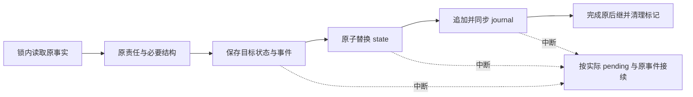

# L4 权威状态与转换事务核心

## 1. 共同事实为什么需要独立的事务核心

Main、多个原生子代理和 Hook 会在不同时间看到工程进展。一个文件已保存、一条返回消息写了“完成”、一次集成检查成功，都只是某个环节的事实；如果各入口据此自行解释整个工程已经完成，恢复和并发就会产生冲突：同一结果接收两次、旧责任被重新激活、阶段已经改变却仍按旧材料推进，或状态已经更新但事件没有落盘。

事务核心让这些参与者共享可定位的权威事实，并规定怎样改变事实、怎样识别重复、怎样在中断后恢复。它维护工程责任与生命周期，不接管 Claude Code 的子代理创建、执行和消息，也不替代专业消费者判断工作是否充分。

本篇承载 [L1](../l1-principles/L1-design-principles.md)中权威外置、明确分工和收敛可观测的原则。它解释“事实在哪里、怎样改变才成立、失败后凭什么恢复”。[修订使用](L4-revision-usage.md)展开内部提交协调，[阶段答卷](L4-stage-form.md)解释专业输入与接收，[运行时控制面](L4-runtime-control-plane.md)展开领域求值与反馈；[原生子代理衔接](L4-agent-dispatch-governance.md)另述真实执行和交付。

## 2. 权威记录、专业产物和显示各承担什么

### 2.1 状态与事件是一对记录

| 载体 | 保存什么 | 不能代替什么 |
| --- | --- | --- |
| `.claude/loop-state.json` | 当前 Runtime 身份、生命周期位置、代际、实际验证计划、责任、登记及有效性等当前工程事实 | 不自动证明引用材料的自然语言内容真实充分 |
| `.claude/loop-events.jsonl` 及其轮转段 | 已发生的工程事件、提交关联和转换过程 | 不凭一段日志文字重建未发生的专业工作 |
| 专业文档、答案和执行产物 | 需求、设计、判断依据、实际观察、本人计划和交付内容 | 不通过文件存在自行改变工程状态 |
| 可读报告、状态投影、看板与 Hook 提示 | 解释已有事实、当前责任、具体缺口及下一动作 | 不成为另一个可独立修改的控制账本 |
| Claude Code 原生上下文与执行 | 实际子代理运行、消息、恢复和工作区行为 | 不因平台执行结束就自动证明领域接收或阶段完成 |

状态保存当前视图，事件保留其形成依据。正常业务提交使状态的 journal 游标与事件尾部对应，事件序号与 Runtime 内部提交关联。轮转后检查完整历史必须包括归档段；只查看活动文件的末尾或行数不足以判断历史完整性。

`last_transition` 是最近相关转换的快照，不是另一份事件全集。某些维护性或领域提交保留该快照，恢复时必须按相应事件契约处理，不能由“最近一次转换没有改变”推导没有新事实。

完整结构见 [Runtime Schema](../../internal/schema/assets/loop-state.schema.json)与[事件 Schema](../../internal/schema/assets/loop-event.schema.json)。结构合法只说明字段能够被读取，仍需要配对一致、原业务条件和专业事实分别成立。

### 2.2 权威根属于绑定工程

权威根由 REQ 的 `bound_req.workspace.project_root` 确定，可以本身就是 linked worktree。它不是固定的 Git 主 checkout，也不随 Worker 的当前目录变化。Worker 在本人工作区交付，原消费者将必要事实交回权威根；不能复制一对 Runtime 文件就成为第二个控制面。

正常 Writer 校验真实根路径及权威 state／journal 坐标，目录别名可按真实路径归一；文件别名不能给同一份状态另造独立锁与恢复标记。这样避免“两个路径看起来不同，实际写同一个文件”绕过串行化。

离线恢复有明确的恢复能力与暂存配对，仍受绑定工程及语义校验约束。普通 `--root`、`--state`、`--journal` 参数不能自动取得恢复资格。工作区和路径的具体配合见 [Worktree 治理](L4-worktree-governance.md)。

### 2.3 当前 Runtime 的几种关联轴

| 关联 | 解决的问题 |
| --- | --- |
| `runtime_id` | 这是不是同一个工程周期；修订数相同不代表身份相同 |
| `revision` 与 journal 序号 | 这次内部提交基于哪份事实，状态与事件如何配对 |
| `baseline.generation` | 当前锁定需求及其下游依据属于哪一代 |
| 原 ReviewPlan 身份及实际关联 | 验证结果、发现与交接属于哪次实际完整验证；删除旧 `review.round` 兼容读取 |
| 生命周期 state／phase 与阶段入口事实 | 当前在哪里工作或等待，恢复或重入对应哪项责任 |
| 原对象、责任、owner 与已有尝试关联 | 谁对什么交付负责，旧结果为什么不能冒充新的工作 |

这些关联解决不同问题，不应压成一个“版本号”。数字变化也不自动推导专业工作重新完成。新 S7 责任不生成或累计轮数，实际 Plan、题面与进入提交的关系见[工作流收敛 §3.3.3](L4-workflow-convergence.md#333-实际验证身份与不计数的接续)；该合同不预断 S9 seed 的具体事务实现。作者正常工作不需要手抄这些轴或计算下一修订；系统在原事务中维护它们。

## 3. 五态表达责任进度，不替代专业与平台事实

### 3.1 建模单位是责任的一次尝试

同一个 TASK 可以先有规格交付，再有实现交付；同一次 Worker 贡献还有 Main 集成与独立验证责任。它们共享对象关联，却不共享一个含糊的“完成”。状态必须附着于现有的具体责任和尝试，不另建通用工作注册表。

| 工作状态 | 含义 | 当前应交付的下一动作 |
| --- | --- | --- |
| `pending` | 责任已确定，尚未开始 | 明确前置责任及 owner，条件成立后沿原入口开展 |
| `active` | 本次责任已开始，尚未完成 | 继续本人专业工作，给出准确材料、答案路径和实际缺项 |
| `blocked` | 已开始，继续需要消除一个真实阻碍 | 说明阻碍、处理者、必要依据及原恢复动作 |
| `done` | 本次要求的交付与本人检查已被原消费者接收，当前完成依据成立 | 本人可以结束，下一责任交给其 owner |
| `cancelled` | 原撤销、替换或失效流程已终止本次尝试 | 结束旧尝试，必要时指向新的责任 |

正常工作从 pending 开始，开展后 active，可以因真实阻碍进入 blocked，恢复后继续；原接收完成后 done。已收 blocked 是一次历史交接，责任未完成时，Main 原继续安排或明确属于本人的自然继续确定当前新尝试；旧事实保留，当前原卷可接收新结果，不要求作者另行恢复、抄标识或重交旧内容。撤销和替换依据原事件终止责任，不由超时或一次失败查询擅自生成终态。原事务可以一次持久化完整交付，不要求每条语义边都单独写一次状态。

### 3.2 不同维度保持不同含义

| 看起来像状态的值 | 实际表达什么 |
| --- | --- |
| `planning.design`、`verification.running` | 生命周期所在步骤，不是另一组工作状态 |
| `pass`、`fix_required`、`review_required` | 专业结论；合法负结论可使审查责任完成，同时引出后续工作 |
| `locked`、来源与有效性 | 原对象及依据的适用性，不代表产品实现已经完成 |
| accepted receipt、Candidate、Final | 原接收或集成事实，应按各自领域语义使用 |
| 平台执行中、结束或恢复 | Claude Code 原生运行事实，不直接等于工程责任完成 |
| 工作区准备、可用或回收 | 执行资源状况，不代表本人交付质量 |

active 不授予产品写权限，blocked 不自动证明有效交接，done 不证明阶段已经通过。S5 某位 reviewer 交付 done 可以同时存在另一位 active；S6 Worker done 后 Main 仍可能等待真实集成；S9 定向验证完成也不能替代新的完整 S7。

### 3.3 统一语义与兼容读取

`workstate` 提供共享五态、事实投影和具名实体兼容读取。领域消费者提供真实的开始、阻碍、原完成与撤销事实；共享词汇本身不执行专业判断，也不创建新的 Writer。

新实例采用 Runtime 1.3 的五态工作字段，既有 Runtime 1.1／1.2 在具名边界按原格式读取。TASK 文档的 `complete` 表示规格交付事实，同 ID 的实现责任仍可能 pending；它既不能被当作第六种工作状态，也不能因不在工作五态里就被忽略。

当前五态使用当前事件及责任关联；删除旧 reading、activated、reported 等格式、旧消费者和兼容解析，不恢复通用执行抽象。历史专业记录保留为数据；当前责任不需补走启动或读回许可。

历史接收长期保留。来源失效后，它仍是发生过的事实，却不能再充当当前完成依据；返工由原流程关联新尝试，不倒写历史成功或重新激活旧答案。接续尚未建立时，应明确当前覆盖受阻和恢复责任。

## 4. 生命周期与责任状态怎样配合

生命周期回答“工程现在走到哪里”，工作五态回答“某项责任进展如何”。前者由原阶段和转换定义，后者由具体责任及接收依据表达。

| 生命周期位置 | 主要责任及出口 |
| --- | --- |
| `inactive` | 未绑定的周期入口，满足原绑定条件后进入当前需求 |
| `planning` | S2 设计、S3 契约、S4 任务三步形成可审查规格 |
| `document_verification` | S5 独立审查，完成后进入实现或按发现返工 |
| `building` | S6 本人交付、Main 集成与阶段完成 |
| `verification` | S7 计划、独立结果、发现批次或干净轮 |
| `bug_resolution` | S8 调查及获批合同、S9 修复与复验，再返回完整验证 |
| `acceptance`、`release_audit` | S10 两项专业责任，工程结论交给人 |
| `paused` | 保存原恢复依据，等待有权处理的真实决定 |
| `awaiting_human_release` | S11 等待真人选择，没有自动发布决定 |
| `release_authorized`、`aborted` | 当前周期的终态；授权不等于实际发布，中止不自动开启下一周期 |

phase 是 state 内部的位置，例如 planning 的 design／contracts／tasks。bug_resolution 使用当前阶段和当前转换；删除仅解释旧 readback、激活或 Team 流程的兼容转换。阶段消费以相应 L3 与当前入口为准。

转换目录声明这些位置和合法去向，领域接收负责形成相应事实。不能因工作状态词表统一就让每个 owner 任意修改生命周期，也不能因阶段未推进就反推已经交付的 Worker 尚未完成。

## 5. 读写分型与单一写入边界

### 5.1 “单写者”是一条规则，不是一个常驻调度进程

多个 CLI 或 Hook 进程可以先后请求写入，合法修改都经过原 Runtime Writer，在同一权威根下串行提交。它不要求再创建一个平台外的执行协调器。

| 入口 | 用途与边界 |
| --- | --- |
| `NewStore` 的 Snapshot | 加锁读取当前状态并报告 pending，不暗中恢复或提交 |
| 只读 ObservationSnapshot | 在明确读取预算内提供当前观测；不能拿来写入或恢复 |
| `NewWriter` | 携带工程根与候选验证器，可在原锁内恢复并提交 |
| 具名离线恢复 Writer | 只在显式恢复能力与暂存边界内操作，不能绕过语义和身份检查 |

普通 Snapshot 成功不等于完整 Schema、journal 历史和全部来源已经验证。当前轻量读取会检查未完成标记并解码状态，但不逐次扫描整份 journal；写入、恢复和专用诊断在各自边界执行相应检查。Writer 的 Snapshot 可能恢复 pending，调用者不能把它当成纯读取。

### 5.2 候选验证不能是空装饰

Writer 要求注入候选验证器，并对明显非法候选检查它是否会拒绝。提交边界还执行本地结构、权威根、格式、已定义生命周期与注入语义校验。只拒绝空对象、却允许其他语义非法候选的伪验证器，也不能作为合法写入器。

这些是工程模型的校验，不能认证自然语言观察或外部身份。其他阶段的具体动作按各自合同在锁内核对必要业务条件；S7～S9 只核对本次责任、答卷结构／结论和分流所需的必要状态，不在锁内重新验产品、证据或专业结论。

能力自检与真实候选校验承担不同责任。自检用于发现明确、有限的注入接线错误，例如未注入、空装饰或不能拒绝原明显语义非法候选；它不能证明任意有状态 adapter 永久可信。真实业务候选合法性、最终外置表示合法性、磁盘字节及状态／事件配对完整性、当前来源资格和独立恢复分别由各自消费者负责。

本篇不规定每个 candidate 或 checkpoint 重复 schema／adapter 的次数。S7～S9 的目标是删除重复或专业再验证，并明确把真实性、覆盖和来源适用判断交还责任人；这有意改变机器保证，不以旧机器检查行为等价为前提。实际实现前须保证可靠保存和并发不覆盖，保留适用的旧已收／pending 事实；其他阶段的原验证合同不因此放宽。

### 5.3 进程锁与内部修订

当前写入先取得操作系统持有的进程锁，再使用原兼容锁标记。同版活进程持锁时，即使旧标记已经很久，也不能只因标记年龄把它驱逐；锁等待有预算，失败应反馈实际竞争。操作系统锁文件不能随意 unlink，以免形成两个独立 inode 的锁。

正常提交在锁内读取当前事实，由 Writer 分配内部修订。显式非负 `expectedRevision` 仍供有意检查旧快照的高级调用者使用；Runtime 身份另行校验，不能因新周期又出现 revision 0 就接受旧周期请求。默认命令行为和修订冲突处理详见修订使用篇。

## 6. 从领域接收到阶段出口：原子性应该包住什么

一个领域结果会同时影响多个彼此依赖的事实。例如 S7 接收一次 ReviewResult 时，责任结果、Claim 处置、Finding、本轮推进和必要封存必须保持一致；不能先让其他读者看见“责任完成”，却尚未写入该结果带来的发现。

因此，同一领域收口需要的关联更新由原消费者在原 Writer 事务中完成。只为缩短一个函数就拆成多段，会增加下游能观察到的半完成组合；是否拆分应依据真实耗时与一致性设计，而不是给每个中间状态再增加一套协调抽象。

领域收口、生命周期转换和下一份材料准备仍可能是不同事务：

| 环节 | 已成立的事实 | 尚不能推导 |
| --- | --- | --- |
| 原专业结果被接收 | 本人答案及相应领域关联已记录 | Main 集成、其他责任或阶段出口全部完成 |
| 本阶段转换提交 | 当前合法出口和状态变化已记录 | 下一报告已成功写入，或外部操作已发生 |
| 下一责任材料准备成功 | 后续 owner 获得准确题目和位置 | 后续专业工作或人类决定已经完成 |

S2～S4 的接收与规划出口通过原 submission followup 关联；S7 接收与 TR-008／TR-009 分开；S10 正常保存可接续本步 TR-015／TR-017；S11 原决定登记、消费和固定去向共享本次逻辑提交。不能把某一阶段的事务范围推广成所有阶段的同一模板。

已接收而出口失败时，恢复原出口而不重做本人答案；出口已提交而下一材料准备失败时，反馈真实准备缺口，不能称业务回滚。跨文件产物、Git 集成、实际命令和平台执行都不是因调用了 Writer 就自动成为同一原子事务。

## 7. 一次普通业务提交怎样落盘

S0～S11 的自然 Hook 及原消费者不计算、登记或校验散列，包括内部状态、事件和正文摘要；不能改用其他算法或同义指纹。原 Writer 仍负责可靠保存、并发不覆盖和中断后接续，不把这些职责转给作者。以下是目标接线，当前实现仍含摘要，须与类型、schema、读写及旧 pending 恢复共同调整。

原 Writer 沿已有权威根和进程锁处理：

1. 读取当前 Runtime 身份、修订及本动作必要的原责任/接收事实；显式旧快照冲突在锁内重新判断，不能覆盖较新接收。
2. 分配本次真实事件身份、下一内部修订和序号；相同原责任的同次已接收交付复用原事实，不因重复平台事件创造新责任。
3. 完成本动作所需的最小结构和业务判断，生成本次实际目标 state 与 journal event；真实业务材料和批准各归原消费者，不由事务推断专业质量。
4. 持久化已有 pending 所需的 Runtime 身份、源/目标修订、事件身份、幂等关联及实际目标 state/event；不登记源/目标摘要、证据摘要或以散列命名的第二份证明。
5. 原子替换 state，追加并同步实际 journal event；适用时按原事件顺序完成轮转，再清理 pending。事件和状态的配对依据原身份、修订、序号及 pending 实际内容，不依赖 SHA 或其他散列。

state、event 的序列化可在同次事务复用，恢复时只在实际中断窗口读取并比较必要原内容，不在每个普通工具事件扫描历史或全量重验。失败若发生在 pending 后，不代表事务未提交；系统读取原事实并只续未完成部分，作者不重存或重交。没有后续执行者时不宣称自动恢复。锁、revision 和实际保存内容不证明同一版本文件未被外部改写；不保留散列意味着这项独立字节认证与防篡改保证不再由 Hook 提供。

## 8. 持久化标记怎样支持恢复

### 8.1 按各自目的恢复

| 故障现场 | 系统/实际接手者责任 | 保证边界 |
| --- | --- | --- |
| 并发提交或重复事件 | 原 Writer 锁内核 Runtime、原责任和修订；旧快照重读当前事实；领域消费者复用已收内容 | 不覆盖已收事实，不以散列键判同答；真正新表达走原修订或新尝试 |
| 原提交中断或反馈丢失 | 原 pending 保留目标 state/event，沿同一事务补未完成部分 | 已收不重交；未知冲突不猜测，不新增作者恢复手续 |
| 下阶段转换或题面准备失败 | 已收和已提交转换各自保留，系统沿现有原入口继续缺失部分 | 不能把接收当作全部后继完成，也不能反复唤回已履职者 |
| 原对象、历史或持久材料缺失/冲突 | 明确实际不可知内容，保留现场交 Main／系统 | 不以同名文件或缺失散列造成功，也不承诺灾损无损恢复 |

只读 Snapshot 报告未完 pending，不暗中提交；原 Writer 沿已有锁恢复。共享权威 state／journal 的事务无法判断时，不能越过冲突追加，普通专业工作仍可继续。取消在安全边界生效：pending 前停止本次提交；pending 后保留现场，不从超时推断没有写入。

### 8.2 普通提交的实际窗口

设原事务源修订为 n，目标为 n+1，pending 已保存本次目标 state 和 event：

| 已观察 state 与 journal | 接续动作 |
| --- | --- |
| state 为 n，journal 尚无本事件且尾序号与原事务相符 | 原 pending 保存的目标和事件可用时，写目标 state 并追加该事件 |
| state 为 n+1，journal 尚无本事件 | 仅在当前 state 与 pending 目标内容、Runtime 和修订相符时补原事件 |
| state 为 n+1 且当前 state 与 pending 目标、Runtime 和修订相符，journal 已有同一 event 且序号与实际内容相符 | 清理该 pending，不重复接收或追加 |
| state 为 n 但 journal 已出现目标事件、修订跨 Runtime/不连续、事件或内容冲突、目标缺失 | 保留现场并交系统／Main 处理，不猜测覆盖或伪造成功 |

第一行只适用于持有共同锁、按本协议变更 revision 的配合 Writer 与进程中断模型；未记录在修订中的外部原地改写不能仅凭 n 判断，已知内容冲突时保留未知。内容比较仅发生在实际恢复冲突窗口；不能改成散列后比较，或在每个普通事件重读全部历史。上述版本与原文关系能承接受支持的进程中断，不能独立证明未保留的原字节或任意外部改写。

### 8.3 旧 pending、轮转与周期归档

活动 journal 和原轮转段按已保存的 Runtime、事件身份和序号解释；需要归档时保留实际旧状态和事件及原位置，以实际内容和事务关系接续，不新登记摘要清单或把 Git OID 作资格。分段未知、已缺原文或目标冲突时保留现场，不强删资源或要求作者重交。

旧 `.commit-pending.json` 中若保留完整目标 state/event，可按上述实际身份和内容处理，忽略旧摘要，不重算验证。旧 `.fingerprint-pending.json` 可能只有旧摘要和新 Data，没有旧原文；如果当前内容不能据实际材料确定为该事务的目标或可安全处理的源，必须保留未知并交系统／Main，不能借重算旧 SHA 或同 revision 猜测覆盖。旧轮转/rollover pending 同样按可用原内容与实际步骤逐项判断，不能承诺全部无损自动恢复。历史文件及其原路径可以保留，旧散列字段不迁入新责任或变成新的接收/恢复条件。

### 8.4 工作包正文外置的事务与兼容边界

原题面、原责任及本人已收内容只保存实际交接和恢复所需的一份权威表达；是否内嵌或沿已有原路径保存，由真实消费者与成本决定，不按内容散列命名、索引、登记或重认证，不创建新的证明账本。新签发前原材料应可读取；已接收后不依赖私人原稿持续存在。原材料缺失时如实说明是未交付、已收待后继还是历史未知，不从当前模板或相似路径伪造旧材料。

删除旧题面、旧消费者和旧格式兼容读取接线，当前机制的在途责任沿已知原责任由当前消费者接收；历史专业事实和用户数据保留，不计算或验证旧散列、不要求作者补证明。材料确实缺失交 Main，不伪造历史。

需要的备份、轮转和恢复材料按实际故障模型决定，不因原内容寻址 checkpoint 存在就默认每次复制全历史。资源回收仅处理真实可归属且明确可清理的内容，未知文件保留现场；不因未引用副产物新增反向门或强删。成本分别核普通事件、真实提交、冲突恢复及历史继续。

## 9. 重复事件、幂等与一次消费

底层事务、领域幂等和授权消费是三项相互配合的约束：

| 约束 | 解决什么 | 由谁提供 |
| --- | --- | --- |
| 事件标识不重复、状态与 journal 配对 | 同一事务不能任意重复追加或拼接历史 | 原 Writer 与持久化恢复 |
| 同一领域答案正常重放复用原事实 | 接收响应丢失或重复原生结束事件时，不重复本人贡献 | 对应领域消费者与原接收记录 |
| 人类决定只能用于原授权操作 | 同一批准不能被用于另一阶段、动作或新入口 | 原决定关联、消费事实和对应 Writer |

`idempotency_key` 是关联信息，不是一放进任意 mutation 就自动获得“重复返回旧回执”的通用开关。原 Store 会拒绝重复事件标识；各领域还需要准确识别同一责任、答案和原接收。不同事件能否共享某个键、如何读取历史，由实际消费者的契约决定，不能宣称存在底层统一的全局去重证明。

恢复还要先于可变草稿判断。在已接收记录仍然有效时，不应因为 Worker 私人答案后来缺失，就要求重交已接受工作；没有接受过的答案也不能借用 Main 的同名文件。不同内容、旧轮次或错 owner 不是正常重放。

阶段出口同样要区别：已经接受答案但出口尚未完成时，可继续原出口；游标已改变后旧卷回放应保持无新业务作用。S11 再次进入门禁必须定位新申请，不能复用已消费旧决定。详细作者交互见阶段答卷篇与相应 L3。

## 10. 转换目录、守卫、动作与自动仲裁

### 10.1 声明合法动作，按当前事实执行

[生命周期定义](../../docs/control/loop-definition.json)声明状态、相位、实体和转换。转换目录将声明与代码注册项对齐：guard 是守卫，判断必要条件；action 执行合法变化。当前出口缺失或不可解析的必要注册项须报告系统错误；非当前出口的注册问题不得阻断当前阶段。代码可用全集和本次声明实际引用的子集不必数量相等。

| 转换或操作 | 作用范围 |
| --- | --- |
| TR 阶段转换 | 顶层生命周期与相关固定出口 |
| PTR 相位转换 | 所属 state 内部步骤及规划等专业交接 |
| GTR 全局转换 | 在已声明来源状态范围内处理暂停、治理等跨阶段情况 |
| 实体事件 | 更新原责任、TASK 或兼容对象的领域事实，不任意改顶层阶段 |
| Runtime 边界操作 | bind 的身份重置、unbind／rollover 的跨文件归档等，不能冒充普通阶段跳转 |

质量门的语义定义不等于非空证据槽：已由原结论或责任进度直接判断的门可明确不要求证据。空证据集合不能当成缺失注册，也不能要求作者补造证明。当前出口未知或未实现门应报告系统问题，不伪造通过；无关阶段的目录问题不得成为当前出口前置或当前作者的专业缺项。

Apply 根据当前游标解析声明，检查该路径实际需要的 actor、证据、业务条件与动作，并在 Writer 锁内重新验证必要事实。守卫的语义取决于真正调用的消费者：有的复核产品来源，有的读取当前已接收结果。不能仅凭名字叫 semantic check 就承诺完整来源认证。

例如新 S7 的 TR-009 读取原 ReviewPlan 下原答卷的结论和必要责任完成状态，不复核产品基线或要求机器 CleanRound 证明；TR-015／TR-017 消费 S10 的专业报告及已有 S7 交接，S11 消费真实明确决定。旧实现仍可能执行额外 Gate，本段是目标设计，不声称现已改变。不得把任一路径恢复成统一全哈希资格门。

### 10.2 唯一候选不等于已经获准提交

自动转换声明使用规范的触发元数据与单次转换限制，不能将人类边界声明为自动许可。目录按当前游标及已有 selector 求候选；当前解析可由已请求事件或已满足门结果命中。两者都不是单独跳过守卫和 Writer 的权限。

没有命中就继续本责任；唯一候选还需原 Controller 与 Apply 检查；多个不相容候选不能按声明顺序或任意优先级挑一个，应返回稳定冲突及候选标识。固定选择与条件检查共同避免“只因事件名出现就跳阶段”。

`auto_trigger` 不意味着普通公开 Pre 要承担所有业务。S7～S9 的 Pre 监听当前责任就绪原答卷并调用原消费者；成功 Post、Stop 兜底，已收结果接续适用下一步。它不启动子代理、重验所有历史或因答卷未完成限制普通工具。其他阶段的原事件职责不因本条变化。

### 10.3 失败与人类边界

守卫失败时，原转换拒绝提交，并反馈具体缺项。声明里的 `on_guard_failure` 不能单独证明引擎已经替调用者暂停、重试或建立检查点；暂停必须有真实路由、原动作和已提交依据。未满足阶段门意味着继续处理工作，不等于普通工具被拒绝。

Controller 对 `awaiting_human_release`、`release_authorized`、`aborted` 不产生自动发布决定。人类处置使用固定路由、准确当前责任及一次消费事实，actor 字符串不认证身份。没有真人选择时保持等待，不因事件、超时或全部指标变绿自动批准。

## 11. 输入来源与来源效力

### 11.1 先声明从哪里读，再判断内容

| 来源语义 | 使用场合 | 必须守住的边界 |
| --- | --- | --- |
| `git_tree` | 消费者明确要求的正式已提交需求、规格、代码、测试和配置 | 读取指定提交中的内容；磁盘 dirty、index-only 或同名文件不能补足该树中的缺失输入 |
| `disk` | 明确声明的运行证据、专业草稿、私人答案及执行产物 | 使用准确权威根或原执行根、路径与版本，不按 ignore 或文件存在猜资格 |
| Runtime 快照 | 当前控制状态、登记索引和责任／消费事实 | 经原 Store／Writer 读取，不从 Worker 的 Git 副本或聊天重建 |

`FileView` 执行文件来源声明，当前规则使用 `git_tree`／`disk`；Runtime 是另一类快照载体，不能把它误填成 FileView 新枚举。规则按明确路径适用，不由扩展名、是否被 gitignore 或磁盘存在自动决定。

需要读取实际 Git 工作时，由专业责任选择真实工作区、分支和可读材料；Hook 不登记或校验 Git OID，也不从散列证明对象有效。磁盘来源使用已有准确根和路径，不能用 Main 同名文件冒充 Worker 原产物。对输入的可信性和适用性由实际作者及专业复验判断，不能声称框架已证明同一版本字节未变。

### 11.2 文件读取与交付资格不是一回事

正式上游是否要求提交、原答卷是否从本人 worktree 读取、某项接受记录是否可直接消费，应由本阶段与该消费者契约明确。不能把一个严格 Git 输入要求推广成“每份私人报告必须先造 commit”，也不能因普通报告允许磁盘保存就用未交付规格替换正式输入。

同一转换使用已经解析的来源与必要绑定，避免守卫和动作换一套读取方式。绑定、提交或责任变化时，按本次动作的原核对范围重新求值。实际文件视图校验与阶段特有边界以其消费者为准，不能从辅助函数存在推导每个入口都完整复核它。

### 11.3 真实对象变化与原决定

需求、规格、修复影响和真实人类决定沿原责任、实际对象和已有修订处理；原接收与真实决定保留历史含义。对象实际变化是否影响旧判断，由对应专业责任按实际材料判断；真正改变批准对象不能让旧决定自动代签。Hook 不刷新或登记对象指纹，也不通过计算任何散列证明材料未变。需要恢复的原对象不可用时保留未知，不伪造新批准或要求已履职者重交。

## 12. 失效、暂停和周期边界

### 12.1 改变当前效力，不改写发生过的事实

| 原因 | 原事务的作用 |
| --- | --- |
| 锁定需求修订 | 建立新代际，按原规则使下游依据失效，重新形成需要的专业工作 |
| 验证换轮 | 新轮只消费本轮必要结果与发现；历史记录保留但不替新轮完成 |
| 修复或规格影响 | 按真实影响及原消费者处置旧证据，不由文件名或总体 PASS 推断可保留范围 |
| 人类退回验收／审计 | 使对应类别旧最终记录失效，保留观察，交实际理由并重新形成结论 |
| 撤销或替换责任 | 终止旧尝试并指向原接续，不让旧答案重新取得作用 |

S7～S9 不生成或累计审查轮数与调查重入次数，不因默认次数产生暂停、治理或额外批准；保留用户实际约束和原真实决定。其他阶段确有适用预算时，预算值、计数和原决定按各自原事务维护，字段存在不意味着所有入口已经消费它，不能只写配置就声称获得全局保证。

pause 保存实际来源位置、代际、责任关联和未完成事实；resume 沿当前对象和真实决定继续，不登记或重算指纹。删除旧暂停材料格式兼容接线；暂停、需求修订和授权由 S1 及相关 L3 解释。

### 12.2 身份重置和周期归档需要独立协议

TR-001 绑定是 inactive 到新活动 Runtime 的身份边界：先保存原配对的归档，再安装新身份及其初始状态／事件配对。数字修订重置不意味着原历史被抹掉，也不能让旧请求再次符合新身份。

unbind 与 rollover 是原 Runtime 跨文件操作，不是任意阶段迁移。前者撤销当前执行绑定，后者从允许的终态开启新的 inactive 周期；两者需自己的真实授权、旧配对归档、源身份和目标格式校验。旧发布决定不授权所有后续周期动作。新实例保留原格式与明确配置边界，不能简单改 Schema 版本或复用旧证据索引。

归档保留旧状态、原事件、真实责任和明确位置，恢复核对可用原内容、事件顺序与真实授权，不登记摘要清单，不凭目录存在就确认完成。实际发布、终态授权和周期归档是不同事实。

轮转历史与活动尾部共同组成旧周期 journal。绑定、解绑和周期归档沿原出口按实际需要读取历史，核对 Runtime 身份、状态游标和事件顺序后保存归档，不计算或验证摘要。新 Runtime 从自己的事件起点开始，旧轮转段不能继续留在活动读取位置混入下一周期。

实际存在轮转段时，原事务使用准确源文件名、事件序号与可用实际内容确定分段关系，不登记、校验文件摘要。恢复按原事务身份、授权和实际可读内容接续替换与清理；未知分段、缺失原文或无法确定归属时保留现场，不因年龄或文件名猜测清理。

这份内部关联使替换状态到逐段清理之间的中断可以继续原事务，不需要新状态、人工删日志或另选一次处置。未轮转的原配对与旧合法 pending 保持原恢复语义；无法确定原事务配对的历史标记仍需保留现场处理，不能凭目录存在补造成功。同一权威 state／journal 的旧 pending 确有无法判定的冲突时，Writer 不能绕过它任意追加；这是系统／Main 的恢复责任，不向作者加重交手续，普通专业工作仍可继续。底层归档也不代替 REQ 标签更新、原生执行终止或实际工作区资源清理。

## 13. 诊断与恢复应当怎样引导

### 13.1 错误必须对应实际失败面

| 可观察事实 | 说明什么 | 正确的处理方向 |
| --- | --- | --- |
| 权威根或 state／journal 坐标不符 | 请求可能写向另一个控制面或别名 | 回绑定工程的准确根，不复制 Runtime 继续 |
| 锁竞争或显式旧修订冲突 | 当前写入与另一个事实更新发生冲突 | 读当前责任，判断原业务是否已接收，再作必要重试 |
| Runtime 身份不同 | 旧周期或旧绑定请求 | 重新定位当前工程，不能只调整数字修订 |
| pending 标记存在 | 已有持久化操作未完全收尾 | 使用原 Writer／明确恢复入口，不让只读工具修复 |
| journal 缺尾但有可验证原依据 | 可恢复的成对写入窗口 | 补原事件，不新增专业判断 |
| 原内容缺失、历史缺口或冲突事件 | 无法确定原事务及实际内容 | 保留现场，检查／制定明确恢复计划，不手改游标 |
| 专业材料漂移或缺失 | 当前完成依据不能直接成立 | 交原 owner 处理来源、影响或返工，不维护成自动通过 |
| 领域已接收但阶段未提交 | 后续出口仍有真实缺项或系统故障 | 沿原接收事实续出口，不重复本人交付 |

事件中的 Runtime、event／request、责任、from／to、前后修订、必要证据及 guard／action 结果，帮助维护者定位一次工程变更。pending 的实际目标、原修订和 journal 尾部解释中断位置；普通 Hook 决策日志、进度指标只提供辅助观测，不能替换原事件。

不要求专业作者逐次读取这些内部字段。面向作者的反馈应解释“当前责任、具体未完成、准确路径、下一 owner／动作”；内部关联按诊断需要展开。

### 13.2 维护命令不能补造业务事实

| 入口 | 正确用途与限制 |
| --- | --- |
| `doctor` | 检查环境、配置与相应一致性问题，给出修复方向；不是自动批准工具 |
| `validate --all` | 检查仓库声明的结构与语义，不能证明真实平台执行或产品验收 |
| `runtime reconcile` | 只在原快照保留了可核对的已提交缺尾依据时补齐原事件，不任意重排历史或改状态 |
| 旧 fingerprint 维护入口 | 历史入口不再供 Hook 登记或重算散列；原状态修订或真实来源问题沿对应实际责任处理 |
| `runtime recover inspect`／`plan` 及原执行入口 | 检查当前源、形成明确恢复计划，并只恢复证据足以支持的信息 |

文档重建可以恢复其实际支持的结构，不能重建从未发生的发行、专业接收、原生执行或人的决定。未知事实应保持未知，不能通过“对账成功”变成通过。

## 14. 实现对应与保证范围

| 机制 | 当前落点 |
| --- | --- |
| Store／Writer、普通提交、标记与恢复 | [runtime/store.go](../../internal/runtime/store.go) |
| 权威根、正常与离线恢复坐标 | [runtime/authority.go](../../internal/runtime/authority.go) |
| 操作系统进程锁与兼容锁配合 | [filelock](../../internal/filelock)、[Runtime 锁接线](../../internal/runtime/store.go) |
| 事件历史与配对校验 | [controlproof](../../internal/controlproof) |
| 当前五态词汇与事实投影 | [workstate/status.go](../../internal/workstate/status.go)、[workstate/activity.go](../../internal/workstate/activity.go)；删除旧格式具名读取及其调用 |
| 转换目录、守卫与原动作 | [transition/catalog.go](../../internal/transition/catalog.go)、[guards.go](../../internal/transition/guards.go)、[actions.go](../../internal/transition/actions.go) |
| Apply 与 Writer 锁内复核 | [transition/engine.go](../../internal/transition/engine.go) |
| 当前候选、阶段门和原自动转换 | [controller/cycle.go](../../internal/controller/cycle.go) |
| 文件来源声明与固定提交读取 | [fileview/contracts.go](../../internal/fileview/contracts.go)、[fileview/view.go](../../internal/fileview/view.go) |
| 独立归档重置与证据恢复 | [runtime/unbind.go](../../internal/runtime/unbind.go)、[轮转归档接缝](../../internal/runtime/rollover_journal.go)、[runtime/recovery.go](../../internal/runtime/recovery.go) |

本机制保证应按实际调用边界理解：合法 Writer 能对它承担的状态／事件提交实施并发、候选和恢复校验；轻量 Snapshot、一个显示投影或一段登记内容不自动获得同等证明范围。当前五态共享代码也不等于所有领域已经使用同一个完整专业完成函数，仍需各原消费者提供准确事实。

已有登记与新的专业输入具有不同消费要求，某些当前读取不重做旧发行或所有历史幂等键的证明。不能把辅助验证器存在、函数名称带 verified 或测试名称带 hashed 当成该调用路径实际执行了全套证明。具体差异应在相应机制和 L3 明确，不用通用资格门遮盖。

来源改变、调查边界适配、TASK 正式源重锁或阶段返回缺材料，不能因底层事务可恢复就被视作已经解决。底层维护合法记录，专业真实性、充分性、实际独立性和人类意图仍由真实工作与各自边界共同承担。
