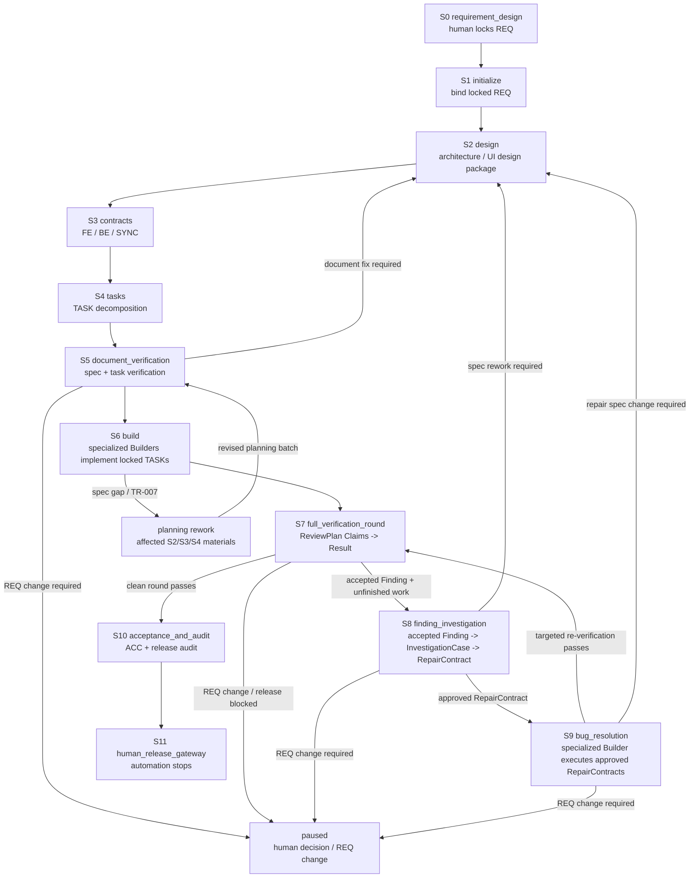

# Agent Protocol — Main Spine

> Authoritative Main Spine. The Main-session Driver (Layer 1) reads the
> current stage's section here at entry, handoff and context recovery. Each
> stage has a stable anchor
> (`#s0` through `#s11`) so `AGENTS.md` and Harness `next` output can link to
> it. Runtime authority for current facts lives in `.claude/loop-state.json`;
> legal transitions live in `docs/control/loop-definition.json`.

## Responsibility status and compatibility fields

Agent guidance describes one responsibility attempt with `pending`, `active`,
`blocked`, `done`, or `cancelled` ([shared status rule](../rules/state-machine.md#21-loop-responsibility-status)). New installations default to Runtime 1.3, where Agent, TASK, and S7 ReviewAssignment work-state fields use those values. Runtime 1.1/1.2 stays in its original format on the compatibility/read path; it is not rewritten in place. Stage cursor/gate, professional outcome, artifact status, receipt facts and host-session state remain separate. Keep exact existing command and payload values where their original schema requires them, including Builder `completion_report.status=completed`, legacy Runtime Agent `reported`, assignment `consumed`, and receipt `work_complete`; these are compatibility inputs/projections, not replacement work states. Original approval/activation event evidence remains separate, and `active` alone grants no write authority. Only the original receiver plus current validity and own checks determine whether a responsibility projects to `done`. Agents do not hand-author a generic status or edit frozen document lifecycle fields.

## How to read this file

1. A `SessionStart` or lifecycle Hook supplies the first recovery packet in
   model `additionalContext`; `systemMessage` is its user-facing notice. The
   packet contains the current Stage, single Next action, ordered read list, and stable links to this file and the Harness Manual. For an
   active responsibility, use the questionnaire's exact view and answer paths,
   required inputs, concrete missing items, and next action shown by the Hook.
2. Follow the packet's `Read in order` list: the project entry document
   (`AGENTS.md`), Runtime/Milestone, this current stage anchor, the bound REQ,
   and the one primary Skill. After compaction, do not reconstruct the stage
   from conversation memory.
3. If the packet says `blocked` or the Runtime is unclear, read
   `.claude/bin/loop-harness.md`. Follow the stage's original work path,
   including its documented planning, dispatch, review, or domain commands.
   Use the CLI for initialization/binding, reconcile after an integrity failure,
   rollback/rollover, human Gateways, and read-only diagnostics as applicable.
   Do not run `stage-answer issue` or `stage-answer consume` as normal work, and
   never use `ready` (or another CLI) to hand-push a Transition. If the Hook
   cannot show the exact current questionnaire paths, send that integration gap
   to Main/system maintenance; do not reconstruct paths from Runtime.
4. Each section has the same shape:
   - `purpose`: why this stage exists
   - `inputs`: what to read before acting
   - `inputs_from`: which upstream stages produce the inputs (explicit data-flow chain)
   - `actions`: ordered work to perform
   - `done_when`: predicates that prove the stage is complete
   - `next`: the default next stage on success
   - `failure_route`: where to go when something is wrong
   - `human_gateway`: conditions that may surface a Gateway
   - `primary_skill`: the main Methodology Skill for this stage

5. Stage advance is allowed only when every `done_when` predicate is true.
   When a predicate is false, the Hook supplies the current responsibility's
   questionnaire, exact view/answer paths, concrete missing items, and next
   action. Fill the professional answers and save that file. The original
   consumer/Writer evaluates its existing stage conditions and updates the
   graph; Hook observes that progress and triggers the existing flow. Do not
   wait for or manually invoke a transition.

> **Design-status note:** this file is the Main-Spine operating contract.
> `docs/control/loop-definition.json`, existing CLI events, and legacy stage details
> may still expose compatibility behavior. Do not infer that a target Hook path
> is fully integrated merely because it is described here. Missing questionnaire
> paths or saves are Main/system integration work; agents do not issue or consume
> packets manually to complete ordinary work.
>
> Revision boundary: Runtime revision and object versions are generated by the
> Writer/API; the Main session follows `next` and does not calculate or carry
> revision values. Any current CLI that still requires such a flag is a
> compatibility implementation gap.

## Event-driven recovery contract

Native Start gives bounded responsibility context. S5 and `s6-native-v1` retain their original Stop reception; S7/S8/S9 use the original answer consumer at natural Pre, successful Post and Stop fallback. Main carries exact original view/answer or brief references into native Agent. Start supplies bounded context without inferring a responsibility from role or actor; Stop passes actual professional artifacts to the original consumer. S7/S8/S9 PreToolUse listens for ready original answers, with successful PostToolUse and Stop/SubagentStop fallback; other native ordinary tools/messages retain their original non-reception contract. No tool activation is added. Engineering owners remain original responsibility labels; actual Claude actor IDs are separate observed facts, including after resume. New read-only responsibility needs no execution/bootstrap/session; registered frozen sources retain their exact recovery. Claude Code owns execution, wait and resume.

The shared per-tool/teammate recovery entries below apply only to Main's original domain work or frozen compatibility responsibilities. They are not native Worker execution prerequisites.
The lifecycle is one continuous journey for one bound REQ. Hook events are
re-entry points into that journey:

| Event | Controller responsibility | Agent responsibility |
|:---|:---|:---|
| `SessionStart` | Read the current graph and original persisted responsibility; emit guidance, ordered read list and current questionnaire paths | Read in the listed order; use the shown view/answer paths, gaps, and next action |
| `SessionStart` native context | Inject a bounded `additionalContext` with current responsibility and a complete answer path; retain full guidance in `systemMessage` | Use it as the immediate re-entry cue; do not read Runtime to guess the questionnaire path |
| `PreCompact` | Perform existing diagnostic maintenance silently; no professional reception, stage control cycle or new Milestone | Keep professional work in its original authoring/receipt path; `SessionStart` recovers current responsibility from persisted facts |
| `SubagentStart` | Observe actual native start and give short engineering context; do not guess or activate responsibility | Follow exact task references and actual inputs; original explicit approval stays required |
| `PostToolUse` `SendMessage` | Capture messages required by the original assignment contract and update its checkpoint | Send a generic PLAN_REPORT only when the frozen role contract requires it (for example, legacy s6-v1.2 Builders); ordinary S5/S7/S8 domain-questionnaire work does not need one, and S9 PlanReport is its original domain answer that projects the existing checkpoint |
| `PostToolUse` questionnaire save | Main domain work and frozen compatibility keep original consumers; successful S7/S8/S9 native saves provide natural-event fallback | S7/S8/S9 saves the ready original answer and continues authorized work; PreToolUse listens, with successful PostToolUse and Stop/SubagentStop fallback. S5/S6 keep their original save/Stop contract |
| `PostToolUseFailure` | Record the platform-native failure as audit evidence; never pretend the event can undo the tool action | Treat it as an evidence signal; continue through the existing S7/S8 failure contract |
| `ConfigChange` | Record source/file facts for governance-asset changes as audit evidence; no policy_settings interception is claimed | Reconcile policy/runtime after a governance asset changes; do not infer that audit means approval |
| `SubagentStop` | Match exact engineering reference, call the original consumer and report real acceptance/gaps; ambiguous references go to Main | Return actual professional artifacts or honest blocker; Main owns integration and later closure |
| `TeammateIdle` | Native Worker: quiet; frozen teammate retains original responsibility recovery | Follow the native task; no framework wake-up or next-item claim |
| `Stop` | Before the Main session exits, preflight review assignments: exit 2 only for undispatched responsibility or unconsumed Results; active background Workers are not blockers, and a blocked stop must not first run a Controller cycle that may write Runtime | Follow the single next action from stderr: dispatch responsibility or continue its original result-consumer path; end the turn only when no work remains to close |
| `PreToolUse` `Task|Agent` | Observe the current Assignment/queue and show the next dispatch or responsibility step; it does not deny a tool by identity or scope | Follow the original dispatch and queue; do not claim a responsibility that has not been assigned |
| `PreToolUse` graph guidance | Show the current questionnaire's exact view/answer paths, concrete missing work, and next action; observe graph progression without product-tool authorization | Complete the listed professional work and save the answer; do not infer tool permission from the Hook |

Every responsibility progress cue must include the actual full view and answer
paths, concrete missing items, and the next action (or named waiting owner). If
the paths or gaps cannot be resolved, Main/system maintenance owns that
integration issue; the Agent must not inspect Runtime or protocol files to guess.

A Hook is a natural-event graph listener and flow trigger. Saving a questionnaire
hands the professional answer to the original consumer/Writer, which validates
the existing schema and stage-specific conditions and updates authoritative
facts. The existing Controller/Transition Engine may then apply an allowed
graph transition through compare-and-swap. The Milestone remains a projection,
not a second state machine. `PreToolUse` does not deny product tools or evaluate
identity, tool permissions, or operation scope.

On the normal path, the Agent fills and saves the current questionnaire. The
original domain consumer/gate decides whether the answer satisfies its existing
professional and stage conditions; Hook reports remaining work or graph
progress. A `not_ready` result is guidance, not a product-tool denial. Existing
human approval and domain gates remain in their original workflows, without a
PreToolUse identity, permission, path, or scope interception. Use stage CLIs for
their existing planning, dispatch, verification, or recovery work, but not to
issue/consume the questionnaire or manually advance a stage.

There is no separate PostCompact event in the shipped Hook registration.
Professional facts are persisted by their original consumers, independently of
compaction. `PreCompact` stays silent; the next `SessionStart` reads those facts
and current exact questionnaire paths. Milestone is a summary that may lag,
not a promise that the old prompt was saved or will be replayed verbatim.
Unreceived private drafts remain unreceived; do not recreate accepted answers
or manually write checkpoints to recover context.

Ordinary S2/S3/S4 packet reads show the current original responsibility and
reuse the observed snapshot; they do not re-run the full quality cycle or
receive a private answer. Actual saves and original followups retain their
professional/source checks. Hook calls share an internal work deadline inside
the existing process timeout; authors do not supply budget fields or wait for
another tool just to obtain authority. Event routing, immutable-source reads
and packet indexes may be reused internally; the original Writer still checks
current responsibility and sources. An internal timeout is not a professional
content verdict and requests no new answer fields, repeated save, report,
evidence deletion or artifact-ID change. The original receiver owns bounded
staging/pending recovery. A missing response does not prove no commit; preserve
the original delivery and accepted receipts. Source/environment gaps stay with
their named owner; only concrete professional omissions require author repair.
Normal reception supplies the original receipt and applicable next responsibility
in the same handoff; cache maintenance and metrics never require an Agent action.

## Stage list

| ID | Stage | Primary skill | Anchor |
|:---|:---|:---|:---|
| S0 | requirement_design | `requirement-funnel` | `#s0` |
| S1 | initialize | `loop-orchestration` | `#s1` |
| S2 | design | `specification-planning` | `#s2` |
| S3 | contracts | `specification-planning` | `#s3` |
| S4 | tasks | `specification-planning` | `#s4` |
| S5 | document_verification | `document-verification` | `#s5` |
| S6 | build | (TASK plus selected Best Practices) | `#s6` |
| S7 | full_verification_round | `loop-orchestration` (DV/QA/E2E Skills are per-Assignment) | `#s7` |
| S8 | finding_investigation | `bug-resolution` + `plan_checkpoint` | `#s8` |
| S9 | bug_resolution | `bug-resolution` | `#s9` |
| S10 | acceptance_and_audit | `acceptance-and-handoff` | `#s10` |
| S11 | human_release_gateway | `acceptance-and-handoff` | `#s11` |

## Stage Flow

The Main Spine is a one-way delivery trunk with explicit correction loops.
S6 and S9 both use specialized Builder capability (`frontend-builder`,
`backend-builder`, or `test-builder`), but they are different stages with
different inputs: S6 builds locked TASKs; S9 executes approved RepairContracts.



## Non-negotiable invariants

These hold across every stage:

1. Chat is not a baseline; decisions land in versioned documents.
2. Engineering Loop binding is independent of Claude `/loop`. Binding requires
   one human-locked REQ; `/loop` only delivers the Wake-up Prompt.
3. UI-impacting work requires module-organized prototypes (HTML + `stories.md`
   + `flows.md` under `docs/design/prototypes/<module>/`) before S3 contract
   lock (see S2). The current implementation IS the baseline; no separate
   capture is required.
4. Every delegated responsibility has one unique Assignment. S6 Builders keep their original professional plan; ordinary S5/S7/S8 reviewers and Investigators use their exact domain questionnaire without a duplicate generic PLAN_REPORT. S9 Builders use the original PlanReport and RepairResult questionnaires; applicable PreToolUse observes each ready original answer, with successful PostToolUse and Stop/SubagentStop fallback through its original consumer. No duplicate generic PLAN or completion report is required. Only an explicit `plan_approval_required` assignment waits for its original approval.
5. The Main Agent does not execute delegated responsibilities itself and does not reply with "approved to start" to an ordinary plan; it intervenes only for plan drift, blocking, permission changes, or Result consumption. Platform session state must not be faked by labeling Runtime `active`.
6. Accepted Findings enter S8 investigation before S9 repair. The
   authoritative handoff is `accepted original answers and Findings → InvestigationCase →
   approved RepairContract`; a canonical BUG is only a post-approval
   compatibility projection and never a prerequisite for investigation.
   Targeted re-verification never produces a clean round; only a same-round
   complete applicable Delivery + QA + E2E review does.
7. On the normal path, the Agent fills and saves the current questionnaire;
   the original consumer/Writer evaluates its domain conditions and updates the
   graph. Hook observes and communicates progress and may trigger the existing
   transition path. The Agent never edits `.claude/loop-state.json` or manually
   invokes transition CLI for ordinary stage advancement.
8. Squash merge, publication, deployment, and formal release always require
   human approval.

---

## S0 — requirement_design {#s0}

- **purpose**: produce one human-locked REQ baseline.
- **inputs**: user intent, project facts (`docs/project-map.md`), applicable rules, Project Design Foundation (`docs/design/DESIGN.md` when the product has user-visible UI).
- **inputs_from**: [] (human input + existing project baselines; this is the entry stage)
- **actions**:
  1. determine UI impact (`none` / `changed` / `unknown`) from the expected outcome **before** drafting §A. If the outcome may change user-visible UI, first record `design investment` (`local / core / extended / N/A`) in `project-map.md` §3 with basis (reuse, handoff, Surface count, shared component/token, risk) per `docs/rules/design-foundation.md` §4 — investment (`local/core/extended`) and F2 path (`thin/full`) are orthogonal. `local` → §C records `Foundation reference: local`, `Surface: local`, `Design posture: local` and writes only a module-local `derivation/REQ-{id}.md` (`Foundation: local`), no published Foundation required. `core`/`extended` with `DESIGN.md` `missing`/`draft`/`in-review`/`provisional`/`superseded`/stale/uncovered surface or missing §0 Next-agent card → finish F0–F6 via `skills/design-foundation` (thin path = one merged confirmation, full path = 2–3 worlds differing in ≥3 of six dimensions + three confirmations) and obtain human publish confirmation before writing §A–§C or locking a `changed` REQ. Only `published` with dates recorded is a covering lock; `draft`/`in-review`/`provisional`/`superseded` must not be treated as one. `published` and covering → record versioned refs only (`DESIGN.md@version`, `SUR-*@version`). S0 records references only; it does not copy Kernel or Grammar. Runtime does not yet hard-block a missing Foundation.
  2. distill the user's expected outcome into §A — an agent-filtered restatement (ambiguous colloquial wording removed, implicit premises made explicit), check genuine ambiguity with the human; reuse already explicit decisions rather than asking mechanically again. The REQ carries the clarified consensus; original material may remain a cited source.
  3. funnel through §A (why) → §B (direction & constraints) → §C (what), as a reasoning method, not mandatory repeated approval. Each necessary hand-up presents a recommendation, reasons and genuine alternative costs. A small set of decision points is an organization suggestion; do not manufacture alternatives for an already chosen direction or hide independent value questions to meet a quota.
  4. record unknowns, dependencies, and out-of-scope items (§D)
  5. obtain human lock and a lock record (date, identity, version)
- **done_when**:
  - REQ file exists at `docs/requirements/REQ-<id>.md` with `status: locked`
  - lock record is present
- **next**: S1
- **failure_route**: stay in S0 until locked; if locked but flawed, human amendment only.
- **human_gateway**: any REQ change after lock requires `req_amendment`.
- **primary_skill**: requirement-funnel (the human supplies real intent and explicitly locks it; Main owns the professional reasoning without mechanical per-layer confirmation)

## S1 — initialize {#s1}

- **purpose**: bind the actual locked, committed REQ and chosen Git targets through original TR001.
- **inputs**: actual REQ lock/startup decision, committed REQ object, development branch and release target. System supplies known facts and the exact current `requirement-binding.md` path.
- **actions**:
  1. Fill the original four questions: selected REQ, actual authorization record, development branch, release target. Reuse an explicit combined lock/start instruction; lock alone leaves startup authorization unanswered. Name is a record, not identity authentication or a tool-permission confirmation.
  2. Preserve the real selected Git targets and committed REQ association. Report a missing commit or target precisely; do not guess, automatically commit, push or release for binding.
  3. Save the current application normally. The listener calls the original TR001/Writer, records the original binding receipt and prepares the S2 responsibility at completion. No hand-written metadata, command or second confirmation is required; `req bind` remains compatibility/recovery.
- **done_when**: the original transaction has bound the actual REQ/targets and returned the S2 responsibility. Writer owns revision, archive and receipt facts; authors do not prove their hashes.
- **next**: S2 directly at successful binding, without waiting for a later Pre.
- **failure_route**: blank undecided choices wait with concrete missing items; real current responsibility/concurrent conflicts retain their original boundary.
- **human_gateway**: actual explicit startup decision, never automatic approval. No extra confirmation if already given.
- **primary_skill**: `loop-orchestration`

Initial SessionStart, real responsibility start and REQ-lock/unbind/rollover completion prepare the current application once. Ordinary Pre/Stop only read. A consumed old application does not bind again after return to inactive: system locates the current path using the existing archive boundary, without a new attempt field or author metadata. The original Runtime/receipt and Writer pending recovery remain internal.

### Actual tool receipts and reuse observation

Profile-backed invocations retain the runner's actual command, result and log location. The original Worker Writer/CAS records them on the current Execution; Main records them in its original integration checkpoint. These are tool facts and do not approve professional answers or complete a responsibility. Authoring a receipt, resealing changed bytes, or finding a file cannot create trusted provenance.

Use the exact `observation_commands["check-reuse"]` adapter for a read-only shadow decision. `action=run` requires the original execution. Main required checks, independent responsibilities, fresh checks and new distinguishing hypotheses always run. Unknown isolation permissions and incomplete input/environment closure cannot enable reuse. Explicit relocation preserves original bytes and checkout facts; it does not authorize reuse across checkouts.

New Worker observations retain the actual original isolation probe, runner and command context, seccomp/argv policy, kernel/identity and original responsibility. The first closed static syntax is limited to `true`, `false`, `test -f <relative file>` and `test -s <relative file>` within the tested tree. Arbitrary shell and external programs remain outside this closed subset. Shadow uses the same disposable-copy algorithm as the real runner; it still executes every required check.

New original Worker profiles may explicitly select `reuse_mode: enabled` for this closed static subset. Default profiles remain shadow. The actual original profile and mode determine applicability; a shadow receipt cannot be upgraded. Exact reuse returns the original accepted reference without publishing another PASS. Main required integration, independent responsibilities and S9/fresh checks always run.

Use the exact `check-running` observation adapter for bounded run diagnostics. A competing identical request returns its existing run reference; the original integration lock and Writer still govern execution and reception. Run diagnostics cannot prove liveness, PASS or completion. Process-owned lock recovery preserves unfinished records as interrupted and rechecks current original authority before proceeding.

## S2 — design {#s2}

- **purpose**: produce architecture decisions and the applicable module current truth: the seven-file behavior core plus the actual applicable UI assets when UI impact is `changed`, or a seven-file service behavior package when UI impact is `none` but an AC targets an FR or service behavior truth changes. The service package preserves CASE IDs and does not contain UI assets.
- **inputs**: locked REQ, existing architecture, existing module packages (if any), applicable design rules (`docs/rules/scenario-model.md`, `docs/rules/design-foundation.md`), Project Design Foundation (`docs/design/DESIGN.md` section 0 first, then `design-language.md` and the current surface row as needed) when UI impact is `changed`.
- **inputs_from**: [S0 (locked REQ), S1 (Runtime Bookmark + baseline generation 1)]
- **actions**:
  1. draft or update `docs/architecture/ARCHITECTURE-<id>.md` (system track)
  2. route by UI impact and AC targets. If UI impact = `changed`, read the **cold-start handoff packet only** — `docs/design/DESIGN.md` §0 Next-agent card + current `SUR-*` diff (or `Foundation: local` packet when investment tier is `local`) — budgeted together ≤120 lines / ≤12 KB; open `design-language.md` only if the card cannot answer Must not. Do not treat a construction hex or library Primary as the brand; after F6 only `semantic_token_only` values via `tokens.css` are legal. Write `docs/design/derivation/REQ-{id}.md` from `docs/design/derivation/DERIVATION-template.md` as a **referenced-ID consumption list** (active `LAW/ANTI/INV` by ID → opening `GR-*`, `Must not` by source ID, `Bindings` by `ROLE/PATTERN`/component, `Proof` by `PROOF-*` with resolvable path) before expanding the module package; `local` uses `Foundation: local` and stays module-local. If any required ID, version (`DESIGN.md@version`, `SUR-*@version`), or Proof path cannot be resolved, stop at semantic fix — do not invent a skin. Then run the dual-track convergence per `skills: specification-planning` — user track first lands `stories.md`; convergence-1 fills the hand-written `cross-matrix.json` carrier (fact×FR×story cells: covering branch or no-branch reason) and produces `scenario-model.json` + `fixture-contract.json`; convergence-2 lands `flows.md`, page HTML, and `index.html`. One macro composition and one stress state must exist before the remaining pages. The current implementation IS the baseline; no separate capture is required. Derivation Note is a semantic duty, not a PTR-PLAN-01 predicate. Foundation does not replace the architecture track. Still do not add aesthetics predicates to `done_when`. If UI impact = `none`, skip Foundation/Derivation and UI assets (HTML, `index.html`, PATH, browser specs). When any AC targets an FR, still maintain the module's seven-file service behavior package: the five sources `scenario-model.json`, `fixture-contract.json`, `cross-matrix.json`, `stories.md`, `flows.md`, plus generated `cases.json` and `scenario-coverage.json`; model the API caller/worker as the story role, use F-NNN without PATH, and set each service branch `browser_required:false`. Also refresh this package when existing service behavior truth changes; if no bound FR sources that change, resolve it through REQ amendment before locking. Do not create per-REQ copies. `ui_impact=none` or `browser_required:false` is not N/A.
  3. at close, when a behavior package exists, run `.claude/bin/loop-harness scenario bridge --root .`, then `scenario generate --module <module> --root .` and `scenario validate --module <module> --root .`. `scenario bridge` checks AC→FR source reachability; module `scenario validate` checks the package and generated outputs. The PTR-PLAN-02 guard still checks the full FR→branch/CASE chain. When all ACs have endorsed NFR/§A4 targets and no behavior package is needed, run the bridge and omit only generate/validate.
  4. Record the decisions contracts will need (state, data, integration, migration), complete applicable architecture/UI/service/ADR work, and lock the real `ARCHITECTURE-*.md`. S3 reads the fileview selected by the original binding and configuration, including applicable accepted ADRs and module sources. Repair concrete missing or unreadable selected-source materials reported by the original preparation. Checkout agreement and an extra commit action are not reception requirements. Preserve unrelated changes.
  5. At S2 responsibility start, the system supplies full duties, conditional pointers, exact view/answer paths, the architecture registration batch with its unlocked items, and the project-wide module source paths S3 will consume. `architecture_path` identifies this report's architecture; it does not restrict registration to one file. The batch may include legacy architecture documents without explicit REQ ownership. Resolve the named document gaps. Preserve an unused alternative as an explicitly unadopted discussion in the actual architecture or ADR rather than a separate active architecture awaiting registration; do not falsely lock it or invent a different REQ owner to pass the outlet. Fill the existing `architecture_path` and `conclusion`, then save normally; do not copy the system's batch inventory into new author fields. The original Writer receives the professional report; the design gate controls PTR-PLAN-01; its successful outlet prepares S3. Empty conclusion is a draft. A received report may still await a locked architecture or resolved UI impact, and a committed transition may still await S3 sources. Follow the concrete remaining step. Normal work needs no metadata copying, hand-created envelope, issue/consume or recovery command; a concrete technical failure may use its named original diagnostic/recovery. Ordinary Pre/Stop read only and do not prepare or re-prove sources. Main/Architect labels, full packet equality and development-source hashes are not S2 reception qualifications.
- **done_when**:
  - architecture document covers every decision the contract stage needs
  - if UI impact = `changed`: the UI package exists at `docs/design/prototypes/<module>/`, including `index.html`/pages, stories, flows/PATHs, scenario model, cross-matrix, fixture contract, and generated cases/coverage
  - if UI impact = `none` and any AC targets an FR or service behavior truth changes: the **seven-file service behavior package** exists in the same module directory — `scenario-model.json`, `fixture-contract.json`, `cross-matrix.json`, `stories.md`, `flows.md`, generated `cases.json`, and generated `scenario-coverage.json`; it has no HTML, PATH, or browser spec, and each service branch uses `browser_required:false`
  - the AC↔CASE bridge reports every acceptance criterion of the bound REQ reached or carrying an endorsed N/A (a declared NFR id or §A4 negative-space pointer; free text and `ui_impact=none` are rejected as N/A)
  - the actual architecture and other active architectures in the system-supplied registration batch are locked, and the current professional design report records pass; real applicable design materials remain required work, not a producer-label qualification
- **next**: S3 through the original successful save outlet. If the report is recorded but the outlet is unfinished, repair the named material gap and follow its original continuation. An explicitly requested same-answer save resumes that outlet without duplicate registration; it is not a routine trigger to repeat unchanged work. Completed old-stage replay is read only. Missing actual materials are reported by exact path, not whole-history proof.
- **failure_route**: if a design decision changes REQ semantics, surface `req_amendment`; otherwise iterate the design document. Missing AC-to-CASE coverage, contract-to-REQ traceability and story/architecture conflicts are professional repair work when they can be resolved within the authorized requirement; an ADR update alone does not require human approval. Bridge failures are S2 gaps even when they surface at S3's gate — return through the original specification rework route without silently modifying frozen inputs.
- **human_gateway**: `req_amendment`, `unrecoverable_business_decision`, or an actually unresolved direction requiring human choice. Use an applicable existing decision without another sign-off. When a decision is needed, present the relevant `docs/design/decisions/ADR-<id>.md` with its `## Depth Self-Review` and `## Endorsed N/A` basis (see `docs/design/decisions/ADR-template.md`). Ordinary reversible engineering choices within the authorized direction continue autonomously.
- **primary_skill**: `specification-planning`

## S3 — contracts {#s3}

- **purpose**: define one current-REQ index and its complete applicable FE / BE / SYNC contract set, establishing shared operations and each actual participant’s responsibilities before task decomposition.
- **inputs**: locked REQ, architecture, the applicable module UI or service behavior truth (if any), naming and API rules.
- **inputs_from**: [S0 (locked REQ), S2 (architecture + applicable module UI or service behavior truth)]
- **actions**:
  1. draft `docs/dev/contracts/CONTRACTS-<id>.md` (index)
  2. decide FE, BE and SYNC applicability independently from real consumer/provider responsibilities. Only for an actual shared operation, converge its applicable shared model and `SYNC-<id>.md`, then finalize the participating `FE-<id>.md` / `BE-<id>.md`. FE-only local behavior or BE-only internal work may need no SYNC; a real SYNC boundary may need no separate FE/BE contracts. No shared data uses `Shared model policy: none` with a concrete reason, without inventing Schema/examples. Mark inapplicable template references with sourced N/A, retaining every applicable CASE and clause, without creating Builder agents or inventing a front end; follow [shared-model contracts](../rules/shared-model-contracts.md)
  3. ensure the complete contract set covers the bound REQ's acceptance criteria; historical or other REQ contract sets do not satisfy this batch
  4. add bottom-up references and a coverage matrix
  5. At `planning.contracts`, the Hook prepares the current questionnaire and supplies its exact view/answer paths, known or candidate output paths and templates, concrete missing items, and next action. The S3 answer covers one bound REQ index and its complete contract set. Issuance freezes the locked REQ, registered S2 architectures, the complete file sets of all non-template modules under `docs/design/prototypes/`, accepted ADRs associated with the bound REQ, and dependencies reached through actual supported source references. The project-wide module scope matches the original bridge and includes modules not referenced by this REQ or architecture; it does not expand the current requirement's design changes or require redesigning unrelated modules. The source inventory supports traceability, not recursive full reading: read the slices relevant to the current operations and investigate additional sources when actual dependencies require them. Do not delete historical materials or split the REQ to reduce this source set. Issuance does not depend on S3's not-yet-authored CONTRACTS index. S3-created shared models/examples are outputs. When Main saves the existing professional answer once, the original shared-model checker discovers their complete dependencies and records them in the existing evidence subjects. S3 may create or refine new models within established S2 meaning. Changing frozen S2 content or its source membership requires formal design rework; a change to REQ semantics requires requirement amendment. Set finalized contracts to `locked`; the original consumer validates the answer, the gate checks the full current batch, and PTR-PLAN-02 performs the original registration. Do not hand-create an envelope or copy machine metadata. Use `contracts check` or `scenario bridge` for autonomous professional self-review and diagnosis when useful; they are not mandatory duplicate submission procedures and do not replace the original consumer checks. If the Hook omits the promised paths or missing-item guidance, route that integration gap to Main/system maintenance. The gate still requires `evidence:planning_contract_record`; the consumer supplies it.
  6. Declare each contract's numbered obligations in its existing `本合同条款` table column, using a normal Markdown header and separator. An index citation must match that target's own `§n` or qualified ID. Prose, examples and references to another contract cannot supply a declaration. If reported missing, Main fixes the original contract/index and saves the same unreceived responsibility; no extra registry, fingerprint or proof. This structural check does not judge promise semantics or coverage; those remain S3/S5 work.
- **done_when**:
  - the current bound REQ's complete contract set covers its criteria and declares the applicable shared-model policy; consumers reference the same native definitions
  - every contract has stability metadata (status, version, owner)
  - contracts reference actual applicable module packages and validation sources; the system maintains the original source paths and responsibility associations, without author copying. Service behavior maps applicable FR clauses to CASE IDs and service checks without inventing HTML, PATH or browser specs
- **next**: distinguish professional completion, report reception, PTR-PLAN-02 registration/transition and S4 preparation. After successful reception, preserve the accepted answer; repair concrete gaps while the gate remains pending and execute the complete original `runtime stage-answer recover` command supplied by feedback. If the transition has committed but S4 preparation failed, repair its named source gap and execute the supplied original `runtime stage-answer issue` command for current-stage preparation. Do not refill or resave accepted judgments. Ordinary reads and arbitrary material saves do not promise automatic recovery. Before reception, finish required Git delivery and save the original answer at its supplied path. A completed transition with failed S4 preparation is reported separately, with its concrete recovery.

For S3 outputs declared `git_tree`, the Hook names the bound development branch
and output paths. Commit the completed contracts and their Git-sourced
model/example dependencies to that branch before saving the current answer.
These are editable S3 deliverables; the frozen upstream inputs are REQ/S2.
If the current answer is rejected because an output differs from that committed
view, commit the intended professional change and save the same answer path.
An unreceived answer needs no named revision; retain required professional fixes.
After reception, registration retains the complete accepted source closure,
including shared models and examples. If registration reports an accepted source
changed, Main restores the original bytes for the existing followup or uses
controlled planning rework for an intended professional change. Do not rewrite
the accepted envelope, re-register newer bytes, or refill the accepted answer.
- **failure_route**: refine missing contract/model detail within established S2 meaning in S3. If frozen design, scenario truth or source membership must change, return through formal design rework; use `req_amendment` for changed requirement semantics. Missing applicable UI/service design inputs are a concrete upstream design gap, not permission to invent a front end or silently modify frozen inputs. Quality readiness does not control ordinary tool permission.
- **human_gateway**: only `req_amendment`.
- **primary_skill**: `specification-planning`

The existing S3 questionnaire asks for `applicability` with exactly FE, BE and
SYNC keys. Each value is an object with `disposition` (`required` or
`not_applicable`) and an author-written `rationale` grounded in the actual
scope; applicability remains a Main professional decision, not an automatic
machine judgment. The Hook supplies the current form, exact answer path and
known or candidate output paths/templates; the original consumer validates
the existing shape. When all three areas are genuinely `not_applicable`, the
current receiver does not support an empty contract delivery. Report that stage
adaptation gap to Main/system maintenance, retaining the actual applicability;
do not fabricate a BE contract or mark a false `required` to advance.

For S3/S4, tool access uses the exact supplied absolute filesystem paths;
answer fields `index_path`, `contract_paths` and `task_paths` contain
repository-relative values. For example, read/write the same contracts file
under its supplied absolute path with a tool, but put its repository-relative
path (`docs/dev/contracts/CONTRACTS-{id}.md`) in `index_path`. Save the
questionnaire at its exact supplied absolute answer path. Markdown links remain
relative to the containing document; do not convert them to answer-field
root-relative paths.

Professional S3/S4 rework is separate from technical continuation. Within the
same bound REQ, use
`.claude/bin/loop-harness runtime stage-answer rework --target design --reason "<concrete design correction>" --root . --agent Main`
when frozen S2 inputs must change. Use
`.claude/bin/loop-harness runtime stage-answer rework --target contracts --reason "<concrete contract correction>" --root . --agent Main`
when accepted contracts must change while S2 stays valid. While S4 is still current, use
`.claude/bin/loop-harness runtime stage-answer rework --target tasks --reason "<concrete TASK/index correction>" --root . --agent Main`
when accepted TASKs or the dispatch plan need professional correction and the
frozen REQ/S2/S3 inputs remain valid. Keep correct upstream work; a tasks return
does not refresh drifted upstream sources. After entry into S5, follow the
independent review and original document-rework route. These explicit routes
preserve the accepted history, invalidate affected downstream planning, and
supply the new current view/answer paths. If preparation fails after the
return is recorded, follow the supplied `runtime stage-answer issue` command.
No packet/entry ID or authored evidence envelope is required. Current
unreceived outputs are ordinary professional corrections, followed by required
Git delivery and saving the original answer, even if marked `locked`.
`issue` repairs missing issuance/preparation; `recover` resumes an accepted
pending outlet. Neither changes an accepted professional judgment or authorizes
editing frozen sources. `revise` is not an S3/S4 professional rework route.
REQ semantic changes retain the actual human amendment boundary; ordinary
contract gaps and compatibility choices within authorization remain professional work.
Any questionnaire reminder about human decisions means an actual unresolved
REQ amendment or decision outside existing authorization. It does not require
a fresh approval for every ADR, compatibility choice, N/A rationale or S3/S4 run;
reuse applicable existing decisions.

S3/S4 Main Stop may issue one continuation reminder for the current unblocked
planning responsibility when no delegated agent is active. `stop_hook_active`
permits the next Stop. This bounded reminder is separate from ordinary tool
permissions and is not a scheduler or a completion claim. Honor explicit user
stop requests and real permission/external waits; stage changes and substantial
drafting alone do not require another approval.

## S4 — tasks {#s4}

- **purpose**: split the contract set into single-responsibility TASKs with bidirectional links.
- **inputs**: contracts, REQ, applicable rules.
- **inputs_from**: [S3 (FE/BE/SYNC contracts), S0 (REQ acceptance criteria)]
- **actions**:
  1. derive one TASK per single-responsibility work package
  2. give each TASK: read order, prospective product/test/evidence paths, applicable checks/operations, closing contract and dependencies. Operations describe necessary work, not tool permissions. Plan/Result paths and schemas are supplied by the later actual responsibility; S4 defines their handoff meaning without inventing runtime entries. Legacy REV/QA/E2E paths apply only to original responsibilities that actually use them, without a new separate report obligation
  3. verify the dependency DAG is acyclic and that every contract clause traces to at least one TASK
- **done_when**:
  - every contract clause has TASK coverage
  - every TASK has a verifiable Closing Contract
  - write-path overlaps have explicit sequential ownership
- **next**: S5. Main performs the real TASK/index planning and required ordinary Git work using the exact current questionnaire paths and actual missing items. Preserve real contract coverage, Closing Contracts, dependency DAG and sequential ownership. Fill only the three existing fields (`conclusion`, `index_path`, `task_paths`) and save once. The system runs the actual TASK batch check once, carries the actual batch including cancelled TASKs, and records it through the original Writer and TR-002 into independent S5. Main does not assemble a full directory inventory, source fingerprints, envelopes or machine-recognizable checker commands as reception prerequisites. Check output diagnoses concrete professional gaps; it is not an extra manual normal step. If the answer was accepted but TR-002 remains pending, preserve it, repair the concrete gate/source/technical gap and execute the complete original `runtime stage-answer recover --root . --agent Main` command supplied by feedback. If TR-002 already committed and S5 preparation failed, preserve the transition and any issued reviews, repair the named preparation gap and execute the complete original `runtime stage-answer issue --root . --agent Main` command supplied by feedback. Successful normal save and explicit recovery supply the same two exact S5 view/answer/source-root sets for actual independent dispatch. Ordinary reads and arbitrary material saves do not promise recovery. Cancelled TASKs exit active dispatch and clause coverage but remain in the complete delivery batch and `task_paths`; resolve any resulting coverage gap. Every TASK, including support/cancelled tasks, declares the current Source REQ refs. TASK complete/cancelled remains document status, separate from work states. Missing questionnaire paths or system continuation belong to Main/system maintenance; real professional missing work remains explicit.
- **failure_route**: correct unreceived TASK/index work in place. For accepted planning while S4 is current, use `runtime stage-answer rework --target tasks --reason "<concrete TASK/index correction>" --root . --agent Main` when REQ/S2/S3 remain valid. Return to S3 for a true contract gap or S2 for a true design gap; preserve correct upstream work. Once in S5 use its independent review and document-rework route. Technical `issue`/`recover` continues original system work and does not reopen accepted professional judgments.
- **human_gateway**: none for ordinary work; only actual REQ amendment or a decision outside existing authorization requires human judgment.
- **primary_skill**: `specification-planning`

## S5 — document_verification {#s5}

The original S5 entry prepares the two mandatory independent responsibilities and their exact views/answers from accepted S4 sources. Runtime/REQ/generation, actual document paths and versions, TASK identity, default Skills, engineering labels, counts and validation time are system-owned. Main receives the real dispatch references; do not assemble a registration DTO, copy Runtime fields, compute SHA, run a metadata-generation script or save an unchanged confirmation. Any actual professional division change follows its existing responsibility route. Preparation/registration does not start a native Agent or sign a review verdict.

Current native dispatch: Main carries the original exact view/answer into native Agent. Read-only subjects and private answers may stay in Main; no workspace prepare, Team, opaque ID lookup or generic activation is required. Worker saves its actual professional answer and returns the reference; SubagentStop invokes the original consumer. Ordinary Worker tools are quiet. Existing independent sources, real independence, explicit approval and domain gates remain. Per-save/identity wording in older compatibility details below is not the new native procedure.

- **purpose**: independent Document Verifier pass over the entire spec chain before Builder implementation.
- **inputs**: locked REQ, architecture, contracts, candidate TASK batch, and the original accepted S3/S4 frozen source closure with its document refs for the applicable S2 module current-truth package.
- **inputs_from**: [S2 (architecture + applicable module package), S3 (FE/BE/SYNC contracts and accepted source refs), S4 (candidate TASK batch + DAG + original frozen source closure), S0 (locked REQ baseline)]
- **module package rule**: if UI impact is `none` but any AC targets an FR or service behavior truth changes, both reviewers still inspect the seven-file service behavior package through the refs in the original accepted S3/S4 frozen closure: `scenario-model.json`, `fixture-contract.json`, `cross-matrix.json`, `stories.md`, `flows.md`, generated `cases.json`, and generated `scenario-coverage.json`. Preserve the existing FR denominator and AC→CASE bridge. Service branches use `browser_required:false`, which exempts only HTML, PATH, and browser specs. Read the frozen versions identified by those refs. If an unavailable or drifted bound source prevents judgment, return the exact source blocker to Main; do not replace it with a live workspace Glob result. Missing content within accurately readable specifications remains a review finding. Do not create a parallel registry or adapter.
- **actions** — S5 has three moves (dispatch → review → three-way closeout):

  **Questionnaire path:** preserve the original independent assignments and frozen input views. When an S5 responsibility is current, the Hook supplies its exact view and answer paths. The current native packet names its reading list in `draft.read`, its private answer in `answer_path`, and its separate analysis artifact in `task_analysis.path`; read these actual objects rather than old execution-view fields. The Reviewer performs the independent professional review, saves the original answer and returns its exact path; SubagentStop invokes the original consumer to validate and record it. Ordinary saves do not receive native review results. An ordinary `plan_checkpoint` review has no separate generic PLAN_REPORT/activation step. An explicit `plan_approval_required` assignment waits for its original approval before review; the questionnaire does not grant approval. Do not make a second envelope or manually issue/consume a packet. The existing responsibility receipt and `work_complete` projection remain machine-owned; peer delivery, system followup, and human decisions stay with their original owners. An accepted judgment is immutable. A changed judgment uses Main's exceptional named-revision recovery; changed inputs or stages use the original rework route. Already registered independent S5 executions use their supplied execution view and frozen inputs; see [workspace integration](../workspace-integration.md). If the Hook does not provide the exact paths, Main/system maintenance resolves that preparation gap; do not guess or fall back to manual issue/consume. The legacy envelope workflow applies only to an explicitly unpacketized Runtime.

  1. **dispatch**: the original S5 entry prepares and registers `DV-SPEC-CONSISTENCY` and `DV-TASK-EXECUTABILITY`, then issues their exact views/answers. Main follows `team-planning` to carry those references into two actual independent native document-verifier contexts; it does not recreate the prepared assignments or save a confirmation. The original manifest declares independence, and registration rejects a shared engineering owner. The system derives its TASK anchor from the accepted S4 dispatch plan; the anchor does not narrow either reviewer's whole-batch responsibility. Ordinary `plan_checkpoint` reviews use the domain questionnaire directly; an explicit `plan_approval_required` responsibility retains its actual original approval.
  2. **review** (the two responsibilities run in parallel; either finding may enter step 3):
     - `DV-SPEC-CONSISTENCY`: read TASK→contract→REQ→design bottom-up, checking acceptance↔clause mapping, actual cross-document references, contract-boundary consistency, and scenario mapping. When applicable, inspect the module package only through the original S3/S4 frozen refs; service CASE remains in the FR denominator without UI artifacts. Deep-dive on AC→assert sampling, NFR implementation tracking, and negative error paths (see the `document-verification` SKILL); record professional conclusions/findings in the current questionnaire.
     - `DV-TASK-EXECUTABILITY`: open the current packet's `task_analysis.path` and consume that analysis artifact's `structural_check` (coverage/DAG are machine-evaluated; do not recalculate or rerun them). For an explicitly older packet that lacks this summary, use the supplied `review_check_command` only when its original frozen inputs are available; otherwise report the missing analysis to Main/system. The command remains available for diagnosis, not as a normal review step. Then evaluate single responsibility/window, semantic coherence, self-contained anchors, forward measurability, and batch cadence. Determine applicable deep-dives from the frozen inputs using the SKILL's Triggered Deep-Dives conditions: data-model migration/debt, external dependency resilience, and critical-profile risk readiness. Do not assume the questionnaire has already classified those triggers.
     - The questionnaire explains the choices directly: `pass` means no issue in this responsibility; `fix_required` means the REQ is clear and correcting design/contracts/TASKs can satisfy it; `req_change_required` means the REQ itself needs a human clarification or change, without authorizing that change. Keep prefilled `findings: []` for pass; otherwise record only the reviewed source path, expected content and actual gap. Save that same current questionnaire once. The original consumer checks subjects, independence, machine evidence, and the professional conclusion; Main does not copy identifiers/hashes or register a parallel envelope. The professional answer is the delivery for both pass and finding outcomes; neither requires a duplicate Markdown REV report.
  3. **three-way closeout** (the original consumer and stage flow route the result; Agents do not call transition commands):
     - two `pass` answers: the original consumer validates both independent reviews and their current source set; the original gate registers the qualified evidence and TR-003 locks the batch → S6.
     - any `fix_required`: the original consumer routes TR-004 to planning; Main fixes the marked document and the affected responsibility is reviewed again. Main judges actual changes and arranges the affected independent review; a previous conclusion does not claim coverage of later changes.
     - `req_change_required` (REQ-level ambiguity prevents a consistent interpretation of the specification chain): record the professional finding in the questionnaire and request the explicit human requirement decision. The original human-boundary path owns TR-005 and amendment or abandonment.

  Two invariants apply: keep a fix at the affected TASK/contract layer unless review evidence shows an upstream design decision itself must change; S5's **baseline-generation handoff** (TR-003) is not the file `Status` field. Contract/TASK files declare `locked`/`complete` when finalized in S3/S4 (`complete` is document status, not implementation responsibility `done`; PTR-PLAN-02/TR-002 consume the on-disk declaration); TR-003 carries the actual reviewed materials and responsibility into S6 without registering a digest.

- **done_when**:
  - both mandatory responsibilities PASS
  - no open finding
  - the original consumer and Gate validate the current sources, independent responsibilities and required machine evidence; consume the supplied analysis rather than rerunning global diagnostics as a review ritual
  - execution batch is atomically locked (TR-003 committed)
- **next**: S6 when the original reception followup commits TR-003, including its atomic-lock actions. Main follows that actual receipt and the ready TASK preparation/dispatch action. An accepted answer with pending followup needs the named Main/system recovery, not another reviewer answer or an unrelated tool call to trigger the transition.
- **failure_route**: if a finding reveals a REQ-level ambiguity, surface `req_amendment`; otherwise rework S2/S3/S4 and rerun the affected responsibility (the fix loop is the `fix_required` branch in action 3).
- **human_gateway**: only `req_amendment`.
- **primary_skill**: `document-verification`

Readable, accurately sourced specification conflicts, missing content or excessive scope are review findings, not automatic stop conditions. Use `fix_required` or `req_change_required` according to the affected layer. If a Reviewer cannot form an independent conclusion because independence or accurate sources are unavailable, return the actual blocker,
unfinished work and exact original reference to Main. An unreceived answer does
not become PASS or complete the responsibility. Main follows the concrete field
or source diagnostic delivered with the original responsibility (or its exact read-only diagnostic entry) and the actual native return to restore or reassign work;
the Reviewer does not select a verdict merely to end a platform turn.

## S6 — build {#s6}

- **purpose**: implement the reviewed TASKs, self-test, deliver and integrate.
- **inputs**: the exact TR-003 batch, locked TASK/contract/design links, scope, Closing Contract and required checks.
- **inputs_from**: [S5 locked execution batch, S0 locked REQ]
- **actions**:
  1. Main selects an eligible TASK and backend-builder, frontend-builder or test-builder. Run `loop-harness s6 prepare --root <Main> --task <TASK> --role <role>`. The native delivery contract prepares the actual inputs and professional artifact paths; it does not launch a process. Carry its exact brief reference into a native Claude Code Agent call. No platform Team or preselected platform Agent ID is required.
  2. Use native worktree isolation for writing, with `worktree.baseRef: head` and Main on the committed bound development branch. The prepared brief retains its original fixed source even if Main advances before dispatch. Follow its exact source-alignment command only in an unstarted clean isolated worktree; on normal resume from the original correct source, preserve your own Plan, commits and uncommitted work and continue even when HEAD has advanced. Use its named Main recovery only when the original source cannot be confirmed or other sources are mixed in. Do not refresh the source binding or force/reset the worktree. Claude Code owns foreground/background work, messages, waiting and resume. Use the supplied native TASK entry for this responsibility.
  3. Builder reads the TASK and its actual linked specifications/products beneath its own worktree at the brief's fixed source commit. The brief supplies worktree-relative source paths; its own reference and installed method paths belong to the control root. Later Main changes do not replace the assigned source. Fill and save the supplied professional plan before implementation, then continue without begin, activation or another approval turn. `Plan.planned_paths` is this Assignment's write set: actual product or test paths the Builder intends to change, within its registered effective write scope; exclude read-only inputs and private Plan/Result files. An empty commit supplies no changed product or implementation evidence and cannot replace unfinished work. The private professional Plan and Result have no dependencies question. The original receiver carries the registered Assignment dependencies into the canonical Plan; they are displayed as read-only context, not copied by the Builder. An explicitly supplied legacy dependency set is still checked against the original registration. Execute implementation and actual TASK self-checks; Main's later rerun does not replace them.
  4. For completed work, commit the actual deliverables, save the professional Result and return its exact delivery reference. For a real blocker before or after forming a Plan, save the brief's minimal blocked Result at the same supplied Result path, preserve any existing Plan/evidence, and return the exact brief plus absolute Result reference with the unfinished work. Missing checks need no invented evidence or placeholder Plan; this handoff remains unreceived and Main owns recovery. Do not copy machine identity/hashes or call task-complete. SubagentStop checks actual artifacts and invokes the original result consumer; ordinary tool-save hooks do not activate or receive this native delivery.
  5. Main follows the native return and explicitly uses the original task-integrate flow to inspect the actual source, merge, run required Main checks and acknowledge it. Worker completion does not wait for Main integration. Preserve failed checkpoints and resume the original integration entry without repeating completed merge work; never reset unrelated work.
  6. Successful integration completion checks the entire original TR-003 batch through GATE-BUILDER-BATCH-READY. Remaining tasks/checks stay explicit. When qualified, that same outlet executes TR-006 and prepares S7, returning the exact ReviewPlan JSON and adjacent guide paths. No unrelated Read/Bash or ordinary PreToolUse is needed to trigger this continuation. If conversion or S7 preparation fails, report the specific error and named original recovery entry while preserving completed integration/transition facts; re-enter the original `runtime task-integrate` command when directed to recover unfinished integration/checks or the S6 exit, preserving checkpoint idempotence without duplicate merge or reception. If Main check failure left a preserved/blocked checkpoint, resolve the stated environment/check cause and use the original pending command with `--retry-preserved`; bare replay retains the failure. Already successful integration needing only exit continuation has no such retry prerequisite. After migration to S7, recover missing materials through the supplied original `s7 draft --root <Main> --out <original-path>` entry. Do not resubmit the Builder Result or use an unrelated tool call to manufacture another event.
- **done_when**: every TASK in the TR-003 exact batch has a current accepted professional Result with its actual completion judgment, and verified Main integration with the required real checks. Keep the author's risks and scope statements for Main to consider against the TASK and actual changes; a nonempty list alone neither blocks the exit nor approves a deviation. Original GATE-BUILDER-BATCH-READY / TR-006 decides the exit; Builder self-report is not a clean review round.
- **next**: S7 full verification round through the successful original integration completion outlet, with the exact prepared ReviewPlan/guide references. Main completes the original professional plan; no prewritten Reviewer PASS is supplied.
- **failure_route**: ordinary TASK implementation, fixture and reversible diagnostic choices remain with the Builder. A true locked-specification gap goes through TR-007 to planning (S2/S3/S4 as applicable), then renewed independent S5 review before implementation resumes; do not jump directly from S6 to S5. Missing/drifted bound sources, necessary out-of-scope decisions and actual original approvals go to Main with exact references and unfinished work. Keep actual blockers, results and failed checkpoints; Main handles recovery through the original domain paths. Execution revision retains the exact reviewed TASK ID/path/version/content. A repeated native prepare checks that same locked source before returning its original brief; unrelated Main commits do not recapture its source baseline. Formal TASK changes belong to Main through original planning/document review (TR-007 where applicable), and must not be disguised as an Assignment correction. Same-generation TASK replacement is not supported by the current recovery/product reader; do not refresh fingerprints, invent a relock proof or repeatedly retry revision to bypass it.
- **human_gateway**: retain actual requirement/release and operation-specific human decisions; a generic Agent activation is not another human decision.
- **primary_skill**: the TASK-selected engineering practices plus agent-dispatch's native S6 contract.

Optional `s6 status --capacity <total-slots> [--advice]` only computes a batch recommendation. Unknown capacity leaves eligible TASKs visible; there is no capacity registration, tool permission or extra prepare prerequisite.

The native source brief and exact professional output paths are authoritative task references; SubagentStart does not contain the task Prompt and must not guess by role or registration order. SubagentStop consumes the actual report artifacts, not an assumed success from closing text. Ended execution, accepted delivery, Main integration and stage completion remain separate.

Existing assignments with the older s6-v1.2 / workspace contract retain their original recovery commands and frozen inputs. Do not relaunch them as native tasks or reinterpret their historical approval. The native S6 contract is `s6-native-v1`; it versions engineering delivery, not platform execution.

## S7 — full_verification_round {#s7}

Current native dispatch: Main carries the original exact view/answer into native Agent. Read-only subjects and private answers may stay in Main; no workspace prepare, Team, opaque ID lookup or generic activation is required. Worker saves its actual professional answer and reports results to Main when finished; PreToolUse listens for the ready original answer; successful PostToolUse and Stop/SubagentStop provide fallback through the same original consumer. No extra submit, done or activation is required. If sources or the environment prevent a conclusion, preserve actual observations and describe the obstacle; a genuine `verdict=blocked` can be saved and handed to Main without inventing PASS or a product Finding. A rejected or missing answer is handed back to Main on the first native Stop with its actual owner, answer path and consumer error; it remains unreceived, with no forced second Stop or implied completion. Ordinary tools remain available; unfinished drafts remain unreceived. Existing frozen sources, real independence, explicit approval and domain gates remain. Legacy commands apply only to their named recovery or integration use; a missing native path is a Main/system preparation gap.

Plan E2E responsibilities from actual behavior, available scenarios and environment. Record browser or non-browser scope and applicable assets when known; an unresolved optional classification does not by itself prevent reception. Preserve an already issued responsibility and its original scope.

- **purpose**: perform the applicable independent verification responsibilities and route accepted original conclusions. Dispatch mechanics: `skills/agent-dispatch/SKILL.md`.
- **inputs**: S6 integrated baseline, REQ/contracts/TASKs, Builder Result, project rules, risk tags, CASE/PATH, runnable app/test environment.
- **inputs_from**: [S6 (integrated implementation + Result/check evidence), S5 (locked spec chain), S0 (REQ acceptance criteria)]
- **lenses**: actual required Claims, partitioned into independent single-lens Assignments —
  - `delivery`: traceability — every current-generation TASK appears in at least one Claim's source_refs;
  - `qa`: static engineering quality (pattern-fit, logic/boundary, maintainability oracles);
  - `e2e`: actual browser, API, command or state-based end-to-end behavior over the assigned coverage. Browser prerequisites apply only to browser work; a cold start gets an isolated verification-artifact workspace pinned at registration. Main owns complete-round module and affected-surface coverage; each Reviewer executes only its assigned Claims/CASEs and reports uncovered surfaces to Main.
- **actions**:
  1. plan: the Hook gives Main the exact original ReviewPlan and adjacent `review-plan.md`. Use the original professional Claims, actual inputs and responsibilities to express the review and save the JSON naturally. An understandable partial plan may be received while unresolved choices remain visible; an empty or unparseable draft is not a conclusion. Neither E2E classification nor a local placeholder alone adds an acceptance or exit gate. The guide gives the available field shapes, including optional `e2e_assets` items with `case_ref` and `path`; use actual values when an asset is selected and do not invent them. Main may continue editing the original plan when professional judgment changes; the original listener receives actual revisions and preserves unaffected or in-flight work. No separate plan submission, source proof, copied hash, round counter or fixed revision limit is required.

  2. dispatch: after plan reception, the Hook provides the exact manifest preparation command for each currently available original Assignment. Use that command; Main selects the engineering Reviewer and professional division, then uses the returned real TASK choices and original `runtime register-workgroup` command. Existing Plan and Assignment identities distinguish preparation paths; no round number, SHA or extra author submission is required. An unassociated existing file is preserved while the system offers another available path. If actual source facts are unavailable, Main/system repairs the stated preparation gap rather than guessing. After registration, a subsequent natural event prepares the original Reviewer view and answer; carry those exact paths into the native Agent task with its objective, inputs and relevant methods. Real dependencies, resource contention, pauses and changed stages retain their original handling.
  3. submit: after the original Reviewer dispatch, the Hook prepares the current S7 questionnaire for each active Assignment and gives its exact view/answer paths. A queued Assignment receives its questionnaire only after the existing queue releases it. An ordinary `plan_checkpoint` Reviewer does not send a separate generic PLAN_REPORT or complete a duplicate activation handshake. An explicit `plan_approval_required` assignment still waits for its original approval. Each Reviewer reads the supplied view, fills only professional `answer` fields (exact Claim results, observations, evidence, Findings, and explicit verdict), then saves the ready original answer and reports results to Main when finished. PreToolUse listens for the ready original answer; successful PostToolUse and Stop/SubagentStop provide fallback through the same original consumer. No extra submit, done or activation is required. The original consumer checks parsing, necessary fields and the direct conclusion once, then records this original responsibility’s answer once; Main does not write Reviewer conclusions or copy system-known identifiers/hashes. For cold-start E2E, create only needed scripts/fixtures in the declared `verification_artifact_workspace` under `e2e-workspace/`, run those actual files using the selected runner/configuration, and report the workspace actually executed. Existing `web/e2e/<module>/` assets remain read/run-only and run at their original selected paths; describe the actual artifacts and checks in the answer. Existing captures may be cited as actual observations; they are not a reception qualification. A valid accepted Result updates its owner's responsibility through the original receipt; it does not wait for the whole round. Receipt queries are read-only diagnostics. Already registered independent Workers use the exact answer path in their original ready execution root and retain their issued source paths; new S7 responsibility uses an independent native context sharing the final Main checkout and its unique system-issued ordinary `.loop-submissions/s7/.../answer.json` questionnaire. The original issued responsibility supplies its path; historical packets retain their original paths without recomputing or validating old digests. No flat duplicate or author submission action is added. An actual native worktree without the original source binding remains unreceived; Main's same-named answer cannot substitute. Do not manually issue/consume a packet or submit a duplicate Canonical ReviewResult on the normal path. If the exact questionnaire is absent, Main/system maintenance owns the integration gap. Natural Plan revisions retain their original responsibility; old answers do not acquire a different responsibility.
     - required answer content: actual assigned checks, observations, relevant references, Findings and the explicit conclusion stated by the current questionnaire. Expected negative behavior that passes belongs in the observation; only actual failure is a Finding. Report blocked or unexecuted checks truthfully in the same original answer, including the environment/prerequisite and effect on the conclusion. Ordinary Findings permit remaining safe work; stop dangerous work for a real P0 or unsafe operation, preserving genuine observation gaps. No extra capture, evidence registration, URI encoding, per-file hash or author proof qualifies reception. Evidence supports Main and the reviewer's professional judgment; the framework does not authenticate its truth or completeness.
     - **Repair rounds (TR-012 re-entry)**: the Hook-prepared new ReviewPlan carries the applicable post-repair source paths and original responsibility. Review that the plan covers every post-repair artifact named by the current `change_impact`; Main assesses the actual repaired scope using the original plan and accepted impact judgment. Do not copy machine metadata or frozen-subject hashes from Runtime status. The original consumer records the necessary plan structure and original responsibility.
  4. observe: `loop-harness s7 status` is the read-only board: it shows the exact current Main/Reviewer questionnaire paths, current required Claim gaps, pending dispatch responsibilities, recorded `blocker_ref`, original Plan provenance, findings and original exit facts. Fill and save the indicated professional questionnaire. Main/system handles missing questionnaire preparation or recovery wiring; do not guess command parameters or manually submit the same Result. A missing seed projection is reported for original reconciliation. Status reads existing facts without issuing questionnaires or repeating the baseline/receipt/Git chain; domain checks, Reviewer independence and explicit human gates remain with their original consumers. An accepted controlled plan revision retires its explicitly invalidated old Results only when current Claims, Assignments and receipts no longer use them; affected responsibilities still need their actual new results. Keep history invalid and intact. Main judges the effect of actual unresolved Findings and source gaps; a newer PASS does not rewrite earlier observations, and unrelated historical evidence has no automatic veto.
- **constraint_recovery**: drafts stay unreceived. The original consumer names a concrete required field or responsibility when a complete answer is invalid. Main restores actual source/environment preparation or resumes the original author only for unfinished professional work. Accepted answers remain accepted after private files are changed or removed; pending handoff preparation resumes from the accepted fact, without another author save or Stop. Existing historical blockers and pending transactions retain their named recovery; they do not add proof requirements to new answers.
- **continuation**: Continue the original professional responsibility without a default review budget, iteration statistic or count-based human approval. Legacy numeric configuration is compatibility data and does not establish a user instruction. Main follows actual user constraints and existing real decisions through their original consumers; normal events do not create budget applications.
- **reviewer scope rule**: Reviewers do not repair; a product problem is a Finding. The original consumer records the current answer and its conclusion; Main and each reviewer own the professional quality. PreToolUse only reports graph progress and does not deny product writes by tool, identity, or scope.
- **exits** (the original completion outlet uses accepted conclusions and the original necessary responsibilities):
  1. Necessary responsibilities complete with no Finding: continue TR-009 and prepare the exact S10 acceptance questionnaire in that same handoff. No new CleanRound proof is produced or reconstructed. Reception, transition and material preparation are reported separately. A failed successor retains accepted answers and gives Main its original continuation; S10 material gaps use the named current preparation entry.
  2. Any accepted Finding: hand the received Findings and unfinished work to S8 through the original TR-008 outlet, without manufacturing an ObservationBatch or waiting for another Main Pre. Already dispatched S7 responsibilities remain eligible for first reception after S8 begins; late Findings go to Main to assess against the current investigation or later work. They do not automatically rewrite existing approval. Ordinary safe review work may continue; real P0 or unsafe work stops as appropriate.
  3. Actual blocked or unfinished work: give Main the original conclusion, exact responsibility and concrete missing work; do not call it PASS or stage completion. Existing real requirement/release decisions retain their own routes and authority.
- **done_when**: the accepted original answers permit the corresponding original outlet to hand the work to the accurate next responsibility. A saved draft, ended execution, personal answer reception and stage handoff remain distinct facts.
- **next**: S10 after the required no-Finding completion; S8 for actual Findings; Main for blockers or unfinished work. No parallel coverage, evidence or historical-hash proof qualifies these routes.
- **failure_route**: preserve received observations and accepted results. Only actual scope or input changes use their original revision/rework route; a missing field alone does not restart the round.
- **human_gateway**: none for ordinary work; verdict pauses (TR-010/TR-011) surface the human gateway.
- **primary_skill**: `loop-orchestration` (dispatch mechanics: `skills/agent-dispatch`; focus-specific DV/QA/E2E Skills are per-Assignment dispatch facts, not the round's `primary_skill`); Main owns professional coverage; the original completion outlet routes accepted facts.

Reception does not wait for a final message or returned reference: use the exact original task binding and ready personal answer. Report actual results and unfinished work to Main when finished; this report is not another submission.

## S8 — finding_investigation {#s8}

Current native dispatch: Main carries the original exact view/answer into native Agent. Read-only subjects and private answers may stay in Main; no workspace prepare, Team, opaque ID lookup or generic activation is required. Worker saves its original professional answer once. PreToolUse observes that answer; successful PostToolUse and Stop/SubagentStop provide fallback through the same original consumer. Reception does not wait for a final message or returned reference. Existing frozen sources, real independence, explicit approval and domain gates remain. Legacy commands apply only to their named recovery or integration use; a missing native path is a Main/system preparation gap.

Existing evidence IDs, `runtime:<id>`, Finding references and actual file paths keep their meanings. Investigators describe their real observations and readable locations in the original answer. Reception does not recapture evidence, require an alias or revalidate historical sources/hashes. FindingSupplement only appends clarification of the original scene; the Investigator's own new comparison, log or experiment belongs directly in the HypothesisResult. `new_hypotheses` stays an authored suggestion: only Main decides whether to adopt, register and actually dispatch it; it adds no exit responsibility automatically.

- **purpose**: investigate the actual reported problem from accepted S7 Findings or an explicit human report, form the active InvestigationCase, derive an evidence-backed root cause and approve a complete RepairContract for S9. S8 does not create a canonical BUG at intake; after approval, a canonical BUG may be emitted as a compatibility projection carrying the actual Case/RepairContract responsibility and path.
- **inputs**: the actual accepted Finding material and unfinished review work when present, or the explicit human problem and original decision material without a fabricated Batch/Finding; locked spec chain, implementation, tests and existing relevant observations remain the investigation materials.
- **inputs_from**: [S7 (accepted Findings, encounter, unfinished work and capture gaps), S5 (locked spec chain), S6 (current implementation)]
- **actions**:
  1. Main reads the exact current Main questionnaire and actual source paths supplied by the Hook: read the accepted Finding material; read a historical Batch only when the original responsibility uses it; a human-source Case uses its actual problem/decision material and locked inputs. The original consumers supply known Case/Runtime identities, versions and responsibility paths; Main does not copy these into another envelope or repeat discovery by default.
  2. Main fills `intake.json` as an object with the professional `grouping_rationale`, then saves it. The original intake consumer creates the Case from the received Findings or actual human problem through this same normal save; without a Batch no Batch/Finding is invented. Grouping judgments stay revisable. Main may include an already accepted late Finding by referencing its actual ID in a new question in the original hypotheses answer, or leave it for later work. The same Case revision carries the selected source and new question without changing old answers or approvals. Current Runtime supports one active Case, not arbitrary Case split/merge or parallel mixed-route aggregation; distinguish mixed mechanisms within the original Case and explicitly handle incompatible authority/routes.
  3. Main fills `hypotheses.json` as an array of falsifiable questions: `statement`, `invariant`, `discriminator`, `expected_outcomes` as an object with `support`/`refute`, and `source_finding_ids`/`evidence_refs` as arrays. Existing question IDs are supplied; an optional `agent_id` records Main's actual owner choice. Put experiment-specific read/command scope, stopping and unresolved conditions in the existing `discriminator`; put predictions in `expected_outcomes`. General product/formal-test/locked-specification/formal-configuration read-only limits accompany the issued question. Do not invent scope/stop fields. Saving uses the original registration and dispatch consumers. Main then actually starts/resumes each Investigator with that person's exact issued view and answer paths in the platform Agent prompt; registration alone is not a launch.
     Main uses actual source references supported by the supplied question and original preparation. Existing issued references remain unchanged. A new question whose source form is not yet supported stays a named Main/system preparation gap; do not invent an alias, execution anchor or alternative source protocol to force issuance.
  4. Each Investigator reads its issued questionnaire and original evidence, makes its own professional judgment, fills only its HypothesisResult answer and saves the exact file, for PreToolUse observation, successful PostToolUse and Stop/SubagentStop fallback through the original consumer. The first native return can hand incomplete work, its exact answer reference and concrete diagnostics to Main; an absent judgment remains draft, while a comprehensible failed, blocked or inconclusive judgment is received as stated and handed to Main. Main restores sources or asks the author to continue, without forcing a verdict or another Stop. Main follows the original accepted results and outstanding owners; a supported, refuted or inconclusive result remains that Investigator's actual conclusion.
  5. Main fills the supplied `route-…json` object and saves it: choose the professional `route`/`route_reason`; for repair, fill the existing causal-model, blast-radius and detection-gap objects in that same questionnaire. Main judges causal sufficiency and important unknowns; the original consumer records the choice and applies its existing downstream route. Result counts, per-Finding explanation IDs, suggested questions and a required refuted result are not machine exit gates. An unresolved mechanism stays in S8; an earlier specification/REQ/duplicate disposition does not require inventing a supported repair cause.
  6. For `s9_repair`, Main fills the supplied `contract-…json` professional questionnaire and saves it: strings for invariant/intent/migration, arrays for scope/assertions/regression/stop conditions, and `repair_units` objects with `id`, `description`, `scope` and `assertion_ids`. The Case cause and binding are carried automatically into the original Contract. The system fixes the final presented draft and supplies its exact original human or authorized Driver application. Record only the actual human choice/reason, or the designated Driver's actual technical judgments/evidence. The current application identifies the real reviewer. If that Driver is Main, Main fills and saves the original application. Otherwise Main supplies the designated Driver the exact fixed final draft and review fields; the Driver returns their own four judgments, evidence and reason, and Main faithfully records them and saves the original application. A Worker save event does not consume Main's application. Do not add a mandatory second reviewer, new Worker questionnaire or second report. Existing bounded authority, identities and approval association are system-owned; evidence registration is not an approval prerequisite. A reusable finite grant is optional and requires its real human scope/budget/reviewer/expiry choice; it is not a second ordinary approval or an S1 fifth question. Saving the Contract or an empty decision does not approve repair. Only original `S8-REPAIR-CONTRACT-APPROVAL` success enters S9 `repair_readback`; preparation failure afterward resumes from that same approval.
- **disposition routing**:

  | S8 result | Required disposition | Next route |
  |:---|:---|:---|
  | Case lacks causal evidence or has unexplained Findings | `investigate_more` | stay in S8; add evidence or discriminator-bound follow-up |
  | confirmed implementation/test/tooling/environment repair | `s9_repair` + approved RepairContract (`S8-REPAIR-CONTRACT-APPROVAL`) | S9 repair |
  | duplicate of an already covered Case | reversible duplicate link | follow canonical Case |
  | specification correction | `s2_spec_rework` | S2 planning via original route consumer |
  | locked REQ must change | `human_req_change` | paused / human Gateway (TR-024) |
  | evidence-backed no artifact change | `s7_no_change` | new complete S7 round via original route consumer when all sources need no artifact change |

  Current no-change, specification-rework and duplicate downstream effects use
  `S8-ROUTE-CONSUME`; lifecycle TR-022/TR-023 names do not prove those transitions
  were executed. Route registration, outlet consumption and prepared next-stage
  materials are separate facts.
- **done_when**:
  - every Finding maps to a Case disposition without deleting or overwriting the source observation
  - every Case routed to S9 has a supported CausalModel, blast radius, detection gap and approved RepairContract
  - no accepted repair is defined as a symptom-only patch; S9 consumes the approved RepairContract instead of re-deriving root cause
  - any canonical BUG emitted for compatibility references the approved RepairContract and is not an independent S8 authority
- **next**: Normal Main work is **read the supplied exact Main questionnaire and sources → fill professional fields → save → follow original reception, missing fields and waiting owners**. Intake, questions, route and Contract are Main's questionnaires; each HypothesisResult is its assigned Investigator's questionnaire. Main uses the actual platform Agent tool to start/resume the named responsibilities and supplies every person's complete view/answer paths. Two Investigators may share the same role; role names and a native platform ID do not establish the registered owner. When a native owner cannot be resolved, do not guess an identity or create an alias: Main supplies that responsibility's exact paths, and natural Pre/successful Post/Stop matches the original responsibility before invoking its answer consumer.
- **S8 questionnaire**: The Hook prepares and gives the exact current path; begin there instead of searching directories, running `actions`/`--help`, or consulting the Runtime/recovery manual as a normal prerequisite. Read the questionnaire's actual Findings, Case and locked inputs, and any historical Batch used by the original responsibility, then fill its existing professional shape. The original responsibility, source paths and versions are supplied by the system. A missing path or unreadable source is a Main/system preparation gap: retain the exact known path and concrete missing source, and let the original preparation/recovery owner resolve it. Do not invent another questionnaire, identity binding, metadata record or approval.
  An ordinary `plan_checkpoint` Investigator needs no duplicate generic PLAN_REPORT or activation handshake; an explicit `plan_approval_required` responsibility retains its original approval. New questions and owner choices are saved in Main's hypotheses questionnaire. Changed own sources, dispatch or routing follow the original Main recovery path, preserving received sibling work. Do not manually issue/consume, submit duplicate result flags, or perform command discovery on the normal questionnaire path.
- **continued investigation**: Main continues the original Case and hypotheses file, dispatches applicable investigation and chooses the actual outlet from the professional results. There is no default investigation reentry limit, remaining allowance or evidence-fingerprint requirement. Preserve real contract approval and terminal decisions.
- **legacy/recovery only**: low-level intake, register, dispatch, route, result and approval CLI commands, expected-revision assertions and optional canonical BUG projection remain available for existing legacy flows, explicit integration and diagnosed recovery. Multi-value `--source-finding`, `--source-boundary`, `--evidence`, `--explains` and `--does-not-explain` flags accept repeats or comma-separated values; the original validator checks exact membership and duplicates. Separate `--causal-model-file`, `--blast-radius-file` and `--detection-gap-file` inputs belong to those explicit CLI flows; normal Main fills the corresponding objects in the supplied route questionnaire.
- **failure_route**: missing original Findings or human-report material is Main-owned preparation recovery; genuine P0 observation gaps remain truthful without repeat dangerous capture; an unsupported root cause, unexplained Finding or incomplete contract stays in the same S8 Case; a duplicate follows its canonical Case; specification ambiguity routes to S2; REQ-level ambiguity surfaces `req_amendment`. A follow-up observation is allowed only when it is bound to a named discriminator and a safe evidence gap.
- **human_gateway**: `req_amendment` and explicit RepairContract approval when neither a project policy pinned at REQ binding nor a valid bounded-repair grant applies. Main follows the actual assigned technical-review and approval inputs supplied with the current Contract feedback, preserving any applicable independence; the original consumers bind the saved professional review, exact Contract and actual authority metadata. A saved Contract or technical review never impersonates a human decision. The existing policy and bounded delegation requirements remain in [bounded repair autonomy](../bounded-repair-autonomy.md); low-level delegation flags belong to the explicit legacy/recovery flow.
- **primary_skill**: `bug-resolution` plus `plan_checkpoint`; S8 Investigator is read-only against product, formal tests, locked specifications and formal configuration. Automatically loaded code-quality/testing-strategy methods serve only that Investigator's hypothesis/discriminator, without ReviewPlan Claims, module positive/negative ratios, full-chain validation or test rewriting. S6 implementation and S7 review retain their original obligations.

For explicit legacy/recovery, `runtime investigation status` is S8's single recovery entry point: when a Case is `contract_approved` and has no unprocessed S9 targeted failure, `next` directly gives
`runtime repair session open --root <root> --session-id <session> --created-by <agent>`, and also exposes
`repair_contract_ref`; the Agent does not need to run `contract approve` again. When `review.repair.status=blocked` and the lifecycle has returned to S8, status prioritizes S9's saved `next_action` and `repair_recovery`, so the next verb is visible whether the failure is causal reassessment or verification blocking. For a non-`blocked` failure, first read `causal_reassessment_refs[]` using that command, then register a Hypothesis with a new `assignment-*`; the same Writer transaction retires the old `review.repair` pointer, preventing a new Contract from being mistaken for the old S9 session. A `blocked` failure does not enter S8 causal investigation: first execute the `runtime repair targeted resume --actor <actor> --reason <resolution>` shown by status, then create an independent re-verification.

## S9 — bug_resolution {#s9}

Reading follows responsibility: Main uses its own division/recovery questions, exact native dispatch brief and accepted professional artifacts; it does not receive Worker private Plan/Result questions as authoring work. An accepted Worker reads its recorded artifact, while Main integrates the contribution, runs actual checks and saves its original Impact judgment. No new Final or proof is required for Impact reception. Do not wait for Final before integration or redispatch an accepted answer. The original Main blocker-recovery question remains available.

For current native S9 responsibility selection, the original registered reference may appear as the full absolute path under the Main control root, its complete control-root-relative path, or `./` followed by that complete relative path. These identify the same original responsibility; they do not locate the brief beneath the Worker cwd. Main supplies readable absolute control-root paths for the brief, questions and method materials, and carries the actual task constraints, including any simulation prohibition on product development or commits, into every delegated task. The Worker writes only its supplied private outputs in its actual worktree. Basenames, arbitrary `../`, another absolute root, role names and guessed neighboring paths do not select a responsibility; multiple different responsibilities remain ambiguous. Original responsibility selection, actual work, Main integration and actual approvals still apply. Answer reception does not revalidate Git state, historical evidence or hashes. This S9 rule does not change other stages or frozen responsibility contracts.

**Native S9 delivery:** Follow [agent-dispatch](../../skills/agent-dispatch/SKILL.md#native-s9)
for the exact native handoff and [bug-resolution](../../skills/bug-resolution/SKILL.md#issued-s9-planreport-adapter)
for Builder authoring. Main selects real professional responsibilities and carries
the prepared brief into native Agent with worktree isolation. Builder PlanReport and
Result are private flat outputs at the exact brief paths in the actual worktree;
Main-root questions are read-only, without another `answer` wrapper. PreToolUse listens for the ready original answer; successful PostToolUse and Stop/SubagentStop provide fallback through the same original consumer. No extra submit, done or activation is required. Main owns actual integration of accepted
Candidates and necessary checks. The original Impact may be received early and naturally updated without certifying that work. An explicitly independent
Targeted verifier, including test-builder in that role, uses only its original request
and answer, without Builder PlanReport/Result or product writes. Its answer is received
by the same PreToolUse listener, with successful PostToolUse and Stop/SubagentStop fallback. First incomplete returns preserve the original
rejection and exact gaps for Main without requiring another Stop or inventing completion.
Native delivery coordinates support only original reception/integration; Claude Code
owns execution. Registered frozen sources retain their original shape and recovery.

**Explicit S9 reception recovery:** a real launch/async notification establishes
execution timing, not reception failure or domain acceptance. Natural-event reception adds no
manual submission, re-save or returned-path prerequisite. If current feedback gives the exact original native flat input,
saved typed answer or Targeted answer, Main follows its supplied
`runtime stage-answer consume --root <Main-root> --path <exact-original-input>`
through the original adapter and consumer. Preserve original owner, assignment,
worktree and accepted partial work; no second Worker Start/Stop or rewritten answer
is needed for a system reception failure. Missing exact input is a named preparation
gap, never permission to guess another owner's path. Accepted PlanReport is skipped;
accepted candidate continues Main integration/checks. Accepted Targeted with pending Handoff keeps its observations and round; Main/system follows the specific continuation in the actual failure feedback without repeating the verifier work.
Only concrete unfinished professional work requires the original Worker to continue.
This recovery entry does not grant the same native capability to S5/S6/S7/S8; their
original named recovery boundaries remain.

- **purpose**: execute an approved RepairContract, target-re-verify root-cause elimination, invalidate affected historical PASS evidence, and return for a fresh complete S7 round. A canonical BUG is only a compatibility projection and never the repair authority.
- **inputs**: approved RepairContract and its CausalModel/InvestigationCase references, source Finding evidence needed for verification, original spec chain, implementation, and the current baseline.
- **inputs_from**: [S8 (approved RepairContract), S5 (locked spec chain), S6 (current implementation)]
- **normal authoring contract**: Main selects actual Builders and independent verification work and performs real native spawn/resume. The system supplies exact personal view/answer paths and the current-step brief; Main carries them into each task without authoring or saving Worker answers. The Builder personally saves PlanReport in the actual native worktree before work and continues without waiting for an extra acceptance/startup step, then implements/self-checks or performs no-change tests there, saves RepairResult for automatic reception (PreToolUse, with successful PostToolUse and Stop/SubagentStop fallback). These are two professional facts, without a second generic PLAN/AgentBegin/activation/work_started/completion prerequisite. Missing paths or environment are concrete Main/system preparation gaps. Ordinary tools have no Hook ACL; product scope does not exclude explicitly supplied personal questionnaires/evidence.
- **control shape**:

  ```mermaid
  flowchart TD
      FINDING["S7 accepted answers<br/>Findings + actual encounter"]
      INVESTIGATE["S8 InvestigationCase<br/>failure boundary + root cause"]
      CONTRACT["approved RepairContract<br/>repair scope + assertions"]
      BUG["canonical BUG<br/>legacy compatibility projection"]
      READBACK["S9.1 Builder read-back<br/>RepairContract + original spec chain"]
      FIX["S9.2 Builder fixes<br/>RepairContract-scoped plan"]
      INVALIDATE["S9.3 invalidate affected PASS evidence"]
      TARGET["S9.4 original responsibility<br/>targeted re-verification"]
      HANDOFF["S9.5 ready_for_full_review<br/>persisted handoff checkpoint"]
      REVIEW["S7 new full review round<br/>Delivery + QA + E2E"]

      FINDING --> INVESTIGATE --> CONTRACT --> READBACK --> FIX --> INVALIDATE --> TARGET --> HANDOFF --> REVIEW
      CONTRACT -.-> BUG
  ```

- **actions** (S8 investigation and approval happen above; the legacy phase names remain only as Runtime compatibility projections):
  1. **S9.1 `repair_readback → planning → reproducing`** — Main selects professional division and carries the exact original question and prepared native brief into the real Agent task. Each Builder records `plan,red_checks,proposed_paths` in its own native worktree before implementation; the Main-root question is read-only input, not an output path. Commands describe actual executed checks or blockers with real evidence, without a URI-prefix requirement. PreToolUse listens for the ready original professional payload; successful PostToolUse and Stop/SubagentStop provide fallback. The adapter imports that actual private professional payload and the original consumer records the Plan and graph facts; this is neither Main authoring nor a second plan delivery. Claude Code owns the worktree and execution; new work has no workspace bind/prepare, generic Begin or activation step. Existing frozen workspace responsibilities keep their exact original recovery. A missing prior Plan is an honest deviation, never invented timestamps or a tool ACL.
  2. **S9.2 `fixing`** — at the supplied prepared Worker root, implement and self-check or complete assigned no-change tests, then personally save the exact RepairResult. Give the professional verdict, assertion observations, unit results, evidence, deviations, risks and applicable migration/rollback facts. Known Git/check data is supplied, not recopied. The original consumer supplies `analyzed_at` and `performed_at` from reception or the original accepted artifact on recovery; authors do not invent timestamps. Saving preserves the private result; PreToolUse listens for the ready original answer; successful PostToolUse and Stop/SubagentStop provide fallback through the same original consumer. No extra submit, done or activation is required. No-change tests require no product diff/new commit; actual contributions require Main integration, with necessary Main checks in either case. A repair may have no product changes: empty change_types and decisions are legitimate, optional explanation is not required for reception, and necessary independent observations and the fresh full S7 remain. If the repair premise is invalid, return to the original S8 disposition; never manufacture a diff, empty commit or change type. Nonempty “No migration” text does not force migration/rollback references. Main obtains any required explicit user decision; blockers retain actual gaps and current recovery responsibility.
     Plan and Result are received independently from their original personal paths. Actual no-change tests retain their genuine observations and conclusion without an empty commit, technical preservation proof or source/Git/hash revalidation before reception. Main performs any actual pending integration/checks. Already accepted facts survive private-file change or cleanup; a successor failure retains acceptance and names the original continuation. Existing issued responsibilities remain readable without refilling a new format.
     Main integrates real contributions and performs necessary checks. No forced `workspace integrate`, commit, Final or proof artifact qualifies Impact reception; historical Final records remain readable. An accepted contribution can prepare the original Impact question, while Main owns the actual work and professional handoff.
  3. **S9.3 `impact_reconciliation`** — Main/Repair Lead fills the exact ChangeImpact question with actual impact, evidence dispositions and needed re-verification. The system supplies existing contribution and Contract references, then records Main’s judgment. Empty changes and dispositions are legitimate; their reception does not certify actual integration or checks. Authors do not reconstruct assertion IDs from Runtime. It does not rescan physical Session caches or demand exact-set, registered evidence, hash or ledger proof. Do not copy hashes or create a second Impact report.
  4. **S9.4 `targeted_reverification`** — Main actually dispatches and notifies a verifier who did not implement or merge the work. New responsibilities use an independent native context sharing the final Main checkout and the exact ordinary `.loop-submissions/s9/.../targeted-....json` original supplied by the system. The original registered responsibility supplies its authoring path; historical responsibilities retain their original paths without a new digest qualification. Main does not fill this answer, and an unbound native worktree cannot borrow a Main answer. The supplied question shows every necessary assertion’s original text and system-provided slot. The verifier personally performs all necessary observations on the repaired product, saves actual results and file/output evidence paths, for automatic reception (PreToolUse, with successful PostToolUse and Stop/SubagentStop fallback), then reports results to Main when finished. PreToolUse receives a ready original Targeted answer, with successful PostToolUse and Stop/SubagentStop fallback; this responsibility needs no Builder PlanReport, RepairResult, product change or new commit. The verifier reports missing observations honestly and owns its overall conclusion; nonessential assertion rows or evidence references may be absent or unknown without rejecting a comprehensible overall conclusion. A fail with no classification remains a failure of unknown cause, not a machine-assigned same cause. Reception does not recompute coverage or override that conclusion; extra observations or ID spelling/count/alias/owner-pool/issuance qualifications do not reject the report. Honest fail/blocked observations can be recorded. No URI prefix, evidence registration or historical hash proof is required.
  - Independent Targeted verification receives the approved Contract stop/escalation conditions verbatim. Report actual scope/Contract changes as scope_changed and environmental inability as blocked through the existing result/reason/evidence. No new condition IDs, Contract hash entry or second assessment array is required. `check_location` is not a normal answer field; original native preparation fixes execution, and a missing brief is a Main/system recovery gap rather than a request to choose a legacy execution route.

  5. **S9.5 `ready_for_full_review`** — the original completion outlet uses accepted Targeted conclusions, applicable responsibilities and any actual necessary decision to attempt Handoff and prepare the fresh S7 seed once. Main and the independent verifier remain responsible for their actual work; this routing does not certify that work occurred. It uses accepted contribution/Impact/Targeted facts, without an additional Handoff form, manual create/commit, next Pre or source-proof replay. If Targeted is accepted but Handoff fails, retain that accepted fact and follow the supplied original completion continuation, including any existing Handoff source; do not rerun observations or create a second review responsibility. Preparation failure must identify its recovery entry. Status and unchanged Pre observations do not run Handoff; a newly accepted ready Targeted answer follows its original completion outlet. Main receives actual handoff/seed paths; their existence is not a new S7 PASS. Main fills and saves the supplied original S7 ReviewPlan questionnaire before dispatch, refining the seed's PLANNER-REFINE fields, E2E applicability and conservative cold_start hint. The system supplies the known seed and original Plan context; the author does not copy or prove a baseline or digest. Normal saving uses the original consumer; do not add a separate manual review-plan registration. An untouched TR-012 seed is machine input; ordinary discovery revisions keep their original workspace constraints. For a genuinely browser-inapplicable scope, the original choice is e2e_coverage_state=not_applicable, an explicit sourced N/A Claim without an E2E Assignment, and null verification_artifact_workspace (no verification artifact digest is required or registered); preserve every applicable delivery and QA Claim. Do not turn a seed hint into invented browser work.
- **sub-phases** (machine `bug_resolution.*` phases):

  | Target sub-phase (legacy Runtime name) | Role | Entry PTR | Exit PTR | Done when |
  |:---|:---|:---|:---|:---|
  | S8 investigation / Case review (Runtime phase: `investigation`) | Investigator plus Main/Architect when required | enter bug_resolution; then `runtime investigation ingest` | `S8-REPAIR-CONTRACT-APPROVAL` for Contract approval (legacy BUG PTRs are migration-only) | Case has supported causal model, explicit route and approved RepairContract; canonical BUG projection is optional |
  | S9.1 repair_readback → planning → reproducing | Main and dispatched Builders | Main division/native task; each Builder receives an exact PlanReport path | person’s Plan is received independently; the author continues work without a sibling barrier | each Assignment records its actual plan/prechecks or blockers; no generic authorization chain |
  | S9.2 fixing | dispatched Builder(s) | current implementation/test responsibility and supplied execution root | ready private RepairResult received by the natural-event listener | actual work/results recorded; Main checks and real Git integration for changes, no generic completion prerequisite |
  | S9.3 impact_reconciliation | Repair Lead/main session | an original contribution makes the Impact question available; other Builders may remain active | natural observation receives the original ChangeImpact questionnaire | Main’s current judgment is retained and can be naturally updated; empty Impact does not prove actual work or close other responsibilities |
  | S9.4 targeted_reverification | independent verifier / original Finding responsibility | ChangeImpact accepted by its original consumer | ready original independent Targeted answer received by the natural-event listener | the approved Contract's affected Findings and assertions PASS independently |
  | S9.5 ready_for_full_review | Runtime handoff checkpoint | Targeted PASS accepted by its original consumer | actual completion outlet records Handoff and fresh S7 once → `TR-012` | handoff, fresh baseline and S7 seed are durably recorded; only a new complete S7 may follow |

  PlanReport and RepairResult are the professional facts before and after work.
  Save private artifacts at the exact paths in the native brief; PreToolUse
  receives ready original answers, with successful PostToolUse and Stop/SubagentStop fallback.
  Report actual results and unfinished work to Main when finished. Main owns professional division, integration/checks
  and explicit user decisions; Claude Code owns native worktree creation and execution.
  Each Worker owns its answers, without a generic PLAN or activation exchange.
  Independent Targeted verification and fresh S7 remain actual professional work.
  Known data is supplied; preserve minimal JSON, clear question shapes, real results
  and necessary data consistency/CAS without adding schemas, states or protocols.

  Sub-phase invariants:

  - Findings are not repair work. S8 must produce an approved RepairContract with root cause, scope and assertions before any Builder repair starts; a canonical BUG may be created afterward only as a compatibility projection.
  - The S9 Builder follows the approved Contract and assigned professional scope, reporting insufficient scope or invalid cause honestly for Main judgment. Hook guidance does not impose identity, tool, command-class or path ACLs, and the same restrictions are not moved into report reception. The system supplies original source and receipt paths; no extra professional admission chain is required.
  - S9.4 **never produces a clean round**. Targeted re-verification only proves the approved RepairContract's affected Findings and assertions pass. The S9 → S7 handoff starts a fresh complete Delivery + QA + E2E round; it does not claim that round has passed.
  - Main owns actual impact judgment and independent reverification. The original Impact can be observed early, including an indistinguishable empty template; its reception does not prove integration/checks or close in-flight Builders. Later contributions are handed to Main without claiming old PASS covers them.
  - `ready_for_full_review` is the existing routing projection from accepted conclusions and applicable responsibilities, not machine certification of actual S9 work or a new author permission. The original completion outlet attempts Handoff/fresh S7 using existing facts; no new Final or Changeset is a prerequisite.

- **done_when**:
  - an approved RepairContract exists with root cause, scope, causal references and symptom/root/detection assertions; any canonical BUG is a matching compatibility projection
  - Main has recorded which previous observations remain applicable, need replacement or require actual reverification; no new evidence ID registration qualifies the report
  - repair is implemented and the targeted re-verification passes (S9.1, S9.2, S9.4)
  - the original completion outlet records the Handoff and fresh S7 seed from accepted conclusions and applicable responsibilities, without a new Final/Changeset gate; actual work and any necessary real decision remain with their original owners
- **next**: fresh complete S7. Hook reads current stage/responsibility/answer facts, gives exact current questions and missing work, and advances through the original Main-save consumer or applicable native PreToolUse, successful PostToolUse and Stop/SubagentStop reception; it does not run a full business cycle on every tool or demand generic lifecycle proof.
- **failure_route**: preserve actual failed or blocked results and give the exact current question/resolution path. Causal or Contract problems return the same S8 Case for professional reassessment; an environment blocker is resolved before independent verification continues. Existing CLI references are compatibility/recovery material, not another ordinary author report or manual issue/consume requirement. Do not invent PASS or overwrite the failed evidence.
- **human_gateway**: only `req_amendment`.
- **primary_skill**: `bug-resolution`

For ChangeImpact and Targeted, the exact questionnaire must show all original professional fields, legal enums, system-supplied references and all necessary Contract assertion text, plus examples of real file/output evidence in the current questionnaire. Known runtime/Case/Contract/assignment facts and actual source paths are supplied, not recopied. An unchanged accepted answer is not received again. A blocked or unfinished original responsibility can naturally continue with a new truthful conclusion; preserve the earlier accepted facts. Completed responsibility revisions follow their original route. Every recovery/waiting message retains the exact current answer or Main resolution path. Missing paths are a concrete Main/system preparation gap; only explicitly registered legacy mode uses legacy file/CLI submission. Working states remain pending/active/blocked/done/cancelled; domain phases and results retain their original meaning.

Reception does not wait for a final message or returned reference: use the exact original task binding and ready personal answer. Report actual results and unfinished work to Main when finished; this report is not another submission.

## S10 — acceptance_and_audit {#s10}

- **purpose**: perform actual acceptance of the REQ commitments and the relevant release audit, then hand the professional results and remaining risks to S11 for the human decision.
- **inputs**: current complete S7 clean-round facts, locked REQ commitments, applicable Closing Contracts, existing results and relevant delivery/operations materials. A fresh S7 seed or targeted check is not a clean round.
- **actions**:
  1. Read the exact current Manifest path, supplied commitment text, existing expectations and materials. Fill only the existing professional fields; the system carries current responsibility/round and machine summaries.
  2. Personally check the actual commitments and relevant counterexamples. Reuse real S7 observations and existing outputs where applicable; describe unfinished work honestly in the same report. Do not create duplicate tests, evidence or reports to satisfy row counts.
  3. Review delivery, migration, rollback, operations and system concerns according to this change's actual relevance. Eight audit themes are prompts, not eight mandatory tasks or evidence sets. No applicable contract/change/migration means no invented N/A row; an unchecked applicable concern is unfinished work.
  4. Main uses native Agent and actual professional references for necessary independent reviewers; this stage has no separate execution launcher. Main arranges and notifies these reviewers. An owner label does not prove independence. Record actual risk impact, responsibility and a usable follow-up location without manufacturing tracking tickets.
  5. Save the supplied Manifest once with the explicit professional outcome. Empty, unknown or failed observations and reported blockers can be recorded; recording them does not imply completion. The Hook reads reported facts and gives concrete remaining work; it does not prove semantic coverage, authenticate each evidence reference or rerun the review.
- **machine_artifact**: reuse the existing Manifest, actual observations and evidence locations. Do not copy IDs, hashes, registration coordinates or metrics; do not submit a second envelope, audit summary or Markdown report. The original normal consumer records through the Writer and renders the human-readable report from the same content. No exact-set, fixed category/area count, owner-label or reference-registration qualification applies.
- **completion**: explicit completion plus no current reported unfinished observations or business blockers permits the original TR-015/017 path, while the original current clean-round condition remains. Displayed counts/metrics and empty evidence arrays do not certify or disqualify professional results. Genuine product changes return through the original S7 work; S10 does not make product fixes or replace full S7.
- **next**: a genuinely complete acceptance save continues to the accurate release-audit questionnaire; a complete audit save hands the existing materials to S11. This continuation belongs to the normal save exit, not a required later Pre or manual transition. Incomplete work remains visible at its original path; `review_required`/`blocked` use the existing return/pause routes.
- **full review return**: an explicit acceptance `review_required` reuses the original received report and current ReviewPlan scope to supply TR-016's impact input. It does not declare product edits or require a RepairSession, duplicate report or another approval. The original invalidation rules remain; successful return supplies the new S7 plan path. A missing or changed original plan is Main's source recovery responsibility. Preserve the received report; restoring that source lets normal Main completion resume the original consumer without refilling or resaving acceptance. Changed, unsubmitted report content is not received by an unrelated tool.
- **diagnosis**: `s10 status` or the current Hook reports existing responsibility and next action read-only. Explicit validate/render/evidence-add interfaces remain maintenance tools, not normal author steps.
- **human_gateway**: S11 remains the human release decision. S10 does not approve, merge, publish, deploy or release on the human's behalf; a REQ change or irreversible decision uses its existing human boundary. Removing tool ACLs grants no professional or release approval.
- **primary_skill**: `acceptance-and-handoff`

## S11 — human_release_gateway {#s11}

Main receives the real human decision. S11 creates no subagent dispatcher; defect rejection returns through original S8, acceptance/audit rejection through S10, using the target stage's current native/professional contract.

- **purpose**: show the current candidate, accepted S10 conclusions, real residual risks and exact readable report paths; await a real explicit human choice, without repeating the engineering audit or a Gateway form.
- **entry**: the original TR-017 completion prepares current S11 materials/application once. Ordinary Pre/Stop reads existing facts and paths only; no startup or business progression. On a later return to S11, use current known S10 reports to locate a new decision, not a consumed old application.
- **human_task**: choose `approve`, `defer`, `reject_defect`, `reject_acceptance`, `reject_release_audit` or `abort`, with a reason when actually needed. Silence, timeout and Agent advice are not a human choice; without a real choice keep the original disposition empty and wait. Waiting stops undecided advancement, not reading or explaining the materials.
- **normal_save**: Main faithfully fills the prepared application’s original `disposition` and optional `reason` from the human’s explicit choice and saves the exact supplied path. PostToolUse automatically invokes the existing Writer entry to record/consume the decision and fixed outlet in the same logical submission. Metadata and existing caller attribution are system-supplied. Empty-choice drafts do not write Runtime or default to approval; same-answer replay does not repeat business work. Real human intent is the responsibility boundary, not Hook identity authentication or a new confirmation/proof field.
- **compatibility_command**: the original `runtime human-decision` and optional decision-evidence/revision assertions remain for explicit compatibility/recovery, not a normal author task or second submission. Help explains actual parameters; normal feedback gives the questionnaire path and existing two field meanings, not a command to execute.
- **routes**: `approve` → TR-025 `release_authorized` (authorization only); `defer` → TR-026 existing pause/recovery; `reject_defect` → TR-027 original S8 responsibility with the actual human problem or existing finding, without requiring a fabricated/registered finding first; `reject_acceptance` → TR-028 acceptance; `reject_release_audit` → TR-029 release audit; `abort` → TR-030 aborted. S10 rework receives the original reason and exact paths, retains existing observations and clears the returned step’s old final conclusion so old pass is not a new answer.
- **boundary**: keep current responsibility/explicit choice/consumption facts, original Writer/CAS and normal idempotency. Do not reprove hashes, development sources, identity labels or the entire S10 package. Missing actual choice/materials receives a specific reminder, never a guessed decision. No automatic publish, deployment, merge or rollover follows; S11 does not implement an external release operation.
- **primary_skill**: `acceptance-and-handoff`

`release_authorized` is the S11 human-authorized terminal. `aborted` remains a terminal/blocked projection. Runtime rollover is permitted only from `release_authorized` or `aborted`, never from `awaiting_human_release`.

---

## Cursor mapping (Main Spine ↔ machine lifecycle/phase)

Main Spine stage is the human/agent-readable projection of the authoritative
machine lifecycle/phase cursor. The mapping is fixed by
`docs/control/loop-definition.json`; the Milestone, Hook Guidance, and CLI projections
must agree with the same Runtime identity/context and Writer commit state and cannot advance
independently. Artifact inspection is only a legacy reconcile aid, not the
normal S2/S3/S4 cursor authority.

| Main Spine | Machine `lifecycle` / `phase` |
|:---|:---|
| S0 requirement_design | `inactive` (Runtime not yet bound) |
| S1 initialize | `inactive` binding operation; successful `TR-001` enters `planning.design` / S2 |
| S2 design | `planning.design` |
| S3 contracts | `planning.contracts` |
| S4 tasks | `planning.tasks` |
| S5 document_verification | `document_verification` |
| S6 build | `building` |
| S7 full_verification_round | Original ReviewPlan / assignment answers / accepted Findings or no-Finding completion; current phase names remain compatibility projections |
| S8 finding_investigation | Runtime phase: `bug_resolution.investigation`; Case artifact status carries `investigating → contract_review → contract_approved → routed`; `runtime investigation status` is the operator projection |
| S9 bug_resolution | Target: RepairContract-scoped plan / fixing / targeted_reverification / ready_for_full_review; current BUG event names remain compatibility projections |
| S10 acceptance_and_audit | `acceptance` / `release_audit` |
| S11 human_release_gateway | `awaiting_human_release` (non-terminal decision gateway) |
| S11 human_authorized_terminal | `release_authorized` (terminal; human authorization recorded only) |
| S11 aborted_terminal | `aborted` (terminal/blocked) |

Illegal combinations return `INVALID_CURSOR_MAPPING`. Independent mutation
of any one cursor field is rejected without snapshot or journal side effect.

## Runtime projection (status / next)

The main session does not infer state from memory or normally query it with the
CLI. It receives the same Runtime projection in the Hook Recovery Packet and
Milestone. The following CLI examples show the equivalent diagnostic projection
for reconcile or human/operator use.

### `loop-harness status --root .`

The sample below represents a runtime after the first ordinary post-bind
transition. The original binding transaction (normally invoked by application save; `req bind` is compatibility/recovery) installs the new active runtime at
`revision: 0` with an empty journal; `binding_receipt.event` is `req_bound`
and the source pair is under `runtime-archive/`.

```json
{
  "runtime_id": "...",
  "revision": 1,
  "bound_req": {"id": "REQ-001", "path": "...", "version": "v1.0.0"},
  "stage": "S2",
  "lifecycle": "planning",
  "phase": "design",
  "objective": "complete architecture and optional UI design package",
  "completed": [],
  "open_items": [],
  "active_work": [],
  "human_gateway": null
}
```

### `loop-harness next --root .`

```json
{
  "stage": "S2",
  "protocol_ref": "docs/control/agent-protocol.md#s2",
  "objective": "complete architecture decisions",
  "action": "draft and review the architecture document",
  "read": ["REQ-001", "applicable architecture sources"],
  "primary_skill": "specification-planning",
  "missing": ["architecture_record"],
  "done_when": ["architecture_record is valid"],
  "then": "recompute",
  "human_required": false
}
```

The `missing[]` field describes unfinished domain work. Follow its responsible
owner and the current concrete action: Main prepares, dispatches, recovers or
integrates; the assigned author supplies professional work. A missing peer
result is not permission for Main to author that result or a new authoring
requirement for an already completed reviewer. The `primary_skill` field is the
only method-naming field; legacy `method` is rejected, and unknown Skill IDs
are rejected.

## How stage advance actually happens

- A natural Hook event routes to the original stage boundary: Main's successful
  answer save, S7/S8/S9 PreToolUse ready-answer reception with successful
  PostToolUse and Stop/SubagentStop fallback, a native Worker's SubagentStop
  in other stages, or an explicitly retained stage-continuation event.
- After original reception, the stage followup evaluates its current gate and, when satisfied, calls
  `transition.Apply`; the Writer reads the current Runtime under its lock and
  commits at most one allowlisted Transition. An explicit revision assertion
  is optional integration/recovery behavior, not a Controller or Agent step.
- Feedback distinguishes original reception, committed transition and the next
  responsibility's preparation. A pending followup names its actual recovery;
  read-only progress does not receive answers or manufacture completion.
- The Agent never declares a state change or edits `.claude/loop-state.json`.
  It delivers through the original boundary and follows the receipt; no extra
  read or manual transition command is required to manufacture advancement.
- `not_ready` leaves lifecycle unchanged and identifies real missing work.
  PreToolUse guidance does not deny ordinary tools. Locked sources, scope and
  actual release approval remain requirements of their original domain consumers.
- CAS rejection or an unknown gate never guesses success; the Controller emits
  the concrete recovery or original retry boundary without asking an author to
  repeat an already accepted professional answer.


## Worktree reception and committed stage inputs

Bind each REQ with explicit `--dev-branch` and `--release-upstream`; include the remote for a remote release destination. Legacy bindings use `req workspace` to declare these values. The project root remains the sole authority.

Commit formal stage documents, code and tests before dispatching dependent work. A new Git worktree does not inherit dirty, staged-only or untracked files. New S6 uses native Agent/worktree isolation and the exact prepared task brief; frozen workspace work and not-yet-migrated stages retain their original preparation commands. Hand over explicitly non-versioned evidence separately.

Native S6 Builders commit actual product changes with Git before saving their Result; frozen workspace Workers use their original commit adapter; an accepted report freezes that delivered source; corrections follow the original rework or Assignment revision route. Main runs `runtime task-integrate --assignment-id <id>` at the authority root to merge with a merge commit, verify, acknowledge and clean up. Native S6 source/report corrections use `s6 prepare --revise-assignment <id>`, preserving the prior checkpoint and Result without a new platform Team. Frozen s6-v1.2 keeps its original revision contract. Legacy rework retains its original contract. Reception is not release. Unreceived work, checkout deviation and accumulated worktrees receive advisory reminders, without extra Stop or ordinary tool gates.

S0–S11 original answer reception uses the current original answer and existing responsibility, without Git, evidence or historical-hash admission checks. Actual product integration, necessary checks and professional verification remain with their owners. Normal Git work is separate from saving an answer.

## Overall dispatch plan

S4 → S5 → S6 follow [dispatch plan rules](../rules/dispatch-plan.md). Read the approved wave checklist and live S6 board; schedule compatible ready tasks and integrate results promptly.

## Registered assignment source context (G01 shadow)

Native lifecycle and registered teammate readback may supply
`assignment_context_ref: {path}`. Read that exact view in the Main
authority root. It describes actual `source_root`,
`agent_state`, registered responsibility, source paths and reading order; it grants
no Write, Skill, Bash, activation or domain conclusion. Missing/drifting
sources are Main recovery work. Unregistered examples have no registered
context; independent workspace executions keep their original frozen copy.

For S6 Builder `plan_checkpoint` work, use the plan path, schema, questions and
submission adapter supplied by the current assignment context or Hook. Fill the
professional plan once and continue through its existing consumer; do not guess
a file path or command. S5/S7/S8 ordinary domain-questionnaire responsibilities
use their exact supplied answer path directly and do not create a duplicate
generic PLAN_REPORT. `plan_approval_required` still waits for its original
approval. A questionnaire does not create approval or activation.

Main can fix a registered1.2 native/teammate view with
`runtime assignment-context prepare --root . --agent-id <actual-owner>`.
The original Agent.context_binding records its generation and exact profile
reference. Lifecycle/readback then reuse the original responsibility and path, and show
the live Agent state separately from captured agent_state. S5 named revision
uses the exact `--replace-generation <old>` and received predecessor; a retry
does not commit another generation. Original pair/checkpoint recovery retains
this binding; document reconstruction cannot replace its frozen profile.

`runtime assignment-context render-role --root . --role backend-builder` is a
read-only candidate generator with enabled=false. Only the Skill frontmatter
block is reduced; the original authority fields and body remain exact. It is
not installation, activation or proof of actual host loading.

For a new1.2 S6 backend-builder, Main's explicit workspace prepare
`--context-profile backend-core` enables only the generated core Skill preload
in that new Worker role. Its actual source and target paths are recorded in the original
Execution.inputs/context and Bootstrap receipt. Default remains shadow;
existing ready/preparing cannot change the fixed profile, and replacement
retains it. Additional selected Skills use Read paths; tools, model, authority
fields/body and original activation SkillRefs remain unchanged. Original
professional-plan, checks, commit/report/integration and human gateways still apply under the active stage contract; native S6 has no activation prerequisite.

## Frozen engineering conventions

A new registered workspace/native assignment context may contain `conventions`.
Read resolved `entries[].status`, scope, exceptions and actual source
paths; a registry's own `entry.status=approved` does not approve a choice. S5
uses its issued analysis; S6 uses the original registered TASK/Assignment scope
intersection and document snapshot. Worker sources live below `.claude/inputs`;
native sources use the fixed authority root and `input_read_order`. These inputs
never add Skill authorization, product write scope, activation or test PASS.

Existing ready contexts and native bindings keep their original bytes/profile;
missing fields are legacy, not permission to refresh them. Changed sources use
Main's original recovery/replanning route. An owned implementation example may
change through the author's scoped commit and original verified integration;
its initial frozen bytes remain a historical reference. Independent QA/E2E and
fresh S7 still evaluate the actual product.

## Check capability observation

Use the original supplied `observation_commands["check-capabilities"]` for a
read-only current runner report. `entrance_available` verifies a literal tool
or interpreter entrance; `fully_verified=false` explicitly excludes complete
dependency, configuration, fixture and service readiness. Opaque shell syntax
is `unverified`, never guessed or executed during preflight. Missing Main tools
belong to the environment owner and prevent ready publication.

Actual check receipts may include a typed `failure`; preserve its original log
and error chain. `process_exit` is not automatically a failed product assertion.
Retry through the original check/integration entry after its stated condition;
do not change a ready runner or replace required/fresh independent checks with
a receipt lookup. Legacy commands have no approved reusable profile.

## Explicit check profile facts

A new registered Assignment may supply `check_profiles` tied to the exact
original required-check index/command. Read the frozen profile in the original
workspace/native context; it cannot choose another runner or command. Declared
environment facts come from a fixed whitelist and distinguish unset from empty.
Missing dependencies/fixtures or changed environment go to their original owner.

Actual profile observations and v2 receipt integrity are tool records, never an
author's PASS claim. A profile currently executes the original check and records
`reuse_eligible=false`; integrity alone cannot authenticate reuse. Preserve the
original Main required checks, independent responsibility and fresh S7.
