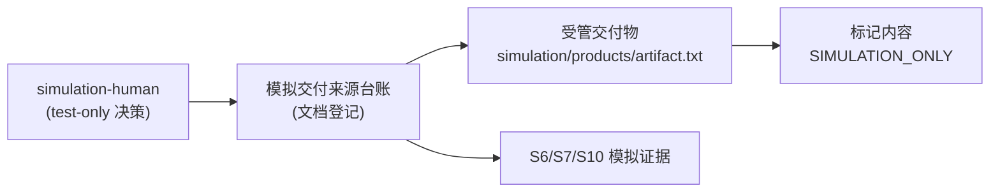

# 架构文档：模拟交付来源台账（SIMULATION-ONLY 模拟夹具）

> 状态：locked
> （定稿时翻 locked——PTR-PLAN-01 只登记 locked 的架构文档；机器登记只认 locked，reviewed 仅人审中间态）
> 版本：v1.0.0
> Architect：Main（PM / Architect）；方向拍板：simulation-human（test-only 模拟人类决策人）
> 日期：2026-10-21
> 关联需求：`docs/requirements/REQ-001.md`

> 前置条件：关联需求必须已 `locked`。本文件描述预期架构和技术取舍，不用于复述脚手架现状。

> **本文件属于 SIMULATION / test-only 夹具。** 它记录的是一次性隔离项目中的测试架构，不是真实产品的工程设计；其中的结论与证据均显式标注为模拟。

## 1. 架构目标

| 目标 | 说明 | 验证方式 |
|:---|:---|:---|
| 受管交付物可被无歧义识别为模拟产物 | 全仓只有一件受管交付物 `simulation/products/artifact.txt`，其内容必须恰为 `SIMULATION_ONLY` | 只读核对文件字节内容（AC-001 / NFR-001） |
| 交付来源可追溯 | 交付来源（文件路径、标记、核对结论）作为台账条目登记在 TASK-001 关闭合同与 S6/S7 证据中，不留在聊天里 | S6 Builder Result 的交付引用；S7 QA Claim 的证据引用 |
| 不引入任何运行时常态 | 无 UI、无服务 API/业务行为、无共享模型、无数据库、无部署，因此不存在运行时状态、迁移路径与回滚动作 | 仓库中不存在对应实现资产；§A4-1…§A4-5 逐条排除 |
| 验证分母不被静默削减 | AC-001 只有一条合法背书（NFR-001），不得被当成"未检查"或被自由文本 N/A 顶替 | `loop-harness scenario bridge` 的 AC→NFR 解析结果 |

## 2. 系统上下文

上下文只含两类对象：一个做出模拟决定的人类身份，以及一件被登记与被核对的交付物文件。**不存在**外部系统集成、网络依赖或第三方服务。

## 3. 容器视图

不适用。本架构不包含任何运行时容器（无前端应用、无后端服务、无数据库、无队列）。"容器"在这里等价于 Git 仓库中的受管文件集合。

## 4. 模块职责

| 模块 | 职责 | 输入 | 输出 | 排除范围 |
|:---|:---|:---|:---|:---|
| 交付来源台账（文档责任） | 登记受管交付物的来源路径与其 `SIMULATION_ONLY` 标记核对结论；把核对结论交给原始消费者 | 锁定的 REQ-001（NFR-001 / AC-001）、BE-001 合同条款 | 台账条目（文档 + S6 Result 交付引用） | 不改变夹具内容；不定义接口或事件；不做部署 |
| 受管交付物夹具（只读资产） | 承载被验收的 `SIMULATION_ONLY` 标记；是验收对象而非产出物 | 测试准备器预置并提交 | 单行 `SIMULATION_ONLY` 文件（16 字节，含行尾换行） | 本 REQ 及其 TASK 一律不写入该文件 |
| 流程控制面（既有，不属于本 REQ） | 承载 S0–S11 流转、原 Gate 与 Runtime 事实 | 阶段事件与人工决定 | Runtime 状态、回执与证据 | 本 REQ 不修改其任何文件 |

## 5. 数据流

| 数据 | 路径 | 存储位置 | 安全要求 |
|:---|:---|:---|:---|
| 交付标记内容 | 测试准备器 → `simulation/products/artifact.txt` | Git 仓库工作树（只读消费） | 只读；任何写入都会使 AC-001 失效，并被 S6/S7 代际证据暴露 |
| 标记核对结论 | BE-001 条款 → TASK-001 关闭合同 → S6 Builder Result → S7 QA Claim → S10 清单 | 文档与 Runtime 证据 | 每处显式标注 simulation/test-only；只引用当前代证据 |
| 台账登记条目 | S2/S3/S4 文档 → 锁定的合同与 TASK 批次 | `docs/dev/**`、`docs/architecture/**` | 随 Git 提交冻结，参与 S5 文档独立审查 |

## 6. 状态机

不适用。本架构不含运行时实体，因此没有状态机文档。§C 的流程表记录的是一次性登记流程（`delivered`），不是需要建模的领域生命周期。

## 7. 数据模型

不适用，无需独立数据模型文档。REQ-001 §C 的数据迁移范围清单只登记一条 `keep` 项（`simulation/products/artifact.txt` → TASK-001），没有任何 schema、查询、迁移或持久化格式变更。

## 8. 接口契约

| 契约 | 文档 | 消费方 |
|:---|:---|:---|
| BE-001 | `docs/dev/contracts/BE-001.md` | TASK-001（S6 Builder 责任） |
| FE-001 | 不适用（§A4-1：本需求无 UI，无前端责任） | — |
| SYNC-001 | 不适用（§A4-2：本需求无 API、事件或共享模型，无同步责任） | — |

## 9. 安全设计

| 层面 | 设计 | 验证方式 |
|:---|:---|:---|
| 认证 | 不适用：无用户面、无受保护操作、无凭据 | — |
| 授权 | 仅 `simulation-human`（test-only）作出模拟决定；Runtime 决策由原 Writer 记录，不由作者手写 | 绑定回执 `binding_receipt` 与 REQ §E 决定记录 |
| 审计 | 每份专业答卷与报告显式标注 simulation/test-only；S10 只引用当前代证据；S11 只记录授权事实，不执行 merge/publish/deploy | S7 round 证据审查；S10 清单逐行核对 |

## 10. 性能基线

不适用。不存在运行时请求路径，无延迟/错误率指标；任何性能数字都会是对本夹具的凭空扩张。

## 11. 部署和回滚

不适用（§A4-5）。本需求不含环境、流水线、镜像、发布或上线；交付物是文档与预置夹具本身。回滚语义等价于"不提交任何交付物变更"。

## 12. 锁定记录

| 日期 | 操作 | 操作人 | 说明 |
|:--|:--|:--|:--|
| 2026-10-21 | locked | Main（PM / Architect），方向经 simulation-human（test-only）背书 | 采纳 ADR-001 的最小夹具方向（纯文档 + NFR，无 UI/服务/数据库/部署）；模块行为真相不变，场景包按 `scenario bridge` 判定为 N/A；本架构为 simulation/test-only |
